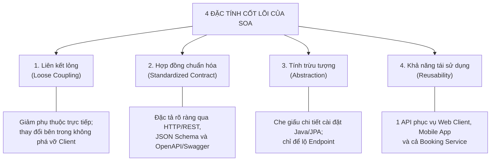
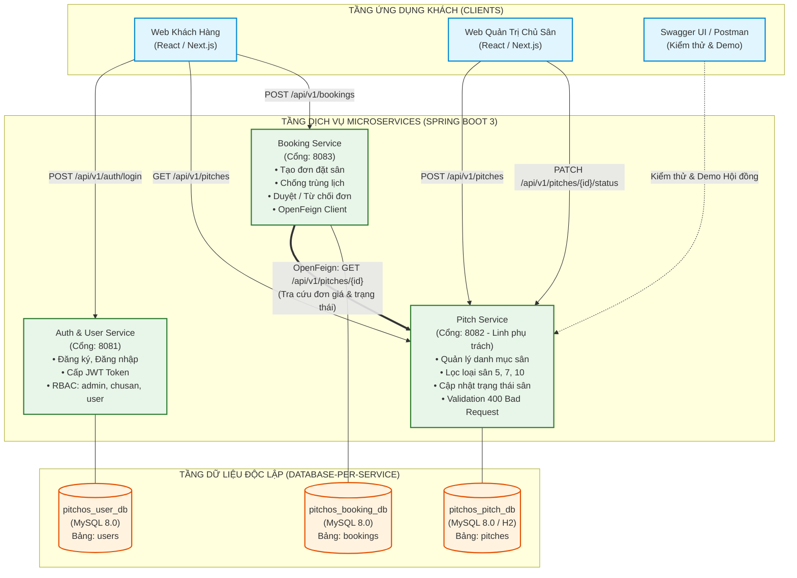

# CHƯƠNG 1. GIỚI THIỆU ĐỀ TÀI VÀ KIẾN TRÚC DỊCH VỤ (LINH PHỤ TRÁCH - 2,5 ĐIỂM)

> Bản nháp nội dung Chương 1 để dán trực tiếp vào file Word báo cáo (theo [`MUC_LUC_BAO_CAO_WORD.md`](MUC_LUC_BAO_CAO_WORD.md)).  
> Ảnh sơ đồ: Dán khối mã `mermaid` vào https://mermaid.live → *Export PNG* để chèn vào Word.  
> Mã nguồn phụ trách: [`pitchos-pitch-service/`](../pitchos-pitch-service/README.md).

---

## 1.1. Mô tả bài toán nghiệp vụ đặt sân bóng đá mini trực tuyến

Trong những năm gần đây, phong trào thể thao rèn luyện sức khỏe, đặc biệt là bộ môn bóng đá phong trào tại các đô thị lớn phát triển vô cùng mạnh mẽ. Tuy nhiên, quy trình quản lý và vận hành tại đa số các cụm sân bóng đá mini hiện nay vẫn mang nặng tính thủ công:
* **Khách hàng (người đi thuê sân):** Phải tìm kiếm số điện thoại của từng cụm sân, gọi điện trực tiếp hoặc nhắn tin qua Zalo/Facebook để hỏi xem sân còn trống vào khung giờ mong muốn hay không. Quá trình này gây mất thời gian, dễ xảy ra tình trạng nhầm lẫn lịch hoặc không nắm rõ được đơn giá, chất lượng mặt sân và vị trí bản đồ.
* **Chủ sân bóng (người quản lý):** Phải ghi chép lịch đặt sân vào sổ tay hoặc file Excel rời rạc. Khi có nhiều đội bóng cùng hỏi đặt sân trong các khung giờ cao điểm (17h30 – 20h30), nguy cơ ghi trùng lịch (*double booking*) dẫn đến việc tranh chấp sân bóng là rất lớn. Việc theo dõi lịch bảo dưỡng mặt cỏ, điều chỉnh bảng giá theo giờ và thống kê doanh thu cũng gặp nhiều khó khăn.

Hệ thống **PitchOS (Football Pitch Booking System)** ra đời nhằm giải quyết triệt để các tồn tại trên bằng việc ứng dụng nền tảng công nghệ số hóa hiện đại:
1. Cho phép khách hàng tra cứu trực quan danh mục sân bóng theo quy mô (sân 5 người, sân 7 người, sân 10 người), xem đơn giá thuê theo giờ, hình ảnh thực tế và địa chỉ bản đồ Google Maps.
2. Cho phép khách hàng gửi yêu cầu đặt sân trực tuyến với thời gian bắt đầu và kết thúc cụ thể, hệ thống tự động kiểm tra trùng lịch và tính toán tổng tiền minh bạch.
3. Cung cấp công cụ quản trị dành cho Chủ sân để đăng tải thông tin sân mới, chuyển đổi trạng thái sân linh hoạt giữa hoạt động (*hoat_dong*) và bảo trì (*bao_tri*), cũng như duyệt hoặc từ chối các yêu cầu đặt sân.

---

## 1.2. Tổng quan kiến trúc hướng dịch vụ (SOA) [Câu 1 - Ý 1a: 0,5đ]

### 1.2.1. 4 đặc tính cơ bản của SOA (Service-Oriented Architecture)

Kiến trúc hướng dịch vụ (SOA) là một phong cách thiết kế kiến trúc phần mềm trong đó các chức năng nghiệp vụ được phân chia thành các đơn vị phần mềm độc lập gọi là **Dịch vụ (Service)**. Các dịch vụ này giao tiếp với nhau thông qua mạng bằng các giao thức chuẩn hóa mà không phụ thuộc vào nền tảng công nghệ hay ngôn ngữ lập trình bên dưới. 

Hệ thống PitchOS được xây dựng tuân thủ nghiêm ngặt 4 đặc tính cốt lõi của SOA:



1. **Liên kết lỏng (Loose Coupling):**
   - *Bản chất:* Giảm thiểu tối đa sự phụ thuộc trực tiếp giữa các thành phần trong hệ thống. Một dịch vụ có thể thay đổi cấu trúc mã nguồn bên trong, nâng cấp phiên bản thư viện hoặc thậm chí thay đổi hệ quản trị cơ sở dữ liệu mà không làm ảnh hưởng hay phá vỡ các dịch vụ khác đang sử dụng nó.
   - *Ứng dụng trong PitchOS:* `Pitch Service` quản lý toàn bộ dữ liệu sân bóng trong database riêng (`pitchos_pitch_db`). Khi `Booking Service` cần lấy đơn giá sân để tính tiền, nó không kết nối trực tiếp vào CSDL của Pitch Service mà chỉ gửi request HTTP qua API. Nếu Pitch Service thay đổi cấu trúc bảng nội bộ, Booking Service hoàn toàn không bị ảnh hưởng miễn là giao diện API giữ nguyên.

2. **Hợp đồng chuẩn hóa (Standardized Service Contract):**
   - *Bản chất:* Mỗi dịch vụ phải công bố một bản mô tả giao tiếp chính thức, minh bạch, quy định rõ ràng về giao thức truyền nhận, định dạng dữ liệu, danh sách tham số đầu vào và cấu trúc kết quả trả về.
   - *Ứng dụng trong PitchOS:* Pitch Service sử dụng giao thức chuẩn hóa HTTP/REST, định dạng dữ liệu trao đổi bằng JSON (JavaScript Object Notation), và được đặc tả tài liệu tự động qua chuẩn quốc tế OpenAPI v3 / Swagger UI tại đường dẫn `/swagger-ui.html`. Bất kỳ lập trình viên hay dịch vụ đối tác nào cũng có thể đọc hiểu và tích hợp dễ dàng.

3. **Tính trừu tượng (Abstraction):**
   - *Bản chất:* Che giấu toàn bộ chi tiết cài đặt nghiệp vụ phức tạp, thuật toán xử lý dữ liệu và công nghệ nội bộ bên trong dịch vụ. Thế giới bên ngoài chỉ nhìn thấy những gì được dịch vụ công bố qua hợp đồng dịch vụ.
   - *Ứng dụng trong PitchOS:* Phía gọi (Client hoặc Booking Service) chỉ cần gửi request `GET /api/v1/pitches/1` để nhận về giá sân và trạng thái. Phía gọi không cần biết (và không được phép can thiệp) việc Pitch Service viết bằng Java Spring Boot, truy vấn dữ liệu qua Hibernate hay lưu trữ trên MySQL hay H2.

4. **Khả năng tái sử dụng (Reusability):**
   - *Bản chất:* Logic nghiệp vụ được đóng gói thành các dịch vụ độc lập có tính tổng quát cao, cho phép tái sử dụng trong nhiều ngữ cảnh nghiệp vụ khác nhau mà không phải viết lại mã nguồn.
   - *Ứng dụng trong PitchOS:* Endpoint `GET /api/v1/pitches/{id}` được tái sử dụng đồng thời bởi: (1) Ứng dụng Web/Mobile cho khách hàng bấm xem chi tiết sân; (2) Giao diện quản trị của chủ sân; và (3) Tiến trình nội bộ của Booking Service gọi sang qua FeignClient để trích xuất đơn giá phục vụ tính tổng tiền đơn đặt.

---

### 1.2.2. Phân biệt Dịch vụ (Service), Giao diện lập trình (API) và Ứng dụng khách (Client)

Để làm rõ kiến trúc phân lớp trong hệ thống phân tán, ba khái niệm cốt lõi được định nghĩa và phân biệt chi tiết trong Bảng 1.1:

*Bảng 1.1: Bảng phân biệt Dịch vụ, API và Ứng dụng khách trong đề tài PitchOS*

| Tiêu chí | Dịch vụ (Service) | Giao diện lập trình (API) | Ứng dụng khách (Client) |
| :--- | :--- | :--- | :--- |
| **Bản chất** | Thành phần phần mềm độc lập hoàn chỉnh, sở hữu logic nghiệp vụ và dữ liệu riêng | Cổng giao tiếp kỹ thuật (Hợp đồng), cầu nối truyền thông giữa các thành phần | Bên chủ động gửi yêu cầu (Request) để tiêu thụ tài nguyên của dịch vụ |
| **Phạm vi trách nhiệm** | Xử lý trọn vẹn nghiệp vụ quản lý sân bóng (CRUD, validation, lưu trữ đĩa cứng) | Định nghĩa đường dẫn URI, HTTP Methods, Header, Request Body và Response JSON | Tiếp nhận tương tác người dùng, gửi request và hiển thị kết quả cho người xem |
| **Hiện diện vật lý** | Một tiến trình chạy độc lập trên máy chủ (`pitchos-pitch-service` cổng 8082) | Tập hợp các endpoints HTTP (Ví dụ: `GET /api/v1/pitches`, `POST /api/v1/pitches`) | Ứng dụng Web React/Next.js, Postman, hoặc `Booking Service` (cổng 8083) |
| **Mối quan hệ** | Cung cấp và thực thi logic phía sau API | Là giao diện công khai do Service phơi ra cho Client gọi | Sử dụng API để tương tác với Service |

---

## 1.3. Phân rã dịch vụ hệ thống PitchOS và Nguyên lý SRP [Câu 1 - Ý 1b: 1,0đ]

### 1.3.1. Danh mục các dịch vụ chính và trách nhiệm nghiệp vụ

Hệ thống PitchOS được thiết kế gồm 3 microservices nghiệp vụ độc lập, mỗi dịch vụ đảm nhận một miền nghiệp vụ riêng biệt và sở hữu cơ sở dữ liệu tách biệt theo mô hình Database-per-Service:

*Bảng 1.2: Danh mục các dịch vụ chính trong hệ thống PitchOS*

| STT | Tên Microservice | Cổng (Port) | CSDL Sở hữu | Trách nhiệm nghiệp vụ chính |
| :---: | :--- | :---: | :--- | :--- |
| **1** | **Auth & User Service** | `8081` | `pitchos_user_db` | Quản lý thông tin tài khoản người dùng, mã hóa mật khẩu an toàn bằng `BCryptPasswordEncoder`, cấp phát và xác thực JSON Web Token (JWT) cho 3 vai trò: `admin`, `chusan`, `user`. |
| **2** | **Pitch Service** *(Linh phụ trách)* | `8082` | `pitchos_pitch_db` | Quản lý danh mục sân bóng đá mini (tên, quy mô sân 5/7/10, đơn giá theo giờ, địa chỉ, ảnh đại diện, link Google Map) và điều phối trạng thái hoạt động (`hoat_dong`, `bao_tri`). |
| **3** | **Booking Service** | `8083` | `pitchos_booking_db` | Điều phối quy trình đặt sân bóng, kiểm tra khung giờ trống, gọi sang Pitch Service lấy giá tiền, tính tổng tiền và quản lý vòng đời đơn đặt (`cho_duyet`, `da_duyet`, `tu_choi`). |

---

### 1.3.2. Đặc tả 03 API tiêu biểu phục vụ nghiệp vụ cốt lõi

Quy trình nghiệp vụ đặt sân cốt lõi của PitchOS được vận hành thông qua sự phối hợp của 03 API tiêu biểu đại diện cho 3 dịch vụ:

*Bảng 1.3: Đặc tả 03 API tiêu biểu phục vụ luồng nghiệp vụ cốt lõi*

| API Tiêu biểu | Phương thức & URI | Dịch vụ cung cấp | Mục đích nghiệp vụ và Dữ liệu trao đổi |
| :--- | :---: | :---: | :--- |
| **1. Xác thực đăng nhập** | `POST /api/v1/auth/login` | Auth Service (8081) | Khách hàng hoặc chủ sân gửi `username` và `password`. Hệ thống kiểm tra thông tin, nếu đúng trả về mã `200 OK` kèm chuỗi `Bearer <JWT_TOKEN>` chứa thông tin vai trò (`role: "chusan"` hoặc `role: "user"`). |
| **2. Tra cứu thông tin sân** | `GET /api/v1/pitches/{id}` | Pitch Service (8082) | Client hoặc Booking Service gửi mã `id` sân bóng. Pitch Service trả về `200 OK` kèm JSON chi tiết: đơn giá thuê `pricePerHour` và trạng thái `status: "hoat_dong"`. Nếu không tìm thấy trả về `404 Not Found`. |
| **3. Tạo đơn đặt sân** | `POST /api/v1/bookings` | Booking Service (8083) | Khách hàng gửi kèm JWT token, chọn `pitchId`, `startTime`, `endTime`. Booking Service kiểm tra chống trùng lịch, gọi sang API (2) lấy giá tiền, tính tổng chi phí và lưu đơn trạng thái `cho_duyet`, trả về `201 Created`. |

---

### 1.3.3. Luận giải phân chia hệ thống theo nguyên lý Đơn trách nhiệm (SRP)

Nguyên lý Đơn trách nhiệm (**Single Responsibility Principle - SRP**) trong kiến trúc phần mềm quy định: *"Mỗi mô-đun hoặc dịch vụ chỉ nên có một và chỉ một lý do để thay đổi"* (A service should have one, and only one, reason to change).

Trong hệ thống PitchOS, việc phân rã bài toán thành 3 dịch vụ được luận giải chặt chẽ theo nguyên lý SRP như sau:
1. **Lý do thay đổi của Auth Service:** Chỉ phát sinh khi chính sách bảo mật thay đổi (ví dụ: chuyển thuật toán băm mật khẩu, đổi thời hạn token, bổ sung đăng nhập OAuth2 Google/Facebook). Những thay đổi này hoàn toàn độc lập và không ảnh hưởng gì tới việc quản lý sân hay tính giá thuê sân.
2. **Lý do thay đổi của Pitch Service:** Chỉ phát sinh khi nghiệp vụ quản lý cơ sở vật chất sân bóng thay đổi (ví dụ: thêm loại sân 11 người, thêm tiện ích đi kèm như đèn chiếu sáng ban đêm, nước uống, hoặc đổi cách lưu trữ ảnh sân). Pitch Service hoàn toàn không quan tâm khách hàng là ai, mật khẩu là gì, hay đơn đặt sân thanh toán ra sao.
3. **Lý do thay đổi của Booking Service:** Chỉ phát sinh khi quy trình điều phối đơn đặt thay đổi (ví dụ: áp dụng chương trình khuyến mãi giảm giá, thay đổi khung giờ đặt tối thiểu, tích hợp cổng thanh toán VNPay/Momo).

**Lợi ích kỹ thuật đạt được:**
- **Phát triển và triển khai độc lập (Independent Deployment):** Lập trình viên phụ trách Pitch Service có thể cập nhật code, build và deploy lại dịch vụ trên cổng 8082 mà không cần phải restart hay build lại Auth Service hay Booking Service.
- **Cô lập lỗi (Fault Isolation):** Nếu Auth Service bị nghẽn mạng do lượng đăng nhập tăng đột biến, người dùng trên ứng dụng vẫn có thể xem danh sách sân bóng bình thường trên Pitch Service.
- **Tối ưu hóa tài nguyên:** Dịch vụ nào có lượng truy cập đọc lớn (như Pitch Service để xem sân) có thể được nhân bản scale-out độc lập mà không cần nhân bản các dịch vụ khác.

---

### 1.3.4. Sơ đồ kiến trúc tổng thể hệ thống PitchOS



---

## 1.4. Thiết kế và Triển khai RESTful API (Pitch Service) [Câu 2 - Ý 1: 1,0đ]

### 1.4.1. Danh mục endpoints quản lý sân bóng và phương thức HTTP

Dịch vụ `pitchos-pitch-service` xây dựng 4 endpoints chuẩn RESTful tuân thủ tiêu chuẩn thiết kế tài nguyên (Resource-oriented), sử dụng danh từ số nhiều `/api/v1/pitches` và các phương thức HTTP tương ứng:

*Bảng 1.4: Danh mục Endpoints chuẩn RESTful của Pitch Service*

| Phương thức | URI | Quyền truy cập (RBAC) | Mã HTTP trả về | Mô tả chi tiết chức năng |
| :---: | :--- | :---: | :---: | :--- |
| **GET** | `/api/v1/pitches` | Public (Ai cũng xem được) | `200 OK` | Lấy danh sách sân bóng công khai. Hỗ trợ query params: `?pitchType=san_5` và `?status=hoat_dong`. |
| **GET** | `/api/v1/pitches/{id}` | Public (Khách hàng & OpenFeign) | `200 OK`, `404 Not Found` | Lấy thông tin chi tiết một sân bóng theo ID (đơn giá, cấu hình, trạng thái). Đây là endpoint cấp cho Booking Service gọi. |
| **POST** | `/api/v1/pitches` | Role `chusan` hoặc `admin` | `201 Created`, `400 Bad Request`, `401 Unauthorized`, `403 Forbidden` | Thêm sân bóng mới vào hệ thống. Trả về `Header Location` trỏ tới URI của sân vừa tạo. |
| **PATCH** | `/api/v1/pitches/{id}/status` | Role `chusan` hoặc `admin` | `200 OK`, `400 Bad Request`, `401 Unauthorized`, `403 Forbidden`, `404 Not Found` | Cập nhật từng phần (Partial Update) trạng thái của sân bóng sang `hoat_dong` hoặc `bao_tri`. |

---

### 1.4.2. Kiểm tra dữ liệu đầu vào (Jakarta Validation) và chuẩn phản hồi 400 Bad Request

Nhằm ngăn chặn việc người dùng gửi dữ liệu rác hoặc dữ liệu phi lý (tên rỗng, đơn giá âm, địa chỉ rỗng), hệ thống áp dụng cơ chế xác thực mạnh mẽ thông qua thư viện chuẩn **Jakarta Bean Validation 3.0** (`jakarta.validation.*`):

#### a) Định nghĩa quy tắc kiểm tra trên lớp `CreatePitchRequest`:
```java
public class CreatePitchRequest {

    @NotBlank(message = "Tên sân bóng không được để trống")
    @Size(max = 150, message = "Tên sân không được vượt quá 150 ký tự")
    private String name;

    @NotNull(message = "Loại sân không được để trống (san_5, san_7, san_10)")
    private PitchType pitchType;

    @NotNull(message = "Đơn giá thuê mỗi giờ không được để trống")
    @Positive(message = "Đơn giá thuê mỗi giờ phải lớn hơn 0")
    private BigDecimal pricePerHour;

    @NotBlank(message = "Địa chỉ sân không được để trống")
    @Size(max = 255, message = "Địa chỉ sân không được vượt quá 255 ký tự")
    private String address;

    private String thumbnailUrl;
    private String googleMapUrl;
    // ... constructors, getters, setters
}
```

#### b) Xử lý ngoại lệ tập trung với `GlobalExceptionHandler`:
Khi dữ liệu vi phạm một trong các ràng buộc trên, Spring MVC tự động ném ra ngoại lệ `MethodArgumentNotValidException`. Lớp `@RestControllerAdvice` bắt giữ và chuyển đổi thành cấu trúc phản hồi lỗi chuẩn **400 Bad Request**:

```java
@RestControllerAdvice
public class GlobalExceptionHandler {

    @ExceptionHandler(MethodArgumentNotValidException.class)
    public ResponseEntity<ErrorResponse> handleValidationExceptions(
            MethodArgumentNotValidException ex, HttpServletRequest request) {

        Map<String, String> fieldErrors = new HashMap<>();
        for (FieldError error : ex.getBindingResult().getFieldErrors()) {
            fieldErrors.put(error.getField(), error.getDefaultMessage());
        }

        ErrorResponse response = ErrorResponse.builder()
                .timestamp(LocalDateTime.now())
                .status(HttpStatus.BAD_REQUEST.value())
                .error("Bad Request")
                .message("Dữ liệu đầu vào không hợp lệ. Vui lòng kiểm tra lại các trường vi phạm.")
                .path(request.getRequestURI())
                .errors(fieldErrors)
                .build();

        return ResponseEntity.status(HttpStatus.BAD_REQUEST).body(response);
    }
}
```

#### c) Cấu trúc phản hồi JSON thực tế khi dữ liệu sai:
*Request gửi lên:*
```json
{
  "name": "",
  "pitchType": "san_5",
  "pricePerHour": -500000.00,
  "address": ""
}
```

*Phản hồi HTTP 400 Bad Request:*
```json
{
  "timestamp": "2026-10-28T00:15:15.024",
  "status": 400,
  "error": "Bad Request",
  "message": "Dữ liệu đầu vào không hợp lệ. Vui lòng kiểm tra lại các trường vi phạm.",
  "path": "/api/v1/pitches",
  "errors": {
    "name": "Tên sân bóng không được để trống",
    "pricePerHour": "Đơn giá thuê mỗi giờ phải lớn hơn 0",
    "address": "Địa chỉ sân không được để trống"
  }
}
```

---

### 1.4.3. Tài liệu hóa API trực quan với OpenAPI 3.0 / Swagger UI

Toàn bộ dịch vụ Pitch Service được tích hợp công cụ tự động sinh tài liệu chuẩn quốc tế OpenAPI v3 thông qua thư viện `springdoc-openapi-starter-webmvc-ui`:
* **Địa chỉ giao diện trực quan:** `http://localhost:8082/swagger-ui.html`
* **Địa chỉ tài liệu JSON raw:** `http://localhost:8082/api-docs`

**Đặc điểm nổi bật của Swagger UI trong Pitch Service:**
1. **Trực quan hóa toàn bộ Endpoints:** Hiển thị rõ ràng các nhóm API, phương thức HTTP (GET, POST, PATCH), mô tả tham số và cấu trúc Response mẫu.
2. **Tích hợp nút Authorize (Bảo mật JWT):** Được cấu hình thông qua lớp `OpenApiConfig` với `SecurityScheme` kiểu `BearerAuth`. Người kiểm thử chỉ cần bấm nút **Authorize**, dán chuỗi JWT Token vào là có thể thực hiện kiểm thử các API được bảo vệ (`POST /api/v1/pitches`) ngay trên giao diện web mà không cần cài thêm công cụ ngoài.
3. **Thử nghiệm trực tiếp (Try it out):** Hỗ trợ nhập trực tiếp dữ liệu và xem kết quả HTTP Status Code (200, 201, 400, 401, 403, 404) tức thì.
