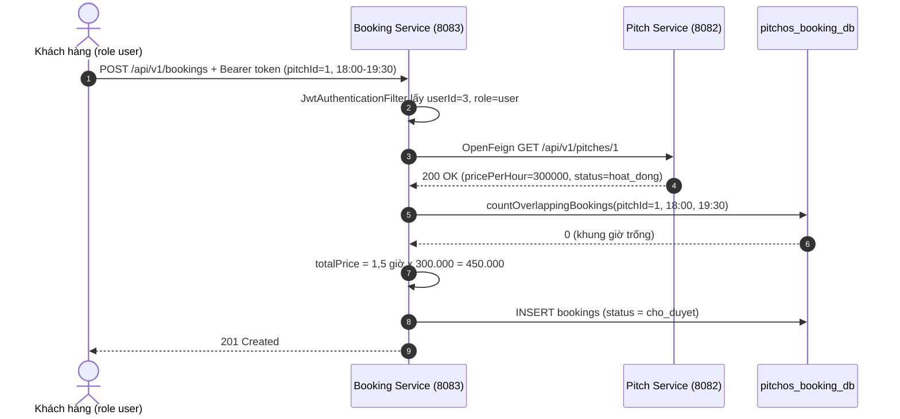
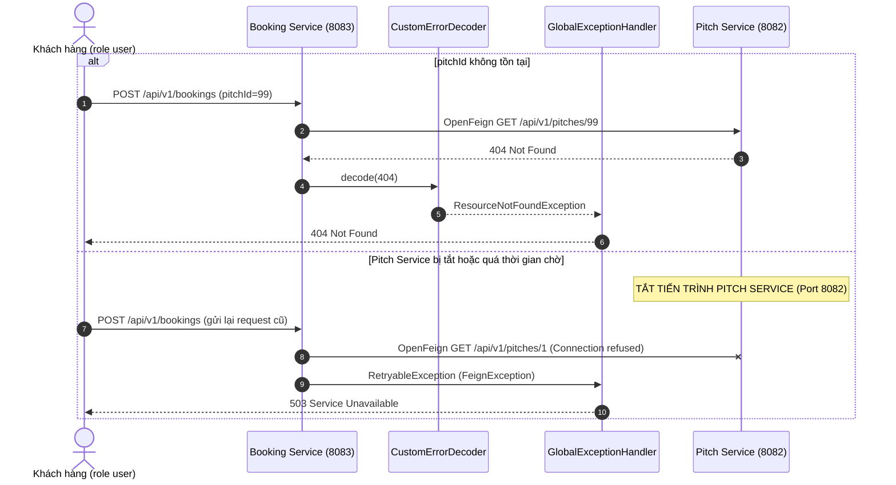

# CHƯƠNG 2. THIẾT KẾ API VÀ GIAO TIẾP DỊCH VỤ (NHẬT PHỤ TRÁCH - 2,25 ĐIỂM)

> Bản nháp nội dung Chương 2 để dán vào file Word (theo [`MUC_LUC_BAO_CAO_WORD.md`](MUC_LUC_BAO_CAO_WORD.md)).
> Ảnh sơ đồ: dán khối `mermaid` vào https://mermaid.live → *Export PNG* để chèn vào Word.
> Mã nguồn: [`pitchos-booking-service/`](../pitchos-booking-service/README.md).

---

## 2.1. Cơ chế giao tiếp giữa các dịch vụ qua giao thức HTTP/REST [Câu 1 - Ý 2a: 0,75đ]

### 2.1.1. Quy trình trao đổi thông tin giữa Booking Service và Pitch Service

Nghiệp vụ minh họa: **"Khách hàng tạo đơn đặt sân bóng"**. Booking Service không sở hữu dữ liệu giá và trạng thái sân (dữ liệu này nằm trong `pitchos_pitch_db` của Pitch Service), nên phải hỏi Pitch Service qua API.

1. Booking Service tiếp nhận request đặt sân chứa `pitchId`, `startTime`, `endTime` (kèm JWT Token để biết người đặt).
2. Booking Service đóng vai trò **Client**, gửi `GET /api/v1/pitches/{id}` sang Pitch Service để tra cứu đơn giá (`pricePerHour`) và trạng thái sân (`hoat_dong`).
3. Pitch Service phản hồi JSON thông tin sân (hoặc `404` nếu sân không tồn tại).
4. Booking Service kiểm tra trùng lịch trong CSDL của mình, tính `totalPrice = số giờ × pricePerHour`, lưu đơn trạng thái `cho_duyet` và trả `201 Created` cho khách.

### 2.1.2. Cấu trúc HTTP Request và HTTP Response

HTTP/REST là giao thức **đồng bộ, phi trạng thái (stateless)**: mỗi request tự mang đủ thông tin (kể cả danh tính qua token), server không lưu phiên; dữ liệu trao đổi bằng JSON.

| | Thành phần | Ví dụ thực tế |
| :--- | :--- | :--- |
| **Request** | Request Line (Method, URI, phiên bản) | `POST /api/v1/bookings HTTP/1.1` |
| | Headers | `Authorization: Bearer <token>`, `Content-Type: application/json` |
| | Body | `{"pitchId":1,"startTime":"2026-10-30T18:00:00","endTime":"2026-10-30T19:30:00"}` |
| **Response** | Status Line (phiên bản, mã trạng thái) | `HTTP/1.1 201 Created` |
| | Headers | `Content-Type: application/json` |
| | Body | `{"id":2,"pitchId":1,"totalPrice":450000.00,"status":"cho_duyet",...}` |

Request liên dịch vụ do OpenFeign tạo: `GET /api/v1/pitches/1 HTTP/1.1` (không có body), Pitch Service trả `200 OK` kèm JSON sân.

### 2.1.3. Ý nghĩa các nhóm mã trạng thái HTTP

| Nhóm | Ý nghĩa | Mã dùng trong Booking Service |
| :---: | :--- | :--- |
| **2xx** | Thành công | `200 OK` (xem lịch sử, duyệt đơn), `201 Created` (tạo đơn) |
| **4xx** | Lỗi phía client | `400 Bad Request` (dữ liệu sai, trùng lịch, sân bảo trì), `401 Unauthorized` (chưa đăng nhập / token sai, hết hạn), `403 Forbidden` (sai vai trò), `404 Not Found` (sân hoặc đơn không tồn tại) |
| **5xx** | Lỗi phía server | `500 Internal Server Error` (lỗi nội bộ), `503 Service Unavailable` (dịch vụ phụ thuộc tạm thời không khả dụng) |

Client nhìn nhóm mã để biết **phải sửa request (4xx)** hay **thử lại sau (5xx)**. Vì vậy khi Pitch Service sập, Booking Service trả `503` chứ không trả `500`.

### 2.1.4. Nguy cơ sụp đổ dây chuyền (Cascading Failure) và giải pháp

**Hiện tượng:** Booking Service gọi đồng bộ sang Pitch Service. Nếu Pitch Service bị treo, mỗi request đặt sân giữ một luồng (thread) của Booking Service để chờ; khi nhiều request dồn lại, thread pool cạn kiệt (*thread pool starvation*), Booking Service không phục vụ được cả các API khác và sập theo — lỗi lan dây chuyền sang các thành phần đang gọi Booking Service.

**Giải pháp trong PitchOS:**
1. **Timeout:** kết nối tối đa 2 giây, đọc tối đa 3 giây (`spring.cloud.openfeign.client.config.pitch-service.*`) — luồng không bị treo vô hạn.
2. **Chuyển lỗi mạng thành 503:** Pitch Service tắt hoặc quá thời gian chờ → Feign ném `RetryableException` (một loại `FeignException`) → `GlobalExceptionHandler` trả `503 Service Unavailable` kèm thông báo thân thiện, không để thành `500`.
3. **Cô lập ảnh hưởng:** khi Pitch Service tắt, các API không cần Pitch Service (ví dụ `GET /my-bookings`) vẫn trả `200 OK` — đã kiểm chứng thực tế.

Hướng mở rộng: Circuit Breaker (Resilience4j), retry có giới hạn, cache giá sân làm fallback.

---

## 2.2. Triển khai Giao tiếp Liên dịch vụ với Spring Cloud OpenFeign [Câu 2 - Ý 2: 1,5đ]

### 2.2.1. Khởi tạo Feign Client gọi tra cứu thông tin sân

```java
@SpringBootApplication
@EnableFeignClients
public class PitchosBookingServiceApplication { ... }

@FeignClient(name = "pitch-service", url = "${pitch.service.url:http://localhost:8082}")
public interface PitchClient {
    @GetMapping("/api/v1/pitches/{id}")
    PitchResponseDTO getPitchById(@PathVariable("id") Long id);
}
```

OpenFeign tự sinh phần cài đặt gửi HTTP request và chuyển JSON trả về thành `PitchResponseDTO` (`id`, `name`, `pricePerHour`, `status`). URL Pitch Service đọc từ cấu hình `pitch.service.url`, không viết cứng trong code.

### 2.2.2. Các nghiệp vụ điều phối đặt sân (Tạo đơn, Lịch sử, Duyệt đơn)

**Bảng 2.1. API của Booking Service (Port 8083)**

| Method | Endpoint | Vai trò | Mô tả | Thành công |
| :--- | :--- | :---: | :--- | :---: |
| `POST` | `/api/v1/bookings` | `user` | Tạo đơn đặt sân (gọi Pitch Service lấy giá) | `201` |
| `GET` | `/api/v1/bookings/my-bookings` | `user` | Danh sách đơn của người dùng trong token | `200` |
| `PATCH` | `/api/v1/bookings/{id}/status` | `chusan`, `admin` | Duyệt (`da_duyet`) hoặc từ chối (`tu_choi`) | `200` |

**Các bước trong `BookingService.createBooking`:**
1. Kiểm tra `endTime` sau `startTime` (sai → `400`).
2. Gọi `pitchClient.getPitchById(pitchId)` (sân không tồn tại → `404`, Pitch Service tắt → `503`).
3. Sân không ở trạng thái `hoat_dong` → `400`.
4. `totalPrice = pricePerHour × số phút / 60`.
5. Khóa theo sân, rồi `countOverlappingBookings` (câu truy vấn của Hùng, bỏ qua đơn `tu_choi`) > 0 → `400` "Khung giờ này đã có người đặt".
6. Lưu đơn `cho_duyet`, nhả khóa, trả `201 Created`.

Gọi Pitch Service **trước** khi kiểm tra trùng lịch để kịch bản demo "tắt Pitch Service rồi gửi lại request vừa đặt" luôn đi tới lời gọi liên dịch vụ và trả `503`.

**Chống đặt trùng khi nhiều khách gửi cùng lúc:** nếu 2 request cùng kiểm tra trùng lịch (đều thấy trống) rồi mới lưu thì cả 2 đều được lưu, tức 1 khung giờ bị đặt 2 lần. Kiểm thử thực tế phiên bản chưa khóa: 5 request đồng thời → 2 request nhận `201`, 2 đơn cùng giữ một khung giờ trong CSDL. Vì vậy bước 5–6 được đặt trong khối `synchronized` theo `pitchId`: các request **cùng sân** phải lần lượt "kiểm tra → lưu", còn các sân khác vẫn chạy song song. Lời gọi Pitch Service nằm **ngoài** khóa nên một request đang chờ Pitch Service không chặn request khác. Hạn chế: khóa nằm trong bộ nhớ của tiến trình, chỉ đúng khi chạy 1 instance Booking Service; khi mở rộng nhiều instance cần khóa ở tầng CSDL (ví dụ `SELECT ... FOR UPDATE` hoặc khóa phân tán).

**Kết quả thực tế** của `POST /api/v1/bookings` (token `user`, sân 1 giá 300.000đ, 18:00–19:30):

```json
HTTP/1.1 201 Created
{
  "id": 2, "userId": 3, "pitchId": 1,
  "startTime": "2026-10-30T18:00:00", "endTime": "2026-10-30T19:30:00",
  "totalPrice": 450000.00, "status": "cho_duyet",
  "createdAt": "2026-10-27T21:23:37.393038"
}
```

Log của Booking Service cùng lúc: `Pitch Service trả về sân 1: giá 300000.00 /giờ, trạng thái hoat_dong`.

**Phân quyền:** `JwtAuthenticationFilter` đọc header `Authorization: Bearer <token>`, kiểm tra chữ ký bằng `jwt.secret` dùng chung với Auth Service, nạp `userId` và quyền `ROLE_<role>`; `SecurityConfig` áp ma trận ở Bảng 2.1 (thiếu/sai token → `401`, sai vai trò → `403`).

---

## 2.3. Sơ đồ Tuần tự và Cơ chế Xử lý Lỗi Phân tán [Câu 2 - Ý 2: 1,5đ]

### 2.3.1. Sơ đồ tuần tự đặt sân thành công (201 Created)

**Sơ đồ 2.1**



### 2.3.2. Sơ đồ tuần tự khi dịch vụ đích lỗi (404 và 503)

**Sơ đồ 2.2**



### 2.3.3. Cài đặt CustomErrorDecoder (404) và GlobalExceptionHandler (503)

- **Pitch Service có phản hồi lỗi 404** → `CustomErrorDecoder` chuyển thành `ResourceNotFoundException` → client nhận `404`.
- **Pitch Service không phản hồi** (tắt tiến trình, mất mạng, quá thời gian chờ) → không có response để decode, Feign ném `RetryableException` → `GlobalExceptionHandler` trả `503`.

```java
@Component
public class CustomErrorDecoder implements ErrorDecoder {
    private final ErrorDecoder defaultDecoder = new ErrorDecoder.Default();

    @Override
    public Exception decode(String methodKey, Response response) {
        if (response.status() == 404) {
            return new ResourceNotFoundException("Không tìm thấy sân bóng với pitchId đã gửi");
        }
        return defaultDecoder.decode(methodKey, response);
    }
}
```

```java
@ExceptionHandler({FeignException.class, RetryableException.class})
public ResponseEntity<ErrorResponse> handlePitchServiceUnavailable(FeignException ex) {
    log.warn("Không gọi được Pitch Service: {}", ex.getMessage());
    return build(HttpStatus.SERVICE_UNAVAILABLE, "Dịch vụ quản lý sân hiện không khả dụng. Vui lòng thử lại sau!");
}
```

Phản hồi thực tế sau khi tắt Pitch Service:

```json
{
  "timestamp": "2026-10-27T21:23:47.9946146",
  "status": 503,
  "error": "Service Unavailable",
  "message": "Dịch vụ quản lý sân hiện không khả dụng. Vui lòng thử lại sau!"
}
```

Booking Service không bị dừng, không trả `500`, không ghi đơn xuống CSDL.

---

## 2.4. Kết quả kiểm thử Booking Service (đóng góp cho Chương 5)

Kiểm thử bằng request HTTP thật tới Booking Service (8083) chạy với MySQL. Vì Pitch Service (Linh) và Auth Service (Hoàng) chưa hoàn thiện lúc kiểm thử, cổng 8082 dùng **Pitch Service giả lập** [`demo/MockPitchService.java`](../pitchos-booking-service/demo/MockPitchService.java) trả dữ liệu như `pitch-service.sql` (sân `1` hoạt động 300.000đ, sân `4` bảo trì) và token được ký bằng `jwt.secret` chung. Bộ ca kiểm thử có sẵn trong [`postman/PitchOS-Booking.postman_collection.json`](../pitchos-booking-service/postman/PitchOS-Booking.postman_collection.json) (thư mục 2 và 3). Chạy lại toàn bộ ngày 27/10/2026 sau khi thêm khóa chống đặt trùng: tất cả đạt. **Cần chạy lại với Pitch Service và Auth Service thật trước khi chụp ảnh minh chứng.**

**Bảng 2.2. Ca kiểm thử Booking Service**

| # | Ca kiểm thử | Kỳ vọng | Kết quả |
| :---: | :--- | :---: | :---: |
| 1 | `POST` không gửi token | 401 | ✅ |
| 2 | `POST` token hết hạn | 401 | ✅ |
| 3 | `POST` token bị sửa chữ ký | 401 | ✅ |
| 4 | `POST` bằng token `chusan` | 403 | ✅ |
| 5 | `POST` thiếu `pitchId` | 400 | ✅ |
| 6 | `POST` `endTime` trước `startTime` | 400 | ✅ |
| 7 | `POST` `pitchId = 99` | 404 | ✅ |
| 8 | `POST` sân `4` đang bảo trì | 400 | ✅ |
| 9 | `POST` hợp lệ sân `1`, 18:00–19:30 | 201, `totalPrice = 450000`, `cho_duyet` | ✅ |
| 10 | `POST` 19:00–20:00 trùng với ca #9 | 400 | ✅ |
| 11 | `GET /my-bookings` token `user` | 200 | ✅ |
| 12 | `PATCH /1/status` token `user` | 403 | ✅ |
| 13 | `PATCH /1/status` `{"status":"abc"}` | 400 | ✅ |
| 14 | `PATCH /1/status` `da_duyet` token `chusan` | 200 | ✅ |
| 15 | `PATCH /999/status` | 404 | ✅ |
| 16 | **Tắt Pitch Service**, gửi lại request ca #9 | **503** | ✅ |
| 17 | `GET /my-bookings` khi Pitch Service đã tắt | 200 | ✅ |
| 18 | 10 request **đồng thời** cùng sân `2`, cùng khung giờ | đúng 1 × 201, 9 × 400 | ✅ (lặp 6 lần) |
| 19 | 3 request đồng thời vào 3 sân khác nhau, cùng giờ | 3 × 201 | ✅ |
| 20 | Từ chối đơn ca #9 (`tu_choi`) rồi đặt lại đúng khung giờ đó | 200, rồi 201 | ✅ |

Kiểm chứng CSDL sau ca #9: `SELECT * FROM pitchos_booking_db.bookings ORDER BY id DESC LIMIT 1;` → `start_time = 2026-10-30 18:00:00`, `total_price = 450000.00`, `status = cho_duyet`.
