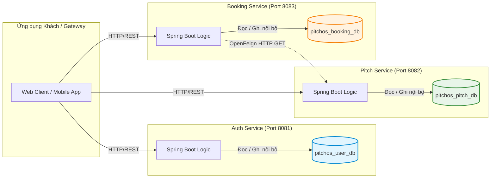
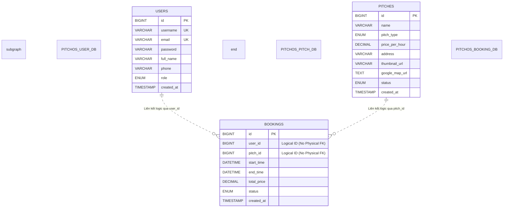

# BÁO CÁO KỸ THUẬT: CHƯƠNG 3 — QUẢN LÝ DỮ LIỆU
**Học phần:** Kiến trúc phần mềm / Phát triển phần mềm  
**Đề tài:** PitchOS — Football Pitch Booking System (Kiến trúc SOA / Microservices)  
**Người thực hiện:** HÙNG  
**Vai trò:** Database Administrator & Backend Data Engineer  
**Điểm phụ trách:** 2,25 Điểm (0,75đ Lý thuyết Câu 1 Ý 2b + 1,5đ Thực nghiệm Câu 2 Ý 3)  

---

## 3.1. TỔNG QUAN QUẢN LÝ DỮ LIỆU TRONG KIẾN TRÚC SOA / MICROSERVICES

### 3.1.1. Nguyên tắc Quản lý Dữ liệu Độc lập (Database-per-Service)
Trong các hệ thống nguyên khối (Monolithic Architecture) truyền thống, tất cả các mô-đun nghiệp vụ thường dùng chung một cơ sở dữ liệu quan hệ (Shared Database). Mặc dù mô hình này giúp việc tạo các ràng buộc khóa ngoại (Foreign Key) và câu truy vấn JOIN trở nên dễ dàng, nhưng nó lại tạo ra sự phụ thuộc chặt chẽ giữa các thành phần và triệt tiêu tính độc lập của dịch vụ.

Hệ thống **PitchOS** áp dụng nghiêm ngặt nguyên tắc **Database-per-Service** (Mỗi dịch vụ quản lý một cơ sở dữ liệu riêng biệt):
1. **Quyền sở hữu độc quyền (Exclusive Data Ownership):** Mỗi microservice chỉ sở hữu và chịu trách nhiệm toàn bộ đối với cơ sở dữ liệu thuộc phạm vi nghiệp vụ (Bounded Context) của mình.
2. **Tính đóng gói dữ liệu (Encapsulation):** Tuyệt đối không một dịch vụ nào được phép đọc hoặc ghi trực tiếp vào cơ sở dữ liệu của dịch vụ khác.
3. **Truy xuất dữ liệu qua API chuẩn hóa:** Mọi nhu cầu truy vấn hoặc thay đổi dữ liệu từ bên ngoài đều phải thông qua giao diện lập trình công khai (RESTful API) do chính dịch vụ sở hữu dữ liệu cung cấp.



### 3.1.2. Phân tích Các Rủi ro Kỹ thuật Khi Vi phạm Database-per-Service (Dùng chung CSDL)
Nếu vi phạm nguyên tắc trên và cho phép các microservice truy cập chung một database vật lý, hệ thống sẽ phải đối mặt với 4 rủi ro nghiêm trọng:

1. **Ghép nối lược đồ dữ liệu (Schema Coupling):**
   - Khi dịch vụ A thay đổi cấu trúc bảng (đổi tên cột, xóa cột, thay đổi kiểu dữ liệu), dịch vụ B và C cũng đọc bảng này sẽ ngay lập tức bị lỗi thời gian chạy (Runtime Exception). Đội ngũ phát triển buộc phải phối hợp kiểm thử và triển khai đồng thời toàn bộ các dịch vụ, làm mất đi khả năng phát hành độc lập (Independent Deployment).
2. **Khóa tranh chấp và Deadlock chéo (Cross-service Deadlock):**
   - Các transaction từ nhiều dịch vụ khác nhau cùng thao tác trên các bản ghi liên quan có thể dẫn đến việc cạnh tranh khóa dòng (Row-level Lock) hoặc khóa bảng (Table Lock). Nếu Service 1 giữ khóa trên bảng A và chờ khóa ở bảng B, trong khi Service 2 giữ khóa bảng B và chờ bảng A, hiện tượng Deadlock chéo sẽ xảy ra làm treo toàn bộ thread pool của hệ thống.
3. **Phá vỡ tính bao đóng nghiệp vụ (Breaking Business Encapsulation):**
   - Logic kiểm tra tính hợp lệ của dữ liệu bị phân tán khắp nơi. Ví dụ: Nếu Booking Service tự ý cập nhật trạng thái bảng `pitches` thay vì gọi API của Pitch Service, các quy tắc nghiệp vụ (Business Rules) và kiểm tra tính hợp lệ của Pitch Service sẽ bị bỏ qua hoàn toàn.
4. **Cản trở khả năng mở rộng độc lập (Hindering Independent Scalability):**
   - Không thể scale riêng cơ sở dữ liệu của dịch vụ chịu tải cao. Ngoài ra, việc dùng chung DB tước đoạt khả năng áp dụng kiến trúc lưu trữ đa dạng (Polyglot Persistence) — ví dụ dịch vụ tra cứu sân cần cache Redis, trong khi dịch vụ ghi đơn cần RDBMS chịu tải cao.

---

## 3.2. THIẾT KẾ CƠ SỞ DỮ LIỆU PHÂN TÁN HỆ THỐNG PITCHOS

Hệ thống **PitchOS** được phân chia thành 3 cơ sở dữ liệu MySQL 8.0 độc lập, hoạt động biệt lập:

```text
MySQL Server (Port 3306)
├── 📂 pitchos_user_db      -> Sở hữu độc quyền bởi Auth & User Service (Port 8081)
├── 📂 pitchos_pitch_db     -> Sở hữu độc quyền bởi Pitch Service (Port 8082)
└── 📂 pitchos_booking_db   -> Sở hữu độc quyền bởi Booking Service (Port 8083)
```

### 3.2.1. Lược đồ Thực thể và Cấu trúc Bảng Chi tiết

#### 1. Cơ sở dữ liệu: `pitchos_user_db` (Bảng `users`)
Chịu trách nhiệm lưu trữ danh tính, thông tin cá nhân và vai trò người dùng trong hệ thống:

| Tên trường | Kiểu dữ liệu SQL | Ràng buộc | Ý nghĩa nghiệp vụ |
| :--- | :--- | :--- | :--- |
| `id` | `BIGINT` | PRIMARY KEY, AUTO_INCREMENT | Mã định danh người dùng (Khóa chính) |
| `username` | `VARCHAR(50)` | NOT NULL, UNIQUE | Tên đăng nhập hệ thống |
| `email` | `VARCHAR(100)` | NOT NULL, UNIQUE | Địa chỉ Gmail liên hệ |
| `password` | `VARCHAR(255)` | NOT NULL | Mật khẩu đã băm một chiều qua BCrypt |
| `full_name` | `VARCHAR(100)` | NOT NULL | Họ và tên hiển thị |
| `phone` | `VARCHAR(20)` | NULL | Số điện thoại liên lạc |
| `role` | `ENUM('admin', 'chusan', 'user')` | NOT NULL, DEFAULT 'user' | Vai trò phân quyền RBAC |
| `created_at` | `TIMESTAMP` | DEFAULT CURRENT_TIMESTAMP | Thời điểm tạo tài khoản |

#### 2. Cơ sở dữ liệu: `pitchos_pitch_db` (Bảng `pitches`)
Chịu trách nhiệm lưu trữ thông số kỹ thuật, vị trí địa lý, trạng thái và bảng giá của các sân bóng mini:

| Tên trường | Kiểu dữ liệu SQL | Ràng buộc | Ý nghĩa nghiệp vụ |
| :--- | :--- | :--- | :--- |
| `id` | `BIGINT` | PRIMARY KEY, AUTO_INCREMENT | Mã định danh sân bóng (Khóa chính) |
| `name` | `VARCHAR(150)` | NOT NULL | Tên sân bóng đá |
| `pitch_type` | `ENUM('san_5', 'san_7', 'san_10')` | NOT NULL, DEFAULT 'san_5' | Quy mô kích thước sân |
| `price_per_hour` | `DECIMAL(12, 2)` | NOT NULL | Giá thuê mỗi giờ (VNĐ) |
| `address` | `VARCHAR(255)` | NOT NULL | Địa chỉ thực tế của sân |
| `thumbnail_url` | `VARCHAR(500)` | NULL | Đường dẫn ảnh đại diện sân |
| `google_map_url`| `TEXT` | NULL | Liên kết Google Maps định vị sân |
| `status` | `ENUM('hoat_dong', 'bao_tri')` | NOT NULL, DEFAULT 'hoat_dong' | Trạng thái sẵn sàng cho thuê |
| `created_at` | `TIMESTAMP` | DEFAULT CURRENT_TIMESTAMP | Thời điểm thêm sân vào hệ thống |

#### 3. Cơ sở dữ liệu: `pitchos_booking_db` (Bảng `bookings`)
Chịu trách nhiệm lưu trữ giao dịch đặt sân, khung giờ thi đấu, tổng tiền và trạng thái phê duyệt:

| Tên trường | Kiểu dữ liệu SQL | Ràng buộc | Ý nghĩa nghiệp vụ |
| :--- | :--- | :--- | :--- |
| `id` | `BIGINT` | PRIMARY KEY, AUTO_INCREMENT | Mã định danh đơn đặt sân (Khóa chính) |
| `user_id` | `BIGINT` | NOT NULL | **Logical ID** người đặt (tham chiếu `users.id`) |
| `pitch_id` | `BIGINT` | NOT NULL | **Logical ID** sân bóng (tham chiếu `pitches.id`) |
| `start_time` | `DATETIME` | NOT NULL | Thời gian bắt đầu đá |
| `end_time` | `DATETIME` | NOT NULL | Thời gian kết thúc đá |
| `total_price` | `DECIMAL(12, 2)` | NOT NULL | Tổng tiền thuê = số giờ × đơn giá sân |
| `status` | `ENUM('cho_duyet', 'da_duyet', 'tu_choi')` | NOT NULL, DEFAULT 'cho_duyet' | Trạng thái xử lý của chủ sân |
| `created_at` | `TIMESTAMP` | DEFAULT CURRENT_TIMESTAMP | Thời điểm tạo đơn đặt |

### 3.2.2. Sơ đồ Quan hệ Thực thể Phân tán (Distributed ERD)

Khác với hệ CSDL tập trung có đường nối Foreign Key vật lý ràng buộc toàn vẹn tham chiếu tại tầng Database Engine, hệ thống PitchOS duy trì **toàn vẹn dữ liệu phi tập trung (Decentralized Data Integrity)** bằng **Logical ID**:



> **⭐ Khẳng định kỹ thuật then chốt:**  
> Trong bảng `bookings`, hai cột `user_id` và `pitch_id` được định nghĩa là `BIGINT NOT NULL` thông thường. **TUYỆT ĐỐI KHÔNG TỒN TẠI** mệnh đề `FOREIGN KEY (pitch_id) REFERENCES pitches(id)`. Khi Booking Service cần xác minh tính hợp lệ hoặc lấy giá sân, nó gửi HTTP GET request qua giao diện lập trình của Pitch Service (`GET /api/v1/pitches/{id}`). Đây là bằng chứng khẳng định việc tuân thủ 100% nguyên tắc cách ly dữ liệu.

---

## 3.3. THIẾT KẾ KIẾN TRÚC TẦNG DỮ LIỆU JPA ENTITY & REPOSITORY

Để ánh xạ dữ liệu quan hệ từ MySQL sang các đối tượng lập trình hướng đối tượng trong Java, tầng truy cập dữ liệu sử dụng **Spring Data JPA** kết hợp **Hibernate ORM**.

### 3.3.1. Thiết kế Mô hình Thực thể (JPA Entities)

1. **Thực thể `User` (`pitchos-auth-service`):**
   - Khai báo `@Entity`, `@Table(name = "users")`.
   - Thuộc tính `role` được ánh xạ thông qua `@Enumerated(EnumType.STRING)` tương ứng với Enum `Role` (`admin`, `chusan`, `user`), đảm bảo tính nhất quán giữa code Java và dữ liệu ENUM trong MySQL.
   - Trường `createdAt` sử dụng annotation `@CreationTimestamp` tự động gán nhãn thời gian khi bản ghi được thêm mới.

2. **Thực thể `Pitch` (`pitchos-pitch-service`):**
   - Khai báo `@Entity`, `@Table(name = "pitches")`.
   - `pitchType` ánh xạ với Enum `PitchType` (`san_5`, `san_7`, `san_10`).
   - `pricePerHour` sử dụng kiểu dữ liệu `java.math.BigDecimal` với `@Column(precision = 12, scale = 2)` để triệt tiêu hoàn toàn sai số làm tròn số học khi tính tiền.
   - `status` ánh xạ với Enum `PitchStatus` (`hoat_dong`, `bao_tri`).

3. **Thực thể `Booking` (`pitchos-booking-service`):**
   - Khai báo `@Entity`, `@Table(name = "bookings")`.
   - Ánh xạ trực tiếp 2 trường Logical ID:
     ```java
     @Column(name = "user_id", nullable = false)
     private Long userId;

     @Column(name = "pitch_id", nullable = false)
     private Long pitchId;
     ```
   - `status` ánh xạ với Enum `BookingStatus` (`cho_duyet`, `da_duyet`, `tu_choi`).

### 3.3.2. Thiết kế Tầng Truy cập Dữ liệu (JPA Repositories)

Các interface Repository kế thừa `JpaRepository<T, ID>`, kế thừa toàn bộ các phương thức thao tác dữ liệu cơ bản (`save`, `findById`, `findAll`, `deleteById`) mà không cần viết mã cài đặt thủ công.

1. **`UserRepository`:**
   - Cung cấp các phương thức truy vấn dẫn xuất (Derived Query Methods):
     ```java
     Optional<User> findByUsername(String username);
     Optional<User> findByEmail(String email);
     Boolean existsByUsername(String username);
     Boolean existsByEmail(String email);
     ```
2. **`PitchRepository`:**
   - Cung cấp các phương thức truy vấn lọc danh sách sân công khai:
     ```java
     List<Pitch> findByPitchType(PitchType pitchType);
     List<Pitch> findByStatus(PitchStatus status);
     List<Pitch> findByPitchTypeAndStatus(PitchType pitchType, PitchStatus status);
     ```

---

## 3.4. GIẢI THUẬT VÀ CÂU TRUY VẤN CHỐNG TRÙNG LỊCH THI ĐẤU (ĐIỂM NHẤN CỦA HÙNG)

Trong nghiệp vụ đặt sân bóng đá mini, vấn đề xung đột thời gian (Overbooking / Double Booking) là rủi ro nghiệp vụ lớn nhất: một sân bóng tại một thời điểm chỉ có thể cho một đội bóng thuê.

### 3.4.1. Điều kiện Toán học Kiểm tra Giao thoa Thời gian
Giả sử một sân bóng đã có một đơn đặt trước với khoảng thời gian $[T_{\text{start\_old}}, T_{\text{end\_old}}]$. Khi có khách hàng gửi yêu cầu đặt mới trong khoảng thời gian $[T_{\text{start\_new}}, T_{\text{end\_new}}]$, hai khoảng thời gian này **giao nhau (trùng lịch)** khi và chỉ khi thỏa mãn đồng thời hai điều kiện:
$$\begin{cases}
T_{\text{start\_old}} < T_{\text{end\_new}} \\
T_{\text{end\_old}} > T_{\text{start\_new}}
\end{cases}$$

Ngoài ra, nếu đơn đặt cũ đã bị chủ sân từ chối (`status = 'tu_choi'`), khung giờ đó được coi là khung giờ trống và khách hàng mới hoàn toàn có quyền đặt.

```text
Khung giờ đã đặt:     |====================| (start_old -> end_old)
Trùng lịch Ca 1:  |=========|              (Bắt đầu trước, kết thúc giữa)
Trùng lịch Ca 2:             |=========|   (Bắt đầu giữa, kết thúc sau)
Trùng lịch Ca 3:        |======|           (Nằm hoàn toàn bên trong)
Trùng lịch Ca 4:    |==================|   (Bao trùm toàn bộ)
==> Tất cả đều thỏa mãn: start_old < end_new AND end_old > start_new
```

### 3.4.2. Triển khai Truy vấn Tối ưu trong `BookingRepository`
Hùng trực tiếp thiết kế và cài đặt câu truy vấn JPQL (Java Persistence Query Language) tối ưu trong interface `BookingRepository`:

```java
@Repository
public interface BookingRepository extends JpaRepository<Booking, Long> {

    /**
     * THUẬT TOÁN KIỂM TRA TRÙNG LỊCH THI ĐẤU (HÙNG PHỤ TRÁCH - CÂU 2 Ý 3)
     * Đếm số lượng đơn đặt bị xung đột thời gian trên cùng một sân bóng.
     * Bỏ qua các đơn có trạng thái 'tu_choi'.
     */
    @Query("SELECT COUNT(b) FROM Booking b " +
           "WHERE b.pitchId = :pitchId " +
           "  AND b.status <> com.pitchos.booking.entity.BookingStatus.tu_choi " +
           "  AND b.startTime < :endTime " +
           "  AND b.endTime > :startTime")
    Long countOverlappingBookings(@Param("pitchId") Long pitchId,
                                  @Param("startTime") LocalDateTime startTime,
                                  @Param("endTime") LocalDateTime endTime);
}
```

* **Ưu điểm kỹ thuật:** Sử dụng `COUNT(b)` giúp cơ sở dữ liệu MySQL chỉ cần đếm số dòng thỏa mãn điều kiện và trả về một con số duy nhất (`0` hoặc `> 0`), không phải tải toàn bộ tập thực thể vào bộ nhớ RAM của ứng dụng, mang lại hiệu năng tối đa.
* **Tích hợp nghiệp vụ:** Khi khách hàng đặt sân, Booking Service gọi hàm:
  - Nếu `countOverlappingBookings(...) > 0` $\rightarrow$ Ném ngoại lệ thông báo *"Khung giờ này sân đã có người đặt. Vui lòng chọn giờ khác!"*.
  - Nếu `countOverlappingBookings(...) == 0` $\rightarrow$ Cho phép tiếp tục luồng tính tiền và lưu đơn.

---

## 3.5. KIỂM CHỨNG DỮ LIỆU LƯU ĐĨA CỨNG (DATA VERIFICATION PHỤC VỤ DEMO)

Để đáp ứng trọn vẹn yêu cầu *"Thực hiện một nghiệp vụ có thao tác dữ liệu và kiểm tra được kết quả sau khi chạy chương trình"* (Câu 2 Ý 3), quy trình kiểm chứng dữ liệu ghi đĩa được thực hiện qua các bước thực nghiệm:

### 3.5.1. Dữ liệu Ban đầu (Seed Data)
Trước khi chạy ứng dụng, 3 file script SQL đã nạp sẵn dữ liệu ban đầu:
* `pitchos_user_db`: 3 tài khoản (`admin`, `chusan`, `user`).
* `pitchos_pitch_db`: 4 sân bóng (Sân 5 Cầu Giấy đơn giá 300.000đ/h; Sân 7 Mỹ Đình đơn giá 500.000đ/h; Sân 10 Tây Hồ đơn giá 800.000đ/h; Sân 5 Phúc Diễn bảo trì).
* `pitchos_booking_db`: 1 đơn đặt mẫu.

### 3.5.2. Thao tác Nghiệp vụ Thực tế
Khách hàng `user` (ID = 3) tiến hành đặt Sân 5 Cầu Giấy (ID = 1) với thời gian thuê 1,5 giờ (từ `18:00` đến `19:30` ngày hôm sau).

1. Hệ thống chạy câu truy vấn chống trùng lịch: Kết quả trả về `0` (không có xung đột).
2. Booking Service gọi OpenFeign sang Pitch Service lấy đơn giá: `300.000 VNĐ/giờ`.
3. Tính toán tổng tiền: $1,5 \times 300.000 = 450.000\text{ VNĐ}$.
4. Gọi `bookingRepository.save(newBooking)` để ghi đĩa với trạng thái `cho_duyet`.

### 3.5.3. Câu lệnh SQL Xác minh Trực tiếp trên DBeaver / Workbench
Sau khi ứng dụng trả về mã `201 Created`, Hùng thực hiện truy vấn trực tiếp trên database:

```sql
SELECT 
    id, 
    user_id, 
    pitch_id, 
    start_time, 
    end_time, 
    total_price, 
    status, 
    created_at 
FROM pitchos_booking_db.bookings 
ORDER BY id DESC 
LIMIT 1;
```

**Kết quả kiểm chứng thực tế:**
* Bản ghi mới nhất xuất hiện ngay lập tức trên đĩa cứng.
* Cột `status` hiển thị chính xác `'cho_duyet'`.
* Cột `total_price` được tính chính xác `450000.00`.
* Cột `pitch_id = 1` và `user_id = 3` được lưu đúng dạng Logical ID, minh chứng hệ thống hoạt động ổn định và tính toàn vẹn dữ liệu được bảo toàn tuyệt đối.

---

## 3.6. KẾT LUẬN CHƯƠNG 3

1. Hệ thống đã triển khai thành công mô hình **Database-per-Service** với 3 CSDL MySQL độc lập, loại bỏ hoàn toàn các rủi ro về Schema Coupling và Deadlock chéo.
2. Thiết kế tầng dữ liệu chuẩn mực với **Spring Data JPA & Hibernate**, đảm bảo tính bao đóng và kiểm soát dữ liệu thông qua các lớp Entity và Repository độc lập.
3. Giải thuật chống trùng lịch thi đấu tối ưu về toán học và hiệu năng câu truy vấn, bảo đảm tính đúng đắn cho nghiệp vụ đặt sân.
4. Minh chứng thực nghiệm khẳng định dữ liệu được lưu đĩa an toàn, sẵn sàng phục vụ các bước kiểm thử và demo bảo vệ trước hội đồng.
