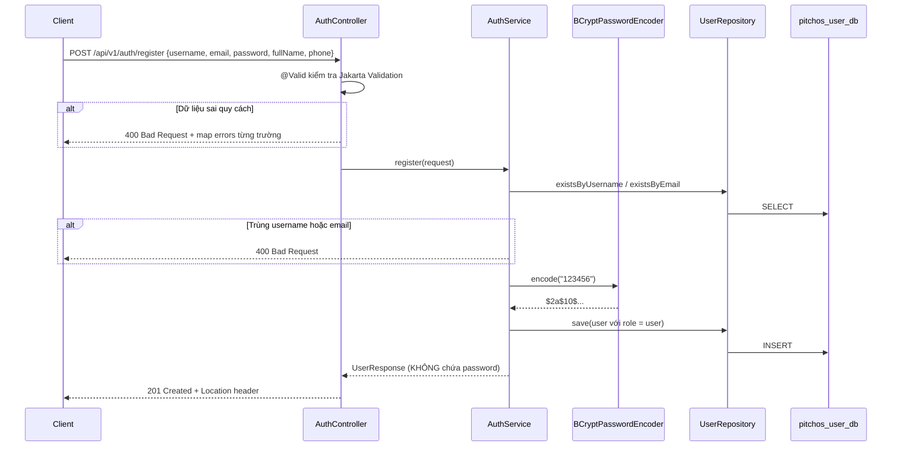
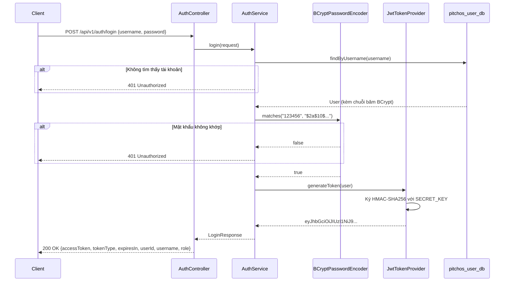
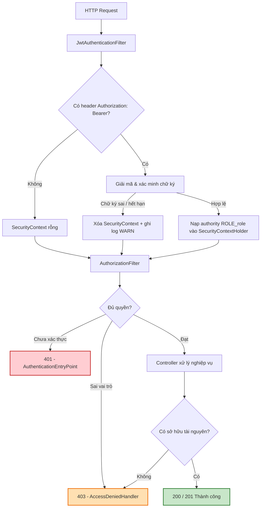
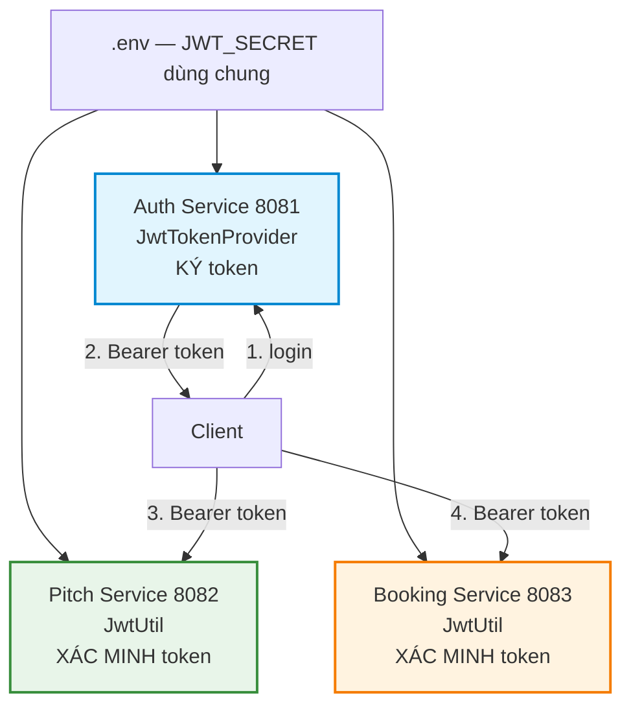

# BÁO CÁO KỸ THUẬT: CHƯƠNG 4 — XÁC THỰC VÀ BẢO MẬT HỆ THỐNG
**Học phần:** Kiến trúc phần mềm / Phát triển phần mềm  
**Đề tài:** PitchOS — Football Pitch Booking System (Kiến trúc SOA / Microservices)  
**Người thực hiện:** HOÀNG (Nhóm trưởng)  
**Vai trò:** Security Architect & Backend Auth Engineer  
**Dịch vụ phụ trách:** `pitchos-auth-service` (Port 8081) — CSDL `pitchos_user_db`  
**Điểm phụ trách:** 3,0 Điểm (1,0đ Lý thuyết Câu 1 Ý 3 + 2,0đ Thực nghiệm Câu 2 Ý 4)

---

## 4.1. CƠ CHẾ XÁC THỰC VÀ PHÂN QUYỀN DỊCH VỤ *(Câu 1 - Ý 3: 1,0đ)*

### 4.1.1. Phân biệt bản chất Authentication và Authorization

Hai khái niệm này thường bị dùng lẫn nhau, nhưng trong kiến trúc hướng dịch vụ chúng là hai tầng phòng thủ tách biệt, giải quyết hai câu hỏi khác nhau và được cài đặt ở hai vị trí khác nhau trong chuỗi xử lý request.

| Tiêu chí | Authentication (Xác thực) | Authorization (Phân quyền) |
| :--- | :--- | :--- |
| **Câu hỏi trả lời** | *"Bạn là ai?"* | *"Bạn được phép làm gì?"* |
| **Dữ liệu đối chiếu** | Thông tin đăng nhập: `username` + `password` | Vai trò (`role`) và quyền sở hữu tài nguyên |
| **Thời điểm diễn ra** | Một lần, khi đăng nhập | Mọi lần gọi API về sau |
| **Kết quả đầu ra** | Cấp phát JWT Access Token | Cho phép hoặc từ chối thao tác |
| **Vị trí cài đặt trong PitchOS** | `AuthService.login()` + `JwtTokenProvider` | `SecurityConfig` + kiểm tra quyền sở hữu tại `AuthService` |
| **Mã lỗi khi thất bại** | **401 Unauthorized** | **403 Forbidden** |

Điểm cốt lõi về trình tự: **xác thực luôn đi trước phân quyền**. Hệ thống không thể quyết định một người được làm gì nếu chưa biết người đó là ai. Ngược lại, xác thực thành công không hề đồng nghĩa với việc được phép truy cập — một tài khoản `user` đăng nhập hoàn toàn hợp lệ vẫn bị từ chối khi gọi API thêm sân mới của `chusan`.

### 4.1.2. Cấu trúc 3 phần của JSON Web Token

JWT là một chuỗi ký tự gồm **ba phần** được phân cách bởi dấu chấm, mỗi phần mã hóa Base64Url:

```
eyJhbGciOiJIUzI1NiJ9 . eyJzdWIiOiJjaHVzYW4iLCJ1c2VySWQiOjIsInJvbGUiOiJjaHVzYW4ifQ . 4f9a2c...
└────── Header ──────┘ └──────────────── Payload (Claims) ────────────────┘ └── Signature ──┘
```

**1) Header** — khai báo thuật toán ký và loại token. Token do PitchOS cấp có header giải mã ra:

```json
{ "alg": "HS256" }
```

**2) Payload (Claims)** — chứa thông tin ngữ cảnh người dùng. Đây là payload thật lấy từ token của tài khoản `chusan` trong quá trình kiểm thử:

```json
{
  "sub": "chusan",
  "userId": 2,
  "role": "chusan",
  "fullName": "Trần Văn Chủ Sân",
  "iat": 1793336101,
  "exp": 1793422501
}
```

| Claim | Ý nghĩa | Vai trò trong hệ thống |
| :--- | :--- | :--- |
| `sub` | Subject — tên đăng nhập | Định danh chính, Auth Service dùng để tra cứu người dùng |
| `userId` | Mã ID số của người dùng | Booking Service dùng làm principal để gán đơn đặt sân cho đúng chủ |
| `role` | Vai trò: `admin` \| `chusan` \| `user` | Căn cứ duy nhất để phân quyền RBAC |
| `fullName` | Họ tên hiển thị | Thông tin tiện dụng cho giao diện client |
| `iat` | Issued At — thời điểm phát hành | Phục vụ truy vết |
| `exp` | Expiration — thời điểm hết hạn | Giới hạn vòng đời token (24 giờ) |

Cần nhấn mạnh: **Payload chỉ được mã hóa Base64Url, không phải mã hóa bảo mật**. Bất kỳ ai cũng giải mã đọc được nội dung này. Vì vậy tuyệt đối không đặt mật khẩu hay dữ liệu nhạy cảm vào Payload. Giá trị bảo mật của JWT nằm ở phần thứ ba.

**3) Signature (Chữ ký số)** — phần bảo đảm tính toàn vẹn:

```
Signature = HMAC-SHA256( Base64Url(Header) + "." + Base64Url(Payload), SECRET_KEY )
```

Chữ ký được tạo bằng cách băm Header và Payload cùng với `SECRET_KEY` mà chỉ server biết. Nhờ đó, nếu kẻ tấn công sửa Payload (ví dụ đổi `"role": "user"` thành `"role": "admin"`) thì chữ ký không còn khớp, và server lập tức từ chối token. Kẻ tấn công không thể tự tạo chữ ký hợp lệ vì không có `SECRET_KEY`.

**Cơ chế Stateless:** server không lưu session trong RAM hay CSDL. Mỗi request client tự gửi kèm token qua header `Authorization: Bearer <token>`, server chỉ cần xác minh chữ ký là đủ biết người gọi là ai. Đây chính là đặc tính giúp JWT phù hợp với kiến trúc microservices: ba dịch vụ của PitchOS đều tự xác thực độc lập, không cần hỏi lẫn nhau và không cần một kho session dùng chung.

### 4.1.3. Phân biệt chính xác giữa HTTP 401 Unauthorized và HTTP 403 Forbidden

Đây là cặp mã lỗi bị dùng sai nhiều nhất trong thực tế. Ranh giới phân biệt rất rõ ràng:

> **401** = hệ thống **không biết bạn là ai** → thất bại ở tầng Authentication.  
> **403** = hệ thống **biết rõ bạn là ai, nhưng bạn không được phép** → thất bại ở tầng Authorization.

| Tình huống thực tế | Mã HTTP | Lớp xử lý trong PitchOS |
| :--- | :---: | :--- |
| Không gửi header `Authorization` | **401** | `AuthenticationEntryPoint` |
| Token sai chữ ký (bị giả mạo) | **401** | `AuthenticationEntryPoint` |
| Token đã hết hạn (`exp` quá khứ) | **401** | `AuthenticationEntryPoint` |
| Sai tên đăng nhập hoặc mật khẩu | **401** | `GlobalExceptionHandler` bắt `UnauthorizedException` |
| Tài khoản `user` gọi API thêm sân của `chusan` | **403** | `AccessDeniedHandler` |
| Tài khoản `user` xem thông tin tài khoản người khác | **403** | `AuthService` ném `AccessDeniedException` |
| Tài khoản `chusan` gọi API danh sách người dùng của `admin` | **403** | `AccessDeniedHandler` |

Một lưu ý về ý nghĩa thực tiễn: trả đúng mã lỗi không chỉ là chuyện hình thức. Client dựa vào mã này để quyết định hành vi — gặp **401** thì điều hướng người dùng về trang đăng nhập (hoặc dùng refresh token), còn gặp **403** thì hiển thị thông báo "bạn không có quyền" và **không** bắt đăng nhập lại, vì đăng nhập lại cũng không giải quyết được gì.

### 4.1.4. Ma trận phân quyền Role-Based Access Control (RBAC)

Hệ thống PitchOS định nghĩa **ba vai trò**, lưu trực tiếp dưới dạng `ENUM('admin','chusan','user')` trong CSDL:

| Vai trò | Đối tượng thực tế | Phạm vi quyền hạn |
| :--- | :--- | :--- |
| `user` | Khách hàng thuê sân | Xem danh sách sân, tạo đơn đặt sân, xem đơn của chính mình |
| `chusan` | Chủ sân bóng | Quản lý sân (thêm sân, đổi trạng thái bảo trì), duyệt hoặc từ chối đơn đặt |
| `admin` | Quản trị viên hệ thống | Toàn quyền, bao gồm quản trị danh sách tài khoản người dùng |

**Ma trận phân quyền toàn hệ thống** (ba dịch vụ):

| Endpoint | Method | Công khai | `user` | `chusan` | `admin` | Mã khi bị từ chối |
| :--- | :---: | :---: | :---: | :---: | :---: | :---: |
| `/api/v1/auth/register` | POST | ✅ | ✅ | ✅ | ✅ | — |
| `/api/v1/auth/login` | POST | ✅ | ✅ | ✅ | ✅ | — |
| `/api/v1/users/me` | GET | ❌ | ✅ | ✅ | ✅ | 401 |
| `/api/v1/users/{id}` | GET | ❌ | Chỉ chính mình | ✅ | ✅ | 401 / 403 |
| `/api/v1/users` | GET | ❌ | ❌ | ❌ | ✅ | 401 / 403 |
| `/api/v1/pitches` | GET | ✅ | ✅ | ✅ | ✅ | — |
| `/api/v1/pitches` | POST | ❌ | ❌ | ✅ | ✅ | 401 / 403 |
| `/api/v1/pitches/{id}/status` | PATCH | ❌ | ❌ | ✅ | ✅ | 401 / 403 |
| `/api/v1/bookings` | POST | ❌ | ✅ | ❌ | ❌ | 401 / 403 |
| `/api/v1/bookings/my-bookings` | GET | ❌ | ✅ | ❌ | ❌ | 401 / 403 |
| `/api/v1/bookings/{id}/status` | PATCH | ❌ | ❌ | ✅ | ✅ | 401 / 403 |

Ma trận này thể hiện rõ nguyên lý **đặc quyền tối thiểu (Principle of Least Privilege)**: mỗi vai trò chỉ được cấp đúng những quyền cần thiết cho nghiệp vụ của mình. Đáng chú ý là `chusan` **không** được tạo đơn đặt sân, và `user` **không** được duyệt đơn — quyền hạn không phải quan hệ bao hàm theo thứ bậc, mà được thiết kế theo đúng chức năng nghiệp vụ.

---

## 4.2. TRIỂN KHAI AUTH & USER SERVICE (PORT 8081) *(Câu 2 - Ý 4: 2,0đ)*

### 4.2.1. Đăng ký tài khoản và mã hóa mật khẩu với BCryptPasswordEncoder

**Thực thể `User`** được thiết kế ánh xạ tới bảng `users` trong `pitchos_user_db`:

| Trường | Kiểu dữ liệu | Ràng buộc |
| :--- | :--- | :--- |
| `id` | `BIGINT` | Khóa chính, tự tăng |
| `username` | `VARCHAR(50)` | Bắt buộc, duy nhất |
| `email` | `VARCHAR(100)` | Bắt buộc, duy nhất, định dạng email |
| `password` | `VARCHAR(255)` | Bắt buộc, lưu chuỗi băm BCrypt |
| `full_name` | `VARCHAR(100)` | Bắt buộc |
| `phone` | `VARCHAR(20)` | Tùy chọn |
| `role` | `ENUM` | `admin` \| `chusan` \| `user`, mặc định `user` |
| `created_at` | `DATETIME` | Tự sinh khi tạo bản ghi |

**Nguyên tắc tối quan trọng: CSDL không bao giờ lưu mật khẩu dạng văn bản thuần.** Mật khẩu được băm một chiều bằng `BCryptPasswordEncoder` trước khi lưu:

```java
@Bean
public PasswordEncoder passwordEncoder() {
    return new BCryptPasswordEncoder();
}
```

BCrypt được chọn thay vì MD5 hay SHA-1 vì ba đặc tính:

1. **Tự sinh salt riêng cho từng mật khẩu** — hai người dùng đặt cùng mật khẩu `123456` sẽ có hai chuỗi băm hoàn toàn khác nhau, vô hiệu hóa tấn công bằng bảng tra cứu sẵn (Rainbow Table).
2. **Băm một chiều, cố tình chậm** — BCrypt có tham số độ phức tạp (cost factor, mặc định 10 tức $2^{10}$ vòng lặp), làm tấn công dò quét (Brute Force) trở nên bất khả thi về thời gian.
3. **Không thể giải mã ngược** — ngay cả khi CSDL bị rò rỉ, kẻ tấn công cũng không lấy lại được mật khẩu gốc.

Cấu trúc một chuỗi băm BCrypt:

```
$2a$10$N9qo8uLOickgx2ZMRZoMye IjZAgcfl7p92ldGxad68LJZdL17lhWy
└┬┘ └┬┘ └──────── salt ──────┘ └──────── hash ──────────────┘
 │   └─ cost factor = 10 (2^10 vòng)
 └───── phiên bản thuật toán
```

**Luồng nghiệp vụ đăng ký** (`POST /api/v1/auth/register`):



Hai quyết định thiết kế đáng lưu ý:

- **Vai trò luôn bị ép thành `user`**, bất kể client gửi lên gì. Nếu cho phép client tự khai `role` thì bất kỳ ai cũng có thể tự đăng ký một tài khoản `admin` — một lỗ hổng leo thang đặc quyền (Privilege Escalation) kinh điển.
- **DTO `UserResponse` không có trường `password`**, nên chuỗi băm không bao giờ lọt ra ngoài qua API, dù đã được băm.

### 4.2.2. Đăng nhập và cơ chế sinh Bearer JWT Token

**Luồng nghiệp vụ đăng nhập** (`POST /api/v1/auth/login`):



Quá trình so khớp mật khẩu dùng `passwordEncoder.matches(mậtKhẩuThô, chuỗiBămTrongDB)`. Hàm này trích salt từ chuỗi băm đã lưu, băm lại mật khẩu thô bằng chính salt đó rồi so sánh kết quả — chứ **không** giải mã ngược chuỗi băm (điều không thể làm được).

**Lớp `JwtTokenProvider`** đảm nhận việc cấp phát token:

```java
public String generateToken(User user) {
    Date now = new Date();
    Date expiryDate = new Date(now.getTime() + expirationMs);

    Map<String, Object> claims = new LinkedHashMap<>();
    claims.put("userId", user.getId());
    claims.put("role", user.getRole().name().toLowerCase());
    claims.put("fullName", user.getFullName());

    return Jwts.builder()
            .setSubject(user.getUsername())
            .addClaims(claims)
            .setIssuedAt(now)
            .setExpiration(expiryDate)
            .signWith(key, SignatureAlgorithm.HS256)
            .compact();
}
```

Một chi tiết nhỏ nhưng mang tính sống còn cho tính đồng bộ toàn hệ thống: claim `role` được ghi **viết thường và không có tiền tố** (`"chusan"` chứ không phải `"ROLE_CHUSAN"`). Lý do được trình bày ở mục 4.3.1.

**Chống dò quét tài khoản:** cả hai trường hợp sai tên đăng nhập và sai mật khẩu đều trả về **cùng một thông báo** *"Tên đăng nhập hoặc mật khẩu không đúng"*. Nếu phân biệt hai thông báo này, kẻ tấn công có thể dùng API đăng nhập để dò xem tài khoản nào tồn tại trong hệ thống (User Enumeration).

---

## 4.3. CẤU HÌNH BẢO VỆ API VỚI SPRING SECURITY 6 *(Câu 2 - Ý 4: 2,0đ)*

### 4.3.1. Xây dựng JwtAuthenticationFilter

Chuỗi lọc bảo mật (Security Filter Chain) hoạt động như một trạm kiểm soát đặt trước toàn bộ Controller. Mọi request đều phải đi qua:



Phần lõi của bộ lọc:

```java
String authHeader = request.getHeader("Authorization");

if (authHeader != null && authHeader.startsWith("Bearer ")) {
    String token = authHeader.substring(7).trim();
    try {
        Claims claims = jwtTokenProvider.parseToken(token);
        String username = jwtTokenProvider.getUsername(claims);
        String role = jwtTokenProvider.getRole(claims);

        if (role != null) {
            List<SimpleGrantedAuthority> authorities = new ArrayList<>();
            authorities.add(new SimpleGrantedAuthority("ROLE_" + role.toLowerCase()));
            authorities.add(new SimpleGrantedAuthority(role.toLowerCase()));

            SecurityContextHolder.getContext().setAuthentication(
                new UsernamePasswordAuthenticationToken(username, null, authorities));
        }
    } catch (JwtException | IllegalArgumentException ex) {
        SecurityContextHolder.clearContext();
    }
}
filterChain.doFilter(request, response);
```

**Vì sao claim `role` phải viết thường và không tiền tố?** Spring Security quy ước: hàm `hasRole("chusan")` sẽ **tự động ghép thêm tiền tố** `ROLE_` rồi mới so sánh, tức nó tìm authority `ROLE_chusan`. Bộ lọc của cả ba dịch vụ PitchOS đều ghép `"ROLE_" + role` từ claim. Do đó nếu Auth Service cấp token với `role = "ROLE_CHUSAN"` thì authority sẽ thành `ROLE_ROLE_CHUSAN`, không khớp với bất kỳ cấu hình nào, và **toàn bộ API của Pitch Service lẫn Booking Service sẽ trả về 403**. Đây là hợp đồng ngầm giữa ba dịch vụ, bắt buộc phải giữ nguyên.

Bộ lọc nạp **đồng thời hai dạng** authority (`ROLE_chusan` và `chusan`) để cấu hình phân quyền viết bằng `hasRole()` hay `hasAuthority()` đều hoạt động.

Một điểm thiết kế quan trọng: khi token sai chữ ký, bộ lọc **không tự trả lỗi** mà chỉ xóa `SecurityContext` rồi cho request đi tiếp. Việc phát sinh mã 401 được giao hoàn toàn cho `AuthenticationEntryPoint`, giúp mọi phản hồi lỗi bảo mật đi qua một chỗ duy nhất và có khuôn JSON thống nhất.

### 4.3.2. Cấu hình AuthenticationEntryPoint (401) và AccessDeniedHandler (403)

Cấu hình phân quyền trong `SecurityConfig`:

```java
.authorizeHttpRequests(auth -> auth
        .requestMatchers(HttpMethod.POST, "/api/v1/auth/register", "/api/v1/auth/login").permitAll()
        .requestMatchers("/swagger-ui/**", "/swagger-ui.html", "/api-docs/**", "/v3/api-docs/**", "/error").permitAll()
        .requestMatchers(HttpMethod.GET, "/api/v1/users").hasRole("admin")
        .anyRequest().authenticated()
)
.exceptionHandling(ex -> ex
        .authenticationEntryPoint(authenticationEntryPoint())   // 401
        .accessDeniedHandler(accessDeniedHandler())             // 403
)
.sessionManagement(session -> session.sessionCreationPolicy(SessionCreationPolicy.STATELESS))
```

Cấu hình `STATELESS` là bắt buộc với JWT: nó yêu cầu Spring Security không tạo `HttpSession`, mỗi request được xác thực độc lập hoàn toàn dựa trên token.

Hai bộ xử lý lỗi trả về JSON có cấu trúc giống hệt khuôn `ErrorResponse` mà Pitch Service và Booking Service dùng, nhờ đó client chỉ cần xử lý một định dạng lỗi duy nhất cho cả hệ thống:

```json
{
  "timestamp": "2026-10-30T11:55:12.345",
  "status": 401,
  "error": "Unauthorized",
  "message": "Chưa xác thực danh tính. Vui lòng đăng nhập và gửi kèm Bearer JWT Token hợp lệ vào Header Authorization.",
  "path": "/api/v1/users/me"
}
```

**Kiểm tra quyền sở hữu tài nguyên (Resource Ownership).** Phân quyền theo vai trò là chưa đủ. Xét tình huống: tài khoản `user` có ID 3 gửi request `GET /api/v1/users/1` để xem thông tin của `admin`. Token hoàn toàn hợp lệ, vai trò `user` cũng được phép gọi endpoint này — nếu chỉ dựa vào vai trò thì request sẽ được chấp nhận và dữ liệu người khác bị lộ.

Nguyên tắc xử lý là **không tin tưởng ID do client gửi lên**, mà phải đối chiếu quyền sở hữu thực tế tại tầng nghiệp vụ:

```java
User target = userRepository.findById(id)
        .orElseThrow(() -> new ResourceNotFoundException("Không tìm thấy người dùng với mã ID: " + id));
User current = userRepository.findByUsername(currentUsername)
        .orElseThrow(() -> new UnauthorizedException("Phiên đăng nhập không hợp lệ"));

if (current.getRole() == Role.user && !current.getId().equals(target.getId())) {
    throw new AccessDeniedException(
        "Truy cập bị từ chối. Tài khoản vai trò 'user' chỉ được xem thông tin của chính mình.");
}
```

Lưu ý kỹ thuật: `AccessDeniedException` ném từ tầng Service **phải được khai báo một handler tường minh** trong `GlobalExceptionHandler`. Nguyên nhân là `@RestControllerAdvice` chạy bên trong `DispatcherServlet`, tức ở *bên trong* `ExceptionTranslationFilter` của Spring Security. Nếu không khai báo riêng, ngoại lệ này sẽ bị handler `Exception.class` bắt trước và bị gói thành **500 Internal Server Error** thay vì 403.

### 4.3.3. Cơ chế đồng bộ Secret Key bảo vệ liên dịch vụ *(Giai đoạn 4)*

Trong kiến trúc microservices, mỗi dịch vụ phải tự xác thực được token mà không cần gọi về Auth Service để hỏi. Điều này đạt được bằng cách **ba dịch vụ dùng chung một `SECRET_KEY`**, khai báo tập trung tại file `.env` của dự án:

```properties
JWT_SECRET=404E635266556A586E3272357538782F413F4428472B4B6250645367566B5970
JWT_EXPIRATION_MS=86400000
```

Mỗi dịch vụ nạp giá trị này qua `application.properties`:

```properties
jwt.secret=${JWT_SECRET:404E6352...}
```



**Ba điều kiện bắt buộc để token dùng chung được cả hệ thống:**

1. **Cùng `SECRET_KEY`** — khác key thì chữ ký không khớp, token bị từ chối.
2. **Cùng cách nạp key.** Cả ba dịch vụ đều dùng `Keys.hmacShaKeyFor(Decoders.BASE64.decode(secret))`. Chi tiết này phải tuyệt đối nhất quán: nếu Auth Service nạp key theo kiểu khác (ví dụ `secret.getBytes()`) thì dù chuỗi secret giống nhau, mảng byte khóa vẫn khác và chữ ký sẽ lệch.
3. **Cùng hợp đồng claim.** Claim `role` viết thường không tiền tố (mục 4.3.1), và claim `userId` **bắt buộc phải có** — Booking Service dùng nó làm principal để gán đơn đặt sân, thiếu claim này request tạo đơn sẽ lỗi.

**Nội dung bàn giao cho Linh và Nhật ở Giai đoạn 4:**

| Hạng mục bàn giao | Mục đích |
| :--- | :--- |
| Chuỗi `JWT_SECRET` dùng chung | Để Pitch và Booking Service giải mã được token |
| Hợp đồng claim (`sub`, `userId`, `role`, `exp`) | Để hai dịch vụ đọc đúng trường dữ liệu |
| Mẫu `JwtAuthenticationFilter` + `SecurityConfig` | Để hai dịch vụ cài đặt phân quyền thống nhất |
| Ba token mẫu (`user`, `chusan`, `admin`) | Để hai bạn tự kiểm thử phân quyền khi Auth Service chưa chạy |
| Khuôn JSON `ErrorResponse` | Để client xử lý một định dạng lỗi duy nhất |

**Hạn chế hiện tại và hướng cải tiến.** Mô hình secret dùng chung (thuật toán đối xứng HS256) có nhược điểm: **mọi dịch vụ đều có khả năng tự ký token**, không chỉ xác minh. Nếu một dịch vụ bị chiếm quyền, kẻ tấn công có thể tự phát hành token `admin` hợp lệ. Hướng khắc phục trong hệ thống thực tế là chuyển sang thuật toán bất đối xứng **RS256**: Auth Service giữ private key để ký, các dịch vụ còn lại chỉ nhận public key để xác minh và không có khả năng tự ký. Ngoài ra có thể bổ sung **API Gateway** làm điểm xác thực tập trung ở biên hệ thống.

---

## 4.4. TỔNG KẾT CHƯƠNG 4

Chương 4 đã trình bày đầy đủ kiến trúc bảo mật của hệ thống PitchOS:

- **Về lý thuyết:** phân định rạch ròi Authentication và Authorization, phân tích ba thành phần của JWT cùng vai trò của chữ ký HMAC-SHA256 trong việc chống giả mạo, và làm rõ ranh giới giữa hai mã lỗi 401 (không biết bạn là ai) và 403 (biết nhưng không cho phép).
- **Về thực nghiệm:** xây dựng hoàn chỉnh `pitchos-auth-service` trên cổng 8081 với ba API xác thực, mã hóa mật khẩu một chiều bằng BCrypt, cấp phát Bearer JWT Token, cấu hình chuỗi lọc Spring Security 6 với hai bộ xử lý lỗi 401/403 trả về JSON chuẩn, bổ sung cơ chế kiểm tra quyền sở hữu tài nguyên, và thiết lập hợp đồng token dùng chung cho cả ba dịch vụ.

Toàn bộ kết quả kiểm thử thực tế chứng minh các cơ chế trên hoạt động đúng được trình bày chi tiết tại **Chương 5**.
