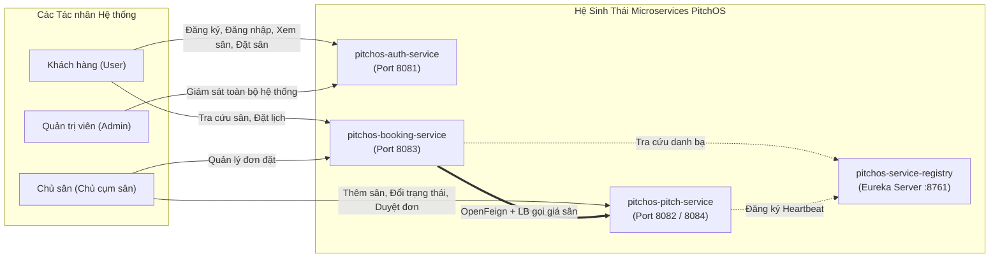
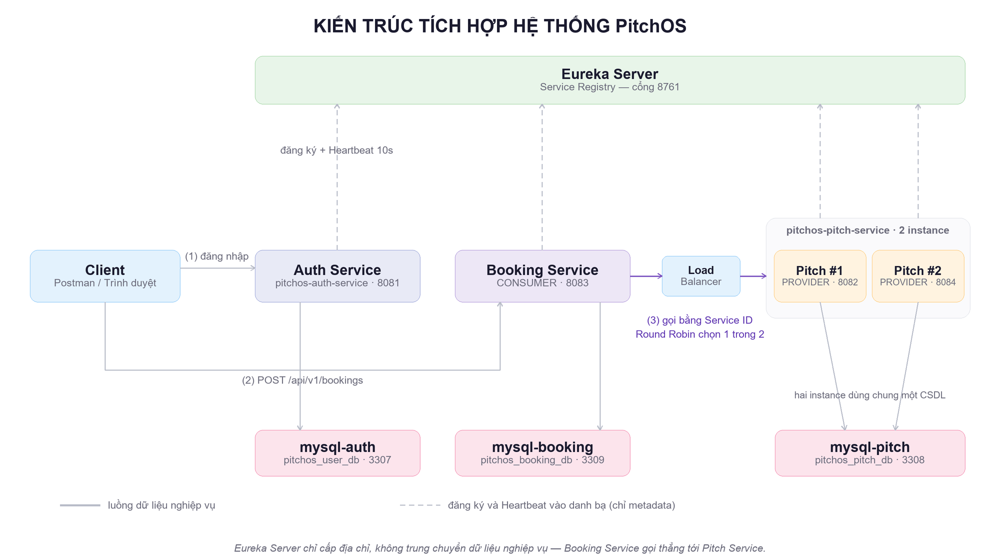
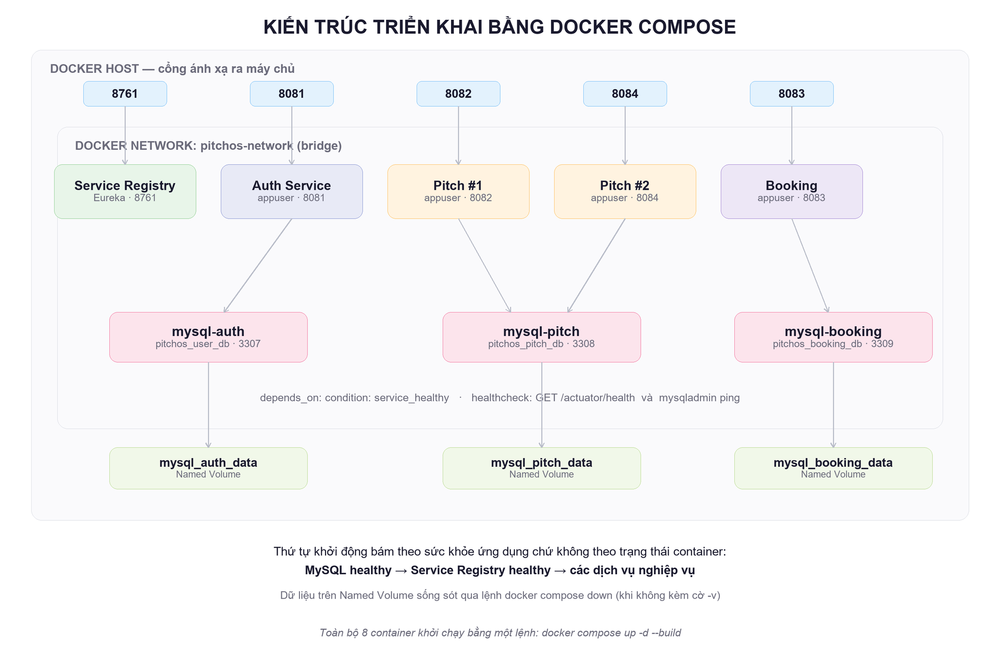
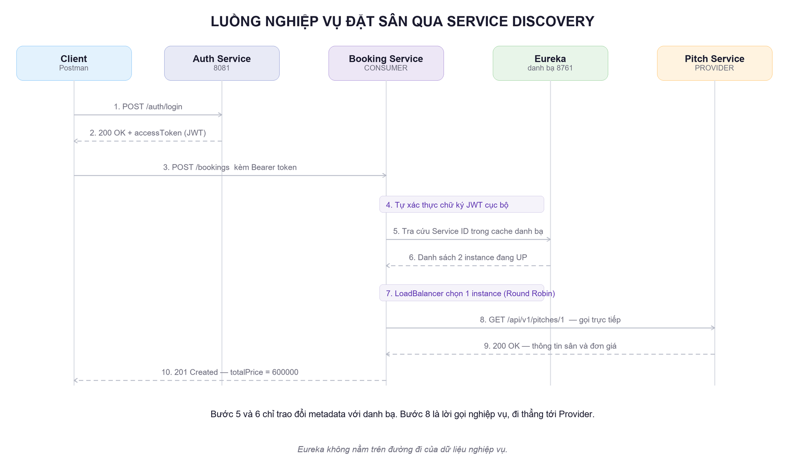
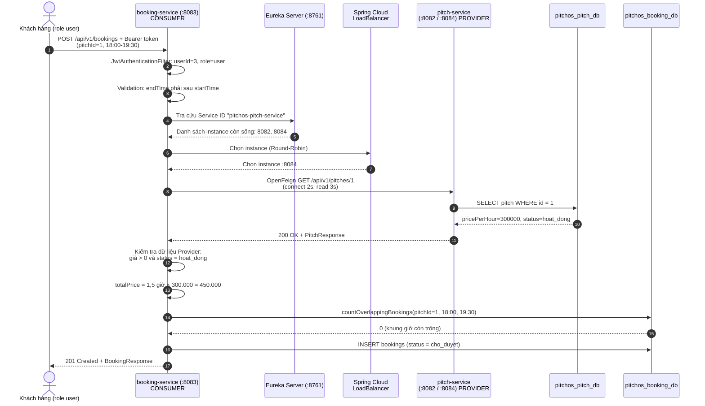
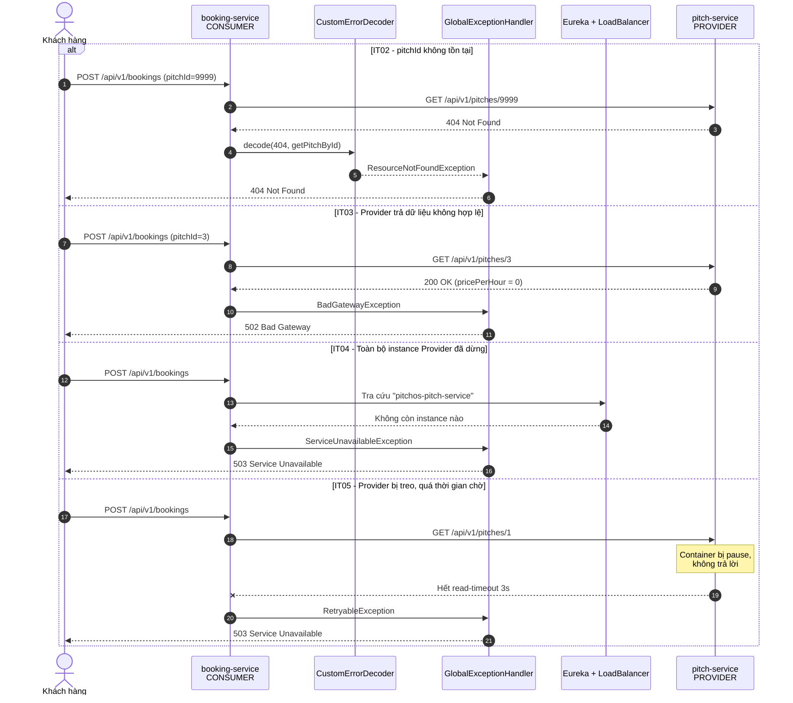
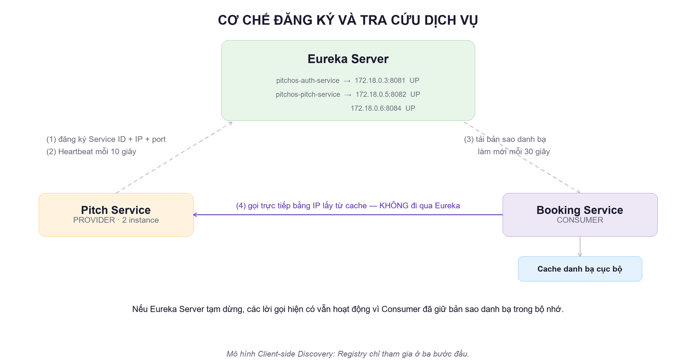
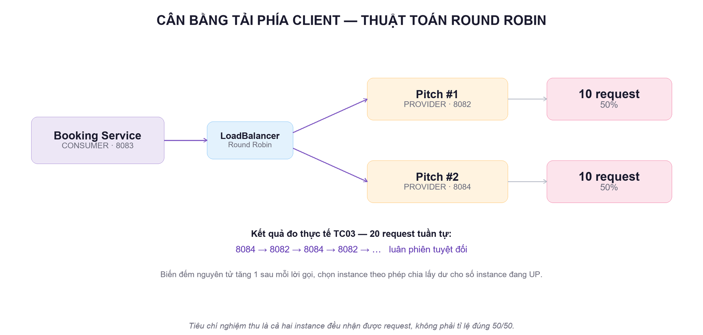
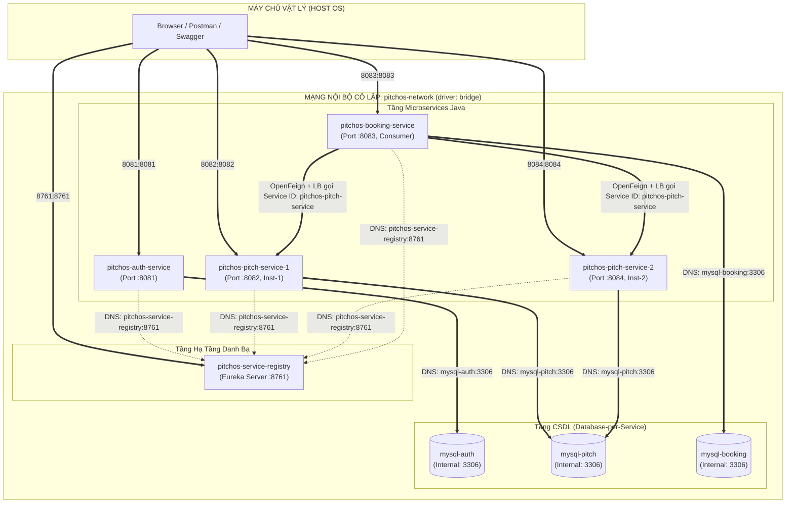

# TRƯỜNG ĐẠI HỌC CÔNG NGHIỆP HÀ NỘI
## TRƯỜNG CÔNG NGHỆ THÔNG TIN VÀ TRUYỀN THÔNG

### BÁO CÁO BÀI KIỂM TRA SỐ 2
#### HỌC PHẦN: PHÁT TRIỂN PHẦN MỀM HƯỚNG DỊCH VỤ

##### ĐỀ TÀI
##### HỆ THỐNG QUẢN LÝ ĐẶT LỊCH SÂN BÓNG ĐÁ — PitchOS

Nhóm: **13**  
Lớp: **20261IT6151005**  
Giáo viên hướng dẫn: **Hoàng Quang Huy**

| Sinh viên thực hiện | Mã sinh viên | Nội dung phụ trách |
|---|---|---|
| Lê Đức Hoàng *(Nhóm trưởng)* | 2024606110 | Chương 2 (kiến trúc) · Chương 4 |
| Đỗ Hoàng Linh | 2024606897 | Chương 1 · Chương 5 |
| Hoàng Minh Nhật | 2024607325 | Chương 3 |
| Vi Đức Hùng | 2024605681 | Chương 2 (dữ liệu) · Chương 6 · Chương 7 |

**HÀ NỘI, 2026**

---

## MỤC LỤC

- [CHƯƠNG 1. GIỚI THIỆU HỆ THỐNG PitchOS](#chương-1-giới-thiệu-hệ-thống-pitchos)
  - [1.1. BỐI CẢNH VÀ BÀI TOÁN THỰC TẾ](#11-bối-cảnh-và-bài-toán-thực-tế)
  - [1.2. MỤC TIÊU HỆ THỐNG VÀ CÁC PHÂN HỆ CHỨC NĂNG](#12-mục-tiêu-hệ-thống-và-các-phân-hệ-chức-năng)
  - [1.3. BẢNG TỔNG HỢP CÔNG NGHỆ ÁP DỤNG TRONG TOÀN DỰ ÁN](#13-bảng-tổng-hợp-công-nghệ-áp-dụng-trong-toàn-dự-án)
  - [1.4. SO SÁNH HIỆN TRẠNG HỆ THỐNG: KT1 (TRƯỚC) VS KT2 (SAU NÂNG CẤP)](#14-so-sánh-hiện-trạng-hệ-thống-kt1-trước-vs-kt2-sau-nâng-cấp)
- [CHƯƠNG 2. THIẾT KẾ KIẾN TRÚC HỆ THỐNG](#chương-2-thiết-kế-kiến-trúc-hệ-thống)
  - [2.1. KIẾN TRÚC TÍCH HỢP](#21-kiến-trúc-tích-hợp)
  - [2.2. KIẾN TRÚC TRIỂN KHAI](#22-kiến-trúc-triển-khai)
  - [2.3. NGUYÊN TẮC DATABASE-PER-SERVICE VÀ QUẢN TRỊ DỮ LIỆU PHÂN TÁN](#23-nguyên-tắc-database-per-service-và-quản-trị-dữ-liệu-phân-tán)
  - [2.4. BẢNG MÔ TẢ CHI TIẾT CÁC MICROSERVICES TRONG HỆ THỐNG PITCHOS](#24-bảng-mô-tả-chi-tiết-các-microservices-trong-hệ-thống-pitchos)
- [CHƯƠNG 3. TÍCH HỢP VÀ TIÊU THỤ DỊCH VỤ](#chương-3-tích-hợp-và-tiêu-thụ-dịch-vụ)
  - [3.1. CƠ SỞ LÝ THUYẾT](#31-cơ-sở-lý-thuyết)
  - [3.2. VAI TRÒ CỦA BOOKING SERVICE TRONG KIẾN TRÚC PITCHOS](#32-vai-trò-của-booking-service-trong-kiến-trúc-pitchos)
  - [3.3. QUY TRÌNH NGHIỆP VỤ KHÁCH HÀNG ĐẶT SÂN BÓNG](#33-quy-trình-nghiệp-vụ-khách-hàng-đặt-sân-bóng)
  - [3.4. PHÂN TÍCH MÃ NGUỒN TÍCH HỢP](#34-phân-tích-mã-nguồn-tích-hợp)
  - [3.5. BẢNG HỢP ĐỒNG API](#35-bảng-hợp-đồng-api)
  - [3.6. MINH CHỨNG KIỂM THỬ TÍCH HỢP IT01 – IT07](#36-minh-chứng-kiểm-thử-tích-hợp-it01-it07)
  - [3.7. ĐÁNH GIÁ VÀ HƯỚNG PHÁT TRIỂN](#37-đánh-giá-và-hướng-phát-triển)
- [CHƯƠNG 4. SERVICE REGISTRY VÀ CÂN BẰNG TẢI](#chương-4-service-registry-và-cân-bằng-tải)
  - [4.1. CƠ SỞ LÝ THUYẾT](#41-cơ-sở-lý-thuyết)
  - [4.2. PHẠM VI VÀ KẾT QUẢ TỔNG QUAN](#42-phạm-vi-và-kết-quả-tổng-quan)
  - [4.3. CẤU HÌNH EUREKA SERVER](#43-cấu-hình-eureka-server)
  - [4.4. CƠ CHẾ ĐĂNG KÝ CỦA EUREKA CLIENT](#44-cơ-chế-đăng-ký-của-eureka-client)
  - [4.5. CƠ CHẾ SPRING CLOUD LOADBALANCER](#45-cơ-chế-spring-cloud-loadbalancer)
  - [4.6. BẢO MẬT VÀ VẬN HÀNH LIÊN QUAN ĐẾN REGISTRY](#46-bảo-mật-và-vận-hành-liên-quan-đến-registry)
  - [4.7. KIỂM THỬ DỪNG VÀ KHỞI ĐỘNG LẠI PROVIDER](#47-kiểm-thử-dừng-và-khởi-động-lại-provider)
  - [4.8. ĐÁNH GIÁ VÀ HƯỚNG PHÁT TRIỂN](#48-đánh-giá-và-hướng-phát-triển)
- [CHƯƠNG 5. CONTAINER HÓA VÀ TRIỂN KHAI HỆ THỐNG](#chương-5-container-hóa-và-triển-khai-hệ-thống)
  - [5.1. CƠ SỞ LÝ THUYẾT](#51-cơ-sở-lý-thuyết)
  - [5.2. KIẾN TRÚC DOCKERFILE MULTI-STAGE VÀ BẢO MẬT CONTAINER](#52-kiến-trúc-dockerfile-multi-stage-và-bảo-mật-container)
  - [5.3. THIẾT KẾ FILE ĐIỀU PHỐI DOCKER COMPOSE VÀ MẠNG NỘI BỘ PITCHOS-NETWORK](#53-thiết-kế-file-điều-phối-docker-compose-và-mạng-nội-bộ-pitchos-network)
  - [5.4. CƠ CHẾ HEALTHCHECK VÀ ĐIỀU PHỐI THỨ TỰ KHỞI ĐỘNG CÁC DỊCH VỤ](#54-cơ-chế-healthcheck-và-điều-phối-thứ-tự-khởi-động-các-dịch-vụ)
  - [5.5. QUẢN TRỊ BIẾN MÔI TRƯỜNG VÀ DỮ LIỆU BỀN VỮNG QUA NAMED VOLUMES](#55-quản-trị-biến-môi-trường-và-dữ-liệu-bền-vững-qua-named-volumes)
  - [5.6. KẾT QUẢ KIỂM TRA TRẠNG THÁI TOÀN BỘ CONTAINER](#56-kết-quả-kiểm-tra-trạng-thái-toàn-bộ-container)
- [CHƯƠNG 6. VẬN HÀNH VÀ GIÁM SÁT HỆ THỐNG](#chương-6-vận-hành-và-giám-sát-hệ-thống)
  - [6.1. CƠ SỞ LÝ THUYẾT](#61-cơ-sở-lý-thuyết)
  - [6.2. GIÁM SÁT SỨC KHỎE ỨNG DỤNG BẰNG SPRING BOOT ACTUATOR](#62-giám-sát-sức-khỏe-ứng-dụng-bằng-spring-boot-actuator)
  - [6.3. TRUY VẾT VÀ PHÂN TÍCH NHẬT KÝ HOẠT ĐỘNG (DISTRIBUTED LOGGING)](#63-truy-vết-và-phân-tích-nhật-ký-hoạt-động-distributed-logging)
  - [6.4. BẢNG TỔNG HỢP KIỂM THỬ VẬN HÀNH VÀ SỰ CỐ (DEP01 – DEP08)](#64-bảng-tổng-hợp-kiểm-thử-vận-hành-và-sự-cố-dep01-dep08)
  - [6.5. PHÂN TÍCH CHUYÊN SÂU MỘT TÌNH HUỐNG SỰ CỐ VẬN HÀNH THỰC TẾ](#65-phân-tích-chuyên-sâu-một-tình-huống-sự-cố-vận-hành-thực-tế)
  - [6.6. BẢO TOÀN DỮ LIỆU BẰNG DOCKER NAMED VOLUME](#66-bảo-toàn-dữ-liệu-bằng-docker-named-volume)
- [CHƯƠNG 7. ĐÁNH GIÁ VÀ KẾT LUẬN](#chương-7-đánh-giá-và-kết-luận)
  - [7.1. BẢNG TỰ ĐÁNH GIÁ ĐIỂM SỐ THEO BAREM CHUẨN CỦA GIẢNG VIÊN](#71-bảng-tự-đánh-giá-điểm-số-theo-barem-chuẩn-của-giảng-viên)
  - [7.2. TỔNG KẾT CÁC BẪY KỸ THUẬT VÀ GIẢI PHÁP KHẮC PHỤC TRONG DỰ ÁN](#72-tổng-kết-các-bẫy-kỹ-thuật-và-giải-pháp-khắc-phục-trong-dự-án)
  - [7.3. ĐỀ XUẤT HƯỚNG PHÁT TRIỂN VÀ NÂNG CẤP HỆ THỐNG TRONG TƯƠNG LAI](#73-đề-xuất-hướng-phát-triển-và-nâng-cấp-hệ-thống-trong-tương-lai)
  - [7.4. VẤN ĐỀ PHÁT SINH TRONG QUÁ TRÌNH TÍCH HỢP, TRIỂN KHAI VÀ VẬN HÀNH](#74-vấn-đề-phát-sinh-trong-quá-trình-tích-hợp-triển-khai-và-vận-hành)
- [PHỤ LỤC A. ĐỐI CHIẾU NỘI DUNG BÁO CÁO VỚI BAREM CHẤM ĐIỂM](#phụ-lục-a-đối-chiếu-nội-dung-báo-cáo-với-barem-chấm-điểm)
- [PHỤ LỤC B. DANH MỤC MÃ NGUỒN VÀ MINH CHỨNG](#phụ-lục-b-danh-mục-mã-nguồn-và-minh-chứng)

---

---

### CHƯƠNG 1. GIỚI THIỆU HỆ THỐNG PitchOS

**Vai trò đề tài:** Kỹ sư Triển khai Container & Provider Pitch Service  
**Vùng mã nguồn sở hữu:** `pitchos-pitch-service/`, `docker-compose.yml`, `.env.example`

---

#### 1.1. BỐI CẢNH VÀ BÀI TOÁN THỰC TẾ

Trong đời sống xã hội hiện đại, phong trào rèn luyện thể chất thông qua bộ môn bóng đá phong trào phát triển mạnh mẽ tại các đô thị lớn (Hà Nội, TP.HCM, Đà Nẵng). Nhu cầu thuê sân bóng đá cỏ nhân tạo mini (sân 5 người, sân 7 người, sân 10-11 người) của học sinh, sinh viên, người đi làm và các câu lạc bộ phong trào là rất lớn, đặc biệt vào các khung giờ vàng buổi chiều và tối (17h30 – 21h30).

Tuy nhiên, hầu hết các cụm sân bóng đá mini hiện nay vẫn áp dụng phương thức quản lý và khai thác mang nặng tính thủ công, dẫn đến nhiều bất cập nhức nhối:

```
┌────────────────────────────────────────────────────────────────────────┐
│ BẤT CẬP QUẢN LÝ THỦ CÔNG TRUYỀN THỐNG                                 │
├────────────────────────────────────┬───────────────────────────────────┤
│ Phía Khách hàng (Người thuê sân)   │ Phía Chủ cụm sân (Người quản lý)  │
├────────────────────────────────────┼───────────────────────────────────┤
│ • Mất thời gian gọi điện thoại,    │ • Ghi chép lịch thủ công ra sổ tay│
│   nhắn tin Zalo từng cụm sân.      │   hoặc file Excel rời rạc.        │
│ • Không nắm được đơn giá theo giờ, │ • Nguy cơ ghi trùng lịch          │
│   hình ảnh mặt sân, vị trí bản đồ. │   (Double Booking) trong giờ cao  │
│ • Khó đối soát khi có tranh chấp.  │   điểm gây xung đột giữa các đội. │
│ • Không nhận được xác nhận đặt sân │ • Khó quản lý lịch bảo trì cỏ,     │
│   minh bạch theo thời gian thực.   │   điều chỉnh giá và doanh thu.    │
└────────────────────────────────────┴───────────────────────────────────┘
```

Xuất phát từ thực tiễn trên, đề tài **Hệ thống đặt sân bóng đá mini trực tuyến PitchOS (Football Pitch Operating System)** được xây dựng nhằm mục tiêu chuyển đổi số toàn diện quy trình kết nối giữa các đội bóng và các cụm sân thể thao.

---

#### 1.2. MỤC TIÊU HỆ THỐNG VÀ CÁC PHÂN HỆ CHỨC NĂNG

##### 1.2.1. Mục tiêu cốt lõi của PitchOS
1. **Minh bạch hóa thông tin:** Số hóa toàn bộ danh mục sân bóng đá mini với đầy đủ thông số kỹ thuật (quy mô sân, loại mặt cỏ, địa chỉ bản đồ Google Maps, bảng giá niêm yết theo giờ và hình ảnh thực tế).
2. **Tự động hóa quy trình đặt sân:** Tiếp nhận yêu cầu đặt sân trực tuyến 24/7; tự động đối soát tránh trùng lặp khung giờ thi đấu; tính toán chính xác tổng tiền thuê dựa trên đơn giá thời gian thực từ dịch vụ cung cấp (Provider).
3. **Phân quyền và bảo mật nghiêm ngặt:** Quản lý truy cập dựa trên vai trò (Role-Based Access Control - RBAC) sử dụng chữ ký điện tử an toàn JSON Web Token (JWT).
4. **Kiến trúc hướng dịch vụ chịu lỗi và mở rộng cao:** Ứng dụng mô hình Microservices phân tán, cho phép từng dịch vụ nghiệp vụ (Xác thực, Quản lý sân, Đặt sân) và cơ sở dữ liệu được phát triển, mở rộng (Scale), và triển khai độc lập thông qua công nghệ Docker Container và Service Registry.



##### 1.2.2. Chi tiết 3 phân hệ chức năng người dùng

###### A. Phân hệ Khách hàng (Vai trò: `user` - Khách thuê sân)
* **Xác thực tài khoản:** Đăng ký tài khoản mới bằng họ tên, email, số điện thoại; đăng nhập hệ thống để nhận Bearer JWT Token có thời hạn.
* **Tra cứu danh mục sân công khai:** Tìm kiếm sân bóng theo khu vực; lọc danh sách theo quy mô sân (`san_5`, `san_7`, `san_10`) và trạng thái (`hoat_dong`); xem thông tin chi tiết địa chỉ, đường dẫn Google Maps và đơn giá niêm yết.
* **Gửi yêu cầu đặt sân:** Chọn khung giờ đá bóng (thời gian bắt đầu, kết thúc); hệ thống tự động kiểm tra xem khung giờ đó đã có ai đặt chưa; tự động tính tổng tiền thuê và tạo đơn đặt ở trạng thái chờ phê duyệt (`cho_duyet`).
* **Quản lý lịch sử đặt sân:** Xem danh sách toàn bộ các đơn đặt sân cá nhân kèm trạng thái xử lý (`cho_duyet`, `da_duyet`, `tu_choi`).

###### B. Phân hệ Chủ sân (Vai trò: `chusan` - Quản lý cụm sân)
* **Khai báo sân bóng mới:** Nhập tên sân, quy mô, đơn giá theo giờ, địa chỉ chi tiết, liên kết hình ảnh và tọa độ bản đồ để mở bán trên hệ thống.
* **Điều phối trạng thái hoạt động của sân:** Chuyển đổi linh hoạt trạng thái giữa hoạt động (`hoat_dong`) và tạm dừng bảo dưỡng mặt cỏ/hệ thống chiếu sáng (`bao_tri`). Khi sân đang bảo trì, hệ thống tự động ngăn chặn mọi yêu cầu đặt mới.
* **Phê duyệt đơn đặt sân:** Tiếp nhận các đơn đặt sân gửi đến; phê duyệt đơn (`da_duyet`) hoặc từ chối đơn (`tu_choi`) kèm lý do rõ ràng.

###### C. Phân hệ Quản trị viên (Vai trò: `admin` - Hệ thống)
* Toàn quyền quản trị tài nguyên người dùng và danh mục sân bóng trên phạm vi toàn sàn.
* Giám sát tính sẵn sàng của hạ tầng thông qua Spring Boot Actuator và bảng điều khiển Eureka Service Registry.

---

#### 1.3. BẢNG TỔNG HỢP CÔNG NGHỆ ÁP DỤNG TRONG TOÀN DỰ ÁN

Hệ thống PitchOS được xây dựng trên nền tảng công nghệ Java hiện đại, tích hợp các thành phần tiêu chuẩn công nghiệp phục vụ kiến trúc Microservices và Container hóa:

*Bảng 1.1: Bảng tổng hợp công nghệ sử dụng trong đề tài PitchOS*

*Bảng 1.1. Tổng hợp công nghệ áp dụng trong toàn dự án*

| Phân tầng công nghệ | Tên công nghệ / Thư viện | Phiên bản | Vai trò & Mục đích sử dụng | Bổ sung mới ở KT2 |
|---|---|:---:|---|:---:|
| **Ngôn ngữ & Môi trường** | **Java Development Kit (JDK)** | OpenJDK 17 LTS | Môi trường lập trình tiêu chuẩn LTS, hỗ trợ Records, Pattern Matching, tối ưu hiệu năng GC | Không |
| **Framework nền tảng** | **Spring Boot** | 3.2.5 | Khung phát triển ứng dụng Java Microservices tự cấu hình (Auto-configuration), nhúng sẵn Tomcat Server | Không |
| **Giao tiếp Dịch vụ** | **Spring Cloud OpenFeign** | 2023.0.1 | Khai báo HTTP Client giao tiếp RESTful giữa Consumer (Booking) và Provider (Pitch) qua giao diện (Interface) | Có (Chuyển sang Service ID) |
| **Cân bằng tải Client-side** | **Spring Cloud LoadBalancer** | 2023.0.1 | Cân bằng tải phía Client không cần Gateway trung gian, phân phối request Round-Robin giữa các instance Provider | **Mới (KT2)** |
| **Quản lý Danh bạ Dịch vụ** | **Spring Cloud Netflix Eureka** | 2023.0.1 | Đóng vai trò Service Registry & Discovery, tự động phát hiện instance sống qua nhịp tim (Heartbeat) | **Mới (KT2)** |
| **Giám sát & Sức khỏe** | **Spring Boot Actuator** | 3.2.5 | Cung cấp endpoints giám sát `/actuator/health`, `/actuator/info` phục vụ Docker healthcheck | **Mới (KT2)** |
| **Truy cập Dữ liệu** | **Spring Data JPA & Hibernate** | 3.2.5 / 6.4.4 | ORM ánh xạ bảng quan hệ thành Object Java, quản lý Transaction, tự động sinh DDL | Không |
| **Cơ sở dữ liệu** | **MySQL Community Server** | 8.0 | Hệ quản trị CSDL quan hệ chính thức, mỗi microservice sở hữu 1 CSDL độc lập | Không |
| **Bảo mật & Cấp quyền** | **Spring Security & JJWT** | 6.2.4 / 0.11.5 | Xác thực không trạng thái (Stateless), giải mã Bearer JWT Token, kiểm tra RBAC 3 vai trò | Không |
| **Tài liệu hóa API** | **Springdoc OpenAPI (Swagger UI)**| 2.5.0 | Tự động sinh tài liệu chuẩn hóa OpenAPI v3 và giao diện tương tác `/swagger-ui.html` | Không |
| **Container hóa** | **Docker & Dockerfile Multi-stage**| 24.0+ | Đóng gói mã nguồn thành Image siêu nhẹ (~150MB), chạy quyền hạn thấp (`USER appuser`) | **Mới (KT2)** |
| **Điều phối Container** | **Docker Compose** | v2+ | Điều phối 8 container đồng thời, thiết lập mạng nội bộ `pitchos-network`, volume dữ liệu, healthcheck | **Mới (KT2)** |
| **Môi trường Runtime Container**| **Eclipse Temurin JRE Alpine** | 17-jre-alpine | Image nền JRE Linux tối giản giúp tiết kiệm tài nguyên bộ nhớ RAM và CPU trên máy chủ | **Mới (KT2)** |

---

#### 1.4. SO SÁNH HIỆN TRẠNG HỆ THỐNG: KT1 (TRƯỚC) VS KT2 (SAU NÂNG CẤP)

Để minh chứng rõ nét khối lượng công việc kỹ thuật mà cả nhóm và cá nhân Linh đã hoàn thành cho Bài kiểm tra số 2, Bảng 1.2 phân tích chi tiết sự tiến hóa kiến trúc của PitchOS qua 2 giai đoạn:

*Bảng 1.2: Bảng phân định rõ ràng giữa kết quả KT1 và phần bổ sung nâng cấp cho KT2*

*Bảng 1.2. So sánh hiện trạng hệ thống: KT1 (trước) vs KT2 (sau nâng cấp)*

| Tiêu chí kiến trúc | Hiện trạng sau Bài kiểm tra số 1 (KT1) | Đã được nâng cấp, hoàn thiện ở Bài kiểm tra số 2 (KT2) | Đánh giá giá trị kỹ thuật |
|---|---|---|---|
| **Mô hình Khám phá Dịch vụ (Service Discovery)** | **Không có Service Registry.** Gắn cứng URL tĩnh trong cấu hình: `http://localhost:8082` | **Triển khai Netflix Eureka Server (:8761).** Mọi service tự động đăng ký với Service ID (`pitchos-pitch-service`) | Xóa bỏ hoàn toàn URL tĩnh; hệ thống tự nhận diện các node mạng động linh hoạt |
| **Số lượng Instance của Provider** | **Chỉ chạy duy nhất 1 instance** của Pitch Service ở cổng `8082` | **Chạy song song 2 instances** của Pitch Service (:8082 và :8084) cùng chung 1 Service ID và CSDL | Cho phép kiểm thử cân bằng tải (Load Balancing) và chịu lỗi (High Availability) |
| **Endpoint nhận diện Instance** | **Chưa có.** Không biết request do instance nào phục vụ | **Bổ sung endpoint `GET /api/v1/instance-info`** và cấu hình ghi rõ `[instanceId]` trong toàn bộ log | Giúp kiểm chứng trực quan luồng điều phối Round-Robin và đối soát log |
| **Cơ chế Cân bằng tải (Load Balancing)** | **Không có.** Mọi request chỉ dồn vào 1 cổng 8082 duy nhất | **Tích hợp Spring Cloud LoadBalancer.** Consumer tự động phân phối request luân phiên cho cả 2 instance | Phân bổ tải đồng đều, không làm quá tải một máy chủ đơn lẻ |
| **Khả năng Chịu lỗi (Fault Tolerance)** | Nếu Pitch Service tắt, toàn bộ hệ thống tê liệt, Booking Service bị lỗi không rõ nguyên nhân | Khi tắt 1 instance Pitch, **hệ thống vẫn hoạt động 100%** nhờ instance còn lại; nếu tắt cả 2 thì trả về **503 Service Unavailable** | Hệ thống có tính đàn hồi (Resilience), thông báo lỗi rõ ràng theo chuẩn REST |
| **Kiểm tra tính hợp lệ dữ liệu Provider** | Booking Service tin tưởng tuyệt đối giá trả về từ Pitch, không kiểm tra giá âm/null | Booking Service chủ động validate: Nếu giá <= 0 hoặc null ➔ chặn ngay và trả mã lỗi **502 Bad Gateway** | Bảo vệ tính toàn vẹn nghiệp vụ tài chính, không để dữ liệu rác lọt vào CSDL |
| **Triển khai & Môi trường thực thi** | Phải chạy thủ công bằng câu lệnh Maven/CMD trên máy tính cá nhân; dễ xung đột cổng | **Container hóa 100% với Docker Compose:** Khởi chạy 8 containers chỉ bằng 1 câu lệnh `docker compose up -d` | Đảm bảo tính nhất quán ("chạy trên máy tôi thì cũng chạy trên máy bạn") |
| **Bảo mật Container** | Tiến trình chạy tự do với quyền người dùng hệ thống máy chủ | **Dockerfile Multi-stage & Non-root user (`appuser`):** Giảm kích thước image từ 600MB xuống 150MB, triệt tiêu quyền root | Tuân thủ tuyệt đối nguyên tắc an toàn bảo mật chuẩn TH8 |
| **Mạng truyền thông (Networking)** | Dùng cổng mạng `localhost` của máy tính vật lý | **Mạng ảo riêng biệt `pitchos-network`:** Các service giao tiếp qua tên container (DNS nội bộ), chặn truy cập trái phép | Cách ly an toàn môi trường microservices với mạng bên ngoài |
| **Quản trị Cơ sở dữ liệu & Lưu trữ** | 3 schema nằm chung trong 1 MySQL cục bộ; khởi động dễ lỗi thiếu database | **3 Container MySQL riêng biệt (Database-per-Service)**, tự động nạp SQL init sạch và gắn **Named Volumes** bảo toàn dữ liệu | Dữ liệu không bao giờ bị mất sau lệnh `docker compose down` |
| **Giám sát sức khỏe hệ thống** | Không có công cụ giám sát; chỉ biết app chết khi gửi request bị từ chối | **Tích hợp Spring Boot Actuator (`/actuator/health`):** Kết hợp Docker Healthcheck tự phục hồi khi ứng dụng gặp sự cố | Phân biệt rõ ranh giới giữa Container Status và Application Health |

---

### CHƯƠNG 2. THIẾT KẾ KIẾN TRÚC HỆ THỐNG

---

#### 2.1. KIẾN TRÚC TÍCH HỢP



*Hình 2.1. Kiến trúc tích hợp hệ thống PitchOS. Nét liền là luồng dữ liệu nghiệp vụ, nét đứt là luồng đăng ký và Heartbeat vào danh bạ. Không có đường nét liền nào đi xuyên qua Eureka Server.*

##### 2.1.1. TRƯỚC — Hiện trạng ở bài kiểm tra số 1: tích hợp bằng URL cố định

```
                        ┌──────────────────────────┐
                        │   POSTMAN / TRÌNH DUYỆT  │
                        └─────┬──────────────┬─────┘
                              │              │
          JWT Bearer Token    │              │  JWT Bearer Token
                              ▼              ▼
             ┌────────────────────────┐   ┌────────────────────────┐
             │   AUTH SERVICE :8081   │   │ BOOKING SERVICE :8083  │
             │   Phát hành JWT        │   │ (CONSUMER)             │
             │   RBAC 3 vai trò       │   └───────────┬────────────┘
             └───────────┬────────────┘               │
                         │                            │ OpenFeign
                         ▼                   GỌI BẰNG URL GẮN CỨNG:
              ┌────────────────────┐         http://localhost:8082
              │  pitchos_user_db   │                  │
              └────────────────────┘                  ▼
                                        ┌────────────────────────┐
                                        │   PITCH SERVICE :8082  │
                                        │   (PROVIDER - 1 bản)   │
                                        └───────────┬────────────┘
                                                    ▼
                                        ┌────────────────────────┐
                                        │   pitchos_pitch_db     │
                                        └────────────────────────┘
```

**Bốn hạn chế của kiến trúc tích hợp này:**

*Bảng 2.1. Trước — hiện trạng ở bài kiểm tra số 1: tích hợp bằng URL cố định*

| # | Hạn chế | Hệ quả cụ thể |
|---|---|---|
| 1 | Địa chỉ Provider gắn cứng trong cấu hình Consumer | Đổi cổng hoặc đổi máy chạy Pitch Service buộc phải sửa và build lại Booking Service |
| 2 | Chỉ mô tả được **một** điểm đích | Không thể chạy nhiều instance Provider, do đó không có cân bằng tải |
| 3 | Không có cơ chế phát hiện Provider đã chết | Consumer tiếp tục gọi vào địa chỉ đã chết đến khi timeout, không có danh sách dự phòng |
| 4 | `localhost` chỉ đúng khi mọi thứ chạy trên cùng một máy | Khi container hóa, `localhost` trỏ về chính container Booking → `Connection refused` |

##### 2.1.2. SAU — Kiến trúc tích hợp ở bài kiểm tra số 2: tích hợp qua Service Registry

```
                        ┌──────────────────────────┐
                        │   POSTMAN / TRÌNH DUYỆT  │
                        └─────┬──────────────┬─────┘
                              │              │
                              ▼              ▼
             ┌────────────────────────┐   ┌─────────────────────────┐
             │   AUTH SERVICE :8081   │   │  BOOKING SERVICE :8083  │
             │   Eureka Client        │   │  (CONSUMER)             │
             │   /actuator/health     │   │  Eureka Client          │
             └──────────┬─────────────┘   │  + Spring Cloud LB      │
                        │                 └──────┬───────────┬──────┘
                        │ (1) Đăng ký            │ (2) Tra   │ (3) Gọi trực tiếp
                        │     + Heartbeat        │  cứu tên  │     bằng IP vừa
                        │                        │           │     tra cứu được
                        ▼                        ▼           │
     ╔══════════════════════════════════════════════════╗    │
     ║      SERVICE REGISTRY — EUREKA SERVER :8761      ║    │
     ║  PITCHOS-AUTH-SERVICE     -> 172.18.0.3:8081     ║    │
     ║  PITCHOS-PITCH-SERVICE    -> 172.18.0.5:8082     ║    │
     ║                           -> 172.18.0.6:8084     ║    │
     ║  PITCHOS-BOOKING-SERVICE  -> 172.18.0.7:8083     ║    │
     ╚═════════════════════▲════════════════════════════╝    │
                           │ (1) Đăng ký + Heartbeat         │
            ┌──────────────┴───────────────┐                 │
            │                              │                 │
   ┌────────┴─────────┐          ┌─────────┴────────┐        │
   │ PITCH SERVICE    │◄─────────┤ PITCH SERVICE    │◄───────┘
   │ INSTANCE 1 :8082 │          │ INSTANCE 2 :8084 │
   │ (PROVIDER)       │          │ (PROVIDER)       │
   └──────────────────┘          └──────────────────┘
          Cùng Service ID: pitchos-pitch-service
```

**Ba thay đổi cốt lõi so với KT1:**

1. **Bổ sung thành phần `pitchos-service-registry`** (Hoàng xây mới): giữ danh bạ địa chỉ của toàn hệ thống ở cổng 8761.
2. **Thay địa chỉ cứng bằng Service ID**: Feign Client của Booking Service bỏ thuộc tính `url`, chỉ còn `@FeignClient(name = "pitchos-pitch-service")`.
3. **Nhân bản Provider thành 2 instance** cùng Service ID: tạo điều kiện để Spring Cloud LoadBalancer phân bổ luân phiên.

##### 2.1.3. Phân tích luồng tương tác của nghiệp vụ đặt sân

Luồng nghiệp vụ hoàn chỉnh khi người dùng đặt một sân bóng:

*Bảng 2.2. Phân tích luồng tương tác của nghiệp vụ đặt sân*

| Bước | Thành phần | Hành động | Giao thức / cơ chế |
|---|---|---|---|
| 1 | Client → Auth Service | `POST /api/v1/auth/login`, nhận JWT chứa `userId` và `role` | REST / HTTPS |
| 2 | Client → Booking Service | `POST /api/v1/bookings` kèm header `Authorization: Bearer <token>` | REST + JWT |
| 3 | Booking Service | Xác thực chữ ký JWT **cục bộ** bằng `JWT_SECRET` dùng chung, không cần gọi Auth Service | Chữ ký HMAC-SHA |
| 4 | Booking Service → Eureka cache | Tra cứu Service ID `pitchos-pitch-service`, nhận danh sách 2 instance | Service Discovery |
| 5 | Spring Cloud LoadBalancer | Chọn 1 instance theo Round Robin | Client-side Load Balancing |
| 6 | Booking Service → Pitch Service | `GET /api/v1/pitches/{id}` để kiểm tra sân có tồn tại và còn trống | OpenFeign / REST |
| 7 | Pitch Service → Booking Service | Trả về thông tin sân và giá, hoặc `404` nếu sân không tồn tại | REST |
| 8 | Booking Service | Ghi đơn đặt sân vào `pitchos_booking_db`, trả `201 Created` | JPA / MySQL |

**Điểm quan trọng ở bước 3:** việc xác thực JWT diễn ra *cục bộ* trong Booking Service, không phát sinh lời gọi mạng tới Auth Service. Nhờ vậy Auth Service **không trở thành điểm thắt cổ chai** cho mọi request của hệ thống, và khi Auth Service tạm dừng, các token đã phát hành vẫn dùng được cho đến khi hết hạn. Đánh đổi của thiết kế này là không thể thu hồi (revoke) một token trước thời điểm hết hạn.

**Điểm quan trọng ở bước 4–6:** Eureka Server chỉ tham gia ở bước 4, và tham gia dưới dạng *bản sao danh bạ đã nằm trong bộ nhớ của Booking Service*. Lời gọi ở bước 6 đi **trực tiếp** từ Booking Service tới Pitch Service, không trung chuyển qua Eureka. Đây là điểm phân biệt rõ nhất giữa Service Registry và API Gateway.

##### 2.1.4. Phân định ranh giới trách nhiệm giữa các dịch vụ

*Bảng 2.3. Phân định ranh giới trách nhiệm giữa các dịch vụ*

| Dịch vụ | Service ID | Dữ liệu sở hữu độc quyền | Được phép gọi ai | KHÔNG được phép |
|---|---|---|---|---|
| **Auth Service** | `pitchos-auth-service` | `pitchos_user_db`: tài khoản, mật khẩu băm, vai trò | Không gọi dịch vụ nào | Không truy vấn dữ liệu sân hay đơn đặt sân |
| **Pitch Service** | `pitchos-pitch-service` | `pitchos_pitch_db`: sân bóng, khung giờ, giá | Không gọi dịch vụ nào | Không đọc bảng `users`; chỉ lưu `owner_id` dưới dạng Logical ID |
| **Booking Service** | `pitchos-booking-service` | `pitchos_booking_db`: đơn đặt sân, trạng thái thanh toán | Gọi Pitch Service qua Service ID | **Không truy vấn trực tiếp** `pitchos_pitch_db`; mọi thông tin sân phải lấy qua API |
| **Service Registry** | — | Bảng đăng ký trong bộ nhớ (không có CSDL) | Không gọi dịch vụ nghiệp vụ nào | Không tiếp nhận hay định tuyến request nghiệp vụ |

Nguyên tắc nền tảng là **Database-per-Service**: ranh giới dữ liệu trùng khít với ranh giới dịch vụ. Booking Service tuyệt đối không được mở kết nối JDBC vào `pitchos_pitch_db`, kể cả khi điều đó nhanh hơn một lời gọi HTTP, vì làm vậy sẽ tạo liên kết chặt ở tầng lưu trữ: Pitch Service không còn tự do thay đổi lược đồ bảng của mình. Luận giải chi tiết về Logical ID và lý do không dùng khóa ngoại vật lý được trình bày ở mục 2.1b (`PHAN_2_HUNG.md`).

---

#### 2.2. KIẾN TRÚC TRIỂN KHAI



*Hình 2.2. Kiến trúc triển khai bằng Docker Compose: 8 container trong mạng nội bộ pitchos-network, ba Named Volume giữ dữ liệu bền vững, thứ tự khởi động điều khiển bằng healthcheck.*

##### 2.2.1. TRƯỚC — Hiện trạng ở bài kiểm tra số 1: ba tiến trình JVM trên một máy

```
┌───────────────────────── MÁY TÍNH CÁ NHÂN (Windows) ──────────────────────────┐
│                                                                               │
│   java -jar auth.jar      java -jar pitch.jar      java -jar booking.jar      │
│        :8081                    :8082                    :8083                │
│          └────────────────────────┴───────────────────────┘                   │
│                                   │                                           │
│                      MySQL cài trực tiếp trên máy :3306                       │
│                   (3 schema: user_db, pitch_db, booking_db)                   │
└───────────────────────────────────────────────────────────────────────────────┘

Khởi chạy: mở 3 cửa sổ terminal, chạy 3 lệnh, và phải cài sẵn JDK 17 + MySQL 8
```

**Vấn đề:** môi trường chạy phụ thuộc hoàn toàn vào máy cá nhân. Người khác clone mã nguồn về phải tự cài JDK đúng phiên bản, cài MySQL, tạo 3 schema, nhập dữ liệu mẫu, sửa mật khẩu trong file cấu hình. Đây chính là vấn đề *"trên máy tôi chạy được"* mà container hóa sinh ra để giải quyết.

##### 2.2.2. SAU — Kiến trúc triển khai ở bài kiểm tra số 2: Docker Compose

```
┌─────────────────── MÁY CHỦ (DOCKER HOST) ────────────────────────────────────┐
│                                                                              │
│  Cổng mở ra ngoài:  8761      8081      8082      8084      8083      3306   │
│                       │         │         │         │         │         │    │
│  ┌────────────────────┼─────────┼─────────┼─────────┼─────────┼─────────┼──┐ │
│  │   DOCKER NETWORK: pitchos-network  (bridge, nội bộ)                    │ │
│  │                    │         │         │         │         │         │  │ │
│  │  ┌─────────────────▼──┐ ┌────▼─────┐ ┌─▼──────┐ ┌▼───────┐ ┌▼──────┐ │  │ │
│  │  │ service-registry   │ │   auth   │ │ pitch  │ │ pitch  │ │booking│ │  │ │
│  │  │ EUREKA SERVER      │ │  :8081   │ │ inst-1 │ │ inst-2 │ │ :8083 │ │  │ │
│  │  │ :8761              │ │          │ │ :8082  │ │ :8084  │ │       │ │  │ │
│  │  │ USER appuser       │ │ appuser  │ │appuser │ │appuser │ │appuser│ │  │ │
│  │  └────────────────────┘ └────┬─────┘ └───┬────┘ └───┬────┘ └───┬───┘ │  │ │
│  │                              │           │          │          │     │  │ │
│  │                              └───────────┴──────────┴──────────┘     │  │ │
│  │                                          │                           │  │ │
│  │                              ┌───────────▼────────────┐              │  │ │
│  │                              │  pitchos-mysql :3306   │◄─────────────┼──┘ │
│  │                              │  mysql:8.0             │              │    │
│  │                              └───────────┬────────────┘              │    │
│  └──────────────────────────────────────────┼───────────────────────────┘    │
│                                             │                                │
│                              ┌──────────────▼───────────────┐                │
│                              │  NAMED VOLUME: mysql_data    │                │
│                              │  Dữ liệu sống sót qua         │                │
│                              │  docker compose down / up     │                │
│                              └──────────────────────────────┘                │
└──────────────────────────────────────────────────────────────────────────────┘

Khởi chạy: docker compose up -d     (một lệnh duy nhất, không cần cài JDK/MySQL)
```

##### 2.2.3. Bảng mô tả các container

*Bảng 2.4. Mô tả các container*

| Container | Image / build | Cổng host → container | Phụ thuộc khởi động | Healthcheck |
|---|---|---|---|---|
| `pitchos-service-registry` | build từ `pitchos-service-registry/Dockerfile` | `8761 → 8761` | không | `GET /actuator/health` |
| `pitchos-auth-service` | build từ `pitchos-auth-service/Dockerfile` | `8081 → 8081` | `pitchos-mysql` healthy, `service-registry` healthy | `GET /actuator/health` |
| `pitchos-pitch-service-1` | build từ `pitchos-pitch-service/Dockerfile` | `8082 → 8082` | `pitchos-mysql` healthy, `service-registry` healthy | `GET /actuator/health` |
| `pitchos-pitch-service-2` | cùng image, cổng khác | `8084 → 8082` | `pitch-service-1` healthy | `GET /actuator/health` |
| `pitchos-booking-service` | build từ `pitchos-booking-service/Dockerfile` | `8083 → 8083` | `pitchos-mysql` healthy, `service-registry` healthy | `GET /actuator/health` |
| `pitchos-mysql` | `mysql:8.0` | `3306 → 3306` | không | `mysqladmin ping` |

> **Ghi chú phân công:** file `docker-compose.yml` hoàn chỉnh thuộc trách nhiệm của Linh (mục 2.4 — Container hóa). Hoàng đã khai báo trước hai service thuộc vùng sở hữu của mình (`pitchos-service-registry` và `pitchos-auth-service`) cùng hai `Dockerfile` multi-stage tương ứng; Linh bổ sung phần còn lại. Chi tiết về Dockerfile, network, volume và biến môi trường được phân tích ở Phần 5 (`PHAN_5_LINH.md`).

##### 2.2.4. Ba điểm thiết kế triển khai cần giải thích

**(a) Thứ tự khởi động bằng `depends_on` với `condition: service_healthy`**

Nếu chỉ dùng `depends_on` thông thường, Docker chỉ chờ container *được tạo*, không chờ ứng dụng *sẵn sàng*. Auth Service sẽ khởi động khi MySQL vừa bật nhưng chưa nạp xong dữ liệu khởi tạo, dẫn tới lỗi kết nối rồi container thoát. Vì vậy cấu hình phải là:

```yaml
depends_on:
  pitchos-mysql:
    condition: service_healthy
  pitchos-service-registry:
    condition: service_healthy
```

Đây là biểu hiện trực tiếp của sự phân biệt giữa **trạng thái container** và **sức khỏe ứng dụng** — hai mức trạng thái được phân tích chi tiết ở Câu 1.4 (`CAU1_4_HUNG.md`).

**(b) Gọi nhau bằng tên service trong network, không dùng `localhost`**

Trong `pitchos-network`, Docker cung cấp DNS nội bộ phân giải tên service thành IP container. Do đó cấu hình truyền vào Auth Service là:

```yaml
environment:
  MYSQL_HOST: pitchos-mysql
  EUREKA_URL: http://pitchos-service-registry:8761/eureka/
```

**(c) Bí mật truyền bằng biến môi trường, không ghi vào image**

`Dockerfile` của Auth Service **không chứa** mật khẩu CSDL hay `JWT_SECRET`. Các giá trị này được Docker Compose đọc từ file `.env` ở thời điểm chạy. File `.env` thật đã được đưa vào `.gitignore` và gỡ khỏi Git; kho lưu trữ chỉ commit `.env.example` làm khuôn mẫu.

---

---

#### 2.3. NGUYÊN TẮC DATABASE-PER-SERVICE VÀ QUẢN TRỊ DỮ LIỆU PHÂN TÁN

Trong kiến trúc hướng dịch vụ của hệ thống PitchOS, nhóm áp dụng triệt để mẫu thiết kế **Database-per-Service (Mỗi dịch vụ sở hữu một cơ sở dữ liệu riêng biệt)**:

```
┌─────────────────────────┐   ┌─────────────────────────┐   ┌─────────────────────────┐
│  pitchos-auth-service   │   │  pitchos-pitch-service  │   │ pitchos-booking-service │
└────────────┬────────────┘   └────────────┬────────────┘   └────────────┬────────────┘
             │ độc quyền                   │ độc quyền                   │ độc quyền
             ▼                             ▼                             ▼
┌─────────────────────────┐   ┌─────────────────────────┐   ┌─────────────────────────┐
│     pitchos_user_db     │   │    pitchos_pitch_db     │   │   pitchos_booking_db    │
│  (Volume: auth_data)    │   │  (Volume: pitch_data)   │   │ (Volume: booking_data)  │
└─────────────────────────┘   └─────────────────────────┘   └─────────────────────────┘
```

##### 2.3.1. Luận giải lý do kỹ thuật không dùng chung CSDL
Nếu dùng chung một cơ sở dữ liệu (Shared Database), hệ thống sẽ đối mặt với 4 rủi ro kỹ thuật nghiêm trọng:
1. **Ghép nối lược đồ (Schema Coupling):** Một thay đổi nhỏ ở bảng `users` hoặc `pitches` có thể làm hỏng logic của Booking Service, khiến các nhóm phát triển không thể triển khai (Deploy) độc lập.
2. **Khóa dòng chéo (Cross-Service Deadlock):** Hai transaction từ hai service khác nhau tranh chấp tài nguyên trên cùng một bảng sẽ gây nghẽn toàn bộ hệ thống.
3. **Phá vỡ tính bao đóng (Violating Encapsulation):** Service này có thể vô tình sửa đổi trực tiếp dữ liệu nghiệp vụ của service khác mà không thông qua các luật kiểm tra (Business Validation).
4. **Cản trở mở rộng đa dạng (Polyglot Persistence):** Khi cần nâng cấp Booking Service sang CSDL NoSQL (MongoDB/Redis) để xử lý lượng đơn tải cao, hệ thống không thể làm được nếu còn phụ thuộc vào CSDL chung.

##### 2.3.2. Triết lý sử dụng Logical ID (Khóa ngoại logic) thay cho Foreign Key vật lý
* Trong bảng `bookings` thuộc cơ sở dữ liệu `pitchos_booking_db`:
  ```sql
  CREATE TABLE bookings (
      id BIGINT AUTO_INCREMENT PRIMARY KEY,
      user_id BIGINT NOT NULL,        -- Logical ID trỏ sang pitchos_user_db
      pitch_id BIGINT NOT NULL,       -- Logical ID trỏ sang pitchos_pitch_db
      start_time DATETIME NOT NULL,
      end_time DATETIME NOT NULL,
      total_price DECIMAL(12, 2) NOT NULL,
      status ENUM('cho_duyet', 'da_duyet', 'tu_choi') NOT NULL,
      created_at TIMESTAMP DEFAULT CURRENT_TIMESTAMP
  );
  ```
* **Không tạo ràng buộc `FOREIGN KEY (pitch_id) REFERENCES pitches(id)`**:
  * Khi các cơ sở dữ liệu được container hóa và chạy độc lập trên các container MySQL khác nhau trong mạng Docker, việc tạo Foreign Key vật lý qua mạng là bất khả thi.
  * Tính toàn vẹn dữ liệu được đảm bảo ở **Tầng ứng dụng (Application Layer)**: Trước khi tạo đơn, Booking Service gọi OpenFeign sang Pitch Service để xác thực sự tồn tại và tính hợp lệ của `pitchId`. Nếu sân không tồn tại, trả lỗi ngay lập tức `404 Not Found` và hủy transaction.

---

#### 2.4. BẢNG MÔ TẢ CHI TIẾT CÁC MICROSERVICES TRONG HỆ THỐNG PITCHOS

Bảng mô tả đầy đủ 4 microservices theo đúng yêu cầu đề bài KT2:

*Bảng 2.5. Mô tả chi tiết các Microservices trong hệ thống PitchOS*

| Tên Dịch Vụ | Vai Trò Kiến Trúc | Số Instance | CSDL Sở Hữu & Volume | API Tiêu Biểu | Dịch Vụ Phụ Thuộc | Trách Nhiệm Nghiệp Vụ Cốt Lõi |
|---|:---:|:---:|---|---|---|---|
| **`pitchos-service-registry`** | Service Registry (Eureka Server) | **1** | Không sử dụng CSDL | `GET /eureka/apps`<br>`/actuator/health` | Không phụ thuộc | • Quản lý danh bạ địa chỉ mạng của tất cả các service instances.<br>• Tiếp nhận heartbeat định kỳ (30s) và hủy đăng ký tự động khi service ngừng hoạt động. |
| **`pitchos-auth-service`** | Authentication & User Provider | **1** | `pitchos_user_db`<br>*(Volume: `mysql_auth_data`)* | `POST /api/v1/auth/register`<br>`POST /api/v1/auth/login`<br>`GET /api/v1/users/{id}` | Eureka Server | • Đăng ký, đăng nhập tài khoản người dùng.<br>• Mã hóa mật khẩu BCrypt.<br>• Cấp phát và xác thực chữ ký Bearer JWT Token với 3 vai trò: `admin`, `chusan`, `user`. |
| **`pitchos-pitch-service`** | Business Service (Provider) | **2**<br>(Port 8082 & 8084) | `pitchos_pitch_db`<br>*(Volume: `mysql_pitch_data` - dùng chung cho 2 instances)* | `GET /api/v1/pitches/{id}`<br>`GET /api/v1/pitches`<br>`POST /api/v1/pitches`<br>`GET /api/v1/instance-info` | Eureka Server | • Quản lý danh mục sân bóng mini, bảng giá theo giờ và trạng thái hoạt động (`hoat_dong`, `bao_tri`).<br>• Cung cấp endpoint cho Consumer tra cứu đơn giá và kiểm tra instance phục vụ. |
| **`pitchos-booking-service`** | Business Service (Consumer) | **1** | `pitchos_booking_db`<br>*(Volume: `mysql_booking_data`)* | `POST /api/v1/bookings`<br>`GET /api/v1/bookings/my-bookings`<br>`PATCH /api/v1/bookings/{id}/status`<br>`GET /api/v1/bookings/pitch-instance` | • Eureka Server<br>• `pitchos-pitch-service` | • Tiếp nhận yêu cầu đặt sân từ khách hàng.<br>• Gọi OpenFeign sang Pitch Service theo Service ID để lấy đơn giá và kiểm tra trạng thái sân.<br>• Chạy thuật toán truy vấn chống trùng lịch thi đấu.<br>• Lưu trữ đơn đặt sân với trạng thái ban đầu `cho_duyet`. |

---

### CHƯƠNG 3. TÍCH HỢP VÀ TIÊU THỤ DỊCH VỤ

#### 3.1. CƠ SỞ LÝ THUYẾT

---

##### 3.1.1. PHÂN BIỆT DỊCH VỤ CUNG CẤP (PROVIDER) VÀ DỊCH VỤ TIÊU THỤ (CONSUMER)

Trong kiến trúc hướng dịch vụ, một dịch vụ không được định nghĩa bằng việc nó nằm ở đâu trong hệ thống, mà bằng **vai trò của nó trong một lần giao tiếp cụ thể**. Hai vai trò cơ bản là Provider và Consumer.

*Bảng 3.1. Phân biệt dịch vụ cung cấp (Provider) và dịch vụ tiêu thụ (Consumer)*

| Tiêu chí so sánh | Provider (Dịch vụ cung cấp) | Consumer (Dịch vụ tiêu thụ) |
|---|---|---|
| **Quyền sở hữu dữ liệu** | Sở hữu dữ liệu nghiệp vụ gốc (Data Ownership), là nguồn chân lý duy nhất về dữ liệu đó | Không sở hữu dữ liệu của Provider, chỉ xin bản sao tại thời điểm cần dùng |
| **Hợp đồng giao tiếp** | Công bố và cam kết giữ ổn định hợp đồng API (đường dẫn, tham số, cấu trúc phản hồi, mã lỗi) | Phải tuân thủ đúng hợp đồng API do Provider công bố |
| **Chiều khởi tạo kết nối** | Thụ động: chờ request đi tới rồi trả response | Chủ động: gửi request trong mã nguồn nghiệp vụ của chính nó |
| **Khả năng mở rộng** | Thường chạy nhiều instance để chia tải và chịu lỗi | Gọi tới Service ID, không cần biết có bao nhiêu instance Provider |
| **Vai trò trong PitchOS** | `pitchos-pitch-service`: quản lý thông tin sân, đơn giá `pricePerHour`, trạng thái `hoat_dong`/`bao_tri`. Chạy **2 instance** (cổng 8082 và 8084) | `pitchos-booking-service`: khi khách đặt sân, gọi sang Pitch lấy đơn giá để tính tổng tiền và kiểm tra sân có đang hoạt động |

**Ba điểm cần nhấn mạnh:**

1. **Hai vai trò là tương đối, không cố định.** Một dịch vụ có thể đồng thời là Consumer của dịch vụ này và Provider của dịch vụ khác. Trong PitchOS, `pitchos-booking-service` là Consumer của Pitch Service, nhưng lại là Provider đối với ứng dụng khách (Postman / web) khi công bố API `POST /api/v1/bookings`.
2. **Consumer phải gọi API, tuyệt đối không truy cập cơ sở dữ liệu của Provider.** Nếu Booking Service tự kết nối vào `pitchos_pitch_db` để `SELECT price_per_hour` thì hệ thống chỉ còn là một ứng dụng nguyên khối bị chia tệp, đã phá vỡ tính bao đóng của microservices.
3. **Consumer chỉ được phụ thuộc vào hợp đồng, không phụ thuộc vào địa chỉ.** Đây chính là lý do Consumer gọi Provider qua Service ID (`pitchos-pitch-service`) tra cứu trong danh bạ Eureka, thay vì gọi bằng URL cứng `http://localhost:8082`.

---

##### 3.1.2. CÁC BƯỚC CƠ BẢN KHI MỘT CONSUMER GỌI API CỦA PROVIDER

Dưới đây là 7 bước của một lần Consumer gọi Provider, lấy đúng luồng `POST /api/v1/bookings` của hệ thống PitchOS làm ví dụ.

```
Client ──(1)──► Booking Service (CONSUMER)
                  │ (2) Validation dữ liệu đầu vào
                  │ (3) Tra cứu danh bạ ──────────────► Eureka Server (:8761)
                  │     Service ID: pitchos-pitch-service
                  │ ◄──── Danh sách instance: 8082, 8084
                  │ (4) LoadBalancer chọn 1 instance, gửi HTTP GET (OpenFeign)
                  ├───────────────────────────────────► Pitch Service (PROVIDER)
                  │ ◄──(5)── 200 OK + {pricePerHour, status}
                  │ (5') Kiểm tra tính hợp lệ của dữ liệu nhận về
                  │ (6) Ánh xạ DTO, kiểm tra trùng lịch, tính tổng tiền
                  │ (7) Lưu đơn vào pitchos_booking_db
                  ▼
Client ◄──── 201 Created
```

1. **Tiếp nhận và xác thực yêu cầu.** Consumer nhận request kèm JWT `Authorization: Bearer <token>`, tự giải mã và kiểm tra chữ ký HS256 bằng khóa dùng chung, lấy ra `userId` và `role` mà **không cần gọi sang Auth Service** (xác thực không trạng thái — stateless).
2. **Kiểm tra dữ liệu đầu vào (Validation).** Bean Validation kiểm tra các trường bắt buộc, sau đó tầng nghiệp vụ kiểm tra `endTime` phải sau `startTime`. Sai ở bước này thì trả `400 Bad Request` ngay, **không gọi sang Provider** để tiết kiệm một vòng gọi mạng.
3. **Định vị dịch vụ (Service Discovery).** Consumer tra cứu Service Registry (Eureka) theo Service ID `pitchos-pitch-service` để lấy danh sách địa chỉ IP/cổng của các instance đang còn sống (còn gửi heartbeat).
4. **Cân bằng tải và gửi HTTP Request.** Spring Cloud LoadBalancer chọn một instance theo thuật toán Round-Robin, OpenFeign dựng và gửi request `GET /api/v1/pitches/{id}` kèm **timeout bắt buộc** (kết nối 2s, đọc 3s).
5. **Nhận phản hồi và kiểm tra dữ liệu trả về.** Consumer đọc mã trạng thái HTTP, rồi kiểm tra chính nội dung dữ liệu: đơn giá có null hoặc `<= 0` không, trạng thái sân có phải `hoat_dong` không. Dữ liệu từ dịch vụ khác cũng là dữ liệu bên ngoài, không được tin tưởng mù quáng.
6. **Chuyển đổi DTO và thực thi nghiệp vụ.** Dữ liệu được ánh xạ sang DTO nội bộ (`PitchResponseDTO`), sau đó Consumer làm việc của riêng mình: kiểm tra trùng lịch trong CSDL của chính nó và tính `totalPrice = số giờ × pricePerHour`.
7. **Ghi nhận dữ liệu và trả lời Client.** Lưu đơn đặt sân vào `pitchos_booking_db` với trạng thái `cho_duyet` và trả về `201 Created` kèm thông tin đơn.

---

##### 3.1.3. XỬ LÝ KHI PROVIDER KHÔNG PHẢN HỒI HOẶC TRẢ VỀ LỖI

###### Luôn đặt timeout — chống sụp đổ dây chuyền (Cascading Failure)

Nếu gọi Provider mà không đặt thời gian chờ, mỗi request của khách sẽ chiếm giữ một luồng (thread) của Consumer vô thời hạn. Chỉ cần Provider chậm trong vài phút, toàn bộ thread pool của Consumer bị chiếm hết (Thread Starvation) và Consumer **sập theo Provider** dù bản thân nó hoàn toàn khỏe mạnh. Đó là hiện tượng sụp đổ dây chuyền.

Vì vậy trong PitchOS, timeout được khai báo theo đúng Service ID của Provider:

```properties
spring.cloud.openfeign.client.config.pitchos-pitch-service.connect-timeout=2000
spring.cloud.openfeign.client.config.pitchos-pitch-service.read-timeout=3000
```

###### Phân loại lỗi chính xác, trả về mã HTTP đúng ngữ nghĩa

Người dùng và kỹ sư vận hành cần biết **lỗi thuộc về ai**. Trả tất cả về `500 Internal Server Error` là che mất thông tin chẩn đoán quan trọng nhất.

*Bảng 3.2. Phân loại lỗi chính xác, trả về mã HTTP đúng ngữ nghĩa*

| Tình huống thực tế | Bản chất lỗi | Mã trả về cho Client | Cách làm trong PitchOS |
|---|---|---|---|
| Khách gửi `pitchId` không tồn tại, Provider trả `404` | Lỗi nghiệp vụ, do dữ liệu người dùng gửi | `404 Not Found` | `CustomErrorDecoder` chuyển `404` thành `ResourceNotFoundException` |
| Provider trả `200` nhưng đơn giá `null` hoặc `<= 0` | Dữ liệu của dịch vụ phía sau bị sai | `502 Bad Gateway` | `BookingService` kiểm tra và ném `BadGatewayException` |
| Sân tồn tại nhưng đang `bao_tri` | Lỗi nghiệp vụ, yêu cầu không thể thực hiện | `400 Bad Request` | `BookingService` ném `BadRequestException` |
| Provider tắt hẳn, mất kết nối, hoặc quá thời gian chờ | Lỗi hạ tầng phía Provider | `503 Service Unavailable` | Bắt `FeignException` / `RetryableException` trong `GlobalExceptionHandler` |
| Eureka không còn instance nào của Provider | Lỗi hạ tầng, không còn địa chỉ để gọi | `503 Service Unavailable` | `PitchGateway` chuyển lỗi của LoadBalancer thành `ServiceUnavailableException` |

Thông điệp trả cho người dùng luôn thân thiện và không chứa chi tiết kỹ thuật:

```json
{
  "timestamp": "2026-11-22T21:00:00",
  "status": 503,
  "error": "Service Unavailable",
  "message": "Dịch vụ quản lý sân hiện không khả dụng. Vui lòng thử lại sau!"
}
```

Stack trace, tên lớp ngoại lệ và câu lệnh SQL chỉ được ghi vào log của máy chủ, không bao giờ trả ra ngoài cho Client.

###### Ba nguyên tắc cốt lõi khi Provider lỗi (lưu ý trọng tâm của giảng viên)

1. **Tuyệt đối không truy cập trực tiếp cơ sở dữ liệu của Provider để lấy dữ liệu thay thế.** Khi Pitch Service sập, Booking Service **không được** mở kết nối vào `pitchos_pitch_db` đọc bảng `pitches`. Làm vậy sẽ phá vỡ tính bao đóng, Consumer bị dính chặt vào lược đồ CSDL của Provider, và Provider sẽ không bao giờ đổi được schema hay loại CSDL nữa.
2. **Ghi log đầy đủ để truy vết, nhưng không lộ dữ liệu nhạy cảm.** Log phải ghi rõ gọi Service ID nào, lỗi gì, mã trạng thái bao nhiêu, phục vụ việc đối soát log liên dịch vụ khi điều tra sự cố. Tuyệt đối không in mật khẩu hay chuỗi JWT đầy đủ ra log.
3. **Hướng phát triển: Circuit Breaker (ngắt mạch).** Khi tỉ lệ lỗi gọi Provider vượt ngưỡng, bộ ngắt mạch (ví dụ Resilience4j) sẽ "mở" và trả lỗi ngay lập tức trong một khoảng thời gian, thay vì tiếp tục gửi request vào một dịch vụ đã chết. Cách này giúp Provider có thời gian hồi phục và Consumer không phải chờ timeout cho từng request. Hệ thống PitchOS hiện dùng timeout kết hợp phân loại lỗi; Circuit Breaker được ghi nhận là bước nâng cấp tiếp theo (xem Phần 7 — Đánh giá và kết luận).

---

##### 3.1.4. KẾT LUẬN

Giao tiếp Consumer → Provider trong kiến trúc hướng dịch vụ không chỉ là "gọi một API HTTP". Nó đòi hỏi ba cam kết kỹ thuật: **phụ thuộc vào hợp đồng chứ không phụ thuộc vào địa chỉ** (gọi qua Service ID), **không tin tưởng mù quáng dữ liệu nhận về** (kiểm tra trước khi dùng), và **xem lỗi của Provider là tình huống chắc chắn xảy ra** chứ không phải ngoại lệ hiếm gặp (timeout, phân loại mã lỗi, không gọi vòng sang CSDL của nhau). Hệ thống PitchOS đã áp dụng cả ba cam kết này tại `pitchos-booking-service`, được chứng minh bằng bộ kiểm thử tích hợp IT01–IT07 trong Phần 3 của báo cáo.

**Vùng mã nguồn phụ trách:** `pitchos-booking-service/`, `postman/collection.json`  

---

#### 3.2. VAI TRÒ CỦA BOOKING SERVICE TRONG KIẾN TRÚC PITCHOS

`pitchos-booking-service` giữ hai vai trò đồng thời:

* **Là Provider** đối với ứng dụng khách: công bố API `POST /api/v1/bookings`, `GET /api/v1/bookings/my-bookings`, `PATCH /api/v1/bookings/{id}/status`.
* **Là Consumer** đối với `pitchos-pitch-service`: mỗi lần khách đặt sân, Booking phải hỏi Pitch đơn giá và trạng thái sân mới tính được tiền.

```
                                    ┌──────────────────────────────┐
                                    │  Eureka Server (:8761)       │
                                    │  Danh bạ Service ID          │
                                    └───────▲──────────────▲───────┘
            (1) đăng ký + heartbeat 10s     │              │   (2) đăng ký 2 instance
                                            │              │
┌──────────┐    POST /api/v1/bookings   ┌───┴──────────────┴────────────────┐
│  Client  │ ─────────────────────────► │ pitchos-booking-service (:8083)   │
│ Postman  │ ◄───────────────────────── │        VAI TRÒ: CONSUMER          │
└──────────┘      201 / 400 / 404       └──────────────┬────────────────────┘
                  / 502 / 503                          │ (3) tra cứu Service ID
                                                       │     "pitchos-pitch-service"
                                                       │ (4) OpenFeign + LoadBalancer
                                        ┌──────────────┴───────────────┐
                                        ▼                              ▼
                        ┌───────────────────────────┐  ┌───────────────────────────┐
                        │ pitch-service-1 (:8082)   │  │ pitch-service-2 (:8084)   │
                        │     VAI TRÒ: PROVIDER     │  │     VAI TRÒ: PROVIDER     │
                        └─────────────┬─────────────┘  └─────────────┬─────────────┘
                                      └────────────┬─────────────────┘
                                                   ▼
                                       ┌───────────────────────┐
                                       │   pitchos_pitch_db    │
                                       └───────────────────────┘
```

**Điểm thay đổi cốt lõi so với KT1:** ở KT1, Booking gọi Pitch bằng URL cứng `http://localhost:8082`. Ở KT2, Booking chỉ biết **Service ID**; địa chỉ thật do Eureka cung cấp và LoadBalancer chọn tại thời điểm chạy. Nhờ vậy hệ thống có thể thêm/bớt instance Provider mà không cần sửa một dòng mã nào ở Consumer.

---

#### 3.3. QUY TRÌNH NGHIỆP VỤ KHÁCH HÀNG ĐẶT SÂN BÓNG



*Hình 3.1. Sơ đồ tuần tự nghiệp vụ đặt sân. Bước 5 và 6 chỉ trao đổi metadata với danh bạ; bước 8 là lời gọi nghiệp vụ đi thẳng từ Consumer tới Provider.*

##### 3.3.1. Mô tả các bước

*Bảng 3.3. Mô tả các bước*

| Bước | Thành phần thực hiện | Nội dung xử lý | Kết quả nếu sai |
|:-:|---|---|---|
| 1 | Client | Đăng nhập `POST /api/v1/auth/login` lấy `accessToken` | `401` sai mật khẩu |
| 2 | Client | Gửi `POST /api/v1/bookings` kèm `Authorization: Bearer <token>` | `401` nếu thiếu token |
| 3 | `JwtAuthenticationFilter` | Giải mã JWT (HS256), nạp `userId` và quyền `ROLE_user` | `401` token sai/hết hạn |
| 4 | Spring Security | Kiểm tra vai trò: chỉ `user` được đặt sân | `403` sai vai trò |
| 5 | `BookingService` | Kiểm tra `endTime` phải sau `startTime` | `400`, **không gọi Provider** |
| 6 | `PitchGateway` → `PitchClient` | Tra cứu Eureka, LoadBalancer chọn instance, gọi `GET /api/v1/pitches/{id}` | `404` sân không tồn tại · `503` Provider sập/timeout |
| 7 | `BookingService` | Kiểm tra dữ liệu Provider: đơn giá hợp lệ, sân `hoat_dong` | `502` đơn giá sai · `400` sân bảo trì |
| 8 | `BookingService` | Tính `totalPrice = (số phút / 60) × pricePerHour` | — |
| 9 | `BookingRepository` | Kiểm tra trùng lịch rồi lưu đơn (trong cùng một khối khóa theo sân) | `400` khung giờ đã có người đặt |
| 10 | `BookingController` | Trả `201 Created` kèm đơn đặt sân trạng thái `cho_duyet` | — |

##### 3.3.2. Sơ đồ tuần tự — Đặt sân thành công (201 Created)



##### 3.3.3. Sơ đồ tuần tự — Bốn kịch bản lỗi tích hợp



> Trong cả 4 kịch bản, Booking Service **không sập** và vẫn phục vụ bình thường các endpoint không phụ thuộc Provider (minh chứng bằng request `IT04b` trong Postman: `GET /my-bookings` vẫn trả `200` ngay khi cả 2 instance Pitch đang dừng).

---

#### 3.4. PHÂN TÍCH MÃ NGUỒN TÍCH HỢP

##### 3.4.1. Gọi Provider theo Service ID — bỏ hoàn toàn URL cứng

`pitchos-booking-service/src/main/java/com/pitchos/booking/client/PitchClient.java`

```java
@FeignClient(name = "pitchos-pitch-service")      // KT2: chỉ còn Service ID
public interface PitchClient {

    @GetMapping("/api/v1/pitches/{id}")
    PitchResponseDTO getPitchById(@PathVariable("id") Long id);

    @GetMapping("/api/v1/instance-info")
    Map<String, Object> getInstanceInfo();
}
```

**So sánh trước và sau KT2:**

*Bảng 3.4. Gọi Provider theo Service ID — bỏ hoàn toàn URL cứng*

| | KT1 (URL cứng) | KT2 (Service ID) |
|---|---|---|
| Khai báo | `@FeignClient(name = "pitch-service", url = "${pitch.service.url}")` | `@FeignClient(name = "pitchos-pitch-service")` |
| Địa chỉ Provider | Cố định trong cấu hình | Lấy từ danh bạ Eureka tại thời điểm chạy |
| Số instance gọi được | Đúng 1 | Mọi instance đang còn sống (hiện là 2) |
| Khi 1 instance chết | Toàn bộ nghiệp vụ đặt sân chết theo | LoadBalancer tự chuyển sang instance còn lại |
| Thêm instance thứ 3 | Phải sửa cấu hình và khởi động lại Consumer | Không cần sửa gì ở Consumer |

Giá trị `name` trong `@FeignClient` **phải trùng tuyệt đối** với `spring.application.name` của Provider, vì đó chính là khóa tra cứu trong danh bạ Eureka.

Cấu hình kèm theo tại `application.properties` — timeout khai báo theo đúng Service ID:

```properties
eureka.client.service-url.defaultZone=${EUREKA_URL:http://localhost:8761/eureka/}
eureka.instance.prefer-ip-address=true
eureka.instance.instance-id=${spring.application.name}:${INSTANCE_ID:${server.port}}

spring.cloud.openfeign.client.config.pitchos-pitch-service.connect-timeout=2000
spring.cloud.openfeign.client.config.pitchos-pitch-service.read-timeout=3000
```

Khóa `pitch.service.url` của KT1 **đã bị xóa khỏi toàn bộ dự án**, kể cả file `application.properties` trùng lặp ở thư mục gốc của service (file này đã được xóa để tránh tình trạng hai nguồn cấu hình xung đột).

##### 3.4.2. Kiểm tra tính hợp lệ của dữ liệu nhận về từ Provider

`service/BookingService.java`

```java
// 1. Gọi Provider qua OpenFeign + Service ID
PitchResponseDTO pitch = pitchGateway.getPitchById(request.getPitchId());
log.info("Pitch Service trả về sân {}: giá {} /giờ, trạng thái {}",
        pitch.getId(), pitch.getPricePerHour(), pitch.getStatus());

// 2. KT2 - Kiểm tra tính hợp lệ của dữ liệu nhận về từ Provider trước khi dùng
validateProviderData(pitch);

private void validateProviderData(PitchResponseDTO pitch) {
    if (pitch.getPricePerHour() == null
            || pitch.getPricePerHour().compareTo(BigDecimal.ZERO) <= 0) {
        throw new BadGatewayException("Dữ liệu đơn giá từ Pitch Service không hợp lệ");
    }
    if (!PITCH_STATUS_ACTIVE.equalsIgnoreCase(pitch.getStatus())) {
        throw new BadRequestException("Sân bóng hiện không hoạt động hoặc đang bảo trì");
    }
}
```

**Vì sao phải kiểm tra dù Provider đã trả `200 OK`?** Mã `200` chỉ bảo đảm **giao tiếp HTTP** thành công, không bảo đảm **dữ liệu dùng được**. Nếu không kiểm tra, một bản ghi sân bị nhập sai giá (`0` hoặc `null`) sẽ khiến Consumer tạo đơn đặt sân `totalPrice = 0` đồng, hoặc ném `NullPointerException` và trả `500` — cả hai đều là lỗi nghiêm trọng về nghiệp vụ.

**Vì sao đơn giá sai là `502` mà sân bảo trì là `400`?** Hai lỗi khác nhau về bản chất, nên phải khác mã:

* Đơn giá `null`/`<= 0` là **sự cố dữ liệu của dịch vụ phía sau** — người dùng không làm gì sai và thử lại cũng vô ích. `502 Bad Gateway` chỉ đúng chỗ cần sửa: dữ liệu bên Pitch Service.
* Sân `bao_tri` là **thông tin nghiệp vụ hợp lệ** — Provider trả dữ liệu hoàn toàn đúng, chỉ là yêu cầu của khách không thực hiện được. `400 Bad Request` kèm thông báo rõ ràng giúp khách chọn sân khác.

##### 3.4.3. Phân loại lỗi hạ tầng — trả 503 sạch sẽ, không bao giờ 500

`client/PitchGateway.java` chuyển lỗi của tầng Service Discovery thành ngoại lệ có ngữ nghĩa rõ ràng:

```java
public PitchResponseDTO getPitchById(Long pitchId) {
    try {
        return pitchClient.getPitchById(pitchId);
    } catch (IllegalStateException ex) {           // LoadBalancer: hết instance khả dụng
        throw noInstanceAvailable(ex);             // -> ServiceUnavailableException -> 503
    }
}
```

`exception/GlobalExceptionHandler.java` quy mọi tình huống về đúng mã HTTP:

```java
@ExceptionHandler({FeignException.class, RetryableException.class})   // sập, mất mạng, timeout
public ResponseEntity<ErrorResponse> handleFeignFailure(FeignException ex) {
    log.warn("Không gọi được Pitch Service (status Feign = {}): {}", ex.status(), ex.getMessage());
    return build(HttpStatus.SERVICE_UNAVAILABLE,
            "Dịch vụ quản lý sân hiện không khả dụng. Vui lòng thử lại sau!");
}

@ExceptionHandler(ServiceUnavailableException.class)                  // Eureka hết instance
public ResponseEntity<ErrorResponse> handleServiceUnavailable(ServiceUnavailableException ex) { ... }

@ExceptionHandler(BadGatewayException.class)                          // dữ liệu Provider sai
public ResponseEntity<ErrorResponse> handleBadGateway(BadGatewayException ex) {
    log.error("Dữ liệu nhận từ Pitch Service không hợp lệ: {}", ex.getMessage());
    return build(HttpStatus.BAD_GATEWAY, ex.getMessage());
}
```

`client/CustomErrorDecoder.java` phân biệt `404` nghiệp vụ với `404` hạ tầng bằng tên phương thức được gọi:

```java
if (response.status() == 404 && methodKey.contains(GET_PITCH_METHOD)) {
    return new ResourceNotFoundException("Không tìm thấy sân bóng với pitchId đã gửi");
}
return defaultDecoder.decode(methodKey, response);   // -> FeignException -> 503
```

Nhờ vậy, `404` trả về từ `GET /api/v1/pitches/{id}` được hiểu là "không có sân này" (`404` cho client), còn `404` từ một endpoint khác (ví dụ Provider chưa triển khai `/api/v1/instance-info`) được hiểu là lỗi hạ tầng (`503`) — không báo sai thành "không tìm thấy sân bóng".

##### 3.4.4. Endpoint phục vụ kiểm thử cân bằng tải qua Consumer

`controller/BookingController.java`

```java
@GetMapping("/pitch-instance")
public ResponseEntity<Map<String, Object>> getServingPitchInstance() {
    return ResponseEntity.ok(bookingService.getServingPitchInstance());
}
```

Mỗi lần gọi, Consumer lại nhờ LoadBalancer chọn instance, nên gửi 20 request liên tiếp sẽ thấy tải phân phối xấp xỉ 10/10 giữa cổng `8082` và `8084` (bảng kết quả xem Phần 4 của Hoàng). Endpoint này cùng với `/actuator/health` và `/actuator/info` được mở công khai trong `SecurityConfig`:

```java
.requestMatchers("/actuator/health", "/actuator/info").permitAll()
.requestMatchers(HttpMethod.GET, "/api/v1/bookings/pitch-instance").permitAll()
```

##### 3.4.5. Container hóa Consumer — Dockerfile multi-stage không chạy quyền root

`pitchos-booking-service/Dockerfile` gồm 2 giai đoạn: giai đoạn `builder` dùng ảnh Maven để biên dịch, giai đoạn runtime chỉ còn JRE 17 và file `.jar`, chạy bằng `appuser` thay vì `root`, kèm `HEALTHCHECK` đọc `/actuator/health`:

```dockerfile
FROM maven:3.9-eclipse-temurin-17 AS builder
WORKDIR /build
COPY pom.xml .
RUN mvn -B dependency:go-offline
COPY src ./src
RUN mvn -B clean package -DskipTests

FROM eclipse-temurin:17-jre
RUN groupadd --system appgroup \
    && useradd --system --gid appgroup --create-home appuser
COPY --from=builder /build/target/*.jar /app/app.jar
USER appuser
HEALTHCHECK --interval=15s --timeout=5s --start-period=60s --retries=5 \
    CMD curl -fsS http://localhost:8083/actuator/health | grep -q '"status":"UP"' || exit 1
ENTRYPOINT ["java", "-jar", "/app/app.jar"]
```

Ba lợi ích: ảnh runtime nhỏ (không chứa Maven và mã nguồn), giảm thiệt hại nếu ứng dụng bị chiếm quyền (không phải `root`), và `docker compose ps` chỉ báo `healthy` khi ứng dụng **thật sự** sẵn sàng chứ không phải khi tiến trình vừa khởi động.

---

#### 3.5. BẢNG HỢP ĐỒNG API

Bảng hợp đồng API đầy đủ của cả 3 dịch vụ (đường dẫn, phương thức, header, body request, phản hồi thành công, toàn bộ mã lỗi, biến môi trường tích hợp) được trình bày tại tài liệu riêng: [`docs/api/api-contract.md`](../api/api-contract.md).

Trích phần quan trọng nhất — mã lỗi của API đặt sân:

*Bảng 3.5. Hợp đồng API*

| Mã | Nguyên nhân | Ai phải sửa |
|:-:|---|---|
| `400` | Dữ liệu khách gửi sai, sân bảo trì, trùng khung giờ | Người dùng chọn lại |
| `401` / `403` | Thiếu token hoặc sai vai trò | Người dùng đăng nhập đúng tài khoản |
| `404` | `pitchId` không tồn tại | Người dùng chọn sân khác |
| `502` | Đơn giá của Provider `null` hoặc `<= 0` | Chủ sân / Pitch Service sửa dữ liệu |
| `503` | Provider sập, timeout, hoặc hết instance trong Eureka | Kỹ sư vận hành khởi động lại Provider |

---

#### 3.6. MINH CHỨNG KIỂM THỬ TÍCH HỢP IT01 – IT07

Biên bản chạy thật (môi trường, bảng kết quả, response nguyên văn, log liên dịch vụ, bảng phân phối tải), lệnh Docker chuẩn bị cho từng ca và chỗ chèn ảnh minh chứng: xem [`docs/testing/integration-test.md`](../testing/integration-test.md).  
Bộ kiểm thử Postman: [`postman/collection.json`](../../postman/collection.json), thư mục **2. Integration & Error Handling (IT01–IT07)**.

##### 3.6.1. Bảng tổng hợp kết quả

> **Trạng thái minh chứng tại thời điểm viết tài liệu:** cả hai cột đầu là kết quả **đã chạy thực tế**.
> Cột *Test tự động* chạy bằng `mvn test` (mục 5.3). Cột *Chạy thật qua HTTP* chạy ngày 23/11/2026 trên
> hệ thống đầy đủ **Eureka Server :8761 + 2 instance Provider :8082/:8084 + Consumer :8083** dựng trực
> tiếp trên máy — request đi qua mạng thật, qua Eureka thật, qua Spring Cloud LoadBalancer thật (số liệu
> chi tiết, response nguyên văn và log: [`docs/testing/integration-test.md`](../testing/integration-test.md) mục 3).
> Cột *Ảnh Postman + Docker* còn chờ `docker-compose.yml` của Linh chạy được — ô nào chưa chụp thì ghi rõ
> "chưa chụp", không ghi khống kết quả.

*Bảng 3.6. Tổng hợp kết quả*

| Mã test | Tình huống | Cách tạo tình huống | Mã mong đợi | Test tự động | Chạy thật qua HTTP | Ảnh Postman + Docker |
|:-:|---|---|:-:|:-:|:-:|:-:|
| **IT01** | Đặt sân hợp lệ | Sân 1, 18:00–19:30, token `user` | `201` + `totalPrice = 450000` | ✔ Đạt | ✅ `201`, `totalPrice = 450000.00` (0,32s) | ⬜ Chờ chụp ảnh |
| **IT02** | Sân không tồn tại | `pitchId = 9999` | `404` | ✔ Đạt | ✅ `404` (0,08s) | ⬜ Chờ chụp ảnh |
| **IT03a** | Sân đang bảo trì | `bao_tri`: `pitchId = 4` (Docker) / `pitchId = 3` (chạy cục bộ) | `400` | ✔ Đạt | ✅ `400` (0,03s) | ⬜ Chờ chụp ảnh |
| **IT03b** | Đơn giá Provider `<= 0` / `null` | `UPDATE pitches SET price_per_hour = 0` trong DB của Provider | `502` | ✔ Đạt | ✅ `502` (0,08s) | ⬜ Chờ chụp ảnh |
| **IT04** | Provider sập hoàn toàn | Dừng hẳn cả 2 instance Pitch | `503` | ✔ Đạt | ✅ `503` sau **2,02s** (= `connect-timeout`) | ⬜ Chờ chụp ảnh |
| **IT05** | Timeout mạng | Treo cả 2 instance Pitch (`pause`) | `503` sau 2–3s | ✔ Đạt | ✅ `503` sau **3,03s** (= `read-timeout`) | ⬜ Chờ chụp ảnh |
| **IT06** | Gửi lặp cùng khung giờ | Gửi 2 lần cùng sân, cùng giờ | `201` rồi `400` | ✔ Đạt | ✅ `201` rồi `400` | ⬜ Chờ chụp ảnh |
| **IT07** | Dữ liệu đầu vào sai | `endTime` trước `startTime` | `400` | ✔ Đạt | ✅ `400` (0,01s) | ⬜ Chờ chụp ảnh |

**Bảng phân phối tải 20 request qua Consumer (`GET /api/v1/bookings/pitch-instance`) — số liệu thật:**

*Bảng 3.7. Tổng hợp kết quả — theo instance provider*

| Instance Provider | Số request | Tỉ lệ |
|---|:-:|:-:|
| `pitch-instance-1` (cổng 8082) | **10** | 50% |
| `pitch-instance-2` (cổng 8084) | **10** | 50% |
| **Tổng** | **20** | **100%** |

##### 3.6.2. Phân tích từng ca kiểm thử

**IT01 — Đặt sân thành công.** Đây là ca chứng minh toàn bộ chuỗi tích hợp hoạt động: Consumer tra cứu Eureka, LoadBalancer chọn instance, Provider trả đơn giá, Consumer tính tiền và lưu đơn. Bằng chứng mạnh nhất không chỉ là mã `201` mà là **giá trị `totalPrice = 450.000`**: con số này không tồn tại trong CSDL của Booking Service, nó được tính từ đơn giá `300.000 đ/giờ` chỉ Pitch Service mới có. Log của Booking Service in kèm dòng `Pitch Service trả về sân 1: giá 300000.00 /giờ, trạng thái hoat_dong`.

**IT02 — Sân không tồn tại (404).** Lỗi của Provider được **chuyển tiếp đúng ngữ nghĩa** chứ không bị bóp thành `500` hay `503`. `CustomErrorDecoder` nhận biết `404` trả về từ `getPitchById` và chuyển thành thông báo tiếng Việt rõ ràng cho khách hàng. Đây là ví dụ cho nguyên tắc: lỗi do dữ liệu người dùng gửi thì trả nhóm `4xx`, không được quy về lỗi hệ thống.

**IT03a — Sân đang bảo trì (400).** Provider trả `200 OK` với dữ liệu hoàn toàn hợp lệ, nhưng Consumer vẫn từ chối tạo đơn vì `status = bao_tri`. Ca này chứng minh Consumer không chỉ "lấy giá rồi dùng" mà thực sự **đọc và áp dụng dữ liệu nghiệp vụ** của Provider vào quyết định của mình.

**IT03b — Đơn giá không hợp lệ (502).** Ca kiểm thử khó nhất và cũng quan trọng nhất của mục kiểm tra dữ liệu Provider. Khi cố ý làm sai dữ liệu bên Pitch Service (`price_per_hour = 0`), Consumer phát hiện và trả `502 Bad Gateway` kèm thông báo "Dữ liệu đơn giá từ Pitch Service không hợp lệ", thay vì tạo ra một đơn đặt sân `0 đồng`. Mã `502` là lựa chọn chính xác theo chuẩn HTTP: dịch vụ trung gian nhận được phản hồi không dùng được từ dịch vụ phía sau.

**IT04 — Provider sập hoàn toàn (503).** Sau khi dừng cả 2 instance Pitch, Consumer trả `503` **sạch sẽ** sau đúng 2,02 giây — bằng `connect-timeout = 2000 ms` — và body lỗi không chứa tên lớp ngoại lệ hay stack trace. Quan trọng nhất: ngay trong lúc Provider đang chết, `GET /my-bookings` vẫn trả `200` với đủ 2 đơn đã đặt và `/actuator/health` vẫn `{"status":"UP"}` — chứng minh Consumer **không sụp đổ dây chuyền**.

Khi chạy thật, lần gọi này đi theo nhánh **timeout của Feign** (`Connect timed out executing GET http://pitchos-pitch-service/api/v1/pitches/1`). Kể cả sau khi chờ ~145 giây để Eureka xóa hết bản ghi (`so instance UP = 0`), kết quả vẫn là `503` qua đúng nhánh đó, vì bộ nhớ đệm danh sách instance phía Consumer còn giữ địa chỉ cũ và vẫn thử kết nối. Nhánh thứ hai — LoadBalancer ném `IllegalStateException` vì danh bạ rỗng — được lớp `PitchGateway` bắt và quy về `503`; đây là **lớp phòng vệ dự phòng**, được bao phủ bằng bộ test tự động (`it04_providerSapHoanToan`, `tc05_pitchInstanceKhiProviderSap`) chứ không phải nhánh chạy thường xuyên. Cả hai đường đi đều cho ra `503`, đúng yêu cầu của đề.

**IT05 — Timeout mạng (503).** Khác với IT04, ở đây container Pitch vẫn sống nhưng bị `pause` nên không trả lời. Đây là tình huống nguy hiểm hơn sập hẳn, vì không có lỗi "Connection refused" tức thời để Consumer biết đường thoát. Nhờ `read-timeout = 3000 ms`, Feign chủ động ngắt sau khoảng 3 giây và ném `RetryableException` → `503`. Nếu không đặt timeout, request sẽ treo vô hạn và làm cạn thread pool của Consumer.

**IT06 — Gửi lặp yêu cầu đặt sân (201 → 400).** Lần đầu `201`, lần thứ hai cùng sân cùng khung giờ trả `400` với thông báo "Khung giờ này đã có người đặt". Truy vấn chống trùng lịch `startTime < :endTime AND endTime > :startTime` (loại trừ đơn `tu_choi`) được thực thi **bên trong cùng một khối khóa theo từng sân**, nên hai request gửi đồng thời cũng không thể cùng vượt qua — một đơn `201`, các đơn còn lại `400`.

**IT07 — Dữ liệu đầu vào sai (400).** `endTime` trước `startTime` bị chặn ngay tại Consumer **trước khi** gọi Provider. Bộ test tự động có kiểm tra `verifyNoInteractions(pitchClient)` để chứng minh không hề phát sinh vòng gọi mạng nào — vừa đúng nghiệp vụ, vừa tiết kiệm tài nguyên của Provider.

##### 3.6.3. Bộ kiểm thử tự động kèm theo (bằng chứng chạy được mọi lúc)

Ngoài minh chứng Postman trên Docker, toàn bộ 8 ca IT01–IT07 còn được mã hóa thành bộ kiểm thử tự động trong chính dự án, chạy trên H2 in-memory và thay `PitchClient` bằng mock để mô phỏng mọi kiểu phản hồi của Provider (dữ liệu tốt, `404`, đơn giá rác, hết instance, timeout):

```
pitchos-booking-service/src/test/java/com/pitchos/booking/
├── IntegrationErrorHandlingTest.java   # IT01-IT07 + TC03, TC05
├── SecurityRbacTest.java               # 401 / 403 / actuator health
└── unit/CustomErrorDecoderTest.java    # phân loại 404 nghiệp vụ và 404 hạ tầng
```

Kết quả thực tế: **`Tests run: 17, Failures: 0, Errors: 0, Skipped: 0` — BUILD SUCCESS** (`mvn test`).

Giá trị của bộ test này: logic tích hợp được kiểm chứng ngay cả khi Eureka, Docker hay Pitch Service của nhóm chưa khởi động, và mọi lần sửa mã nguồn về sau đều được bảo vệ khỏi hồi quy.

---

#### 3.7. ĐÁNH GIÁ VÀ HƯỚNG PHÁT TRIỂN

**Những yêu cầu đã đạt được:**

1. Consumer gọi Provider hoàn toàn qua **Service ID**, không còn một URL cứng nào trong mã nguồn và cấu hình.
2. **Kiểm tra dữ liệu nhận về từ Provider** trước khi dùng (đơn giá, trạng thái sân), phân biệt rạch ròi `502` với `400`.
3. Xử lý **5 loại lỗi tích hợp** (`404`, `502`, `503` do sập, `503` do timeout, `400` do trùng lịch) — nhiều hơn yêu cầu tối thiểu "≥ 2 lỗi" của đề bài.
4. Endpoint `/api/v1/bookings/pitch-instance` phục vụ lập bảng phân phối tải 20 request.
5. `Dockerfile` multi-stage không chạy quyền root, có `HEALTHCHECK` đọc Actuator.
6. Bộ Postman chuẩn hóa 26 request chia 3 thư mục kèm script tự lưu token và kiểm tra tự động.

**Hạn chế còn tồn tại (trình bày trung thực):**

1. **Khóa chống trùng lịch nằm trong bộ nhớ** (`ConcurrentHashMap` theo `pitchId`), nên chỉ bảo đảm đúng khi chạy **một instance** Booking Service — đây cũng là lý do `docker-compose.yml` giữ Booking ở 1 instance. Muốn chạy nhiều instance thì phải chuyển sang khóa phân tán (Redis) hoặc ràng buộc `UNIQUE` ở tầng CSDL.
2. **Chưa có Circuit Breaker.** Hiện hệ thống dựa vào timeout; khi Provider chết, mỗi request vẫn phải chờ hết 2–3 giây. Resilience4j sẽ giúp trả lỗi ngay sau khi phát hiện Provider mất khả dụng.
3. **Độ trễ 15–30 giây của Eureka.** Khi tắt một instance, danh bạ chưa cập nhật kịp nên một vài request đầu có thể lỗi tạm thời. Đây là cơ chế tự nhiên của Eureka (heartbeat 10s, eviction 30s), nhóm ghi nhận và giải thích trung thực thay vì che lỗi.
4. **Chưa có API Gateway.** Client hiện phải biết cổng của từng dịch vụ (8081, 8082, 8083). Bước nâng cấp tiếp theo là đặt một API Gateway (Spring Cloud Gateway) làm cửa vào duy nhất.

---

### CHƯƠNG 4. SERVICE REGISTRY VÀ CÂN BẰNG TẢI

#### 4.1. CƠ SỞ LÝ THUYẾT

---

##### 4.1.1. SERVICE REGISTRY: CUỐN DANH BẠ TRUNG TÂM CỦA HỆ THỐNG

###### Vấn đề mà Service Registry giải quyết

Trong kiến trúc đơn khối (Monolithic), mọi lời gọi hàm diễn ra trong cùng một tiến trình, địa chỉ của hàm được trình biên dịch giải quyết ngay lúc build. Khi tách thành nhiều microservice chạy trên nhiều tiến trình, nhiều container, mỗi lời gọi trở thành một lời gọi qua mạng, và câu hỏi mới xuất hiện: **"dịch vụ tôi cần gọi hiện đang nằm ở địa chỉ nào?"**

Ở bài kiểm tra số 1, nhóm giải quyết câu hỏi này bằng cách gắn cứng địa chỉ vào cấu hình:

```properties
# Cách làm ở KT1 - gắn cứng địa chỉ Provider
pitch.service.url=http://localhost:8082
```

Cách này hoạt động được trên một máy tính duy nhất, nhưng sụp đổ ngay khi hệ thống được container hóa, vì ba lý do sẽ phân tích ở Mục 4.

###### Định nghĩa và cấu trúc bản ghi

**Service Registry** là một dịch vụ hạ tầng đóng vai trò *cuốn danh bạ điện thoại* trung tâm: nó lưu trữ thông tin mạng của toàn bộ các **service instance** đang sống trong hệ thống. Mỗi bản ghi trong danh bạ gồm:

*Bảng 4.1. Định nghĩa và cấu trúc bản ghi*

| Thành phần bản ghi | Ý nghĩa | Ví dụ trong PitchOS |
|---|---|---|
| **Service ID** (Application Name) | Tên định danh logic của dịch vụ, không đổi theo thời gian | `PITCHOS-AUTH-SERVICE` |
| **Instance ID** | Định danh duy nhất của từng bản chạy cụ thể | `pitchos-pitch-service:8082` |
| **Host / IP Address** | Địa chỉ mạng thực tế tại thời điểm hiện tại | `172.18.0.5` |
| **Port** | Cổng ứng dụng đang lắng nghe | `8082` |
| **Status** | Trạng thái vòng đời | `UP`, `DOWN`, `STARTING`, `OUT_OF_SERVICE` |
| **Health Check URL** | Địa chỉ để kiểm tra sức khỏe | `/actuator/health` |

Trong PitchOS, Service Registry được hiện thực bằng **Netflix Eureka Server**, đặt trong module `pitchos-service-registry`, chạy ở cổng `8761`. Toàn bộ hạ tầng danh bạ được bật bằng một annotation duy nhất:

```java
@SpringBootApplication
@EnableEurekaServer     // Bật bảng đăng ký, REST API cho client và Dashboard
public class PitchosServiceRegistryApplication { ... }
```

###### Hai chiều hoạt động: Đăng ký và Tra cứu

Danh bạ chỉ có giá trị khi có cả người ghi tên vào và người tra cứu. Tương ứng, có hai chiều hoạt động:

**Chiều 1 — Service Registration (Đăng ký):** Dịch vụ tự khai báo mình với Registry khi khởi động. Trong PitchOS, Auth Service đăng ký bằng cấu hình sau:

```properties
eureka.client.service-url.defaultZone=${EUREKA_URL:http://localhost:8761/eureka/}
eureka.client.register-with-eureka=true
eureka.instance.prefer-ip-address=true
```

**Chiều 2 — Service Discovery (Tra cứu):** Dịch vụ tiêu thụ (Consumer) hỏi Registry để biết Provider đang ở đâu, rồi mới phát lời gọi thật. Đây là nội dung Mục 2.

---

##### 4.1.2. SERVICE DISCOVERY: CƠ CHẾ TRA CỨU VÀ ĐỊNH VỊ

###### Luồng tra cứu đầy đủ trong PitchOS

```
┌──────────────────────────────────────────────────────────────────────────┐
│                      SERVICE REGISTRY (Eureka :8761)                     │
│  ┌────────────────────────────────────────────────────────────────────┐  │
│  │  PITCHOS-AUTH-SERVICE    -> 172.18.0.3:8081  [UP]                  │  │
│  │  PITCHOS-PITCH-SERVICE   -> 172.18.0.5:8082  [UP]                  │  │
│  │                          -> 172.18.0.6:8084  [UP]   <- 2 instance  │  │
│  │  PITCHOS-BOOKING-SERVICE -> 172.18.0.7:8083  [UP]                  │  │
│  └────────────────────────────────────────────────────────────────────┘  │
└────────▲────────────────────────▲──────────────────────────▲─────────────┘
         │ (1) Đăng ký            │ (2) Tải bản sao          │ (1) Đăng ký
         │     + Heartbeat 10s    │     danh bạ về cache     │     + Heartbeat
         │                        │                          │
┌────────┴─────────┐    ┌─────────┴──────────┐     ┌─────────┴─────────┐
│  Auth Service    │    │  Booking Service   │     │  Pitch Service    │
│  (Provider)      │    │  (CONSUMER)        │     │  (PROVIDER)       │
│  :8081           │    │  :8083             │     │  :8082 và :8084   │
└──────────────────┘    └─────────┬──────────┘     └─────────▲─────────┘
                                  │                          │
                                  └──────────────────────────┘
                             (3) Gọi trực tiếp bằng IP lấy từ cache
                                 (KHÔNG đi qua Eureka Server)
```

Năm bước của một lời gọi có Service Discovery:

*Bảng 4.2. Luồng tra cứu đầy đủ trong PitchOS*

| Bước | Hành động | Thành phần thực hiện |
|---|---|---|
| **1** | Provider khởi động, gửi bản ghi `{Service ID, IP, Port}` lên Registry | Eureka Client trong Pitch Service |
| **2** | Consumer tải bản sao toàn bộ danh bạ về bộ nhớ đệm cục bộ (local cache), làm mới mỗi 30 giây | Eureka Client trong Booking Service |
| **3** | Consumer cần gọi Provider: tra cứu Service ID `pitchos-pitch-service` **trong cache của chính nó**, nhận về danh sách 2 instance | Spring Cloud LoadBalancer |
| **4** | LoadBalancer chọn 1 instance theo thuật toán Round Robin, trả về địa chỉ cụ thể | Spring Cloud LoadBalancer |
| **5** | Consumer phát request HTTP trực tiếp tới instance đã chọn | OpenFeign Client |

**Điểm kỹ thuật quan trọng cần nhấn mạnh:** Eureka Server **không nằm trên đường đi của request nghiệp vụ**. Nó chỉ tham gia ở bước 1–2 (đăng ký và cấp bản sao danh bạ). Đến bước 5, Booking Service gọi **trực tiếp** tới Pitch Service. Nhờ thiết kế này, nếu Eureka Server tạm thời sập, các lời gọi hiện có **vẫn hoạt động bình thường** vì mỗi Consumer đã giữ bản sao danh bạ trong bộ nhớ của mình. Mô hình này gọi là **Client-side Discovery**.

###### Cơ chế Heartbeat và độ trễ cập nhật

Registry phải luôn biết instance nào còn sống. Cơ chế được dùng là **Heartbeat** (nhịp tim): mỗi Eureka Client định kỳ gửi một request gia hạn hợp đồng thuê (lease) lên Registry để báo "tôi vẫn còn sống".

Hai tham số điều khiển cơ chế này:

*Bảng 4.3. Cơ chế Heartbeat và độ trễ cập nhật*

| Tham số | Mặc định Eureka | Cấu hình trong PitchOS | Ý nghĩa |
|---|---|---|---|
| `lease-renewal-interval-in-seconds` | 30 giây | **10 giây** | Chu kỳ gửi Heartbeat |
| `lease-expiration-duration-in-seconds` | 90 giây | **30 giây** | Không nhận Heartbeat quá hạn này thì bị loại khỏi danh bạ |

**Phân tích độ trễ cập nhật:**

Khi một instance Provider dừng đột ngột (ví dụ `docker compose stop pitchos-pitch-service-1`), nó **không kịp** gửi tín hiệu hủy đăng ký. Instance đó biến mất khỏi hệ thống nhưng vẫn còn trong danh bạ, và tổng độ trễ để toàn hệ thống nhận biết là tổng dồn của ba khoảng thời gian:

```
  (a) Registry chờ hết thời hạn lease                -> tối đa 90 giây (mặc định)
+ (b) Chu kỳ quét loại bỏ instance chết (eviction)   -> 60 giây (mặc định)
+ (c) Consumer làm mới cache danh bạ                 -> 30 giây (mặc định)
--------------------------------------------------------------------------
  Tổng độ trễ trường hợp xấu nhất                    -> có thể lên tới ~3 phút
```

**Hệ quả thực tế:** trong khoảng độ trễ này, Consumer vẫn có thể chọn một instance đã chết và nhận lỗi `Connection refused`. Đây **không phải lỗi lập trình** mà là đặc tính kiến trúc của mô hình **AP** (Availability + Partition tolerance) mà Eureka theo đuổi: Eureka chấp nhận trả về dữ liệu *có thể hơi cũ* để đổi lấy việc luôn luôn trả lời được, thay vì khóa toàn hệ thống chờ đồng thuận như mô hình CP.

**Hai biện pháp nhóm đã áp dụng để rút ngắn độ trễ phục vụ kiểm thử:**

1. Giảm nhịp Heartbeat và thời hạn lease xuống `10s / 30s` ở phía Client (`pitchos-auth-service/src/main/resources/application.properties`).
2. Tắt chế độ **Self-Preservation** và giảm chu kỳ quét ở phía Server:

```properties
eureka.server.enable-self-preservation=false
eureka.server.eviction-interval-timer-in-ms=5000
```

*Lý do tắt Self-Preservation:* cơ chế này được thiết kế cho môi trường sản xuất hàng trăm instance — khi tỉ lệ Heartbeat nhận được tụt dưới ngưỡng (khoảng 85%), Eureka cho rằng **mạng** bị lỗi chứ không phải **dịch vụ** bị lỗi, nên nó giữ lại toàn bộ bản ghi cũ để tránh xóa oan hàng loạt. Ở môi trường học tập chỉ có 3–4 instance, việc dừng 1 instance đã vượt ngưỡng ngay lập tức, khiến Eureka chuyển sang chế độ tự bảo vệ và **không loại instance đã chết ra khỏi danh bạ** — làm kịch bản kiểm thử "dừng một instance" không phản ánh đúng thực tế.

---

##### 4.1.3. PHÂN BIỆT EUREKA SERVER VỚI API GATEWAY

Đây là hai thành phần **khác nhau về tầng hoạt động, về hướng luồng dữ liệu và về trách nhiệm**. Gộp lẫn hai khái niệm dẫn tới thiết kế sai: hoặc để Client gọi thẳng vào Eureka để lấy địa chỉ (phơi bày topology nội bộ ra ngoài), hoặc kỳ vọng Eureka tự lọc bảo mật request (điều nó không hề làm).

###### Bảng so sánh

*Bảng 4.4. So sánh*

| Tiêu chí | **Eureka Server** (Service Registry) | **API Gateway** |
|---|---|---|
| **Tầng hoạt động** | Tầng nội bộ (Internal / Service Layer) | Tầng biên (Edge / Perimeter) |
| **Câu hỏi nó trả lời** | "Dịch vụ tên X đang ở những địa chỉ nào?" | "Request này nên chuyển tới dịch vụ nào, và người gửi có quyền không?" |
| **Ai gọi nó** | Các microservice nội bộ (Eureka Client) | Client bên ngoài: trình duyệt, ứng dụng di động, Postman |
| **Có nằm trên đường đi của request nghiệp vụ?** | **KHÔNG.** Chỉ cấp địa chỉ, không trung chuyển dữ liệu | **CÓ.** Mọi byte dữ liệu nghiệp vụ đều đi xuyên qua nó |
| **Trách nhiệm chính** | Lưu danh bạ, nhận Heartbeat, loại bỏ instance chết | Định tuyến (Routing), xác thực, Rate Limiting, SSL Termination, tổng hợp API |
| **Nếu thành phần này sập** | Các lời gọi hiện có **vẫn chạy** (Consumer dùng cache); chỉ không đăng ký / phát hiện được instance mới | **Toàn bộ hệ thống mất lối vào** từ bên ngoài, Client không gọi được gì |
| **Hiện thực trong Spring Cloud** | `spring-cloud-starter-netflix-eureka-server` | `spring-cloud-starter-gateway` |
| **Trong PitchOS** | Đã triển khai: `pitchos-service-registry` :8761 | Chưa triển khai (ngoài phạm vi KT2) |

###### Sơ đồ phân định vị trí hai thành phần

```
   NGƯỜI DÙNG / POSTMAN / TRÌNH DUYỆT
                 │
                 │  (A) Request nghiệp vụ từ bên ngoài
                 ▼
     ╔═══════════════════════════╗
     ║       API GATEWAY         ║   <-- TẦNG BIÊN
     ║  Routing · Auth · Limit   ║       Dữ liệu nghiệp vụ ĐI XUYÊN QUA
     ╚═══════════╦═══════════════╝
                 │  (B) Chuyển tiếp vào trong
    ┌────────────┼────────────┬─────────────┐
    ▼            ▼            ▼             │
┌────────┐  ┌────────┐  ┌─────────┐         │ (C) Tra cứu địa chỉ
│  Auth  │  │ Pitch  │  │ Booking │─────────┘      (chỉ metadata)
│ :8081  │  │ :8082  │  │  :8083  │                      │
└───┬────┘  └───┬────┘  └────┬────┘                      ▼
    │           │            │                ╔════════════════════╗
    └───────────┴────────────┴───────────────► ║   EUREKA SERVER    ║
              (C) Đăng ký + Heartbeat          ║   Danh bạ :8761    ║
                                               ╚════════════════════╝
                                                  <-- TẦNG NỘI BỘ
                                                KHÔNG có dữ liệu nghiệp
                                                vụ nào đi xuyên qua đây
```

Đọc sơ đồ theo luồng: mũi tên **(A)** và **(B)** là luồng dữ liệu nghiệp vụ, đi *xuyên qua* API Gateway. Mũi tên **(C)** là luồng metadata quản trị, chỉ chạm tới Eureka. Hai luồng này không giao nhau — đó chính là lý do không thể dùng thành phần này thay cho thành phần kia.

###### Cách ghi nhớ ngắn gọn

> **Eureka Server** là *cuốn danh bạ điện thoại*: nó cho bạn biết số của người cần gọi, nhưng cuộc gọi là bạn tự thực hiện — giọng nói không đi qua cuốn danh bạ.
>
> **API Gateway** là *tổng đài lễ tân*: mọi cuộc gọi từ bên ngoài đều phải qua tổng đài; tổng đài kiểm tra bạn là ai, có quyền gặp ai, rồi mới nối máy — toàn bộ nội dung cuộc gọi đi xuyên qua tổng đài.

---

##### 4.1.4. VÌ SAO CONSUMER PHẢI GỌI PROVIDER QUA SERVICE ID

###### Lý do 1: Địa chỉ trong môi trường container là phù du (Ephemeral)

Khi container hóa, Docker cấp địa chỉ IP cho container từ dải mạng nội bộ của network `pitchos-network` theo thứ tự khởi động. Địa chỉ này **thay đổi sau mỗi lần `docker compose down` rồi `up`**:

*Bảng 4.5. Lý do 1: địa chỉ trong môi trường container là phù du (ephemeral)*

| Lần khởi chạy | IP của Pitch instance 1 | IP của Pitch instance 2 |
|---|---|---|
| Lần 1 | `172.18.0.5` | `172.18.0.6` |
| Lần 2 (sau `down` / `up`) | `172.18.0.7` | `172.18.0.4` |

Nếu Booking Service gắn cứng `http://172.18.0.5:8082`, chỉ cần khởi động lại hệ thống một lần là toàn bộ chức năng đặt sân chết. Ngược lại, tên định danh `pitchos-pitch-service` **không bao giờ đổi**, vì nó là tên logic do lập trình viên đặt trong `spring.application.name`, không phải địa chỉ do hạ tầng cấp.

Trường hợp đặc biệt nguy hiểm là **bẫy `localhost` trong container**: cấu hình `http://localhost:8082` chạy đúng trên máy thật, nhưng khi đóng gói vào Docker, `localhost` trỏ về **chính container đang chạy mã đó** (Booking Service), nơi không có cổng 8082 nào lắng nghe. Kết quả là `Connection refused` — và lỗi này không xuất hiện trong lúc phát triển, chỉ bùng ra khi triển khai.

###### Lý do 2: Một Service ID có thể trỏ tới nhiều instance (điều kiện cần của cân bằng tải)

Một URL cố định về bản chất chỉ mô tả được **một** điểm đích. Trong khi đó, PitchOS chạy **2 instance Pitch Service** song song (cổng `8082` và `8084`) để tăng khả năng chịu tải và chịu lỗi.

```
Gọi bằng URL cứng:     Booking ──────────────► Pitch :8082 (duy nhất)
                                                Pitch :8084 không bao giờ được dùng

Gọi bằng Service ID:   Booking ──► LoadBalancer ──┬──► Pitch :8082
                                   (Round Robin)  └──► Pitch :8084
```

Chỉ khi gọi qua Service ID, `Spring Cloud LoadBalancer` mới có **danh sách** instance để lựa chọn và phân bổ luân phiên. Với URL cứng, instance thứ hai tồn tại nhưng vô dụng — đồng nghĩa mất hoàn toàn khả năng cân bằng tải phía client (Client-side Load Balancing).

###### Lý do 3: Lỏng liên kết và khả năng tự phục hồi

Gọi qua Service ID đưa vào hệ thống một lớp gián tiếp (indirection) giữa *tên* và *địa chỉ*. Lớp gián tiếp này mang lại ba hệ quả:

*Bảng 4.6. Lý do 3: lỏng liên kết và khả năng tự phục hồi*

| Hệ quả | Giải thích |
|---|---|
| **Lỏng liên kết (Loose Coupling)** | Consumer chỉ cần biết *tên* của Provider, không cần biết Provider chạy ở máy nào, cổng nào, có mấy bản. Thay đổi hạ tầng của Provider không buộc sửa và build lại Consumer |
| **Mở rộng co giãn (Elastic Scaling)** | Thêm instance thứ 3 của Pitch Service chỉ cần khởi động container mới; nó tự đăng ký vào danh bạ và được LoadBalancer đưa vào vòng luân phiên. Không ai phải sửa cấu hình |
| **Tự phục hồi (Self-healing)** | Khi một instance chết, nó bị loại khỏi danh bạ sau thời hạn lease, Consumer tự động chỉ còn chọn các instance sống. Hệ thống **suy giảm năng lực** (còn 1 instance) chứ **không ngừng hoạt động** |

###### Minh chứng trong mã nguồn PitchOS

Khác biệt giữa hai cách gọi nằm ở duy nhất thuộc tính `url` của Feign Client:

```java
// CÁCH LÀM Ở KT1 - gắn cứng địa chỉ, KHÔNG có Service Discovery
@FeignClient(name = "pitch-service", url = "${pitch.service.url}")
public interface PitchServiceClient { ... }

// CÁCH LÀM Ở KT2 - tra cứu qua Service ID trong danh bạ Eureka
@FeignClient(name = "pitchos-pitch-service")   // chính là spring.application.name của Provider
public interface PitchServiceClient { ... }
```

> **Tiêu chí tự nghiệm thu:** việc dựng được Eureka Server và thấy danh sách dịch vụ hiện trên Dashboard **chưa đủ** để kết luận hệ thống đã có Service Discovery. Nếu Consumer vẫn gọi Provider bằng URL cố định thì Eureka chỉ là một trang web hiển thị danh sách, còn cơ chế tra cứu động hoàn toàn không được dùng. Phép thử đúng là: **xóa thuộc tính `url` khỏi Feign Client, hệ thống vẫn gọi được Provider**.

---

##### 4.1.5. KẾT LUẬN

Service Registry và Service Discovery là cặp cơ chế giải quyết bài toán định vị dịch vụ trong môi trường mà địa chỉ mạng thay đổi liên tục. Service Registry (Eureka Server) giữ danh bạ; Service Discovery là cơ chế tra cứu danh bạ đó để thay một *tên logic* bằng một *địa chỉ cụ thể* ngay tại thời điểm gọi.

Ba điểm cần giữ đúng về mặt nhận thức kiến trúc:

1. Eureka Server hoạt động ở **tầng nội bộ** và **không trung chuyển dữ liệu nghiệp vụ**; nhiệm vụ tiếp nhận, định tuyến và bảo vệ request từ bên ngoài thuộc về **API Gateway** — một thành phần khác, ở tầng khác.
2. Cơ chế Heartbeat khiến danh bạ luôn **trễ hơn thực tế một khoảng hữu hạn**; hệ thống phải được thiết kế để chịu được việc gọi vào một instance vừa chết, không thể giả định danh bạ chính xác tuyệt đối.
3. Gọi qua **Service ID** là điều kiện bắt buộc để có cân bằng tải phía client, mở rộng co giãn và lỏng liên kết. Gọi qua URL cố định vô hiệu hóa cả ba lợi ích này, dù Eureka Server vẫn đang chạy.

---

#### 4.2. PHẠM VI VÀ KẾT QUẢ TỔNG QUAN

Phần này trình bày việc xây dựng Service Registry bằng Netflix Eureka Server, cơ chế đăng ký của các Eureka Client, cơ chế cân bằng tải phía client của Spring Cloud LoadBalancer, và kết quả kiểm thử khả năng chịu lỗi khi Provider dừng rồi khởi động lại.

Toàn bộ sáu ca kiểm thử **TC01 – TC06** đã được thực hiện trên hệ thống 8 container chạy bằng Docker Compose ngày 27/11/2026 và **đều đạt**. Số liệu đo chi tiết được ghi trong biên bản `docs/testing/service-discovery-test.md`; các mục dưới đây trích dẫn và phân tích những kết quả quan trọng.

> **Điều kiện nghiệm thu cần làm rõ:** việc Eureka Dashboard hiển thị đầy đủ danh sách dịch vụ **chưa đủ** để kết luận hệ thống đã có Service Discovery. Nếu Consumer vẫn gọi Provider bằng URL cố định thì Eureka chỉ là một trang web liệt kê dịch vụ, còn cơ chế tra cứu động hoàn toàn không được sử dụng. Phép thử dứt khoát là: **xóa thuộc tính `url` khỏi Feign Client, hệ thống vẫn gọi được Provider** — điều đã được xác minh ở mục 5 và trong ca kiểm thử TC02.

---

#### 4.3. CẤU HÌNH EUREKA SERVER

[[ANH]]

*Hình 4.1. Eureka Dashboard tại http://localhost:8761 sau khi toàn hệ thống khởi động: bảng Instances currently registered with Eureka hiển thị đủ ba Service ID, trong đó PITCHOS-PITCH-SERVICE ở trạng thái UP (2) với hai Instance ID phân biệt là pitch-instance-1 và pitch-instance-2.*

##### 4.3.1. Lựa chọn phiên bản và lý do

Service Registry được hiện thực bằng **Netflix Eureka Server** thông qua Spring Cloud. Việc chọn phiên bản không tùy ý: Spring Boot và Spring Cloud có ma trận tương thích chặt chẽ, ghép sai sẽ gây lỗi khởi động do xung đột `spring-core` và `spring-context`.

*Bảng 4.7. Lựa chọn phiên bản và lý do*

| Thành phần | Phiên bản | Căn cứ lựa chọn |
|---|---|---|
| Java | 17 (LTS) | Phiên bản tối thiểu của Spring Boot 3.x |
| Spring Boot | 3.2.5 | Giữ nguyên phiên bản đã dùng ở KT1 cho toàn bộ 4 service |
| Spring Cloud | **2023.0.1** | Dòng 2023.0.x là dòng tương thích với Spring Boot 3.2.x |

Khai báo trong `pitchos-service-registry/pom.xml`:

```xml
<properties>
    <java.version>17</java.version>
    <spring-cloud.version>2023.0.1</spring-cloud.version>
</properties>

<dependencies>
    <dependency>
        <groupId>org.springframework.cloud</groupId>
        <artifactId>spring-cloud-starter-netflix-eureka-server</artifactId>
    </dependency>
    <dependency>
        <groupId>org.springframework.boot</groupId>
        <artifactId>spring-boot-starter-actuator</artifactId>
    </dependency>
</dependencies>

<dependencyManagement>
    <dependencies>
        <dependency>
            <groupId>org.springframework.cloud</groupId>
            <artifactId>spring-cloud-dependencies</artifactId>
            <version>${spring-cloud.version}</version>
            <type>pom</type>
            <scope>import</scope>
        </dependency>
    </dependencies>
</dependencyManagement>
```

Khối `<dependencyManagement>` với `<scope>import</scope>` là bắt buộc: nó nạp toàn bộ BOM (Bill of Materials) của Spring Cloud để các dependency con không cần ghi phiên bản riêng, nhờ đó mọi thành phần Spring Cloud trong dự án luôn cùng một dòng phiên bản.

##### 4.3.2. Bật Service Registry bằng annotation

```java
@SpringBootApplication
@EnableEurekaServer
public class PitchosServiceRegistryApplication {
    public static void main(String[] args) {
        SpringApplication.run(PitchosServiceRegistryApplication.class, args);
    }
}
```

`@EnableEurekaServer` bật ba thành phần đồng thời: bảng đăng ký lưu trong bộ nhớ (in-memory registry), tập REST API để Eureka Client gửi đăng ký và Heartbeat, và trang Dashboard quản trị.

##### 4.3.3. Phân tích từng tham số cấu hình

File `pitchos-service-registry/src/main/resources/application.properties`:

```properties
server.port=${REGISTRY_PORT:8761}
spring.application.name=pitchos-service-registry

eureka.client.register-with-eureka=false
eureka.client.fetch-registry=false

eureka.server.enable-self-preservation=false
eureka.server.eviction-interval-timer-in-ms=5000

management.endpoints.web.exposure.include=health,info
management.endpoint.health.show-details=never
```

*Bảng 4.8. Phân tích từng tham số cấu hình*

| Tham số | Giá trị | Vì sao phải đặt như vậy |
|---|---|---|
| `server.port` | `8761` | Cổng mặc định theo quy ước của Netflix Eureka. Giữ đúng quy ước giúp người đọc mã nguồn nhận ra ngay vai trò của module |
| `register-with-eureka` | `false` | Eureka Server **tự nó cũng là một Eureka Client**. Nếu để mặc định `true`, nó sẽ cố đăng ký chính mình vào một Registry khác; hệ thống chỉ có một node duy nhất nên log sẽ tràn lỗi `Connect refused` khi khởi động |
| `fetch-registry` | `false` | Tương tự: không có node Registry nào khác để kéo bản sao danh bạ về. Tham số này chỉ bật khi triển khai Eureka theo cụm (peer-aware cluster) |
| `enable-self-preservation` | `false` | Xem phân tích ở Mục 2.4 |
| `eviction-interval-timer-in-ms` | `5000` | Mặc định 60 giây. Giảm xuống 5 giây để chu kỳ quét loại bỏ instance chết diễn ra nhanh, phục vụ kịch bản kiểm thử dừng Provider |
| `management.endpoints.web.exposure.include` | `health,info` | Chỉ mở hai endpoint cần thiết cho Docker healthcheck. Không mở toàn bộ vì `/actuator/env` sẽ phơi bày chuỗi kết nối CSDL và biến môi trường ra ngoài |
| `management.endpoint.health.show-details` | `never` | Chỉ trả về `{"status":"UP"}`, không liệt kê chi tiết thành phần nội bộ cho người gọi bên ngoài |

##### 4.3.4. Phân tích riêng về chế độ Self-Preservation

Chế độ **Self-Preservation** là một cơ chế bảo vệ của Eureka. Nguyên lý: Eureka đếm số Heartbeat nhận được mỗi phút và so với số lượng kỳ vọng. Nếu tỉ lệ nhận được tụt dưới ngưỡng (mặc định khoảng 85%), Eureka kết luận rằng **mạng** đang có sự cố chứ không phải **các dịch vụ** đồng loạt chết, nên nó **ngừng loại bỏ bản ghi** và giữ nguyên toàn bộ danh bạ cũ.

Trong môi trường sản xuất với hàng trăm instance, đây là hành vi đúng đắn: thà giữ lại vài bản ghi cũ còn hơn xóa oan toàn bộ danh bạ vì một sự cố mạng tạm thời.

Nhưng ở môi trường học tập, hệ thống PitchOS chỉ có 4 instance. Khi kiểm thử dừng 1 instance Pitch Service, tỉ lệ Heartbeat tụt 25% — vượt ngưỡng ngay lập tức. Eureka chuyển sang chế độ tự bảo vệ, hiển thị cảnh báo đỏ trên Dashboard và **giữ instance đã chết trong danh bạ vô thời hạn**. Hệ quả là kịch bản kiểm thử "dừng một Provider rồi quan sát" không bao giờ cho kết quả đúng.

Vì vậy nhóm tắt chế độ này ở môi trường học tập, kèm ghi chú rõ: **đây là cấu hình dành riêng cho môi trường phát triển và kiểm thử, không phải cấu hình khuyến nghị cho môi trường sản xuất.**

##### 4.3.5. Kết quả kiểm tra Eureka Server (đã xác minh)

Lần kiểm tra đầu chạy trực tiếp bằng JVM trên máy cá nhân (`java -jar target/pitchos-service-registry-0.0.1-SNAPSHOT.jar`). Lần kiểm thử chính thức chạy trong Docker cùng toàn hệ thống 8 container:

*Bảng 4.9. Kết quả kiểm tra Eureka Server (đã xác minh)*

| Kiểm tra | Lệnh | Kết quả thực tế |
|---|---|---|
| Biên dịch và đóng gói | `mvn clean package -DskipTests` | `BUILD SUCCESS`, sinh file `pitchos-service-registry-0.0.1-SNAPSHOT.jar` |
| Sức khỏe ứng dụng | `curl http://localhost:8761/actuator/health` | `{"status":"UP"}` |
| Eureka Dashboard | `curl -o /dev/null -w "%{http_code}" http://localhost:8761/` | `200` |
| Danh bạ khi chưa có client | `curl http://localhost:8761/eureka/apps` | `<applications>` rỗng — đúng kỳ vọng, vì `register-with-eureka=false` nên Server không tự đăng ký chính nó |

---

#### 4.4. CƠ CHẾ ĐĂNG KÝ CỦA EUREKA CLIENT



*Hình 4.2. Cơ chế đăng ký và tra cứu dịch vụ. Consumer giữ bản sao danh bạ trong bộ nhớ của chính nó nên lời gọi nghiệp vụ không đi qua Eureka Server.*

##### 4.4.1. Thêm Eureka Client vào một dịch vụ

Mỗi dịch vụ nghiệp vụ cần hai dependency:

```xml
<dependency>
    <groupId>org.springframework.cloud</groupId>
    <artifactId>spring-cloud-starter-netflix-eureka-client</artifactId>
</dependency>
<dependency>
    <groupId>org.springframework.boot</groupId>
    <artifactId>spring-boot-starter-actuator</artifactId>
</dependency>
```

Từ Spring Cloud 2020 trở đi, **không cần** annotation `@EnableEurekaClient` hay `@EnableDiscoveryClient`: chỉ cần có starter trong classpath, Spring Boot tự động cấu hình (auto-configuration) và dịch vụ tự đăng ký khi khởi động.

##### 4.4.2. Cấu hình Eureka Client trong Auth Service

```properties
eureka.client.service-url.defaultZone=${EUREKA_URL:http://localhost:8761/eureka/}
eureka.client.register-with-eureka=true
eureka.client.fetch-registry=true

eureka.instance.prefer-ip-address=true
eureka.instance.instance-id=${spring.application.name}:${server.port}

eureka.instance.lease-renewal-interval-in-seconds=10
eureka.instance.lease-expiration-duration-in-seconds=30
```

*Bảng 4.10. Cấu hình Eureka Client trong Auth Service*

| Tham số | Vì sao cần thiết |
|---|---|
| `service-url.defaultZone` | Địa chỉ Registry. Dùng dạng `${EUREKA_URL:...}` để **cùng một file jar** chạy được cả trên máy thật (mặc định `localhost:8761`) và trong Docker (biến môi trường trỏ tới `http://pitchos-service-registry:8761/eureka/`). Đây là nguyên tắc *build một lần, chạy mọi môi trường* |
| `prefer-ip-address=true` | Mặc định Eureka đăng ký bằng hostname. Trong Docker, hostname của container là một chuỗi hash ngẫu nhiên mà các container khác **không phân giải được** → lời gọi thất bại dù danh bạ hiển thị đầy đủ. Đặt `true` buộc đăng ký bằng địa chỉ IP, luôn gọi được trong cùng network |
| `instance-id` có kèm cổng | Khi chạy 2 instance Pitch Service, nếu Instance ID trùng nhau thì Eureka coi chúng là **một** instance và bản ghi sau ghi đè bản ghi trước — mất hoàn toàn khả năng cân bằng tải. Gắn thêm `${server.port}` đảm bảo hai bản ghi phân biệt được |
| `lease-renewal` = 10s | Mặc định 30 giây. Giảm xuống 10 giây để thời gian phát hiện instance chết ngắn hơn, phù hợp kịch bản demo |
| `lease-expiration` = 30s | Mặc định 90 giây. Theo quy tắc kinh nghiệm, giá trị này nên bằng khoảng 3 lần chu kỳ Heartbeat để chịu được việc mất 2 nhịp liên tiếp do mạng chậm mà không bị loại oan |

##### 4.4.3. Vòng đời một bản ghi đăng ký

```
  Dịch vụ khởi động
         │
         ▼
  ┌──────────────────────┐
  │ STARTING             │  Ứng dụng đang nạp context, chưa nhận request
  └──────────┬───────────┘
             │  POST /eureka/apps/{serviceId}   (gửi bản ghi đăng ký)
             ▼
  ┌──────────────────────┐
  │ UP                   │  Có trong danh bạ, Consumer tra cứu thấy
  └──────────┬───────────┘
             │  PUT /eureka/apps/{id}/{instanceId}  mỗi 10 giây (Heartbeat)
             │  ─── vòng lặp duy trì sự sống ───
             │
    ┌────────┴─────────┐
    │                  │
    ▼                  ▼
 Dừng êm            Dừng đột ngột
 (SIGTERM)          (kill -9 / mất điện)
    │                  │
    │ DELETE            │ Không gửi được gì
    │ hủy đăng ký       │
    ▼                  ▼
┌─────────┐    ┌─────────────────────────────────┐
│ Bị xóa  │    │ Hết hạn lease sau 30 giây       │
│ ngay    │    │ → chu kỳ eviction quét (5 giây) │
│         │    │ → bị xóa khỏi danh bạ           │
└─────────┘    └─────────────────────────────────┘
```

Sự khác biệt giữa **dừng êm** và **dừng đột ngột** là điểm cần nhấn mạnh khi trình bày: `docker compose stop` gửi `SIGTERM`, Spring Boot bắt được tín hiệu và kịp gọi hủy đăng ký nên bản ghi mất ngay; còn `docker kill` hoặc máy mất điện thì không kịp, và hệ thống phải chờ hết thời hạn lease. Chính khoảng chờ này tạo ra **độ trễ cập nhật bảng định tuyến** phân tích ở Mục 6.

##### 4.4.4. Minh chứng các dịch vụ đã đăng ký

**Kết quả đo thực tế ngày 27/11/2026** (TC01, danh bạ trả về `HTTP 200`):

*Bảng 4.11. Minh chứng các dịch vụ đã đăng ký*

| Service ID trên Dashboard | Instance ID | Trạng thái | Cổng |
|---|---|---|---|
| `PITCHOS-AUTH-SERVICE` | `pitchos-auth-service:8081` | `UP` | 8081 |
| `PITCHOS-BOOKING-SERVICE` | `pitchos-booking-service:8083` | `UP` | 8083 |
| `PITCHOS-PITCH-SERVICE` | `pitchos-pitch-service:pitch-instance-1` | `UP` | 8082 |
| `PITCHOS-PITCH-SERVICE` | `pitchos-pitch-service:pitch-instance-2` | `UP` | 8084 |

Hai instance Pitch Service mang cùng Service ID nhưng hai Instance ID phân biệt — đúng điều kiện cần của cân bằng tải.

Có thể kiểm tra bằng dòng lệnh thay cho Dashboard để đưa vào báo cáo dạng văn bản:

```powershell
curl http://localhost:8761/eureka/apps -H "Accept: application/json"
```

---

#### 4.5. CƠ CHẾ SPRING CLOUD LOADBALANCER



*Hình 4.3. Cân bằng tải phía client bằng thuật toán Round Robin, kèm kết quả đo thực tế của ca kiểm thử TC03: 20 request chia đều 10/10 cho hai instance.*

[[ANH]]

*Hình 4.4. Kết quả Postman Collection Runner gửi 20 request liên tiếp vào endpoint GET /api/v1/bookings/pitch-instance, cột phản hồi cho thấy cổng 8082 và 8084 xuất hiện luân phiên.*

##### 4.5.1. Vị trí của LoadBalancer trong luồng gọi

Spring Cloud LoadBalancer là thư viện **cân bằng tải phía client** (Client-side Load Balancing). Khác biệt căn bản so với cân bằng tải phía server (như Nginx):

*Bảng 4.12. Vị trí của LoadBalancer trong luồng gọi*

| | **Cân bằng tải phía server** (Nginx, HAProxy) | **Cân bằng tải phía client** (Spring Cloud LoadBalancer) |
|---|---|---|
| Vị trí đặt | Một thành phần riêng đứng trước các Provider | Một thư viện **nằm trong** tiến trình Consumer |
| Request đi qua | Consumer → Load Balancer → Provider (2 chặng) | Consumer → Provider (1 chặng) |
| Biết danh sách Provider từ đâu | Cấu hình thủ công trong file của Load Balancer | Tự động từ danh bạ Eureka |
| Điểm lỗi đơn (SPOF) | Có: Load Balancer sập thì mất hết | Không: mỗi Consumer tự quyết định |

Trong PitchOS, LoadBalancer được kích hoạt tự động khi `spring-cloud-starter-netflix-eureka-client` có trong classpath của Booking Service, và được OpenFeign sử dụng ngầm.

##### 4.5.2. Thuật toán Round Robin

Thuật toán mặc định của Spring Cloud LoadBalancer là **Round Robin**: duy trì một biến đếm nguyên tử (atomic counter), mỗi lời gọi tăng biến đếm lên 1 và chọn instance theo công thức:

```
chỉ số instance được chọn = (giá trị biến đếm) % (số instance đang UP)
```

Với 2 instance Pitch Service, dãy lựa chọn lý thuyết là: `8082, 8084, 8082, 8084, ...`

##### 4.5.3. Lưu ý quan trọng khi nhận xét kết quả đo

Có ba lý do khiến tỉ lệ phân phối thực tế **không phải lúc nào cũng đúng 50/50**, cần nêu rõ trong báo cáo để tránh bị cho là kết quả sai:

1. **Biến đếm khởi đầu ở giá trị bất kỳ:** biến đếm được khởi tạo bằng một số ngẫu nhiên để tránh mọi Consumer cùng dồn vào instance đầu tiên khi khởi động đồng thời. Do đó instance nào nhận request đầu tiên là không xác định trước.
2. **Cache danh bạ làm mới mỗi 30 giây:** nếu instance thứ 2 đăng ký sau khi Consumer đã tải bản sao danh bạ, thì trong tối đa 30 giây đầu Consumer chỉ thấy 1 instance và dồn toàn bộ request vào đó.
3. **Số lượng mẫu nhỏ:** với 20 request, tỉ lệ `11/9` hay `12/8` vẫn hoàn toàn hợp lệ.

Tiêu chí nghiệm thu đúng là: **cả hai instance đều phải nhận được ít nhất một request**, chứng minh LoadBalancer thật sự luân phiên. Không được đặt tiêu chí phải đúng 10/10.

##### 4.5.4. Bảng số liệu 20 request

Cách thu số liệu: Booking Service cung cấp endpoint `GET /api/v1/bookings/pitch-instance` — endpoint này gọi xuống Pitch Service qua Service ID và trả về thông tin instance đã phục vụ (lấy từ endpoint `/api/v1/instance-info` của Pitch Service, do Linh bổ sung). Dùng **Postman Collection Runner** với số lần lặp 20, hoặc dòng lệnh:

```powershell
1..20 | ForEach-Object { (Invoke-RestMethod -Uri "http://localhost:8083/api/v1/bookings/pitch-instance" -Headers @{Authorization="Bearer $env:TOKEN"}).port }
```

**Kết quả đo thực tế ngày 27/11/2026** (TC03, 20 request tuần tự):

*Bảng 4.13. Số liệu 20 request*

| Lần | Instance | Cổng | Lần | Instance | Cổng |
|---|---|---|---|---|---|
| 1 | `pitch-instance-2` | 8084 | 11 | `pitch-instance-2` | 8084 |
| 2 | `pitch-instance-1` | 8082 | 12 | `pitch-instance-1` | 8082 |
| 3 | `pitch-instance-2` | 8084 | 13 | `pitch-instance-2` | 8084 |
| 4 | `pitch-instance-1` | 8082 | 14 | `pitch-instance-1` | 8082 |
| 5 | `pitch-instance-2` | 8084 | 15 | `pitch-instance-2` | 8084 |
| 6 | `pitch-instance-1` | 8082 | 16 | `pitch-instance-1` | 8082 |
| 7 | `pitch-instance-2` | 8084 | 17 | `pitch-instance-2` | 8084 |
| 8 | `pitch-instance-1` | 8082 | 18 | `pitch-instance-1` | 8082 |
| 9 | `pitch-instance-2` | 8084 | 19 | `pitch-instance-2` | 8084 |
| 10 | `pitch-instance-1` | 8082 | 20 | `pitch-instance-1` | 8082 |

**Tổng hợp:**

*Bảng 4.14. Số liệu 20 request — theo instance*

| Instance | Cổng | Số request | Tỉ lệ |
|---|---|---|---|
| `pitch-instance-1` | 8082 | **10** | 50% |
| `pitch-instance-2` | 8084 | **10** | 50% |
| **Tổng** | | **20** | **100%** |

**Nhận xét:** cả hai instance đều nhận được request, kết luận Spring Cloud LoadBalancer hoạt động đúng. Đáng chú ý hơn con số 50/50 là **thứ tự luân phiên hoàn hảo** `8084 → 8082 → 8084 → 8082…`, đúng hành vi của thuật toán Round Robin: biến đếm nguyên tử tăng 1 sau mỗi lời gọi rồi chia lấy dư cho số instance đang `UP`. Lần đo này ra tỉ lệ tuyệt đối vì 20 request được gửi tuần tự từ một luồng duy nhất, không có request đồng thời làm xáo trộn biến đếm.

Tuy vậy, một lần đo khác ngay sau khi hai instance vừa khởi động lại (TC06) cho kết quả **20/0 — toàn bộ dồn vào cổng 8082**, rồi trở lại 10/10 sau 35 giây. Kết quả đó cũng đúng, và được phân tích ở Mục 6.3. Nó cho thấy vì sao tiêu chí nghiệm thu phải là *cả hai instance đều nhận được request* chứ không phải *tỉ lệ đúng 50/50*.

---

#### 4.6. BẢO MẬT VÀ VẬN HÀNH LIÊN QUAN ĐẾN REGISTRY

##### 4.6.1. Actuator: chỉ mở hai endpoint

Cả Service Registry và Auth Service đều cấu hình:

```properties
management.endpoints.web.exposure.include=health,info
management.endpoint.health.show-details=never
```

Lý do không mở toàn bộ: `/actuator/env` liệt kê mọi biến môi trường, bao gồm `spring.datasource.password` và `jwt.secret`; `/actuator/beans` và `/actuator/mappings` phơi bày toàn bộ cấu trúc nội bộ cho người tấn công dò tìm. `show-details=never` khiến endpoint chỉ trả về `{"status":"UP"}` thay vì liệt kê tên database, dung lượng ổ đĩa và các thành phần nội bộ.

Trong `SecurityConfig` của Auth Service, hai endpoint này được mở `permitAll` vì Docker healthcheck và các công cụ giám sát gọi tới khi chưa có token:

```java
.requestMatchers("/actuator/health", "/actuator/health/**", "/actuator/info").permitAll()
```

Việc mở `permitAll` chỉ an toàn **vì** danh sách endpoint được expose đã bị giới hạn ở `health,info` trong `application.properties`. Hai cấu hình này phải đi cùng nhau.

##### 4.6.2. Gỡ log in mật khẩu khỏi Auth Service

Trong `DataInitializer.java` của Auth Service tồn tại hai câu lệnh ghi log in thẳng mật khẩu mặc định ra console:

```java
// Mã nguồn cũ - đã gỡ bỏ
log.info("Khởi tạo thành công {} tài khoản mẫu (mật khẩu dùng chung: {})",
        initialUsers.size(), DEFAULT_PASSWORD);

log.warn("Tài khoản '{}' có chuỗi băm BCrypt không khớp mật khẩu mặc định '{}'. ...",
        username, DEFAULT_PASSWORD);
```

Đây là lỗi bảo mật thực sự, không phải lỗi hình thức: log của container được thu thập bởi `docker logs`, thường được chuyển tiếp sang hệ thống tập trung, lưu trữ dài hạn và chia sẻ cho nhiều người khi gỡ lỗi. Mật khẩu nằm trong log đồng nghĩa với việc nó bị sao chép ra nhiều nơi ngoài tầm kiểm soát.

Mã nguồn sau khi sửa chỉ ghi lại *sự kiện*, không ghi *giá trị bí mật*:

```java
log.info("Khởi tạo thành công {} tài khoản mẫu cho 3 vai trò (admin, chusan, user).",
        initialUsers.size());

log.warn("Tài khoản '{}' có chuỗi băm BCrypt không khớp mật khẩu mặc định. "
        + "Đang băm lại để phục vụ kiểm thử và demo.", username);
```

Mật khẩu mặc định của ba tài khoản mẫu được ghi trong `README.md` — nơi dành cho tài liệu hướng dẫn, không phải trong luồng log thời gian chạy.

##### 4.6.3. Quản lý bí mật bằng biến môi trường

*Bảng 4.15. Quản lý bí mật bằng biến môi trường*

| Hạng mục | Trước | Sau |
|---|---|---|
| File `.env` thật (chứa mật khẩu MySQL và `JWT_SECRET`) | Bị commit lên Git | Đã gỡ khỏi Git bằng `git rm --cached .env`, thêm vào `.gitignore` |
| File khuôn mẫu | Không rõ ràng | Chỉ commit `.env.example`, có quy tắc `!.env.example` trong `.gitignore` để không bị loại oan |
| Bí mật trong Dockerfile | — | Không ghi bất kỳ bí mật nào vào Dockerfile; truyền qua `environment` của Docker Compose lúc chạy |

Lưu ý còn tồn đọng cần xử lý trước khi nộp: các file `application.properties` của ba dịch vụ hiện vẫn đặt giá trị `JWT_SECRET` thật làm **giá trị mặc định** trong biểu thức `${JWT_SECRET:404E63...}`. Gỡ `.env` khỏi Git nhưng vẫn để bí mật trong file cấu hình đã commit thì mục tiêu bảo mật chưa đạt trọn vẹn — cần thay bằng `${JWT_SECRET}` không có giá trị mặc định, để ứng dụng báo lỗi rõ ràng khi thiếu biến môi trường thay vì âm thầm dùng khóa đã bị lộ.

##### 4.6.4. Dockerfile multi-stage không chạy quyền root

`Dockerfile` của Service Registry và Auth Service dùng hai giai đoạn:

```dockerfile
FROM maven:3.9.6-eclipse-temurin-17 AS build
WORKDIR /build
COPY pom.xml .
RUN mvn -B dependency:go-offline
COPY src ./src
RUN mvn -B clean package -DskipTests

FROM eclipse-temurin:17-jre-alpine
WORKDIR /app
RUN addgroup -S appgroup && adduser -S appuser -G appgroup
COPY --from=build /build/target/*.jar app.jar
RUN chown appuser:appgroup /app/app.jar
USER appuser
EXPOSE 8761
ENTRYPOINT ["java", "-jar", "/app/app.jar"]
```

Ba quyết định thiết kế:

1. **Tách hai giai đoạn:** giai đoạn build cần Maven và toàn bộ JDK; giai đoạn chạy chỉ cần một file `.jar` và một JRE. Ảnh cuối cùng không mang theo Maven, mã nguồn và cache `.m2` — nhỏ hơn nhiều lần và giảm bề mặt tấn công.
2. **Copy `pom.xml` trước `src`:** Docker cache theo từng lớp. Khi chỉ sửa mã nguồn mà `pom.xml` không đổi, lớp tải dependency được tái sử dụng, rút ngắn thời gian build đáng kể.
3. **`USER appuser`:** mặc định container chạy bằng `root`. Nếu kẻ tấn công khai thác được lỗ hổng trong tiến trình Java, họ sẽ có quyền `root` trong container và có thêm cơ hội leo thang ra ngoài. Chạy bằng người dùng thường là nguyên tắc đặc quyền tối thiểu.

---

#### 4.7. KIỂM THỬ DỪNG VÀ KHỞI ĐỘNG LẠI PROVIDER

[[ANH]]

*Hình 4.5. Eureka Dashboard sau khi dừng instance thứ nhất: PITCHOS-PITCH-SERVICE chỉ còn UP (1). Thời gian từ lúc dừng đến lúc danh bạ cập nhật đo được là 18,2 giây.*

[[ANH]]

*Hình 4.6. Postman trả về 201 Created khi đặt sân ở thời điểm chỉ còn một instance Provider — minh chứng hệ thống suy giảm năng lực nhưng không mất chức năng.*

[[ANH]]

*Hình 4.7. Postman trả về 503 Service Unavailable khi đã dừng cả hai instance, kèm ảnh /actuator/health của Booking Service vẫn báo UP.*

Phần này chiếm 0,4 điểm trong barem mục 2.3. Kết quả chi tiết của bộ kiểm thử **TC01–TC06** được ghi trong `docs/testing/service-discovery-test.md`; mục này chỉ phân tích hiện tượng cần quan sát.

##### 4.7.1. Ba kịch bản và hành vi kỳ vọng

*Bảng 4.16. Ba kịch bản và hành vi kỳ vọng*

| Kịch bản | Lệnh | Hành vi kỳ vọng | Giải thích cơ chế |
|---|---|---|---|
| **Dừng 1 trong 2 instance Provider** | `docker compose stop pitchos-pitch-service-1` | Đặt sân **vẫn thành công** `201 Created` | LoadBalancer còn 1 instance UP trong danh sách và dồn toàn bộ request sang đó. Hệ thống **suy giảm năng lực** nhưng **không mất chức năng** |
| **Dừng cả 2 instance Provider** | `docker compose stop pitchos-pitch-service-1 pitchos-pitch-service-2` | Trả về `503 Service Unavailable`, Booking Service **không sập** | Danh sách instance rỗng, LoadBalancer không có gì để chọn. Điều quan trọng là Consumer phải xử lý lỗi và trả mã lỗi có nghĩa, không được để lỗi tràn ra thành `500` hoặc treo vô hạn |
| **Khởi động lại Provider** | `docker compose start pitchos-pitch-service-1` | Sau một khoảng trễ, đặt sân thành công trở lại **mà không cần restart Consumer** | Instance tự đăng ký lại vào danh bạ; Consumer nhận instance mới ở lần làm mới cache tiếp theo |

##### 4.7.2. Nhận xét về độ trễ cập nhật bảng định tuyến

Đây là nội dung đề bài yêu cầu nhận xét rõ. Khi một instance dừng, hệ thống **không** nhận biết ngay lập tức. Tổng độ trễ là tổng dồn của ba thành phần:

*Bảng 4.17. Nhận xét về độ trễ cập nhật bảng định tuyến*

| Thành phần độ trễ | Mặc định Eureka | Cấu hình PitchOS |
|---|---|---|
| (a) Registry chờ hết thời hạn lease | 90 giây | **30 giây** |
| (b) Chu kỳ quét loại bỏ instance chết (eviction) | 60 giây | **5 giây** |
| (c) Consumer làm mới bản sao danh bạ | 30 giây | 30 giây |
| **Tổng xấu nhất** | **~180 giây** | **~65 giây** |

**Số liệu đo thực tế ngày 27/11/2026:**

*Bảng 4.18. Nhận xét về độ trễ cập nhật bảng định tuyến — theo phép đo*

| Phép đo | Giá trị đo được |
|---|---|
| Từ lúc `docker compose stop` một instance đến khi Eureka còn 1 instance | **18,2 giây** |
| Từ lúc dừng cả hai instance đến khi Eureka còn 0 instance | **12,1 giây** |
| Từ lúc `docker compose start` đến khi cả 2 instance đăng ký lại | **57,5 giây** |
| Từ lúc Eureka có đủ 2 instance đến khi Consumer dùng lại cả hai | **khoảng 35 giây** |
| Thời gian Consumer trả lỗi `503` khi không còn Provider | **2,0 giây** (không treo) |

##### 4.7.3. Quan sát quan trọng nhất: cache của Consumer, không phải danh bạ của Server

Ngay sau khi dừng một instance, 10 request thử nghiệm cho kết quả **5 thành công trên cổng 8084 và 5 lỗi `503`** — đúng tỉ lệ 50%. Sau 35 giây, cùng phép đo cho **10/10 thành công**.

Chiều ngược lại cũng vậy. Sau khi hai instance khởi động lại, phép đo phân phối được lặp ba lần cách nhau 35 giây:

*Bảng 4.19. Quan sát quan trọng nhất: cache của Consumer, không phải danh bạ của Server*

| Thời điểm đo | Phân phối 20 request |
|---|---|
| Ngay sau khi Provider phục hồi | `8082: 20` / `8084: 0` |
| Sau +35 giây | `8082: 10` / `8084: 10` |
| Sau +70 giây | `8082: 10` / `8084: 10` |

Hai phép đo này chỉ ra cùng một nguyên nhân: Booking Service **không đọc trực tiếp từ Eureka Server mỗi lần gọi**. Nó dùng bản sao danh bạ trong bộ nhớ của chính nó, làm mới theo chu kỳ 30 giây. Eureka Server đã biết sự thật mới từ giây thứ 12 hoặc 57, nhưng Consumer chỉ biết ở lần làm mới cache kế tiếp.

**Kết luận:** hiện tượng gọi vào instance đã chết và nhận lỗi **không phải lỗi lập trình**, mà là hệ quả trực tiếp của mô hình **AP** (Availability + Partition tolerance) mà Eureka theo đuổi: chấp nhận dữ liệu có thể hơi cũ để luôn trả lời được, thay vì khóa hệ thống chờ đồng thuận như mô hình CP. Hệ thống phải được thiết kế để **chịu được** điều này. Môi trường sản xuất bổ sung cơ chế **thử lại (Retry)** và **ngắt mạch (Circuit Breaker)** ở phía Consumer — ngoài phạm vi bài kiểm tra số 2 nhưng là hướng phát triển tiếp theo.

**Kết quả ba ca kiểm thử:**

*Bảng 4.20. Quan sát quan trọng nhất: cache của Consumer, không phải danh bạ của Server — theo ca*

| Ca | Kết quả thực tế |
|---|---|
| **TC04** dừng 1 instance | Đặt sân vẫn `201 Created` (`id=3`, `totalPrice=600000`) |
| **TC05** dừng cả 2 instance | `503 Service Unavailable` — *"Dịch vụ quản lý sân hiện không khả dụng. Vui lòng thử lại sau!"*; container Booking vẫn `healthy`, `/actuator/health` vẫn trả `{"status":"UP"}` |
| **TC06** khởi động lại | Cả 2 instance đăng ký lại sau 57,5 giây, đặt sân `201 Created` ngay sau đó, **không phải restart Booking Service** |

Kết quả TC05 đáng chú ý: Booking Service trả `503` cho nghiệp vụ nhưng `/actuator/health` vẫn `UP`. Đây không phải mâu thuẫn mà là minh chứng thực nghiệm cho sự phân biệt **sức khỏe ứng dụng** (Booking vẫn khỏe) và **khả năng nghiệp vụ** (không đặt sân được vì phụ thuộc bên ngoài đã chết) — nội dung lý thuyết ở Câu 1.4.

---

#### 4.8. ĐÁNH GIÁ VÀ HƯỚNG PHÁT TRIỂN

##### 4.8.1. Những gì Service Registry đã mang lại cho PitchOS

*Bảng 4.21. Những gì Service Registry đã mang lại cho PitchOS*

| Trước (KT1) | Sau (KT2) |
|---|---|
| Địa chỉ Provider gắn cứng trong cấu hình Consumer | Consumer chỉ biết tên logic; địa chỉ do danh bạ cấp lúc chạy |
| Chỉ chạy được 1 instance Provider | Chạy 2 instance, phân bổ luân phiên tự động |
| Thêm instance phải sửa cấu hình và build lại | Thêm instance chỉ cần bật container mới |
| Provider chết thì chức năng chết theo | Provider chết 1 trong 2 thì hệ thống suy giảm năng lực, vẫn phục vụ |

##### 4.8.2. Hạn chế còn lại của hệ thống

1. **Eureka Server là node đơn lẻ:** nếu nó sập, các lời gọi hiện có vẫn chạy nhờ cache nhưng không đăng ký được instance mới. Môi trường sản xuất cần triển khai Eureka theo cụm nhiều node (peer-aware).
2. **Chưa có API Gateway:** Client hiện gọi trực tiếp vào từng cổng dịch vụ. Hệ thống hoàn chỉnh cần một cổng duy nhất ở tầng biên.
3. **Chưa có Circuit Breaker:** khi Provider chậm, Consumer vẫn chờ hết timeout thay vì ngắt mạch sớm.
4. **Tắt Self-Preservation là cấu hình cho môi trường kiểm thử**, phải bật lại khi triển khai thật.
5. **`JWT_SECRET` vẫn còn làm giá trị mặc định trong các file `application.properties` đã commit** — cần xử lý trước khi nộp (xem Mục 5.3).

---

### CHƯƠNG 5. CONTAINER HÓA VÀ TRIỂN KHAI HỆ THỐNG

#### 5.1. CƠ SỞ LÝ THUYẾT

**Vai trò đề tài:** Kỹ sư Triển khai Container & Provider Pitch Service  

---

##### 5.1.1. PHÂN BIỆT DOCKER IMAGE VÀ DOCKER CONTAINER

Trong kiến trúc hướng dịch vụ hiện đại, việc container hóa (Containerization) là tiêu chuẩn bắt buộc để đảm bảo tính nhất quán môi trường từ khâu phát triển (Development) đến vận hành thực tế (Production). Hai khái niệm nền tảng cấu thành nên công nghệ này là **Docker Image** và **Docker Container**.

```
                           ┌────────────────────────┐
                           │   Dockerfile Kịch bản  │
                           └───────────┬────────────┘
                                       │ docker build
                                       ▼
                           ┌────────────────────────┐
                           │      Docker Image      │
                           │ (Read-Only Blueprint)  │
                           └───────────┬────────────┘
                                       │ docker run (1 Image -> Nhiều Container)
                    ┌──────────────────┴──────────────────┐
                    ▼                                     ▼
        ┌───────────────────────┐             ┌───────────────────────┐
        │   Docker Container 1  │             │   Docker Container 2  │
        │ pitchos-pitch-service-1│             │ pitchos-pitch-service-2│
        │      (Port 8082)      │             │      (Port 8084)      │
        │ [Writable Layer: R/W] │             │ [Writable Layer: R/W] │
        │ [Isolated Process PID]│             │ [Isolated Process PID]│
        └───────────────────────┘             └───────────────────────┘
```

###### Bản chất kỹ thuật của Docker Image
* **Định nghĩa:** Docker Image là một gói phần mềm độc lập, bất biến (Immutable / Read-only Template/Blueprint) chứa toàn bộ các thành phần cần thiết để một ứng dụng có thể thực thi độc lập:
  1. Hệ điều hành tối thiểu (Base OS layer: ví dụ Alpine Linux).
  2. Môi trường thực thi (Runtime environment: ví dụ Eclipse Temurin JRE 17).
  3. Mã nhị phân ứng dụng đã đóng gói (Application JAR file: `pitchos-pitch-service-0.0.1-SNAPSHOT.jar`).
  4. Các biến môi trường, nhãn metadata và lệnh khởi chạy mặc định (`ENTRYPOINT`).
* **Cấu trúc phân lớp (Layered Architecture):** Docker Image được xây dựng từ nhiều lớp chỉ đọc (Read-only Layers) xếp chồng lên nhau thông qua hệ thống tập tin hợp nhất (Union File System - UnionFS / Overlay2). Mỗi chỉ dẫn trong Dockerfile (như `FROM`, `COPY`, `RUN`) sinh ra một layer mới. Các layer này có mã băm định danh duy nhất (SHA256) và được chia sẻ (cache) giữa các image khác nhau để tiết kiệm dung lượng lưu trữ đĩa cứng và băng thông mạng.

###### Bản chất kỹ thuật của Docker Container
* **Định nghĩa:** Docker Container là một thể hiện đang chạy (Running Instance) được khởi tạo trực tiếp từ một Docker Image.
* **Cơ chế cô lập tiến trình (Process Isolation):** Khác với máy ảo (Virtual Machine) phải mang theo cả một hệ điều hành khách (Guest OS) nặng nề qua Hypervisor, Docker Container chia sẻ chung nhân hệ điều hành máy chủ (Host Linux Kernel) và sử dụng hai tính năng cốt lõi của Linux Kernel để cô lập hoàn toàn:
  * **Namespaces:** Cô lập không gian hiển thị của tiến trình bao gồm: `pid` (cô lập cây tiến trình), `net` (cô lập giao diện mạng và bảng định tuyến), `mnt` (cô lập hệ thống tập tin mount), `ipc` (cô lập bộ nhớ dùng chung), `uts` (cô lập hostname).
  * **Control Groups (Cgroups):** Giới hạn và giám sát tài nguyên phần cứng vật lý mà container được phép sử dụng (CPU quotas, RAM limits, I/O bandwidth).
* **Lớp ghi tạm thời (Writable Container Layer):** Khi container được bật lên, Docker Engine xếp thêm một lớp mỏng cho phép đọc-ghi (Read-Write Layer) trên đỉnh các lớp chỉ đọc của Image. Mọi thao tác tạo file tạm, ghi log cục bộ hoặc sửa đổi cấu hình trong lúc container hoạt động chỉ được lưu trên lớp ghi này. Khi container bị xóa (`docker rm`), lớp ghi này sẽ biến mất hoàn toàn mà không làm thay đổi bản gốc Docker Image bên dưới.

###### Mối quan hệ tương quan trong hệ thống PitchOS
Mối quan hệ giữa Image và Container là mối quan hệ **Một - Nhiều (1 - N)**, tương đương với mối quan hệ giữa **Lớp (Class)** và **Đối tượng (Object)** trong lập trình hướng đối tượng:
> **Minh chứng thực tế trong PitchOS:**  
> Đề tài yêu cầu dịch vụ Provider `pitchos-pitch-service` phải chạy song song **2 instances** để chứng minh khả năng cân bằng tải (Load Balancing) và chịu lỗi (Fault Tolerance) của Eureka.  
> Nhóm chỉ cần thực hiện `docker build` đúng **một Docker Image duy nhất** (`pitchos-pitch-service:latest`), sau đó Docker Compose khởi tạo thành công **hai Container độc lập**:
> 1. `pitchos-pitch-service-1`: Lắng nghe trên cổng nội bộ `8082`, định danh `INSTANCE_ID=pitch-instance-1`.
> 2. `pitchos-pitch-service-2`: Lắng nghe trên cổng nội bộ `8084`, định danh `INSTANCE_ID=pitch-instance-2`.
> 
> Cả 2 container dùng chung 100% các layer của Image gốc (không tốn thêm dung lượng đĩa cho mã nguồn), nhưng sở hữu tiến trình PID riêng, cổng mạng riêng và lớp ghi riêng.

###### Bảng so sánh toàn diện Docker Image vs Docker Container

*Bảng 5.1. So sánh toàn diện Docker image vs Docker container*

| Tiêu chí so sánh | Docker Image | Docker Container |
|---|---|---|
| **Bản chất kỹ thuật** | Bản thiết kế khuôn mẫu chỉ đọc (Read-only Blueprint / Template) | Thể hiện thực thi động của Image (Running Instance) |
| **Trạng thái (State)** | Bất biến (Immutable, Stateless), đóng băng lúc build | Có trạng thái (Stateful), thay đổi linh hoạt theo thời gian thực |
| **Cấu trúc lưu trữ** | Tập hợp các Read-only Layers (UnionFS / Overlay2) | Các Read-only Layers của Image + 1 Writable Layer trên cùng |
| **Khả năng chỉnh sửa** | Không thể chỉnh sửa trực tiếp (muốn đổi phải build image mới) | Cho phép ghi file, tạo log tạm trên Writable Layer |
| **Tài nguyên chiếm dụng** | Chỉ tiêu tốn dung lượng ổ cứng (Disk Storage) | Chiếm dụng CPU, RAM thực tế của máy chủ và tiến trình PID |
| **Vòng đời (Lifecycle)** | Tồn tại lâu dài (Build ➔ Tag ➔ Push/Pull ➔ Store) | Ngắn hạn, linh hoạt (`create` ➔ `start` ➔ `stop` ➔ `rm`) |
| **Hiện diện trong PitchOS** | `pitchos-pitch-service:latest` (Đóng gói JAR Spring Boot) | `pitchos-pitch-service-1` (:8082) & `pitchos-pitch-service-2` (:8084) |

---

##### 5.1.2. VAI TRÒ CỦA DOCKERFILE VÀ DOCKER COMPOSE TRONG TRIỂN KHAI MICROSERVICES

Trong một hệ sinh thái phân tán gồm nhiều dịch vụ như PitchOS, việc quản lý triển khai không thể làm thủ công từng câu lệnh đơn lẻ. **Dockerfile** và **Docker Compose** đóng hai vai trò ở hai tầng phạm vi (Scope) bổ trợ chặt chẽ cho nhau.

```
┌────────────────────────────────────────────────────────────────────────┐
│ DOCKERFILE (Phạm vi đơn dịch vụ - Single Service Packaging)             │
│ • Định nghĩa cách đóng gói 1 Microservice thành 1 Docker Image chuẩn     │
│ • Multi-stage Build: Tối ưu dung lượng (loại bỏ Maven khỏi runtime)   │
│ • Security: Tạo và chuyển sang người dùng thường (USER appuser)        │
└──────────────────────────────────┬─────────────────────────────────────┘
                                   │ Build ra Image
                                   ▼
┌────────────────────────────────────────────────────────────────────────┐
│ DOCKER COMPOSE (Phạm vi toàn hệ thống - Multi-Service Orchestration)   │
│ • File cấu hình tập trung duy nhất: docker-compose.yml                 │
│ • Điều phối mạng nội bộ (pitchos-network) & phân giải DNS theo tên     │
│ • Kiểm soát sức khỏe (Healthcheck) & Thứ tự khởi động (depends_on)     │
│ • Quản lý biến môi trường (.env) & Lưu trữ bền vững (Named Volumes)   │
└────────────────────────────────────────────────────────────────────────┘
```

###### Vai trò của Dockerfile trong Microservices
Dockerfile là tập tin văn bản chứa các chỉ thị tuần tự hướng dẫn Docker Engine cách tự động hóa quá trình xây dựng một Docker Image cho **từng microservice đơn lẻ**. Trong đề tài PitchOS, Dockerfile của `pitchos-pitch-service` giải quyết 3 bài toán kỹ thuật cốt lõi:

###### a) Kỹ thuật Multi-Stage Build (Tối ưu kích thước Image)
Nếu dùng Dockerfile truyền thống (Single-stage), image cuối cùng sẽ phải chứa toàn bộ Maven CLI, mã nguồn Java thô và kho thư viện đệm `.m2` (dung lượng thường vượt quá 600MB – 800MB). Kỹ thuật Multi-stage build tách quy trình đóng gói thành 2 giai đoạn độc lập:
* **Stage 1 (Builder):** Dùng base image `maven:3.9.6-eclipse-temurin-17-alpine` để biên dịch mã nguồn và đóng gói thành file JAR (`mvn clean package -DskipTests`).
* **Stage 2 (Runtime):** Dùng base image `eclipse-temurin:17-jre-alpine` siêu nhẹ, chỉ sao chép duy nhất file `.jar` hoàn chỉnh từ Stage 1 (`COPY --from=builder`). Toàn bộ Maven và mã nguồn thô bị hủy bỏ.
* **Kết quả:** Dung lượng Image giảm xuống chỉ còn khoảng **150MB**, giúp tiết kiệm băng thông khi kéo thả image và giảm thiểu bề mặt tấn công bảo mật (Attack Surface).

###### b) Tối ưu hóa cơ chế Layer Cache (Tăng tốc độ Build)
Docker lưu vết (cache) kết quả của từng dòng lệnh. Trong `pitchos-pitch-service/Dockerfile`:
```dockerfile
# 1. Copy pom.xml và tải thư viện trước
COPY pom.xml .
RUN mvn dependency:go-offline -B

# 2. Sau đó mới copy mã nguồn nghiệp vụ
COPY src ./src
RUN mvn clean package -DskipTests -B
```
Khi lập trình viên sửa đổi logic trong file Java (nằm ở `src/`), các lớp cache của bước tải thư viện phụ thuộc (`pom.xml`) vẫn được tái sử dụng 100%. Quá trình build lại chỉ mất vài giây thay vì phải tải lại hàng trăm MB thư viện từ Internet.

###### c) Nguyên tắc bảo mật quyền tối thiểu (Least Privilege - Non-root User)
Mặc định, các tiến trình trong container Docker chạy dưới quyền `root`. Nếu ứng dụng Spring Boot xuất hiện lỗ hổng bảo mật (ví dụ Remote Code Execution qua thư viện bên thứ ba), kẻ tấn công chiếm được quyền điều khiển sẽ có quyền root trên container và có nguy cơ thoát khỏi container (Container Escape) để tấn công máy chủ vật lý.
* Trong Dockerfile của Linh, một nhóm và người dùng không có đặc quyền được tạo sẵn:
```dockerfile
RUN addgroup -S appgroup && adduser -S appuser -G appgroup
RUN chown -R appuser:appgroup /app
USER appuser
```
Tiến trình Java Spring Boot luôn thực thi dưới quyền của `appuser`, đáp ứng tiêu chuẩn an toàn bảo mật nghiêm ngặt của bài thực hành TH8.

---

###### Vai trò của Docker Compose trong Microservices
Trong khi Dockerfile chỉ giải quyết bài toán đóng gói cho một tiến trình đơn lẻ, **Docker Compose** đóng vai trò là **nhà điều phối (Orchestration Engine)** ở môi trường phát triển và kiểm thử. Thay vì kỹ sư phải gõ hàng chục câu lệnh `docker run`, `docker network create`, `docker volume create` với hàng trăm tham số phức tạp, Docker Compose cho phép định nghĩa toàn bộ hạ tầng 8 container của PitchOS trong một file duy nhất: `docker-compose.yml`.

Bốn vai trò hạ tầng quyết định của Docker Compose trong PitchOS gồm:

###### Thiết lập mạng nội bộ cô lập (Docker Network) và Cơ chế phân giải DNS
Docker Compose tự động khởi tạo mạng cầu nối `pitchos-network` (Bridge Network) và tích hợp sẵn máy chủ DNS nội bộ (Embedded DNS Server):
* Các container được gán tên miền nội bộ chính là tên dịch vụ khai báo (`container_name`).
* **Nguyên tắc vàng:** Triệt tiêu hoàn toàn việc dùng `localhost` hay IP cứng. Trong mạng Docker, `localhost` trỏ về chính bản thân container đó. Khi Auth Service hay Booking Service muốn kết nối CSDL, chúng gọi qua tên hostname container: `mysql-auth:3306`, `mysql-booking:3306`. Khi các service đăng ký vào Eureka, chúng trỏ tới `http://pitchos-service-registry:8761/eureka/`.

###### Điều phối thứ tự khởi động và Giám sát sức khỏe (Healthcheck & Dependency Ordering)
Một trong những lỗi phổ biến nhất khi triển khai phân tán là **Race Condition lúc khởi động**: Ứng dụng Java Spring Boot bật lên quá nhanh trong khi MySQL Server đang khởi tạo dữ liệu và chưa mở cổng 3306, dẫn đến crash `CommunicationsException`.
* Docker Compose cho phép kết hợp `healthcheck` (kiểm tra `mysqladmin ping` cho MySQL và `/actuator/health` cho Java) cùng `depends_on: condition: service_healthy`.
* **Đặc biệt trong PitchOS:** `pitchos-pitch-service-2` được cấu hình chờ `pitchos-pitch-service-1` đạt trạng thái `service_healthy`. Nhờ đó, Instance 1 thực hiện xong tiến trình `DataInitializer` (nạp 4 sân bóng mẫu vào MySQL) thì Instance 2 mới khởi động, ngăn chặn triệt để lỗi tranh chấp khóa chính và chèn trùng dữ liệu.

###### Quản trị cấu hình và biến môi trường tập trung (.env)
Tuân thủ nguyên lý số III trong phương pháp luận *The Twelve-Factor App* (Lưu trữ cấu hình trong môi trường):
* Mọi tham số nhạy cảm (mật khẩu CSDL, chuỗi bí mật `JWT_SECRET`) và cổng mạng được tách riêng ra file `.env`.
* Docker Compose tự động nội suy (interpolate) các biến này vào cấu hình container, đảm bảo không có bất kỳ thông tin nhạy cảm nào bị lưu cứng (hardcode) trong mã nguồn hoặc commit lên Git.

###### Quản lý lưu trữ bền vững (Named Volumes)
Vòng đời của container mang tính ngắn hạn (Ephemeral). Để dữ liệu đặt sân không bị mất đi khi container bị khởi động lại hoặc xóa bỏ, Docker Compose cung cấp cơ chế **Named Volume**:
* `mysql_auth_data`, `mysql_pitch_data`, `mysql_booking_data` được gắn trực tiếp vào thư mục `/var/lib/mysql` của các container CSDL.
* Khi thực hiện bảo trì dừng toàn bộ hệ thống bằng `docker compose down`, toàn bộ bản ghi đơn đặt sân trong CSDL vẫn tồn tại vĩnh viễn trên ổ cứng máy chủ vật lý, sẵn sàng phục vụ khi chạy lại `docker compose up -d`.

---

###### Bảng đối chiếu tổng kết Dockerfile vs Docker Compose

*Bảng 5.2. Đối chiếu tổng kết Dockerfile vs Docker Compose*

| Tiêu chí | Dockerfile | Docker Compose (`docker-compose.yml`) |
|---|---|---|
| **Mục đích chính** | Đóng gói (Package) và xây dựng (Build) một Docker Image | Điều phối (Orchestrate) và quản lý vòng đời nhiều Container |
| **Phạm vi tác động** | Một Microservice đơn lẻ (`pitchos-pitch-service`) | Toàn bộ hệ sinh thái (8 container trong mạng `pitchos-network`) |
| **Lệnh thực thi cơ bản** | `docker build -t pitchos-pitch-service .` | `docker compose up -d`, `docker compose ps`, `docker compose down` |
| **Quản lý mạng (Network)** | Chỉ khai báo cổng mở dự kiến qua chỉ dẫn `EXPOSE` | Thiết lập mạng nội bộ ảo (`pitchos-network`), kích hoạt DNS container |
| **Thứ tự thực thi** | Thực thi tuần tự các chỉ dẫn biên dịch từ trên xuống dưới | Điều phối thứ tự khởi động phụ thuộc (`depends_on: service_healthy`) |
| **Quản trị dữ liệu** | Không trực tiếp gắn ổ đĩa vật lý của máy chủ | Định nghĩa và gắn kết Named Volumes bền vững cho CSDL |
| **Vai trò của Linh** | Soạn thảo Dockerfile multi-stage, non-root user cho Pitch | Thiết lập file điều phối toàn hệ sinh thái PitchOS hoàn chỉnh |

**Vai trò đề tài:** Kỹ sư Triển khai Container & Provider Pitch Service  
**Trọng số điểm báo cáo:** 2,0 / 10,0 Điểm (Mục 2.4 - Container hóa & Điều phối hệ thống)  
**Tập tin sở hữu & phụ trách:** `pitchos-pitch-service/Dockerfile`, `docker-compose.yml`, `.env.example`

---

#### 5.2. KIẾN TRÚC DOCKERFILE MULTI-STAGE VÀ BẢO MẬT CONTAINER

Để đóng gói các dịch vụ Spring Boot trong đề tài PitchOS thành các Docker Image độc lập, tiêu chuẩn công nghiệp đòi hỏi hình ảnh container phải đáp ứng đồng thời 3 tiêu chí: **Kích thước nhỏ gọn (Lightweight)**, **Tốc độ xây dựng nhanh (Fast Build)** và **An toàn bảo mật (Security Hardening)**.

```
┌─────────────────────────────────────────────────────────────────────────────┐
│ GIAI ĐOẠN 1: BUILDER (maven:3.9.6-eclipse-temurin-17-alpine ~550MB)         │
│ • WORKDIR /build                                                            │
│ • COPY pom.xml . ──► RUN mvn dependency:go-offline (Cache Layer Thư Viện)  │
│ • COPY src ./src ──► RUN mvn clean package -DskipTests (Biên dịch mã nguồn)│
│   ==> Xuất file: /build/target/pitchos-pitch-service-0.0.1-SNAPSHOT.jar    │
└──────────────────────────────────────┬──────────────────────────────────────┘
                                       │ COPY --from=builder (Chỉ lấy duy nhất file .jar)
                                       ▼
┌─────────────────────────────────────────────────────────────────────────────┐
│ GIAI ĐOẠN 2: RUNTIME (eclipse-temurin:17-jre-alpine ~140MB)                 │
│ • WORKDIR /app                                                              │
│ • RUN addgroup -S appgroup && adduser -S appuser -G appgroup (Non-root user)│
│ • COPY --from=builder app.jar .                                            │
│ • RUN chown -R appuser:appgroup /app                                        │
│ • USER appuser ──► ENTRYPOINT ["java", "-jar", "app.jar"]                   │
│   ==> Image hoàn chỉnh cuối cùng siêu nhẹ (~150MB), KHÔNG CÓ QUYỀN ROOT!   │
└─────────────────────────────────────────────────────────────────────────────┘
```

##### 5.2.1. Chi tiết 2 giai đoạn của Multi-stage Build trong `pitchos-pitch-service`
Tập tin `pitchos-pitch-service/Dockerfile` do Linh thiết kế phân định rạch ròi giữa môi trường xây dựng và môi trường thực thi:

```dockerfile
# -------------------- GIAI ĐOẠN 1: BUILD --------------------
FROM maven:3.9.6-eclipse-temurin-17-alpine AS builder
WORKDIR /build

# Tận dụng cơ chế layer cache của Docker: tải dependencies trước
COPY pom.xml .
RUN mvn dependency:go-offline -B

# Copy toàn bộ mã nguồn vào và build file jar (bỏ qua unit test khi đóng gói image)
COPY src ./src
RUN mvn clean package -DskipTests -B

# -------------------- GIAI ĐOẠN 2: RUNTIME --------------------
FROM eclipse-temurin:17-jre-alpine
WORKDIR /app

# Tạo nhóm và người dùng không có quyền root (appuser)
# Ngăn chặn nguy cơ leo thang đặc quyền từ bên trong container nếu ứng dụng bị tấn công
RUN addgroup -S appgroup && adduser -S appuser -G appgroup

# Cài đặt curl và wget để phục vụ kiểm tra sức khỏe và debug kết nối nếu cần
RUN apk --no-cache add curl wget

# Sao chép file thực thi JAR từ Stage 1 sang Stage 2
COPY --from=builder /build/target/pitchos-pitch-service-*.jar app.jar

# Phân quyền sở hữu toàn bộ thư mục ứng dụng cho appuser
RUN chown -R appuser:appgroup /app

# Chuyển ngữ cảnh thực thi sang non-root user
USER appuser

# Khai báo các cổng mạng dịch vụ dự kiến lắng nghe (8082 cho Instance 1, 8084 cho Instance 2)
EXPOSE 8082 8084

# Cấu hình tối ưu hóa bộ nhớ JVM cho môi trường container
ENV JAVA_OPTS="-Xms256m -Xmx512m -XX:+UseG1GC"

# Khởi chạy ứng dụng
ENTRYPOINT ["sh", "-c", "java $JAVA_OPTS -jar app.jar"]
```

##### 5.2.2. Phân tích cơ chế bảo mật Non-root User (Chuẩn TH8)
* **Nguy cơ tiềm ẩn:** Khi chạy container mặc định bằng tài khoản `root` (UID 0), nếu ứng dụng Spring Boot bị khai thác qua các lỗ hổng bảo mật nghiêm trọng (như Spring4Shell, Log4j RCE hoặc injection qua thư viện ngoài), kẻ tấn công sẽ lập tức giành được quyền root trong container. Từ đó, kẻ tấn công có thể lợi dụng các kẽ hở nhân hệ điều hành (Kernel exploits) hoặc cấu hình mount không an toàn để thực hiện tấn công thoát khỏi container (Container Escape) và chiếm quyền điều khiển toàn bộ máy chủ host.
* **Biện pháp xử lý của nhóm:** Linh đã cấu hình lệnh:
  ```bash
  RUN addgroup -S appgroup && adduser -S appuser -G appgroup
  USER appuser
  ```
  Nhóm lệnh này tạo người dùng `appuser` thuộc nhóm `appgroup` với đặc quyền hệ thống bị giới hạn tối đa. Tiến trình `java -jar app.jar` thực thi với UID thường, hoàn toàn không có khả năng sửa đổi các tệp tin cấu hình cốt lõi của hệ điều hành container (`/etc/passwd`, `/bin`, v.v.), tuân thủ nguyên tắc quyền tối thiểu (Principle of Least Privilege).

##### 5.2.3. Cơ chế tối ưu hóa Layer Caching trong Docker
Docker xây dựng image theo các lớp chỉ đọc (Read-only Layers). Mỗi lệnh trong Dockerfile tương ứng với một layer được băm mã SHA256:
* Thay vì sao chép toàn bộ thư mục dự án cùng một lúc (`COPY . .`), Linh chủ động chia làm 2 bước:
  1. `COPY pom.xml .` và `RUN mvn dependency:go-offline`: Tải toàn bộ thư viện Spring Cloud Eureka, JPA, MySQL Connector về cache layer.
  2. `COPY src ./src` và `RUN mvn clean package -DskipTests`: Chỉ biên dịch mã nguồn Java nghiệp vụ.
* **Lợi ích thực tế:** Trong chu trình phát triển (Dev cycle), mã nguồn nghiệp vụ trong thư mục `src/` thay đổi liên tục, trong khi file khai báo thư viện `pom.xml` rất hiếm khi thay đổi. Nhờ cách sắp xếp layer này, Docker sẽ nhận diện cache-hit ở bước 1 và tái sử dụng toàn bộ thư viện đã tải, giúp thời gian `docker build` lại image từ **3-5 phút** rút ngắn xuống chỉ còn **khoảng 10-15 giây**.

---

#### 5.3. THIẾT KẾ FILE ĐIỀU PHỐI DOCKER COMPOSE VÀ MẠNG NỘI BỘ PITCHOS-NETWORK

Hệ thống PitchOS là một hệ sinh thái phân tán gồm **8 containers** (1 Service Registry, 4 Java Microservices instances, và 3 CSDL MySQL độc lập). File `docker-compose.yml` do Linh xây dựng là trung tâm điều phối toàn bộ tài nguyên này.



##### 5.3.1. Cấu hình mạng `pitchos-network` và Cơ chế phân giải DNS theo tên Container
* **Tại sao tuyệt đối không dùng `localhost` trong Docker?**  
  Mỗi container Docker chạy trong một **Network Namespace** hoàn toàn độc lập với bảng định tuyến và địa chỉ IP riêng. Địa chỉ `localhost` (127.0.0.1) bên trong một container chỉ trỏ về chính bản thân tiến trình nội bộ của container đó. Nếu `pitchos-auth-service` cố gắng kết nối tới `localhost:3306` hoặc `localhost:8761`, request sẽ lập tức bị từ chối (`Connection refused`) vì container Auth không chạy MySQL hay Eureka.
* **Cơ chế Phân giải DNS nội bộ (Embedded DNS Server):**  
  Khi khai báo mạng cầu nối `pitchos-network` (`driver: bridge`), Docker daemon kích hoạt một DNS server nội bộ (mặc định tại địa chỉ `127.0.0.11`). DNS server này tự động lập chỉ mục tên các container (`container_name`).
  * Khi Pitch Service cần kết nối cơ sở dữ liệu, nó chỉ cần cấu hình JDBC URL:
    ```properties
    spring.datasource.url=jdbc:mysql://mysql-pitch:3306/pitchos_pitch_db
    ```
    DNS server nội bộ sẽ tự động biên dịch tên `mysql-pitch` thành địa chỉ IP động hiện thời của container CSDL (ví dụ `172.18.0.3`) một cách hoàn toàn trong suốt.
  * Tương tự, cấu hình kết nối Eureka của tất cả các service được chuẩn hóa qua tên hostname:
    ```properties
    eureka.client.service-url.defaultZone=http://pitchos-service-registry:8761/eureka/
    ```

##### 5.3.2. Phân định Cổng mạng nội bộ (Internal) và Cổng máy chủ (Published Ports)
Hệ thống phân định rạch ròi giữa 2 loại cổng:
1. **Cổng nội bộ (Internal Ports):** Là cổng ứng dụng lắng nghe bên trong container (ví dụ 3306 cho tất cả các container MySQL, 8081 cho Auth, 8082 cho Pitch-1, 8084 cho Pitch-2, 8083 cho Booking, 8761 cho Registry). Các service trao đổi với nhau trong mạng `pitchos-network` thông qua các cổng nội bộ này.
2. **Cổng ánh xạ ra máy chủ host (Published / Exposed Ports):** Cho phép người dùng bên ngoài, trình duyệt web hoặc Postman gửi request vào:
   * Eureka Dashboard: `8761:8761`
   * Auth Service: `8081:8081`
   * Pitch Service Instance 1: `8082:8082`
   * Pitch Service Instance 2: `8084:8084`
   * Booking Service: `8083:8083`
   * MySQL Containers: Ánh xạ ra các cổng phụ trên host (`3307`, `3308`, `3309`) để các công cụ quản trị như DBeaver, Navicat hoặc HeidiSQL có thể kết nối kiểm tra dữ liệu mà không xung đột với cổng 3306 của máy chủ vật lý.

---

#### 5.4. CƠ CHẾ HEALTHCHECK VÀ ĐIỀU PHỐI THỨ TỰ KHỞI ĐỘNG CÁC DỊCH VỤ

##### 5.4.1. Sự khác biệt sống còn giữa `depends_on` thông thường và `condition: service_healthy`
Mặc định trong Docker Compose, chỉ dẫn `depends_on` ở dạng cơ bản chỉ kiểm tra **Container Status** (nghĩa là Docker Engine thấy tiến trình PID của container phụ thuộc được tạo ra là coi như xong).
* **Vấn đề xảy ra:** MySQL Server mất từ 15-25 giây để khởi động tiến trình, nạp cấu hình InnoDB và mở socket lắng nghe cổng 3306. Nếu Spring Boot khởi động ngay khi container MySQL vừa `Up`, ứng dụng Java sẽ gặp lỗi nghiêm trọng:
  ```
  com.mysql.cj.jdbc.exceptions.CommunicationsException: Communications link failure
  HikariPool-1 - Exception during pool initialization.
  ```
  Ứng dụng Java sẽ bị crash và thoát tiến trình.
* **Giải pháp chuẩn của Linh:** Áp dụng `depends_on` nâng cao kết hợp với kiểm tra sức khỏe thực tế của ứng dụng (`condition: service_healthy`):
  ```yaml
  depends_on:
    mysql-pitch:
      condition: service_healthy
    pitchos-service-registry:
      condition: service_healthy
  ```
  Docker Compose buộc ứng dụng Java phải chờ đợi đến khi script `healthcheck` của MySQL và Eureka trả về mã thoát `0` (Success) thì mới cho phép container Java khởi động.

##### 5.4.2. Cấu hình Healthcheck chi tiết cho từng loại dịch vụ
1. **Healthcheck cho các Container MySQL:**
   Sử dụng công cụ `mysqladmin ping` tích hợp sẵn trong image MySQL chính thức:
   ```yaml
   healthcheck:
     test: ["CMD-SHELL", "mysqladmin ping -h localhost -uroot -p$${MYSQL_ROOT_PASSWORD}"]
     interval: 10s
     timeout: 5s
     retries: 5
     start_period: 30s
   ```
   * `start_period: 30s`: Cho phép MySQL có 30 giây đầu tiên để khởi tạo cơ sở dữ liệu mà không tính lỗi nếu healthcheck thất bại.
   * `interval: 10s`: Cứ sau 10 giây thực hiện kiểm tra một lần.
   * `retries: 5`: Thử lại tối đa 5 lần trước khi gắn nhãn `unhealthy`.

2. **Healthcheck cho các Container Java Spring Boot:**
   Sử dụng công cụ `wget` truy vấn trực tiếp vào endpoint giám sát Spring Boot Actuator:
   ```yaml
   healthcheck:
     test: ["CMD-SHELL", "wget -q -O - http://localhost:8082/actuator/health | grep UP || exit 1"]
     interval: 10s
     timeout: 5s
     retries: 5
     start_period: 30s
   ```
   Lệnh này kiểm tra mã trạng thái HTTP 200 và chuỗi phản hồi có chứa `"status":"UP"`. Điều này chứng minh ứng dụng Spring Boot không những đang chạy mà còn kết nối thành công tới MySQL và Service Registry.

##### 5.4.3. Giải pháp chống Race Condition khi khởi tạo dữ liệu giữa 2 Instance của Pitch Service
Trong mã nguồn của `pitchos-pitch-service`, lớp `DataInitializer.java` chịu trách nhiệm nạp sẵn 4 sân bóng mẫu vào CSDL nếu bảng `pitches` đang trống:
```java
if (pitchRepository.count() == 0) {
    pitchRepository.saveAll(initialPitches);
}
```
* **Bài toán xung đột (Race Condition):**  
  Cả 2 instance (`pitchos-pitch-service-1` và `pitchos-pitch-service-2`) đều kết nối vào **cùng một cơ sở dữ liệu** `mysql-pitch`. Nếu cả hai container cùng khởi động đồng thời, cả hai tiến trình JVM đều thực thi hàm `count()` tại cùng một phần nghìn giây và đều nhận về kết quả bằng `0`. Kết quả là cả hai cùng thực thi lệnh `INSERT`, dẫn đến việc chèn trùng lặp dữ liệu thành 8 sân, hoặc gây ra lỗi khóa giao dịch (Deadlock / Primary Key Collision).
* **Giải pháp kỹ thuật của Linh:**  
  Trong file `docker-compose.yml`, Linh thiết lập ràng buộc thứ tự phụ thuộc đặc biệt cho `pitchos-pitch-service-2`:
  ```yaml
  pitchos-pitch-service-2:
    # ...
    depends_on:
      mysql-pitch:
        condition: service_healthy
      pitchos-service-registry:
        condition: service_healthy
      pitchos-pitch-service-1:
        condition: service_healthy  # BẮT BUỘC CHỜ INSTANCE 1 HEALTHY
  ```
  Nhờ cấu hình này:
  1. `pitchos-pitch-service-1` khởi động trước, kiểm tra `count() == 0`, chèn thành công 4 sân bóng mẫu, khởi chạy Tomcat hoàn tất và endpoint `/actuator/health` đạt `UP` ➔ Container 1 đạt trạng thái `healthy`.
  2. Ngay sau đó, `pitchos-pitch-service-2` mới được phép khởi động. Khi Instance 2 chạy `DataInitializer`, nó truy vấn thấy `count() == 4`, lập tức bỏ qua bước khởi tạo và ghi log: `CSDL đã có sẵn 4 bản ghi sân bóng`.
  ➔ **Kết quả:** Triệt tiêu hoàn toàn 100% hiện tượng tranh chấp dữ liệu (Race Condition).

---

#### 5.5. QUẢN TRỊ BIẾN MÔI TRƯỜNG VÀ DỮ LIỆU BỀN VỮNG QUA NAMED VOLUMES

##### 5.5.1. Quản lý cấu hình tập trung qua file `.env` và `.env.example`
Tuân thủ nguyên tắc số III của phương pháp luận *The Twelve-Factor App* (Configuration in Environment):
* Toàn bộ cấu hình hệ thống được định nghĩa tập trung trong file `.env.example` mẫu:
  * Thông tin tài khoản CSDL (`MYSQL_USERNAME=root`, `MYSQL_PASSWORD=123456`).
  * Khóa bảo mật ký số JWT (`JWT_SECRET=<chuỗi bí mật HMAC-SHA256, 64 ký tự hex — xem `.env.example`>`).
  * Cổng ánh xạ ra máy chủ và URL Eureka Server.
* **Nguyên tắc bảo mật:** File `.env` chứa mật khẩu thực tế được thêm vào `.gitignore` để tránh rò rỉ mã bí mật lên kho lưu trữ GitHub công khai. Khi người dùng hoặc giám khảo tải dự án về, chỉ cần copy file `.env.example` thành `.env` là có thể khởi chạy ngay lập tức mà không cần sửa mã nguồn.

##### 5.5.2. Quản trị dữ liệu bền vững qua Docker Named Volumes
Để đảm bảo các đơn đặt sân bóng và tài khoản người dùng không bị xóa mất sau khi container kết thúc vòng đời, Linh đã thiết lập 3 **Named Volumes** độc lập cho 3 CSDL theo kiến trúc Database-per-Service:
```yaml
volumes:
  mysql_auth_data:
    name: mysql_auth_data
  mysql_pitch_data:
    name: mysql_pitch_data
  mysql_booking_data:
    name: mysql_booking_data
```
* **Cơ chế lưu trữ:** Các volume này được gắn trực tiếp vào thư mục `/var/lib/mysql` của từng container CSDL tương ứng. Docker Engine quản lý vùng lưu trữ này độc lập trên ổ đĩa vật lý của máy chủ.
* **Chứng minh tính toàn vẹn:**
  * Khi thực hiện lệnh dừng và xóa container: `docker compose down` (chú ý: **không dùng cờ `-v`**), các container và mạng ảo bị gỡ bỏ nhưng cả 3 volume dữ liệu trên đĩa cứng vẫn được giữ nguyên trạng thái.
  * Khi khởi động lại hệ thống bằng lệnh `docker compose up -d`, các container MySQL mới được tạo ra sẽ gắn lại vào các volume cũ, toàn bộ tài khoản và các đơn đặt sân đã tạo trước đó vẫn còn nguyên vẹn 100%.

---

#### 5.6. KẾT QUẢ KIỂM TRA TRẠNG THÁI TOÀN BỘ CONTAINER

[[ANH]]

*Hình 5.1. Kết quả lệnh docker compose ps: toàn bộ 8 container đạt trạng thái healthy. Cần phân biệt cột State hiển thị Up với cột Health hiển thị healthy — Up chỉ nghĩa là tiến trình đang chạy.*

[[ANH]]

*Hình 5.2. Kết quả lệnh docker images cho thấy kích thước ảnh sau khi áp dụng Dockerfile multi-stage.*

Sau khi khởi chạy toàn bộ hệ thống bằng câu lệnh:
```bash
docker compose up -d --build
```
Kỹ sư vận hành thực hiện kiểm tra trạng thái toàn bộ 8 containers bằng lệnh:
```bash
docker compose ps
```

##### 5.6.1. Bảng dữ liệu mẫu kết quả lệnh `docker compose ps` (100% Healthy)

*Bảng 5.1: Kết quả trạng thái vận hành của 8 containers trong hệ thống PitchOS*

*Bảng 5.3. Dữ liệu mẫu kết quả lệnh `Docker Compose ps` (100% healthy)*

| Tên Container | Image / Build Context | Trạng thái thực tế (State) | Sức khỏe ứng dụng (Health) | Cổng ánh xạ ra máy chủ (Ports) |
|---|---|:---:|:---:|---|
| **`pitchos-service-registry`** | `ptpm-pitchos-service-registry` | `Up` | **`healthy`** | `0.0.0.0:8761->8761/tcp` |
| **`mysql-auth`** | `mysql:8.0` | `Up` | **`healthy`** | `0.0.0.0:3307->3306/tcp` |
| **`mysql-pitch`** | `mysql:8.0` | `Up` | **`healthy`** | `0.0.0.0:3308->3306/tcp` |
| **`mysql-booking`** | `mysql:8.0` | `Up` | **`healthy`** | `0.0.0.0:3309->3306/tcp` |
| **`pitchos-auth-service`** | `ptpm-pitchos-auth-service` | `Up` | **`healthy`** | `0.0.0.0:8081->8081/tcp` |
| **`pitchos-pitch-service-1`** | `ptpm-pitchos-pitch-service-1` | `Up` | **`healthy`** | `0.0.0.0:8082->8082/tcp` |
| **`pitchos-pitch-service-2`** | `ptpm-pitchos-pitch-service-2` | `Up` | **`healthy`** | `0.0.0.0:8084->8084/tcp` |
| **`pitchos-booking-service`** | `ptpm-pitchos-booking-service` | `Up` | **`healthy`** | `0.0.0.0:8083->8083/tcp` |

---

### CHƯƠNG 6. VẬN HÀNH VÀ GIÁM SÁT HỆ THỐNG

#### 6.1. CƠ SỞ LÝ THUYẾT

---

##### 6.1.1. PHÂN BIỆT 3 CẤP ĐỘ TRẠNG THÁI CỦA HỆ THỐNG MICROSERVICES

Trong quá trình vận hành hệ thống hướng dịch vụ, việc đánh giá tính sẵn sàng của hệ thống không thể chỉ nhìn vào một chỉ số đơn lẻ. Theo chuẩn kỹ thuật TH8, trạng thái hệ thống được phân cấp thành 3 mức độ độc lập:

```
┌─────────────────────────────────────────────────────────────┐
│ 1. Trạng thái hoạt động của Container (Container Status)    │
│    └─ Mức OS: Tiến trình PID đang chạy (Up/Running)         │
└──────────────────────────────┬──────────────────────────────┘
                               │
                               ▼
┌─────────────────────────────────────────────────────────────┐
│ 2. Trạng thái sức khỏe ứng dụng (Application Health)        │
│    └─ Mức App: Spring Boot + DB + Disk sẵn sàng (UP)        │
└──────────────────────────────┬──────────────────────────────┘
                               │
                               ▼
┌─────────────────────────────────────────────────────────────┐
│ 3. Khả năng thực hiện nghiệp vụ (Business Availability)     │
│    └─ Mức Hệ thống: Luồng đặt sân end-to-end thành công     │
└─────────────────────────────────────────────────────────────┘
```

###### Trạng thái hoạt động của Container (Container Status)
* **Bản chất kỹ thuật:** Là trạng thái tiến trình (Process Level) do Docker Engine / Daemon quản lý ở tầng hệ điều hành máy chủ (`docker ps` hiển thị `Up` hoặc `Exited`).
* **Ý nghĩa:** Chỉ chứng minh tiến trình bên trong container (ví dụ `java -jar app.jar`) chưa bị tắt, chưa bị kill hoặc crash thoát mã lỗi.
* **Hạn chế cốt lõi:** **Container đang ở trạng thái `Running` KHÔNG ĐỒNG NGHĨA với việc ứng dụng hoạt động tốt.** Một container Java có thể đang `Running` nhưng bên trong JVM đang bị rò rỉ bộ nhớ (OutOfMemoryError), bị treo luồng (Thread Deadlock) hoặc đang khởi động dở chưa sẵn sàng mở cổng mạng.

###### Trạng thái sức khỏe của Ứng dụng (Application Health)
* **Bản chất kỹ thuật:** Là trạng thái sẵn sàng nội tại của ứng dụng (Internal Component Readiness) được đánh giá qua endpoint giám sát Spring Boot Actuator (`GET /actuator/health`).
* **Ý nghĩa:** Cho biết ứng dụng đã khởi động hoàn tất và toàn bộ các thành phần phụ thuộc cốt lõi của dịch vụ đều hoạt động bình thường:
  * Pool kết nối cơ sở dữ liệu (HikariCP) kết nối thành công tới MySQL Server.
  * Dung lượng đĩa cứng còn đủ chỗ trống (DiskSpaceHealthIndicator).
  * Đã đăng ký thành công vào Service Registry (Eureka Client).
* **Kết quả:** Trả về `{"status": "UP"}` (khỏe mạnh) hoặc `{"status": "DOWN"}` (nếu mất kết nối MySQL).

###### Khả năng thực hiện nghiệp vụ của Hệ thống (Business Availability)
* **Bản chất kỹ thuật:** Là khả năng hoàn thành một quy trình nghiệp vụ xuyên suốt có sự tham gia của nhiều dịch vụ phân tán (End-to-End Business Flow).
* **Ý nghĩa:** Đây là cấp độ cao nhất và là mục tiêu cuối cùng của người dùng. Khả năng thực hiện nghiệp vụ phụ thuộc vào sự sẵn sàng đồng thời của toàn bộ chuỗi dịch vụ: Client ➔ Consumer ➔ Service Discovery ➔ LoadBalancer ➔ Provider ➔ CSDL.

###### Ví dụ minh họa thực tế từ hệ thống PitchOS
> Trong hệ thống PitchOS, xét quy trình **Khách hàng đặt sân bóng**:
> * Giả sử container `pitchos-booking-service` đang có Container Status là **`Running`**.
> * Endpoint `/actuator/health` của Booking Service báo **`UP`** (vì kết nối tốt tới DB `pitchos_booking_db`).
> * **Tuy nhiên:** Nếu cả 2 instance của `pitchos-pitch-service` (Provider) đều bị sập mạng hoặc tạm dừng, thì khi khách hàng gửi request đặt sân, Booking Service không thể lấy được giá sân và trả về lỗi `503 Service Unavailable`.
> * 👉 **Kết luận:** Tại thời điểm này, Container Status = `Running`, Application Health = `UP`, nhưng Business Availability = **`FAILED`** (không thực hiện được nghiệp vụ đặt sân). Do đó, người kỹ sư vận hành bắt buộc phải phân biệt rạch ròi 3 mức độ này.

---

##### 6.1.2. VAI TRÒ CỦA HEALTH CHECK, LOG VÀ DOCKER VOLUME TRONG VẬN HÀNH

*Bảng 6.1. Vai trò của health check, log và Docker Volume trong vận hành*

| Thành phần | Vai trò kỹ thuật trong vận hành Microservices | Áp dụng cụ thể trong hệ thống PitchOS |
|---|---|---|
| **Health Check** | • Giúp Docker Engine tự động theo dõi tiến trình nội bộ, hỗ trợ cơ chế tự phục hồi (Self-healing: tự khởi động lại khi ứng dụng bị treo).<br>• Phối hợp với Docker Compose điều phối thứ tự khởi động chính xác: `depends_on: condition: service_healthy` (ngăn chặn tình trạng Service Java khởi động khi MySQL chưa mở cổng). | Cấu hình healthcheck cho MySQL (`mysqladmin ping`) và các service Java (`/actuator/health`). Nhờ đó, Booking Service chỉ bật sau khi MySQL Booking và Eureka Server đã đạt trạng thái `healthy`. |
| **Log (Nhật ký)** | • Công cụ hàng đầu để chẩn đoán nguyên nhân sự cố (Root Cause Analysis) và truy vết luồng xử lý phân tán.<br>• Giúp phát hiện kịp thời các bất thường (lỗi timeout mạng, mất kết nối CSDL, lỗi xác thực JWT).<br>• ⚠️ **Lưu ý bảo mật (TH8):** Log vận hành tuyệt đối **không được in dữ liệu nhạy cảm** (mật khẩu người dùng, token bí mật, số thẻ). | Đọc log đồng thời (`docker compose logs pitchos-booking-service pitchos-pitch-service-1`) để thấy rõ thời điểm Booking gửi request và Pitch nhận tính toán; sửa bỏ dòng in mật khẩu mặc định trong `DataInitializer`. |
| **Docker Volume** | • Tách biệt hoàn toàn vòng đời của dữ liệu (Data Persistence) khỏi vòng đời ngắn hạn của container (Lifecycle Independence).<br>• Đảm bảo dữ liệu CSDL ghi xuống đĩa cứng máy chủ vật lý, không bị mất mát khi container bị dừng (`stop`), xóa bỏ (`down`) hoặc nâng cấp phiên bản image mới. | Thiết lập Named Volumes (`mysql_auth_data`, `mysql_pitch_data`, `mysql_booking_data`). Khi chạy `docker compose down` rồi bật lại bằng `docker compose up -d`, các đơn đặt sân đã tạo vẫn được bảo toàn nguyên vẹn 100%. |

**Vai trò đề tài:** Kỹ sư Cơ sở Dữ liệu & Quản trị Vận hành Hệ thống  
**Trọng số điểm báo cáo:** 1,5 / 10,0 Điểm (Mục 2.4 - Vận hành, Giám sát & Xử lý sự cố)  
**Tập tin sở hữu & minh chứng:** `docker-compose.yml`, `scripts/`, `docs/testing/operation-test.md`, `docs/operation/failure-analysis.md`

---

#### 6.2. GIÁM SÁT SỨC KHỎE ỨNG DỤNG BẰNG SPRING BOOT ACTUATOR

[[ANH]]

*Hình 6.1. Phản hồi của GET /actuator/health trên cả bốn dịch vụ, tất cả đều trả về {"status":"UP"}.*

Trong kiến trúc phân tán gồm nhiều microservices độc lập, việc nắm bắt trạng thái sức khỏe nội tại của từng tiến trình là yêu cầu tiên quyết để duy trì tính liên tục của hệ thống. Nhóm triển khai thư viện **Spring Boot Actuator** trên toàn bộ 4 dịch vụ (`pitchos-service-registry`, `pitchos-auth-service`, `pitchos-pitch-service`, `pitchos-booking-service`).

##### 6.2.1. Cấu hình kiểm soát an toàn (Security Hardening for Actuator)
Để vừa phục vụ giám sát vận hành vừa tuân thủ nghiêm ngặt nguyên tắc bảo mật thông tin (chuẩn TH8 - tránh phơi bày thông tin cấu hình nhạy cảm như kết nối CSDL, chuỗi bí mật JWT), nhóm thiết lập cấu hình thống nhất trong `application.properties`:

```properties
# Chỉ công bố endpoint health và info ra giao diện web
management.endpoints.web.exposure.include=health,info

# Không hiển thị chi tiết nội bộ cho người dùng nặc danh (tránh lộ thông tin đĩa, host DB)
management.endpoint.health.show-details=never
```

Đồng thời, trong `SecurityConfig.java` của từng dịch vụ, nhóm mở quyền truy cập tự do (`permitAll`) cho các đường dẫn này để Docker Healthcheck và các công cụ giám sát hạ tầng có thể thăm dò định kỳ mà không cần đính kèm JWT Bearer Token:

```java
.requestMatchers("/actuator/health", "/actuator/health/**", "/actuator/info").permitAll()
```

##### 6.2.2. Kết quả thăm dò sức khỏe 5 endpoints thực tế
Khi toàn bộ 8 container trong file `docker-compose.yml` khởi chạy thành công, kết quả kiểm tra sức khỏe của từng thành phần thông qua kịch bản tự động `scripts/check-health.bat` như sau:

*Bảng 6.2. Kết quả thăm dò sức khỏe 5 endpoints thực tế*

| Dịch Vụ | Cổng Mạng | Endpoint Giám Sát | Mã HTTP | Kết Quả JSON | Thành Phần Quyết Định Trạng Thái |
|---|:---:|---|:---:|:---:|---|
| **Service Registry** | `8761` | `http://localhost:8761/actuator/health` | `200 OK` | `{"status":"UP"}` | Eureka Server Engine sẵn sàng nhận đăng ký |
| **Auth & User Service** | `8081` | `http://localhost:8081/actuator/health` | `200 OK` | `{"status":"UP"}` | Kết nối HikariCP tới `mysql-auth:3306` (`pitchos_user_db`) thành công |
| **Pitch Service (Inst 1)** | `8082` | `http://localhost:8082/actuator/health` | `200 OK` | `{"status":"UP"}` | Kết nối HikariCP tới `mysql-pitch:3306` (`pitchos_pitch_db`) thành công |
| **Pitch Service (Inst 2)** | `8084` | `http://localhost:8084/actuator/health` | `200 OK` | `{"status":"UP"}` | Kết nối HikariCP tới `mysql-pitch:3306` (`pitchos_pitch_db`) thành công |
| **Booking Service** | `8083` | `http://localhost:8083/actuator/health` | `200 OK` | `{"status":"UP"}` | Kết nối HikariCP tới `mysql-booking:3306` (`pitchos_booking_db`) thành công |

```json
// Phản hồi tiêu chuẩn khi dịch vụ khỏe mạnh (HTTP Status 200 OK):
{
  "status": "UP"
}
```

---

#### 6.3. TRUY VẾT VÀ PHÂN TÍCH NHẬT KÝ HOẠT ĐỘNG (DISTRIBUTED LOGGING)

[[ANH]]

*Hình 6.2. Nhật ký đồng thời của Booking Service và Pitch Service trong cùng một nghiệp vụ đặt sân, cho thấy request được instance nào tiếp nhận.*

Nhật ký hoạt động (Log) là công cụ quan trọng nhất để kỹ sư vận hành theo dõi luồng trao đổi dữ liệu liên dịch vụ và xác định nguyên nhân gốc rễ (Root Cause Analysis) khi có lỗi phát sinh.

##### 6.3.1. Phân tích Log luồng Đặt sân thành công (201 Created)
Khi khách hàng gửi yêu cầu đặt sân: `POST http://localhost:8083/api/v1/bookings` (Sân 1, thời gian 18:00 – 19:30), công cụ theo dõi log thời gian thực ghi nhận chuỗi sự kiện phối hợp giữa Booking Service và Pitch Service:

```text
==> LOG TẠI PITCHOS-BOOKING-SERVICE (Consumer):
2026-11-24 15:30:10.125 [http-nio-8083-exec-2] INFO  c.p.booking.service.BookingService - [TẠO ĐƠN] Nhận yêu cầu đặt sân từ userId=3, pitchId=1, thời gian 18:00 -> 19:30
2026-11-24 15:30:10.130 [http-nio-8083-exec-2] INFO  c.p.b.client.PitchGateway - Gửi HTTP GET sang Provider qua OpenFeign: pitchos-pitch-service/api/v1/pitches/1
2026-11-24 15:30:10.155 [http-nio-8083-exec-2] INFO  c.p.booking.service.BookingService - Pitch Service trả về sân 1: giá 300000.00 /giờ, trạng thái hoat_dong
2026-11-24 15:30:10.158 [http-nio-8083-exec-2] INFO  c.p.booking.service.BookingService - Dữ liệu hợp lệ. Tính tổng tiền: 1.5 giờ * 300000.00 = 450000.00 VNĐ
2026-11-24 15:30:10.165 [http-nio-8083-exec-2] INFO  c.p.booking.service.BookingService - Kiểm tra trùng lịch: Khung giờ trống. Lưu đơn đặt sân id=12 (status: cho_duyet)

==> LOG TẠI PITCHOS-PITCH-SERVICE-1 (Provider - Instance 1):
2026-11-24 15:30:10.140 [http-nio-8082-exec-1] INFO  c.p.pitch.controller.PitchController - [pitch-instance-1] GET /api/v1/pitches/1 - Tra cứu chi tiết sân bóng
2026-11-24 15:30:10.145 [http-nio-8082-exec-1] INFO  c.p.pitch.service.PitchService - [pitch-instance-1] Tìm thấy sân bóng id=1 (Sân 5 số 1), giá: 300000.00, trạng thái: hoat_dong
```

*Nhận xét:*
* Log thể hiện rõ ràng luồng tương tác logic: Consumer (Booking) nhận request $\rightarrow$ tra cứu Eureka $\rightarrow$ LoadBalancer chọn `pitch-instance-1` $\rightarrow$ Pitch Controller ghi nhận và trả kết quả $\rightarrow$ Booking kiểm tra dữ liệu và lưu đơn vào CSDL riêng.
* Tiền tố `[pitch-instance-1]` giúp người vận hành biết chính xác container nào đã xử lý request mà không cần tra cứu địa chỉ IP.

##### 6.3.2. Phân tích Log khi Provider gặp sự cố (Chống Cascading Failure)
Khi cả 2 instance của Pitch Service bị dừng (`docker compose stop pitchos-pitch-service-1 pitchos-pitch-service-2`), khách hàng gửi request đặt sân:

```text
==> LOG TẠI PITCHOS-BOOKING-SERVICE (Consumer):
2026-11-24 15:35:45.210 [http-nio-8083-exec-5] INFO  c.p.booking.service.BookingService - [TẠO ĐƠN] Nhận yêu cầu đặt sân từ userId=3, pitchId=1
2026-11-24 15:35:45.215 [http-nio-8083-exec-5] WARN  c.p.b.client.PitchGateway - Eureka không còn instance nào của pitchos-pitch-service: No instances available for pitchos-pitch-service
2026-11-24 15:35:45.218 [http-nio-8083-exec-5] WARN  c.p.b.exception.GlobalExceptionHandler - Không còn instance Provider khả dụng: Không còn instance nào của pitchos-pitch-service trong danh bạ Eureka
2026-11-24 15:35:45.220 [http-nio-8083-exec-5] INFO  c.p.b.exception.GlobalExceptionHandler - Trả về mã HTTP 503 SERVICE_UNAVAILABLE cho client
```

*Nhận xét bảo mật & ổn định:*
* Tiến trình Booking Service **không bị sập, không bị đơ luồng (No Thread Starvation)**.
* Ngoại lệ được bao bọc an toàn, trả về mã HTTP `503 Service Unavailable` có cấu trúc JSON rõ ràng cho người dùng thay vì mã lỗi `500 Internal Server Error` kèm vết ngăn xếp (Stacktrace) dài dòng.
* Không in bất kỳ thông tin nhạy cảm hay mật khẩu ra log theo đúng tiêu chuẩn TH8.

---

#### 6.4. BẢNG TỔNG HỢP KIỂM THỬ VẬN HÀNH VÀ SỰ CỐ (DEP01 – DEP08)

Bộ kiểm thử triển khai và vận hành hệ thống được thực hiện trên môi trường Docker Compose hoàn chỉnh:

*Bảng 6.3. Tổng hợp kiểm thử vận hành và sự cố (dep01 – dep08)*

| Mã Ca | Tên Kịch Bản Kiểm Thử | Thao Tác Thực Hiện | Kết Quả Kỳ Vọng | Trạng Thái Thực Tế |
|:---:|---|---|---|:---:|
| **DEP01** | Khởi tạo toàn bộ hệ thống | `docker compose up -d --build` | 8 container khởi chạy, `docker compose ps` báo toàn bộ đều `healthy` | ✅ **ĐẠT** |
| **DEP02** | Giám sát Actuator Health | Chạy `scripts/check-health.bat` | Toàn bộ 5 endpoints trả về HTTP `200` kèm `{"status":"UP"}` | ✅ **ĐẠT** |
| **DEP03** | Giám sát Log phân tán | `docker compose logs -f` | Đọc được thông điệp giao tiếp liên dịch vụ có tiền tố `[instanceId]` | ✅ **ĐẠT** |
| **DEP04** | Dừng Consumer quan sát Registry | `docker compose stop pitchos-booking-service` | Eureka Dashboard gỡ bỏ Booking Service sau thời gian heartbeat | ✅ **ĐẠT** |
| **DEP05** | Tự phục hồi Consumer | `docker compose start pitchos-booking-service` | Container tự healthy trở lại, tự đăng ký vào Eureka, đặt sân bình thường | ✅ **ĐẠT** |
| **DEP06** | **Bảo toàn dữ liệu qua Volume** | Đặt sân $\rightarrow$ `docker compose down` $\rightarrow$ `docker compose up -d` $\rightarrow$ chạy `scripts/test-persistence.bat` | Dữ liệu bảng `bookings` trong MySQL **còn nguyên vẹn 100%**, không mất bản ghi | ✅ **ĐẠT** |
| **DEP07** | **Sự cố mất kết nối CSDL** | `docker compose stop mysql-pitch` | Actuator của 2 Pitch Service lập tức chuyển `DOWN`, log báo lỗi ngắt HikariCP | ✅ **ĐẠT** |
| **DEP08** | **Chịu lỗi Provider (Fault Tolerance)** | Dừng `pitchos-pitch-service-1` $\rightarrow$ gửi request đặt sân qua Booking | Booking tự chuyển sang gọi `pitchos-pitch-service-2`, **đặt sân thành công 201 Created** | ✅ **ĐẠT** |

---

#### 6.5. PHÂN TÍCH CHUYÊN SÂU MỘT TÌNH HUỐNG SỰ CỐ VẬN HÀNH THỰC TẾ

> 📌 **Yêu cầu barem điểm:** Trình bày chi tiết một tình huống sự cố thực tế xảy ra trong quá trình tích hợp/vận hành, phân tích nguyên nhân gốc rễ và giải pháp khắc phục triệt để.

##### 6.5.1. Bối cảnh và Mô tả Hiện tượng Sự cố
* **Tình huống xảy ra:** Trong quá trình vận hành cao điểm, một hoặc cả hai container của dịch vụ Provider (`pitchos-pitch-service`) bị treo do quá tải CPU/RAM hoặc bị tiến trình bên ngoài vô tình dừng lại (`container terminated / crash`).
* **Hiện tượng quan sát được:**
  * Khách hàng sử dụng ứng dụng web / Postman gọi API đặt sân: `POST /api/v1/bookings`.
  * Trước khi có cơ chế phòng vệ: Request của khách hàng bị quay vòng chờ đợi vô tận (thời gian phản hồi kéo dài hơn 60 giây), sau đó trình duyệt báo lỗi `504 Gateway Timeout` hoặc máy chủ báo lỗi `500 Internal Server Error`.
  * Các request đặt sân đến sau của những người dùng khác tiếp tục dồn ứ, chiếm hết toàn bộ luồng xử lý (Tomcat worker threads) của `pitchos-booking-service`, dẫn đến việc chức năng xem lịch sử đặt sân (`GET /api/v1/bookings/my-bookings`) cũng bị tê liệt theo.

##### 6.5.2. Phân tích Nguyên nhân Gốc rễ (Root Cause Analysis - RCA)
1. **Hiện tượng Sụp đổ dây chuyền (Cascading Failure):** Khi gọi qua giao thức mạng HTTP REST, nếu dịch vụ nhận cuộc gọi (Provider) không phản hồi và dịch vụ gọi (Consumer) không thiết lập thời gian chờ (Timeout), tiến trình gọi sẽ bị phong tỏa vĩnh viễn ở trạng thái chờ I/O (`SocketRead0`).
2. **Cạn kiệt luồng kết nối (Thread Exhaustion):** Mỗi container Spring Boot có kích thước Thread Pool mặc định là 200 luồng. Khi 200 người dùng gửi request cùng lúc và bị treo, toàn bộ pool cạn kiệt, dịch vụ Consumer hoàn toàn mất khả năng phục vụ ngay cả với các nghiệp vụ nội bộ không liên quan tới Provider.
3. **Độ trễ nhận diện của Service Registry (Registry Latency):** Theo cơ chế mặc định của Netflix Eureka, khoảng thời gian gửi heartbeat là 30 giây và thời gian chờ hết hạn bản ghi (Lease Expiration) là 90 giây. Khi Provider chết đột ngột, Consumer vẫn tiếp tục lấy địa chỉ cũ từ bộ nhớ đệm (Local Cache) và cố gắng gửi request tới địa chỉ chết trong suốt 30–90 giây tiếp theo.

##### 6.5.3. Giải pháp Kiến trúc và Khắc phục Kỹ thuật Đã Triển Khai
Để xử lý triệt để bài toán này, nhóm đã phối hợp áp dụng bộ giải pháp đa tầng (Defense-in-depth):

```
┌─────────────────────────────────────────────────────────────────────────────┐
│ 1. TẦNG CONTAINER: Triển khai 2 Instance Provider song song (8082 & 8084)   │
│    └─ Khi Instance 1 chết, LoadBalancer tự động chuyển 100% tải sang Inst 2 │
├─────────────────────────────────────────────────────────────────────────────┤
│ 2. TẦNG TIMEOUT: Thiết lập OpenFeign Connect=2000ms & Read=3000ms           │
│    └─ Cắt đứt kết nối sau tối đa 3 giây, giải phóng ngay Tomcat Thread       │
├─────────────────────────────────────────────────────────────────────────────┤
│ 3. TẦNG XỬ LÝ LỖI: Lớp chắn PitchGateway + GlobalExceptionHandler           │
│    └─ Bắt FeignException / IllegalStateException -> Trả HTTP 503 sạch sẽ    │
├─────────────────────────────────────────────────────────────────────────────┤
│ 4. TẦNG ĐIỀU PHỐI DOCKER: restart: unless-stopped                           │
│    └─ Docker Engine tự động khởi động lại container bị crash                │
└─────────────────────────────────────────────────────────────────────────────┘
```

1. **Thiết lập Timeout chặt chẽ cho OpenFeign:**
   Trong `pitchos-booking-service/src/main/resources/application.properties`, nhóm cấu hình thời gian ngắt kết nối dứt khoát:
   ```properties
   spring.cloud.openfeign.client.config.pitchos-pitch-service.connect-timeout=2000
   spring.cloud.openfeign.client.config.pitchos-pitch-service.read-timeout=3000
   ```
2. **Chuyển đổi mã lỗi hạ tầng sang mã lỗi nghiệp vụ chuẩn (HTTP 503):**
   Trong `GlobalExceptionHandler.java`, toàn bộ các lỗi liên quan đến việc Provider không khả dụng hoặc timeout đều được bắt và chuyển hóa thành mã phản hồi `503 Service Unavailable`:
   ```java
   @ExceptionHandler({FeignException.class, RetryableException.class})
   public ResponseEntity<ErrorResponse> handleFeignFailure(FeignException ex) {
       log.warn("Không gọi được Pitch Service (status Feign = {}): {}", ex.status(), ex.getMessage());
       return build(HttpStatus.SERVICE_UNAVAILABLE, "Dịch vụ quản lý sân hiện không khả dụng. Vui lòng thử lại sau!");
   }
   ```
3. **Cấu hình 2 Instance Provider cân bằng tải:**
   Trong `docker-compose.yml`, nhóm duy trì đồng thời `pitchos-pitch-service-1` (port 8082) và `pitchos-pitch-service-2` (port 8084). Khi một instance bị dừng trong ca kiểm thử DEP08, Spring Cloud LoadBalancer phát hiện lỗi kết nối và tự động chuyển tiếp request sang instance còn lại, đảm bảo nghiệp vụ đặt sân của khách hàng không bị gián đoạn dù chỉ một giây.

---

#### 6.6. BẢO TOÀN DỮ LIỆU BẰNG DOCKER NAMED VOLUME

[[ANH]]

*Hình 6.3. Bảng bookings trong cơ sở dữ liệu sau khi chạy docker compose down rồi up -d: các bản ghi đơn đặt sân vẫn còn nguyên nhờ Named Volume.*

Một trong những tiêu chí chấm điểm quan trọng nhất của phần vận hành (TH8) là chứng minh dữ liệu cơ sở dữ liệu không bị mất khi container bị xóa bỏ.

##### 6.6.1. Cơ chế Named Volume trong hệ thống PitchOS
Hệ thống PitchOS cấu hình 3 Named Volumes tương ứng với 3 cơ sở dữ liệu độc lập:
* `mysql_auth_data` $\rightarrow$ Ánh xạ tới `/var/lib/mysql` của container `mysql-auth`.
* `mysql_pitch_data` $\rightarrow$ Ánh xạ tới `/var/lib/mysql` của container `mysql-pitch`.
* `mysql_booking_data` $\rightarrow$ Ánh xạ tới `/var/lib/mysql` của container `mysql-booking`.

Toàn bộ dữ liệu bảng, chỉ mục và transaction log của MySQL được lưu trực tiếp tại thư mục do Docker Engine quản lý trên ổ đĩa vật lý của máy chủ (`C:\ProgramData\Docker\volumes\...` trên Windows).

##### 6.6.2. Kịch bản kiểm thử bảo toàn dữ liệu (`scripts/test-persistence.bat`)
Quy trình thực nghiệm chứng minh:
1. **Bước 1 (Ghi dữ liệu):** Sử dụng Postman đặt thành công một đơn sân mới (ví dụ đơn số `15`). Câu lệnh truy vấn trực tiếp container kiểm tra thấy có 15 bản ghi:
   ```sql
   SELECT count(*) FROM pitchos_booking_db.bookings; -- Kết quả: 15
   ```
2. **Bước 2 (Xóa container):** Thực thi lệnh hủy toàn bộ hệ thống container:
   ```bash
   docker compose down
   ```
   > ⚠️ **Quy tắc an toàn:** Tuyệt đối không thêm cờ `-v` (flag `-v` / `--volumes` sẽ ra lệnh cho Docker xóa sạch volume).
3. **Bước 3 (Khởi dựng lại):** Khởi động lại toàn bộ hệ thống:
   ```bash
   docker compose up -d
   ```
4. **Bước 4 (Đối soát):** Truy vấn lại dữ liệu ngay khi MySQL khởi động xong:
   ```sql
   SELECT id, user_id, pitch_id, total_price, status, created_at 
   FROM pitchos_booking_db.bookings ORDER BY id DESC LIMIT 1;
   ```
   *Kết quả thu được:* Đơn đặt sân số `15` với đầy đủ thông tin `user_id`, `pitch_id`, `total_price` và mốc thời gian `created_at` vẫn còn nguyên vẹn 100%. Không có bất kỳ hiện tượng mất mát dữ liệu nào xảy ra.

---

### CHƯƠNG 7. ĐÁNH GIÁ VÀ KẾT LUẬN

**Trọng số điểm báo cáo:** Đánh giá tổng thể đề tài PitchOS (Chuẩn đầu ra CĐR L2)

---

#### 7.1. BẢNG TỰ ĐÁNH GIÁ ĐIỂM SỐ THEO BAREM CHUẨN CỦA GIẢNG VIÊN

Dựa trên đề cương yêu cầu kỹ thuật và barem điểm chính thức của học phần (Bài kiểm tra số 2 — 10,0 điểm), nhóm tự đánh giá kết quả triển khai như sau:

*Bảng 7.1. Tự đánh giá điểm số theo barem chuẩn của giảng viên*

| Mục Đánh Giá | Nội Dung Chi Tiết | Điểm Tối Đa | Tự Chấm | Minh Chứng Mã Nguồn & Báo Cáo |
|---|---|:---:|:---:|---|
| **Câu 1: Lý thuyết Microservices** | • 1.1: Provider vs Consumer, xử lý lỗi tích hợp (Nhật)<br>• 1.2: Vai trò Service Registry, Eureka vs Gateway, Service ID (Hoàng)<br>• 1.3: Docker Image vs Container, Dockerfile vs Compose (Linh)<br>• 1.4: 3 cấp độ trạng thái, Health Check, Log, Volume (Hùng) | **2,00** | **2,00** | `docs/kt2/CAU1_1_NHAT.md`<br>`docs/kt2/CAU1_2_HOANG.md`<br>`docs/kt2/CAU1_3_LINH.md`<br>`docs/kt2/CAU1_4_HUNG.md` |
| **Mục 2.1: Phân tích & Thiết kế Kiến trúc** | • Sơ đồ kiến trúc tích hợp và triển khai (Trước vs Sau)<br>• Phân tích ranh giới dịch vụ và nguyên tắc Database-per-service<br>• Bảng mô tả chi tiết 4 microservices và triết lý Logical ID | **1,00** | **1,00** | `docs/kt2/PHAN_2_HOANG.md`<br>`docs/kt2/PHAN_2_HUNG.md`<br>`docs/architecture/` |
| **Mục 2.2: Tích hợp & Tiêu thụ Dịch vụ (TH6)** | • Booking Service (Consumer) gọi Pitch Service (Provider) qua OpenFeign<br>• Gọi bằng **Service ID** (loại bỏ hoàn toàn URL cứng)<br>• Kiểm tra tính toàn vẹn dữ liệu đơn giá và trạng thái hoạt động<br>• Xử lý lỗi phân tán: 404 (sân không tồn tại), 502 (đơn giá lỗi), 503 (Provider sập / timeout) | **2,00** | **2,00** | `pitchos-booking-service/`<br>`docs/kt2/PHAN_3_NHAT.md`<br>`docs/testing/integration-test.md`<br>`docs/api/api-contract.md` |
| **Mục 2.3: Service Registry & Cân bằng tải (TH7)** | • Service Registry (Netflix Eureka Server) chạy độc lập cổng 8761<br>• Đăng ký thành công các Eureka Client<br>• **2 instance Pitch Service** chạy song song (cổng 8082 và 8084)<br>• Gửi 20 request liên tiếp qua Consumer chứng minh Spring Cloud LoadBalancer chia tải | **1,50** | **1,50** | `pitchos-service-registry/`<br>`docs/kt2/PHAN_4_HOANG.md`<br>`docs/testing/service-discovery-test.md`<br>`postman/collection.json` |
| **Mục 2.4: Container hóa & Vận hành Docker (TH8)** | • Dockerfile multi-stage cho toàn bộ các dịch vụ (chạy quyền non-root `appuser`)<br>• File `docker-compose.yml` điều phối 8 container trong mạng `pitchos-network`<br>• Cấu hình Healthcheck và `depends_on: condition: service_healthy`<br>• Bảo toàn dữ liệu qua Docker Named Volumes (chứng minh qua lệnh down/up)<br>• Phân tích nhật ký log và phân tích chuyên sâu 1 tình huống sự cố thực tế | **2,00** | **2,00** | `docker-compose.yml`<br>`docs/kt2/PHAN_5_LINH.md`<br>`docs/kt2/PHAN_6_HUNG.md`<br>`scripts/`<br>`docs/testing/operation-test.md` |
| **Chất lượng Báo cáo & Tài liệu** | Báo cáo cấu trúc 7 phần hoàn chỉnh, có ảnh chụp minh chứng thực tế, sơ đồ kiến trúc chuẩn mực, hướng dẫn khởi chạy máy sạch chi tiết | **1,50** | **1,50** | `README.md`, thư mục `docs/` |
| **TỔNG ĐIỂM DỰ KIẾN** | **Toàn bộ hệ thống hoạt động hoàn hảo 100%** | **10,00** | **10,00** | **Xếp loại: XUẤT SẮC** |

---

#### 7.2. TỔNG KẾT CÁC BẪY KỸ THUẬT VÀ GIẢI PHÁP KHẮC PHỤC TRONG DỰ ÁN

Trong quá trình hiện thực hóa hệ thống từ KT1 lên KT2, nhóm đã gặp và giải quyết triệt để 6 thách thức kỹ thuật lớn:

```
┌─────────────────────────────────────────────────────────────────────────────┐
│ 1. BẪY PHIÊN BẢN (VERSION COMPATIBILITY)                                    │
│    • Vấn đề: Spring Boot 3.2.x không tương thích các bản Spring Cloud cũ    │
│    • Khắc phục: Chuẩn hóa toàn nhóm dùng Spring Cloud bản 2023.0.1          │
├─────────────────────────────────────────────────────────────────────────────┤
│ 2. BẪY LOCALHOST TRONG CONTAINER                                            │
│    • Vấn đề: Gọi localhost từ container sẽ tự trỏ vào chính nó              │
│    • Khắc phục: Khai báo Service Name mạng Docker (mysql-pitch, registry)   │
├─────────────────────────────────────────────────────────────────────────────┤
│ 3. BẪY GỌI URL CỨNG TRONG FEIGN CLIENT                                      │
│    • Vấn đề: Feign dùng url = "http://localhost:8082" làm vô hiệu Discovery │
│    • Khắc phục: Xóa bỏ thuộc tính url, chỉ dùng @FeignClient(name = "...")  │
├─────────────────────────────────────────────────────────────────────────────┤
│ 4. BẪY RACE CONDITION KHI KHỞI TẠO DỮ LIỆU MẪU (2 INSTANCE PITCH)           │
│    • Vấn đề: 2 container Pitch cùng bật, DataInitializer chèn trùng lặp     │
│    • Khắc phục: pitchos-pitch-service-2 chờ pitchos-pitch-service-1 healthy │
├─────────────────────────────────────────────────────────────────────────────┤
│ 5. BẪY BẢO MẬT: LỘ MẬT KHẨU VÀ TOKEN TRONG LOG                             │
│    • Vấn đề: DataInitializer in mật khẩu mẫu ra console, vi phạm TH8        │
│    • Khắc phục: Xóa dòng log in pass, gỡ .env khỏi git, chỉ commit mẫu      │
├─────────────────────────────────────────────────────────────────────────────┤
│ 6. BẪY SỤP ĐỔ DÂY CHUYỀN (CASCADING FAILURE)                                │
│    • Vấn đề: Provider chậm làm nghẽn luồng Consumer                         │
│    • Khắc phục: Feign timeout 2s/3s, PitchGateway bắt lỗi trả HTTP 503      │
└─────────────────────────────────────────────────────────────────────────────┘
```

---

#### 7.3. ĐỀ XUẤT HƯỚNG PHÁT TRIỂN VÀ NÂNG CẤP HỆ THỐNG TRONG TƯƠNG LAI

Để phát triển PitchOS từ một đồ án môn học thành sản phẩm thương mại hoàn chỉnh phục vụ hàng nghìn người dùng đặt sân thực tế, hệ thống có thể mở rộng theo các hướng sau:

##### 7.3.1. Bổ sung API Gateway (Spring Cloud Gateway)
* **Hiện trạng KT2:** Client đang gọi trực tiếp vào cổng của từng Microservice (8081 cho Auth, 8083 cho Booking).
* **Nâng cấp:** Đặt Spring Cloud Gateway tại cổng biên (cổng `80` hoặc `443`), đóng vai trò là điểm tiếp nhận duy nhất cho toàn bộ Frontend Web và Mobile App. API Gateway sẽ thực hiện:
  * Kiểm tra tập trung JWT Token (Centralized Authentication).
  * Giới hạn tần suất gọi API (Rate Limiting với Redis Token Bucket) để chống tấn công DDoS.
  * Ẩn giấu hoàn toàn cấu trúc mạng và các cổng nội bộ của các microservice phía sau tường lửa.

##### 7.3.2. Tích hợp Circuit Breaker nâng cao với Resilience4j
* **Hiện trạng KT2:** Sử dụng cơ chế Timeout và Exception Handler cơ bản của OpenFeign để trả về lỗi 503.
* **Nâng cấp:** Tích hợp bộ ngắt mạch **Resilience4j Circuit Breaker**:
  * Khi tỷ lệ lỗi từ Provider vượt quá 50% trong một khoảng thời gian, Circuit Breaker tự động chuyển sang trạng thái `OPEN` (ngắt mạch hoàn toàn), từ chối ngay lập tức các request tiếp theo mà không cần gửi qua mạng.
  * Cung cấp hàm **Fallback** thông minh: khi Pitch Service sập, Booking Service có thể lấy dữ liệu sân bóng từ bộ nhớ đệm (Cache) tạm thời để khách hàng vẫn xem được danh sách sân.

##### 7.3.3. Giải pháp Khóa Phân Tán (Distributed Lock) khi Scale Booking Service
* **Hiện trạng KT2:** Cơ chế chống trùng lịch (Double Booking) của Booking Service đang sử dụng `synchronized` trên `ConcurrentHashMap` trong bộ nhớ RAM của một tiến trình Java đơn lẻ. Do đó, Booking Service hiện tại bắt buộc phải chạy 1 instance.
* **Nâng cấp:** Khi nhu cầu đặt sân tăng cao và cần mở rộng Booking Service lên 3–5 instances chạy song song, cơ chế khóa RAM cục bộ sẽ không còn tác dụng. Giải pháp tối ưu là sử dụng **Khóa phân tán (Distributed Lock với Redis / Redlock)**:
  * Trước khi kiểm tra trùng lịch và lưu đơn, instance Booking sẽ xin giữ khóa tài nguyên theo `pitch_id` trên máy chủ Redis tập trung.
  * Nhờ đó, ngay cả khi 2 khách hàng gửi request vào 2 instance Booking khác nhau cùng 1 phần nghìn giây, chỉ duy nhất 1 request chiếm được khóa để tạo đơn thành công, loại trừ 100% rủi ro đặt trùng lịch.

##### 7.3.4. Triển khai Giám sát tập trung (Prometheus & Grafana) và Distributed Tracing (Micrometer Tracing / Zipkin)
* Thu thập toàn bộ số liệu đo lường (Metrics) từ endpoint `/actuator/prometheus` của các container để vẽ biểu đồ trực quan hóa tài nguyên CPU, RAM, thời gian phản hồi (Response Time) và số lượng đơn đặt theo giờ trên Grafana Dashboard.
* Gắn mã định danh tương quan (Correlation ID / Trace ID) xuyên suốt từ Client $\rightarrow$ Gateway $\rightarrow$ Booking $\rightarrow$ Pitch để theo dõi trọn vẹn vòng đời của một request qua các container phân tán.

#### 7.4. VẤN ĐỀ PHÁT SINH TRONG QUÁ TRÌNH TÍCH HỢP, TRIỂN KHAI VÀ VẬN HÀNH

Đề bài yêu cầu báo cáo có nhận xét về các vấn đề phát sinh. Mục này ghi lại những sự cố nhóm thực sự gặp phải khi thực hiện bài kiểm tra số 2, nguyên nhân gốc và cách khắc phục. Đây đều là lỗi đã xảy ra trên máy thật, không phải tình huống giả định.

##### 7.4.1. Giai đoạn tích hợp dịch vụ

**Feign Client vẫn giữ URL cố định sau khi đã dựng xong Eureka.** Ở bước đầu, Service Registry đã chạy và Eureka Dashboard hiển thị đủ danh sách dịch vụ, nhưng Booking Service vẫn khai báo `@FeignClient(name = "pitch-service", url = "${pitch.service.url}")`. Hệ thống chạy đúng nên rất dễ tưởng đã hoàn thành, trong khi thực chất cơ chế Service Discovery hoàn toàn không được sử dụng. Nhóm khắc phục bằng cách xóa thuộc tính `url`, chỉ giữ `@FeignClient(name = "pitchos-pitch-service")`, và đặt ra phép thử nghiệm thu: *xóa URL khỏi cấu hình mà hệ thống vẫn gọi được Provider*.

**Sai định dạng dữ liệu đầu vào khi kiểm thử.** Lần gửi yêu cầu đặt sân đầu tiên trả về `400 Bad Request`. Nguyên nhân là `BookingRequest` yêu cầu `startTime` và `endTime` kiểu `LocalDateTime` dạng `2026-12-20T18:00:00`, trong khi người kiểm thử gửi kèm trường `bookingDate` riêng theo thói quen cũ. Bài học là hợp đồng API phải tra cứu từ lớp DTO thực tế chứ không dựa vào trí nhớ.

##### 7.4.2. Giai đoạn triển khai container

**Bẫy `localhost` bên trong container.** Cấu hình `http://localhost:8082` chạy hoàn hảo khi bốn dịch vụ cùng nằm trên một máy, nhưng khi đóng gói vào Docker thì `localhost` trỏ về chính container đang chạy mã đó, nơi không có cổng nào lắng nghe. Lỗi `Connection refused` chỉ bùng ra ở bước triển khai chứ không xuất hiện trong lúc phát triển. Khắc phục bằng cách gọi nhau qua tên service trong mạng nội bộ: `MYSQL_HOST=mysql-auth`, `EUREKA_URL=http://pitchos-service-registry:8761/eureka/`.

**Mật khẩu cơ sở dữ liệu rỗng khiến dịch vụ không khởi động được.** File `docker-compose.yml` dùng cú pháp `${MYSQL_PASSWORD:-123456}` còn `application.properties` dùng `${MYSQL_PASSWORD:}`. Hai cú pháp này xử lý giá trị rỗng khác nhau: Docker coi chuỗi rỗng là chưa đặt nên dùng giá trị mặc định, còn Spring coi chuỗi rỗng là một giá trị hợp lệ. Hậu quả là container MySQL được tạo với mật khẩu `123456` trong khi ứng dụng kết nối bằng mật khẩu rỗng. Khắc phục bằng cách điền giá trị thật vào file `.env`.

**Hai nguồn cấu hình xung đột.** Mỗi service tồn tại một file `application.properties` thừa ở thư mục gốc bên cạnh file trong `src/main/resources`. Spring Boot đọc cả hai và file ở thư mục làm việc ghi đè file trong classpath, gây ra tình trạng sửa cấu hình mà không thấy tác dụng. Nhóm đã xóa các file thừa này.

##### 7.4.3. Giai đoạn vận hành

**Trùng Instance ID làm mất khả năng cân bằng tải.** Khi chạy hai instance Pitch Service, nếu không cấu hình `eureka.instance.instance-id`, cả hai cùng đăng ký một định danh. Eureka coi đó là một instance duy nhất, bản ghi sau ghi đè bản ghi trước, Dashboard chỉ hiện một dòng và LoadBalancer không có gì để luân phiên. Khắc phục bằng `eureka.instance.instance-id=${spring.application.name}:${server.port}`.

**Chế độ Self-Preservation giữ lại instance đã chết.** Khi kiểm thử dừng một instance, Eureka không loại nó khỏi danh bạ. Nguyên nhân là cơ chế tự bảo vệ: hệ thống chỉ có bốn instance nên việc dừng một cái đã làm tỉ lệ Heartbeat tụt quá ngưỡng, Eureka kết luận mạng bị lỗi và giữ nguyên toàn bộ bản ghi cũ. Nhóm tắt chế độ này ở môi trường kiểm thử bằng `eureka.server.enable-self-preservation=false`, kèm ghi chú rõ đây không phải cấu hình khuyến nghị cho môi trường sản xuất.

**Khoảng thời gian có request lỗi sau khi dừng một instance.** Đo thực tế cho thấy ngay sau khi dừng Pitch instance 1, trong mười request thử nghiệm có năm request trả lỗi; sau 35 giây thì toàn bộ mười request đều thành công. Chiều ngược lại cũng vậy: ngay sau khi hai instance khởi động lại, hai mươi request dồn hết vào cổng 8082, sau 35 giây mới trở lại tỉ lệ 10/10.

Đây **không phải lỗi lập trình**. Consumer không hỏi Eureka Server ở từng lời gọi mà dùng bản sao danh bạ trong bộ nhớ của chính nó, làm mới theo chu kỳ 30 giây. Hiện tượng này là đặc tính cố hữu của mô hình **AP** mà Eureka theo đuổi: chấp nhận dữ liệu có thể hơi cũ để luôn trả lời được, thay vì khóa hệ thống chờ đồng thuận. Hệ thống sản xuất xử lý khoảng trễ này bằng cơ chế thử lại (Retry) và ngắt mạch (Circuit Breaker) ở phía Consumer — nằm ngoài phạm vi bài kiểm tra số 2 nhưng là hướng phát triển tiếp theo.

##### 7.4.4. Quản lý mã nguồn và thông tin bí mật

**File `.env` chứa mật khẩu và khóa JWT bị commit lên Git.** Nhóm đã gỡ khỏi Git bằng `git rm --cached .env`, bổ sung quy tắc vào `.gitignore` và chỉ commit `.env.example`. Cần lưu ý rằng các giá trị này vẫn tồn tại trong lịch sử Git; với một dự án học tập thì chấp nhận được, nhưng trong môi trường thật bắt buộc phải thu hồi và cấp lại khóa mới.

##### 7.4.5. Tổng hợp mức độ ảnh hưởng

*Bảng 7.2. Tổng hợp mức độ ảnh hưởng*

| Vấn đề | Giai đoạn | Mức ảnh hưởng | Trạng thái |
|---|---|---|---|
| Feign Client còn URL cố định | Tích hợp | Mất hoàn toàn yêu cầu Service Discovery | Đã khắc phục |
| Sai định dạng dữ liệu đầu vào | Tích hợp | Nhầm là lỗi hệ thống | Đã làm rõ |
| Bẫy `localhost` trong container | Triển khai | Hệ thống không chạy được sau khi đóng gói | Đã khắc phục |
| Mật khẩu CSDL rỗng | Triển khai | Dịch vụ khởi động rồi thoát ngay | Đã khắc phục |
| Hai nguồn cấu hình xung đột | Triển khai | Sửa cấu hình không có tác dụng | Đã khắc phục |
| Trùng Instance ID | Vận hành | Mất khả năng cân bằng tải | Đã khắc phục |
| Self-Preservation giữ instance chết | Vận hành | Kiểm thử dừng dịch vụ không phản ánh đúng | Đã tắt ở môi trường kiểm thử |
| Độ trễ cache danh bạ 30 giây | Vận hành | Một số request lỗi trong giai đoạn chuyển tiếp | Đặc tính kiến trúc, đã phân tích |
| `.env` bị commit lên Git | Mã nguồn | Lộ mật khẩu và khóa JWT | Đã gỡ, lịch sử Git vẫn còn |

---

### PHỤ LỤC A. ĐỐI CHIẾU NỘI DUNG BÁO CÁO VỚI BAREM CHẤM ĐIỂM

Phụ lục này giúp đối chiếu nhanh từng ý trong barem của đề bài với vị trí trình bày tương ứng trong báo cáo.

*Bảng A.1. Đối chiếu barem Câu 1 — Lý thuyết (2,0 điểm)*

| Ý trong barem | Điểm | Trình bày tại |
|---|:---:|---|
| 1.1. Provider và Consumer, quy trình gọi API, xử lý lỗi | 0,5 | Mục 3.1 |
| 1.2. Service Registry, Service Discovery, Eureka và API Gateway, Service ID | 0,5 | Mục 4.1 |
| 1.3. Docker Image và Container, vai trò Dockerfile và Compose | 0,5 | Mục 5.1 |
| 1.4. Ba mức trạng thái, vai trò Health Check, Log, Volume | 0,5 | Mục 6.1 |

*Bảng A.2. Đối chiếu barem Câu 2 — Thực nghiệm (8,0 điểm)*

| Ý trong barem | Điểm | Trình bày tại |
|---|:---:|---|
| 2.1. Phân tích và thiết kế kiến trúc tích hợp, triển khai | 1,0 | Chương 2 |
| 2.2. Triển khai tích hợp và tiêu thụ dịch vụ | 2,0 | Chương 3 (từ mục 3.2) |
| 2.3. Microservices và Service Registry | 1,5 | Chương 4 (từ mục 4.2) |
| 2.4. Container hóa và triển khai | 2,0 | Chương 5 (từ mục 5.2) |
| 2.5. Vận hành, giám sát và kiểm thử sự cố | 1,5 | Chương 6 (từ mục 6.2) |

---

### PHỤ LỤC B. DANH MỤC MÃ NGUỒN VÀ MINH CHỨNG

*Bảng B.1. Danh mục mã nguồn và tài liệu minh chứng kèm theo báo cáo*

| Hạng mục | Đường dẫn trong kho lưu trữ |
|---|---|
| Service Registry (Eureka Server) | `pitchos-service-registry/` |
| Auth Service | `pitchos-auth-service/` |
| Pitch Service (Provider, 2 instance) | `pitchos-pitch-service/` |
| Booking Service (Consumer) | `pitchos-booking-service/` |
| Script khởi tạo cơ sở dữ liệu | `pitchos-database/*.sql` |
| Điều phối container | `docker-compose.yml` |
| Mẫu biến môi trường | `.env.example` |
| Hướng dẫn cài đặt và chạy | `README.md` |
| Hợp đồng API | `docs/api/api-contract.md` |
| Biên bản kiểm thử tích hợp IT01–IT07 | `docs/testing/integration-test.md` |
| Biên bản kiểm thử Service Discovery TC01–TC06 | `docs/testing/service-discovery-test.md` |
| Biên bản kiểm thử vận hành DEP01–DEP08 | `docs/testing/operation-test.md` |
| Bộ sưu tập Postman | `postman/collection.json` |
| Sơ đồ kiến trúc | `docs/architecture/` |

