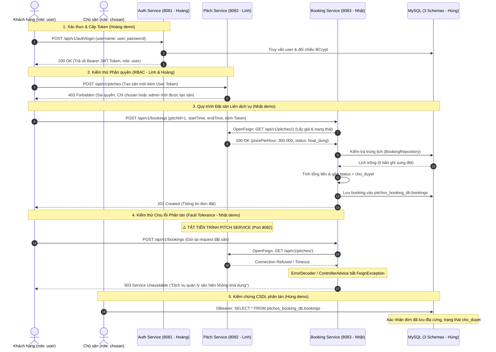

# Kế hoạch Phối hợp, Kiểm thử & Kịch bản Demo 5 Bước (PitchOS)

Tài liệu này tổng hợp quy trình phối hợp nhóm, sơ đồ tương tác Sequence Diagram và kịch bản diễn tập Demo hội đồng chi tiết từ 10–15 phút cho 4 thành viên: **Hoàng (Nhóm trưởng), Linh, Hùng, Nhật**.

---

## 🧭 1. Sơ đồ Tuần tự Chi tiết (Sequence Diagram)



---

## 🎬 2. Kịch bản Diễn tập Demo Hội đồng (10–15 Phút)

Cả nhóm thực hiện tuần tự 5 bước theo đúng phân công:

### Bước 1: Khởi động hệ thống & CSDL (Hùng chủ trì)
- **Hành động:**
  - Khởi chạy Docker Compose hoặc MySQL Server tạo 3 CSDL độc lập: `pitchos_user_db`, `pitchos_pitch_db`, `pitchos_booking_db`.
  - Mở DBeaver / MySQL Workbench chỉ rõ 3 schema dữ liệu tách biệt hoàn toàn, không có Foreign Key vật lý nào giữa các database.
  - Bật cả 3 dịch vụ Spring Boot trên 3 cổng: **8081** (Auth), **8082** (Pitch), **8083** (Booking).

### Bước 2: Demo Xác thực & Cấp Token JWT (Hoàng chủ trì)
- **Hành động trên Postman:**
  1. Gửi request `POST http://localhost:8081/api/v1/auth/login` với tài khoản `user` $\rightarrow$ Nhận mã `200 OK` kèm JWT token chứa role `user`.
  2. Gửi request đăng nhập với tài khoản `chusan` $\rightarrow$ Nhận mã `200 OK` kèm JWT token chứa role `chusan`.
  3. Copy token vào **jwt.io** để chỉ cho giảng viên thấy cấu trúc 3 phần: **Header**, **Payload** (chứa `sub`, `role: chusan`), và **Signature**.

### Bước 3: Demo RESTful API, Validation 400 & Phân quyền 403 (Linh & Hoàng phối hợp)
- **Hành động trên Swagger UI / Postman (Port 8082):**
  1. Mở Swagger UI tại `http://localhost:8082/swagger-ui.html`.
  2. **Test 401:** Gọi `POST /api/v1/pitches` mà không gửi Header Authorization $\rightarrow$ Nhận mã **401 Unauthorized**.
  3. **Test 403:** Gửi token `user` để gọi `POST /api/v1/pitches` $\rightarrow$ Nhận mã **403 Forbidden**.
  4. **Test 400 (Validation):** Gửi token `chusan` nhưng để dữ liệu sai quy cách (tên sân rỗng, đơn giá âm `-100000`, địa chỉ rỗng) $\rightarrow$ Nhận mã **400 Bad Request** với chi tiết lỗi rõ ràng.
  5. **Test 201 (Thành công):** Gửi dữ liệu sân đúng quy chuẩn (kèm địa chỉ, link ảnh, Google Map) với token `chusan` $\rightarrow$ Nhận mã **201 Created**.

### Bước 4: Demo Giao tiếp liên dịch vụ & Bắt lỗi phân tán 503 (Nhật chủ trì)
- **Hành động trên Postman (Port 8083):**
  1. Gửi `POST /api/v1/bookings` đặt sân bằng token `user`.
  2. Booking Service gọi FeignClient sang Pitch Service (8082) lấy giá và tính tổng tiền thành công, gán trạng thái `cho_duyet` $\rightarrow$ Nhận mã **201 Created**.
  3. **Kịch bản phân tán quan trọng:** **Dừng (Stop/Kill) tiến trình Pitch Service (Port 8082)**.
  4. Gửi lại request đặt sân đó vào Booking Service (Port 8083).
  5. **Kết quả kỳ vọng:** Booking Service không bị sập hay báo lỗi 500, mà `GlobalExceptionHandler` bắt được lỗi kết nối và trả về chuẩn xác mã **503 Service Unavailable**.

### Bước 5: Kiểm chứng CSDL ghi đĩa & Tính toàn vẹn (Hùng chủ trì)
- **Hành động trên DBeaver:**
  1. Chạy câu lệnh SQL:
     ```sql
     SELECT * FROM pitchos_booking_db.bookings ORDER BY id DESC LIMIT 1;
     ```
  2. Chỉ rõ bản ghi vừa tạo ở Bước 4 đã ghi xuống đĩa thành công:
     - Trạng thái: `cho_duyet`.
     - `pitch_id`: Lưu ID logic dạng số nguyên, không cần JOIN bảng ngoài.
     - `total_price`: Được tính đúng theo công thức giờ thuê * đơn giá lấy từ Pitch Service.
  3. Khẳng định 3 CSDL độc lập, chứng minh hoàn thành trọn vẹn mô hình **Database-per-Service**.

---

## 📋 3. Bảng Phân công Soạn Báo cáo Chuẩn theo Đề bài

- **Chương 1 (Linh):** Mô tả bài toán, kiến trúc tổng quan hệ thống SOA, phân rã dịch vụ, danh sách và đặc tả API Pitch Service.
- **Chương 2 (Nhật):** Thiết kế API Booking Service, giao tiếp liên dịch vụ qua OpenFeign, Sequence Diagram và cơ chế chịu lỗi phân tán (Cascading Failure, 503).
- **Chương 3 (Hùng):** Quản trị dữ liệu phân tán, nguyên tắc Database-per-service, lược đồ CSDL/ERD từng service, tầng Entity & Repository JPA, giải thuật chống trùng lịch.
- **Chương 4 (Hoàng):** Kiến trúc xác thực & phân quyền, cấu trúc JWT 3 phần, cơ chế RBAC (`admin`, `chusan`, `user`), bộ lọc bảo mật, xử lý 401/403.
- **Chương 5 (Hoàng chủ trì & Cả nhóm):** Bảng tổng hợp các ca kiểm thử (Test Cases), ảnh chụp kết quả thực tế qua Postman/Swagger và phần tự đánh giá kết quả đạt được.
