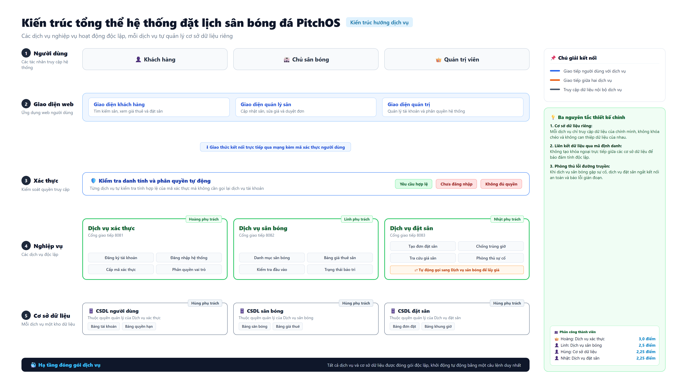
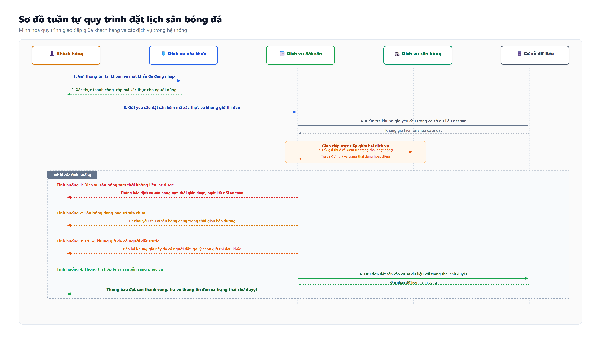

# BÁO CÁO MÔ HÌNH KIẾN TRÚC PITCHOS

File trình chiếu PowerPoint đã được cập nhật tại hai vị trí:
- Trong thư mục dự án: [docs/PitchOS-mo-hinh-kien-truc.pptx](file:///c:/Users/viduc/Downloads/PTPM/docs/PitchOS-mo-hinh-kien-truc.pptx)
- Trong thư mục tải về cá nhân: [PitchOS-mo-hinh-kien-truc.pptx](file:///c:/Users/viduc/Downloads/PitchOS-mo-hinh-kien-truc.pptx)

---

## 1. SƠ ĐỒ KIẾN TRÚC TỔNG THỂ

### Các tầng kiến trúc chính:
1. Tầng người dùng:
   - Khách hàng: Tra cứu sân bóng, xem bảng giá và tạo yêu cầu đặt sân
   - Chủ sân bóng: Quản lý thông tin sân, cập nhật giá thuê và duyệt đơn đặt
   - Quản trị viên: Quản lý tài khoản, phân quyền và giám sát hệ thống
2. Tầng giao diện web:
   - Ứng dụng web dành cho người dùng, kết nối trực tiếp với các dịch vụ
   - Tự động đính kèm mã xác thực người dùng trong mỗi yêu cầu gửi đi
3. Tầng xác thực và phân quyền:
   - Từng dịch vụ tự thẩm định tính hợp lệ của mã xác thực
   - Tự động chặn các yêu cầu chưa đăng nhập hoặc không đủ quyền hạn
4. Tầng nghiệp vụ:
   - Dịch vụ xác thực: Cổng 8081, Hoàng phụ trách 3,0 điểm
   - Dịch vụ sân bóng: Cổng 8082, Linh phụ trách 2,5 điểm
   - Dịch vụ đặt sân: Cổng 8083, Nhật phụ trách 2,25 điểm
5. Tầng cơ sở dữ liệu:
   - Hùng phụ trách 2,25 điểm
   - Ba cơ sở dữ liệu độc lập: CSDL người dùng, CSDL sân bóng, CSDL đặt sân
   - Không tạo khóa ngoại trực tiếp, liên kết dữ liệu hoàn toàn qua mã số định danh
6. Hạ tầng đóng gói:
   - Tất cả dịch vụ và cơ sở dữ liệu được đóng gói độc lập, khởi động bằng một câu lệnh

---

## 2. SƠ ĐỒ TUẦN TỰ NGHIỆP VỤ ĐẶT SÂN

### Các bước trong quy trình:
1. Khách hàng gửi thông tin tài khoản và mật khẩu để đăng nhập hệ thống
2. Dịch vụ xác thực kiểm tra hợp lệ và cấp mã xác thực cho người dùng
3. Khách hàng gửi yêu cầu đặt sân kèm mã xác thực và khung giờ thi đấu
4. Dịch vụ đặt sân kiểm tra trong cơ sở dữ liệu xem khung giờ đã có người đặt chưa
5. Dịch vụ đặt sân gọi trực tiếp sang Dịch vụ sân bóng để lấy giá thuê và kiểm tra trạng thái hoạt động
6. Xử lý các tình huống:
   - Dịch vụ sân bóng tạm thời không liên lạc được: Báo lỗi dịch vụ gián đoạn, ngắt kết nối an toàn
   - Sân bóng đang bảo trì sửa chữa: Từ chối yêu cầu do sân đang bảo dưỡng
   - Trùng khung giờ đã có người đặt: Báo lỗi khung giờ bị trùng và gợi ý chọn giờ khác
   - Thông tin hợp lệ: Lưu đơn vào cơ sở dữ liệu ở trạng thái chờ duyệt và thông báo đặt sân thành công

---

## 3. DANH MỤC 12 SLIDE BẢO VỆ ĐỒ ÁN

| Số slide | Tiêu đề slide | Nội dung tóm tắt | Thành viên phụ trách |
| :---: | :--- | :--- | :---: |
| 01 | Bìa báo cáo kiến trúc | Giới thiệu tên hệ thống, kiến trúc và danh sách bốn thành viên | Cả nhóm |
| 02 | Tác nhân và chức năng | Phân chia ba vai trò khách hàng, chủ sân và quản trị viên | Hoàng |
| 03 | Mô hình kiến trúc tổng thể | Sơ đồ năm tầng trực quan | Cả nhóm |
| 04 | Vì sao chia thành các dịch vụ độc lập | Luận giải lý do phân rã hệ thống và ưu điểm cơ sở dữ liệu riêng | Linh |
| 05 | Các kiểu giao tiếp trong hệ thống | Giao tiếp người dùng, giao tiếp giữa các dịch vụ và truy cập dữ liệu | Nhật |
| 06 | Quy trình nghiệp vụ đặt sân | Luồng sáu bước từ đăng nhập đến khi lưu đơn hoàn tất | Nhật |
| 07 | Quản lý trạng thái thực thể | Vòng đời đơn đặt sân và trạng thái của sân bóng | Hùng |
| 08 | Kỹ thuật chống đặt trùng khung giờ | Kiểm tra tầng dữ liệu và xử lý hai yêu cầu gửi cùng lúc | Hùng |
| 09 | Xử lý lỗi và phòng thủ sự cố | Các nhóm lỗi thường gặp và giải pháp ngắt kết nối an toàn | Linh |
| 10 | Bảng phân công nhiệm vụ và barem điểm | Bảng chi tiết điểm số của từng thành viên, tổng mười điểm | Hoàng |
| 11 | Kịch bản kiểm thử và trình diễn thực tế | Năm bước trình diễn trực tiếp theo đúng yêu cầu đề bài | Cả nhóm |
| 12 | Phụ lục: Sơ đồ tuần tự | Sơ đồ tuần tự quy trình đặt sân phục vụ giải thích chi tiết | Nhật |
