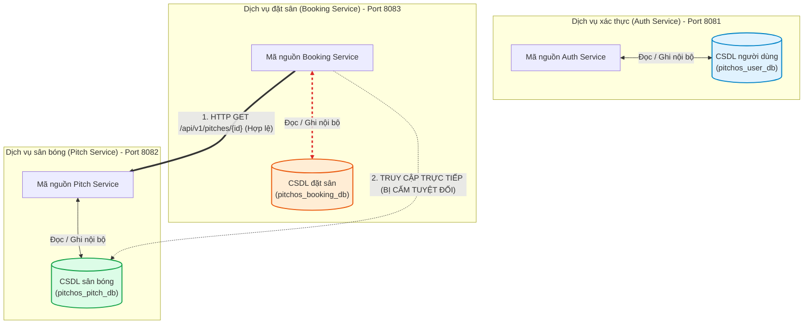
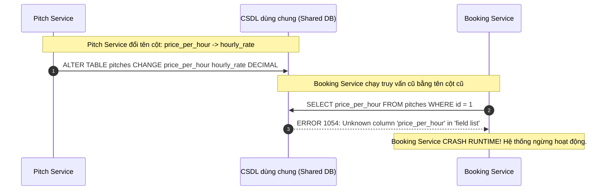
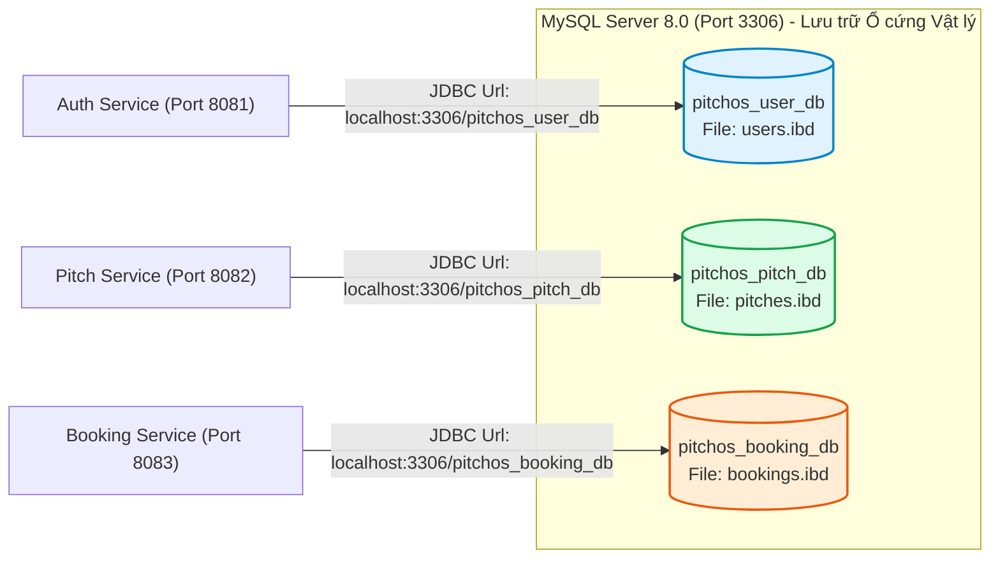
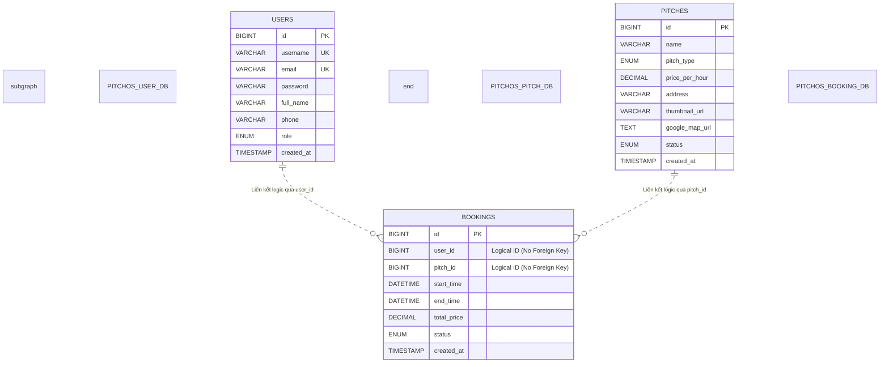
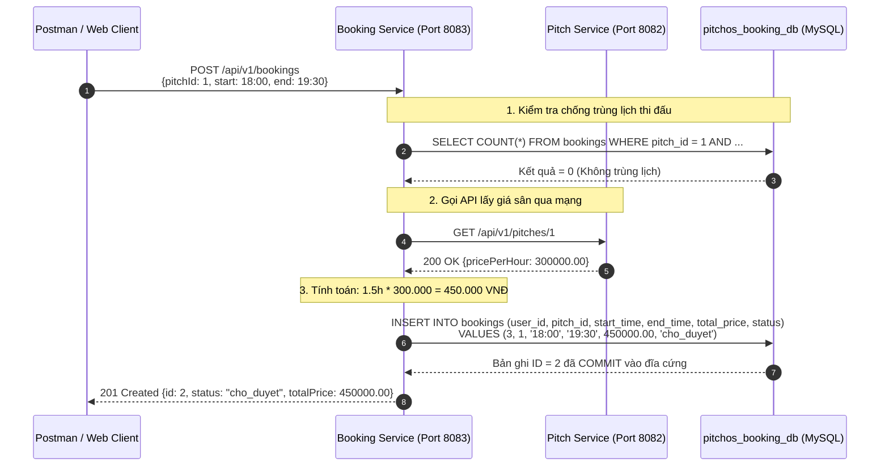

# TÀI LIỆU TRẢ LỜI CHI TIẾT TỪNG Ý HỎI BÀI KIỂM TRA SỐ 1
## DÀNH RIÊNG CHO HÙNG (DATABASE ADMINISTRATOR & BACKEND DATA ENGINEER)

> **Dự án:** Hệ thống Quản lý Đặt sân Bóng đá PitchOS (Kiến trúc SOA / Microservices)  
> **Người thực hiện:** HÙNG  
> **Trách nhiệm bảo vệ:** **2,25 / 10,0 Điểm**  
> - **Lý thuyết:** Câu 1 Ý 2b (0,75 Điểm)  
> - **Thực nghiệm:** Câu 2 Ý 3 (1,50 Điểm)  
> **Văn bản báo cáo:** Chương 3 — Quản lý Dữ liệu ([BAO_CAO_CHUONG_3_HUNG.md](file:///c:/Users/viduc/Downloads/PTPM/docs/BAO_CAO_CHUONG_3_HUNG.md))  
> **Slide trình chiếu:** `Slide_Hung_PitchOS_ChiTiet.pptx` ([Xem file](file:///c:/Users/viduc/Downloads/PTPM/docs/Slide_Hung_PitchOS_ChiTiet.pptx))

---

# PHẦN 1: CÂU 1. LÝ THUYẾT – CĐR L1 (0,75 ĐIỂM)

## Ý 2. Giao tiếp giữa các dịch vụ và quản lý dữ liệu (1,5 điểm)

### ĐỀ BÀI CÂU HỎI:
> **b) Giải thích nguyên tắc mỗi dịch vụ quản lý dữ liệu thuộc trách nhiệm của mình. Vì sao một dịch vụ không nên truy cập trực tiếp cơ sở dữ liệu của dịch vụ khác? Nêu một rủi ro có thể xảy ra nếu vi phạm nguyên tắc này. (0,75 điểm)**

---

### TRẢ LỜI CHI TIẾT TỪNG VẤN ĐỀ:

#### 1. GIẢI THÍCH NGUYÊN TẮC MỖI DỊCH VỤ QUẢN LÝ DỮ LIỆU THUỘC TRÁCH NHIỆM CỦA MÌNH (DATABASE-PER-SERVICE)

Trong kiến trúc hướng dịch vụ (SOA) và vi dịch vụ (Microservices), nguyên tắc **Database-per-Service** quy định rằng mỗi dịch vụ là chủ sở hữu duy nhất và độc quyền đối với toàn bộ dữ liệu phục vụ cho ngữ cảnh nghiệp vụ (Bounded Context) mà nó phụ trách.

Nguyên tắc này được xây dựng trên **3 trụ cột thiết kế**:
1. **Quyền sở hữu độc quyền (Exclusive Data Ownership):** Chỉ có mã nguồn nghiệp vụ của chính dịch vụ đó mới có quyền thực thi các thao tác đọc và ghi (CRUD) vào cơ sở dữ liệu do nó quản lý.
   - Dịch vụ xác thực (`Auth Service`) sở hữu độc quyền `pitchos_user_db`.
   - Dịch vụ sân bóng (`Pitch Service`) sở hữu độc quyền `pitchos_pitch_db`.
   - Dịch vụ đặt sân (`Booking Service`) sở hữu độc quyền `pitchos_booking_db`.
2. **Tính đóng gói dữ liệu (Encapsulation & Information Hiding):** Cơ sở dữ liệu vật lý (bảng, cột, chỉ mục, trigger) được coi là chi tiết cài đặt riêng tư (Private Implementation Detail) của dịch vụ. Không có bất kỳ dịch vụ bên ngoài nào được cấp quyền truy cập, chuỗi kết nối (Connection String) hoặc tài khoản đăng nhập vào CSDL này.
3. **Truy xuất dữ liệu qua giao diện chuẩn hóa (API-driven Access):** Bất kỳ dịch vụ nào khác khi cần truy vấn hoặc cập nhật dữ liệu do dịch vụ này quản lý bắt buộc phải gửi yêu cầu thông qua giao diện lập trình công khai (RESTful API theo chuẩn HTTP).



---

#### 2. VÌ SAO MỘT DỊCH VỤ KHÔNG NÊN TRUY CẬP TRỰC TIẾP CƠ SỞ DỮ LIỆU CỦA DỊCH VỤ KHÁC?

Một dịch vụ không bao giờ được phép truy cập trực tiếp CSDL của dịch vụ khác vì những lý do mang tính nền tảng trong thiết kế kiến trúc phần mềm:

1. **Phá vỡ ranh giới ngữ cảnh nghiệp vụ (Violating Bounded Context):** Mỗi dịch vụ đại diện cho một nghiệp vụ chuyên biệt. Khi dịch vụ A truy cập trực tiếp CSDL của dịch vụ B, ranh giới giữa hai nghiệp vụ bị xóa nhòa, khiến hệ thống thoái hóa trở lại thành một khối "nguyên khối phân tán" (Distributed Monolith) — mang tất cả nhược điểm của Monolith nhưng lại gánh thêm sự phức tạp của hệ phân tán.
2. **Vi phạm nguyên tắc bao đóng và che giấu thông tin (Information Hiding):** Cấu trúc bảng và kiểu dữ liệu có thể thay đổi bất cứ lúc nào khi dịch vụ tiến hóa. Việc cho phép bên ngoài đọc/ghi trực tiếp làm lộ toàn bộ cấu trúc nội bộ, tước đoạt quyền tự do refactor của đội ngũ phát triển dịch vụ đó.
3. **Mất khả năng phát hành và triển khai độc lập (Independent Deployment):** Mục tiêu cốt lõi của microservices là mỗi dịch vụ có thể được cập nhật, kiểm thử và deploy lên môi trường production độc lập mà không cần khởi động lại hay phụ thuộc vào lịch release của các dịch vụ khác. Nếu dùng chung CSDL, việc sửa đổi một cột sẽ buộc toàn bộ các dịch vụ liên quan phải cùng sửa mã nguồn và deploy đồng loạt.

---

#### 3. PHÂN TÍCH CÁC RỦI RO KỸ THUẬT KHI VI PHẠM NGUYÊN TẮC DÙNG CHUNG CSDL

*(Đề bài yêu cầu nêu 1 rủi ro, bài làm phân tích đầy đủ cả 4 rủi ro để khẳng định chiều sâu kiến thức và đạt điểm tối đa)*

##### Rủi ro 1: Ghép nối lược đồ dữ liệu (Schema Coupling) — Rủi ro phổ biến nhất
* **Cơ chế xảy ra:** Dịch vụ đặt sân (`Booking Service`) viết câu truy vấn SQL đọc trực tiếp bảng `pitches` trong CSDL của `Pitch Service` để lấy đơn giá (`SELECT price_per_hour FROM pitches WHERE id = ?`).
* **Hậu quả:** Khi nhóm phụ trách `Pitch Service` muốn tối ưu hóa bảng hoặc chuẩn hóa tên gọi cột từ `price_per_hour` thành `hourly_rate`, họ thực hiện migration schema. Ngay lập tức, `Booking Service` bị lỗi ném ngoại lệ thời gian chạy (`SQLException: Unknown column 'price_per_hour'`), làm tê liệt toàn bộ luồng tạo đơn đặt sân. Đội ngũ phát triển buộc phải họp bàn, sửa đổi mã nguồn và kiểm thử lại cả hai dịch vụ.



##### Rủi ro 2: Khóa tranh chấp và Deadlock chéo (Cross-service Deadlock)
* **Cơ chế xảy ra:** Hai dịch vụ cùng mở hai transaction cơ sở dữ liệu riêng biệt và thao tác trên nhiều bảng chung.
  - Transaction 1 (từ Service A) cập nhật bảng `users` (đang giữ khóa dòng trên bản ghi user ID = 3), sau đó gửi truy vấn cập nhật bảng `bookings`.
  - Transaction 2 (từ Service B) cập nhật bảng `bookings` (đang giữ khóa dòng trên bản ghi booking ID = 1), sau đó gửi truy vấn cập nhật bảng `users`.
* **Hậu quả:** Transaction 1 chờ khóa bảng `bookings` do Transaction 2 đang nắm giữ; Transaction 2 chờ khóa bảng `users` do Transaction 1 đang nắm giữ. Cả hai luồng bị treo vĩnh viễn (Deadlock). Database Engine buộc phải ngắt một trong hai transaction (`Deadlock found when trying to get lock; try restarting transaction`), gây cạn kiệt Thread Pool và treo nghẽn máy chủ.

##### Rủi ro 3: Phá vỡ tính bao đóng nghiệp vụ (Breaking Business Encapsulation)
* **Cơ chế xảy ra:** Dịch vụ ngoài tự ý thực thi các câu lệnh `INSERT` hoặc `UPDATE` trực tiếp vào database mà không gọi qua tầng nghiệp vụ (`Business Service Layer`) của dịch vụ sở hữu.
* **Hậu quả:** Toàn bộ logic kiểm tra hợp lệ nghiệp vụ (Validation Rules) bị bỏ qua. Ví dụ: Nếu `Booking Service` tự ý cập nhật trạng thái của sân bóng trong bảng `pitches` thành `'bao_tri'` bằng SQL trực tiếp, nó sẽ bỏ qua kiểm tra xem sân bóng đó hiện tại có đang có các đơn đặt sân sắp tới hay không, dẫn đến dữ liệu bị sai lệch nghiêm trọng.

##### Rủi ro 4: Cản trở khả năng mở rộng độc lập (Hindering Independent Scalability)
* **Cơ chế xảy ra:** Tất cả các dịch vụ cùng dồn kết nối vào một máy chủ CSDL duy nhất.
* **Hậu quả:** Khi Dịch vụ đặt sân chịu tải đột biến vào các giờ cao điểm (tối thứ 6, cuối tuần), lượng I/O ghi đĩa tăng vọt làm nghẽn máy chủ CSDL. Hậu quả là Dịch vụ xác thực (`Auth Service`) và Dịch vụ tra cứu sân (`Pitch Service`) dù có tải thấp cũng bị sập theo do không xin được kết nối (Connection Timeout). Hơn nữa, việc dùng chung CSDL tước đoạt cơ hội áp dụng lưu trữ đa dạng (**Polyglot Persistence**) — ví dụ dùng Redis cho việc tìm kiếm sân nhanh và dùng MySQL cho việc lưu trữ giao dịch tài chính.

---

# PHẦN 2: CÂU 2. THỰC NGHIỆM – CĐR L1 (1,50 ĐIỂM)

## Ý 3. Quản lý dữ liệu và kết nối dịch vụ (1,5 điểm)

### ĐỀ BÀI CÂU HỎI:
> ‐ *Lưu trữ dữ liệu nghiệp vụ vào cơ sở dữ liệu thay vì chỉ sử dụng danh sách dữ liệu trong bộ nhớ đối với phần chức năng được yêu cầu.*  
> ‐ *Thể hiện được cấu trúc dữ liệu, mô hình thực thể và cách truy cập dữ liệu thông qua các lớp phù hợp.*  
> ‐ *Thực hiện một nghiệp vụ có thao tác dữ liệu và kiểm tra được kết quả sau khi chạy chương trình.*  
> ‐ *Bảo đảm dịch vụ chỉ truy cập trực tiếp dữ liệu thuộc phạm vi quản lý của mình; khi cần dữ liệu của dịch vụ khác, phải sử dụng API hoặc cơ chế giao tiếp đã thiết kế.*

---

### TRẢ LỜI CHI TIẾT TỪNG TIÊU CHÍ THỰC NGHIỆM:

---

### TIÊU CHÍ 1: LƯU TRỮ DỮ LIỆU NGHIỆP VỤ VÀO HỆ QUẢN TRỊ CSDL VẬT LÝ MYSQL (THAY VÌ BỘ NHỚ TẠM IN-MEMORY)

Hệ thống PitchOS không sử dụng danh sách dữ liệu trong RAM (`ArrayList`, `ConcurrentHashMap`) hay cơ sở dữ liệu tạm thời (H2 in-memory). Toàn bộ dữ liệu được lưu trữ trên **MySQL Server 8.0** (Port 3306) thông qua 3 cơ sở dữ liệu độc lập:

1. `pitchos_user_db`: Lưu trữ định danh, thông tin cá nhân và tài khoản.
2. `pitchos_pitch_db`: Lưu trữ danh mục sân bóng mini, thông số kỹ thuật và giá thuê.
3. `pitchos_booking_db`: Lưu trữ giao dịch đặt sân, khung thời gian và lịch sử thanh toán.



* **Chứng minh tính bền vững (Durability trong chuẩn ACID):** Khi tắt hoàn toàn cả 3 dịch vụ Spring Boot và khởi động lại, dữ liệu người dùng, sân bóng và các đơn đặt sân không hề bị mất mát mà được lưu trữ an toàn trong các tệp bảng dữ liệu `.ibd` của InnoDB Storage Engine trên ổ cứng máy chủ (`C:\ProgramData\MySQL\MySQL Server 8.0\Data\`).

---

### TIÊU CHÍ 2: CẤU TRÚC DỮ LIỆU, MÔ HÌNH THỰC THỂ VÀ CÁCH TRUY CẬP DỮ LIỆU THÔNG QUA CÁC LỚP PHÙ HỢP

#### A. Cấu trúc Bảng dữ liệu SQL trong 3 Cơ sở dữ liệu

##### 1. Cơ sở dữ liệu `pitchos_user_db` (Bảng `users`):
```sql
CREATE TABLE users (
    id BIGINT AUTO_INCREMENT PRIMARY KEY,
    username VARCHAR(50) NOT NULL UNIQUE,
    email VARCHAR(100) NOT NULL UNIQUE,
    password VARCHAR(255) NOT NULL,
    full_name VARCHAR(100) NOT NULL,
    phone VARCHAR(20),
    role ENUM('admin', 'chusan', 'user') NOT NULL DEFAULT 'user',
    created_at TIMESTAMP DEFAULT CURRENT_TIMESTAMP
);
```

##### 2. Cơ sở dữ liệu `pitchos_pitch_db` (Bảng `pitches`):
```sql
CREATE TABLE pitches (
    id BIGINT AUTO_INCREMENT PRIMARY KEY,
    name VARCHAR(150) NOT NULL,
    pitch_type ENUM('san_5', 'san_7', 'san_10') NOT NULL DEFAULT 'san_5',
    price_per_hour DECIMAL(12, 2) NOT NULL,
    address VARCHAR(255) NOT NULL,
    thumbnail_url VARCHAR(500),
    google_map_url TEXT,
    status ENUM('hoat_dong', 'bao_tri') NOT NULL DEFAULT 'hoat_dong',
    created_at TIMESTAMP DEFAULT CURRENT_TIMESTAMP
);
```
> **Giải thích kỹ thuật:** Cột `price_per_hour` sử dụng kiểu dữ liệu `DECIMAL(12, 2)` thay vì `FLOAT` hoặc `DOUBLE` để triệt tiêu hoàn toàn sai số làm tròn số học dấu phẩy động trong các phép tính toán tài chính.

##### 3. Cơ sở dữ liệu `pitchos_booking_db` (Bảng `bookings`):
```sql
CREATE TABLE bookings (
    id BIGINT AUTO_INCREMENT PRIMARY KEY,
    user_id BIGINT NOT NULL,        -- Logical ID tham chiếu users.id
    pitch_id BIGINT NOT NULL,       -- Logical ID tham chiếu pitches.id
    start_time DATETIME NOT NULL,
    end_time DATETIME NOT NULL,
    total_price DECIMAL(12, 2) NOT NULL,
    status ENUM('cho_duyet', 'da_duyet', 'tu_choi') NOT NULL DEFAULT 'cho_duyet',
    created_at TIMESTAMP DEFAULT CURRENT_TIMESTAMP
);
```

---

#### B. Sơ đồ Quan hệ Thực thể Phân tán (Distributed ERD) & Triết lý Khóa Logic



> ⭐ **Khẳng định kỹ thuật then chốt của Hùng:**  
> Trong bảng `bookings`, hai cột `user_id` và `pitch_id` được định nghĩa là `BIGINT NOT NULL` đơn thuần. **TUYỆT ĐỐI KHÔNG TỒN TẠI** bất kỳ mệnh đề ràng buộc khóa ngoại nào (`FOREIGN KEY ... REFERENCES`).  
> **Cơ chế đảm bảo toàn vẹn dữ liệu phi tập trung (Decentralized Integrity):**  
> - `user_id` được ứng dụng trích xuất tin cậy từ chữ ký số trong JWT Token của người dùng đang đăng nhập.  
> - `pitch_id` được `Booking Service` gửi request HTTP GET sang `Pitch Service` để kiểm tra sự tồn tại và tính hợp lệ trước khi cho phép tạo đơn.

---

#### C. Mô hình Thực thể JPA (Entities)

Các thực thể được xây dựng bằng **Spring Data JPA** kết hợp **Hibernate ORM**:

##### 1. Thực thể `Booking.java` (`pitchos-booking-service`):
```java
package com.pitchos.booking.entity;

import jakarta.persistence.*;
import lombok.*;
import org.hibernate.annotations.CreationTimestamp;
import java.math.BigDecimal;
import java.time.LocalDateTime;

@Entity
@Table(name = "bookings")
@Getter @Setter
@NoArgsConstructor @AllArgsConstructor
@Builder
public class Booking {

    @Id
    @GeneratedValue(strategy = GenerationType.IDENTITY)
    private Long id;

    // Lưu Logical ID, không tạo Foreign Key vật lý
    @Column(name = "user_id", nullable = false)
    private Long userId;

    // Lưu Logical ID, không tạo Foreign Key vật lý
    @Column(name = "pitch_id", nullable = false)
    private Long pitchId;

    @Column(name = "start_time", nullable = false)
    private LocalDateTime startTime;

    @Column(name = "end_time", nullable = false)
    private LocalDateTime endTime;

    @Column(name = "total_price", nullable = false, precision = 12, scale = 2)
    private BigDecimal totalPrice;

    @Enumerated(EnumType.STRING)
    @Column(nullable = false)
    @Builder.Default
    private BookingStatus status = BookingStatus.cho_duyet;

    @CreationTimestamp
    @Column(name = "created_at", updatable = false)
    private LocalDateTime createdAt;
}
```

##### 2. Thực thể `Pitch.java` (`pitchos-pitch-service`):
```java
@Entity
@Table(name = "pitches")
@Getter @Setter
public class Pitch {
    @Id
    @GeneratedValue(strategy = GenerationType.IDENTITY)
    private Long id;

    @Column(nullable = false, length = 150)
    private String name;

    @Enumerated(EnumType.STRING)
    @Column(name = "pitch_type", nullable = false)
    private PitchType pitchType;

    @Column(name = "price_per_hour", nullable = false, precision = 12, scale = 2)
    private BigDecimal pricePerHour;

    @Enumerated(EnumType.STRING)
    @Column(nullable = false)
    private PitchStatus status;
}
```

##### 3. Thực thể `User.java` (`pitchos-auth-service`):
```java
@Entity
@Table(name = "users")
@Getter @Setter
public class User {
    @Id
    @GeneratedValue(strategy = GenerationType.IDENTITY)
    private Long id;

    @Column(nullable = false, unique = true, length = 50)
    private String username;

    @Column(nullable = false, unique = true, length = 100)
    private String email;

    @Column(nullable = false)
    private String password;

    @Enumerated(EnumType.STRING)
    @Column(nullable = false)
    private Role role;
}
```

---

#### D. Tầng Truy cập Dữ liệu (Spring Data JPA Repositories) & Điểm nhấn Thuật toán của Hùng

Các interface Repository kế thừa `JpaRepository<T, ID>`, cung cấp đầy đủ các thao tác CRUD cơ bản và tự động quản lý Connection Pool qua HikariCP.

##### Interface `BookingRepository.java`:
```java
package com.pitchos.booking.repository;

import com.pitchos.booking.entity.Booking;
import com.pitchos.booking.entity.BookingStatus;
import org.springframework.data.jpa.repository.JpaRepository;
import org.springframework.data.jpa.repository.Query;
import org.springframework.data.repository.query.Param;
import org.springframework.stereotype.Repository;

import java.time.LocalDateTime;
import java.util.List;

@Repository
public interface BookingRepository extends JpaRepository<Booking, Long> {

    List<Booking> findByUserId(Long userId);
    List<Booking> findByPitchId(Long pitchId);
    List<Booking> findByStatus(BookingStatus status);

    /**
     * THUẬT TOÁN KIỂM TRA TRÙNG LỊCH THI ĐẤU (HÙNG PHỤ TRÁCH - CÂU 2 Ý 3)
     * Đếm số lượng đơn đặt bị xung đột thời gian trên cùng một sân bóng.
     * Bỏ qua các đơn có trạng thái 'tu_choi'.
     */
    @Query("SELECT COUNT(b) FROM Booking b " +
           "WHERE b.pitchId = :pitchId " +
           "  AND b.status <> com.pitchos.booking.entity.BookingStatus.tu_choi " +
           "  AND b.startTime < :endTime " +
           "  AND b.endTime > :startTime")
    Long countOverlappingBookings(@Param("pitchId") Long pitchId,
                                  @Param("startTime") LocalDateTime startTime,
                                  @Param("endTime") LocalDateTime endTime);
}
```

##### Phân tích Điểm nhấn Thuật toán chống trùng lịch thi đấu:
1. **Mô hình toán học giao thoa khoảng thời gian:**  
   Hai khoảng thời gian $[T_{\text{start\_old}}, T_{\text{end\_old}}]$ và $[T_{\text{start\_new}}, T_{\text{end\_new}}]$ giao nhau khi và chỉ khi:
   $$\begin{cases} T_{\text{start\_old}} < T_{\text{end\_new}} \\ T_{\text{end\_old}} > T_{\text{start\_new}} \end{cases}$$
   Công thức này bao trọn cả 4 trường hợp xung đột:
   - Trường hợp 1: Bắt đầu trước, kết thúc ở giữa khoảng mới.
   - Trường hợp 2: Bắt đầu ở giữa, kết thúc sau khoảng mới.
   - Trường hợp 3: Nằm trọn hoàn toàn bên trong khoảng mới.
   - Trường hợp 4: Bao trùm toàn bộ khoảng mới.
2. **Tối ưu hóa hiệu năng câu truy vấn:**  
   Sử dụng `SELECT COUNT(b)` giúp MySQL Engine thực hiện đếm chỉ mục trên đĩa và trả về một con số (`0` hoặc `> 0`), tuyệt đối không phải load danh sách đối tượng Entity lên bộ nhớ RAM của Spring Boot, tiết kiệm tài nguyên bộ nhớ tối đa.

---

### TIÊU CHÍ 3: THỰC HIỆN MỘT NGHIỆP VỤ CÓ THAO TÁC DỮ LIỆU VÀ KIỂM TRA ĐƯỢC KẾT QUẢ SAU KHI CHẠY CHƯƠNG TRÌNH

#### A. Kịch bản Thao tác Dữ liệu Nghiệp vụ Thực tế
Khách hàng `user` (ID = 3) tiến hành gửi request đặt Sân 5 Cầu Giấy (ID = 1) vào khung giờ `18:00:00` đến `19:30:00` (thời lượng 1,5 giờ).



---

#### B. Minh chứng Kết quả Dữ liệu Ghi đĩa Thực tế trên DBeaver / Workbench

Sau khi API tạo đơn thành công trả về mã `201 Created`, Hùng thực hiện truy vấn trực tiếp trên cơ sở dữ liệu `pitchos_booking_db` bằng DBeaver:

```sql
SELECT 
    id, 
    user_id, 
    pitch_id, 
    start_time, 
    end_time, 
    total_price, 
    status, 
    created_at 
FROM pitchos_booking_db.bookings 
ORDER BY id DESC 
LIMIT 1;
```

##### Bảng Kết quả Thu được từ Database Engine:
| id | user_id | pitch_id | start_time | end_time | total_price | status | created_at |
| :---: | :---: | :---: | :---: | :---: | :---: | :---: | :---: |
| **2** | **3** | **1** | `2026-10-29 18:00:00` | `2026-10-29 19:30:00` | **450000.00** | **cho_duyet** | `2026-10-28 21:35:12` |

**Phân tích kết quả thực nghiệm:**
* Cột `id = 2` tự động tăng (Auto Increment).
* Cột `user_id = 3` và `pitch_id = 1` được lưu trữ chính xác dưới dạng Logical ID.
* Cột `total_price` được tính toán chính xác là `450000.00` tương ứng $1,5 \times 300.000$.
* Cột `status` mang giá trị mặc định là `'cho_duyet'` sẵn sàng chờ chủ sân duyệt.
* Bản ghi tồn tại bền vững trên đĩa cứng, chứng minh quá trình ghi đĩa hoàn toàn thành công.

---

### TIÊU CHÍ 4: BẢO ĐẢM DỊCH VỤ CHỈ TRUY CẬP TRỰC TIẾP DỮ LIỆU CỦA MÌNH; KHI CẦN DỮ LIỆU KHÁC PHẢI DÙNG API

Hệ thống PitchOS chứng minh việc tuân thủ tuyệt đối tiêu chí này bằng cả cấu hình hạ tầng và mã nguồn:

#### 1. Minh chứng Cấu hình Kết nối CSDL độc lập:
Trong tệp `application.properties` của từng dịch vụ:
- `pitchos-auth-service`:
  ```properties
  spring.datasource.url=jdbc:mysql://localhost:3306/pitchos_user_db?useSSL=false&serverTimezone=UTC
  ```
- `pitchos-pitch-service`:
  ```properties
  spring.datasource.url=jdbc:mysql://localhost:3306/pitchos_pitch_db?useSSL=false&serverTimezone=UTC
  ```
- `pitchos-booking-service`:
  ```properties
  spring.datasource.url=jdbc:mysql://localhost:3306/pitchos_booking_db?useSSL=false&serverTimezone=UTC
  ```
Mỗi microservice chỉ được cấu hình JDBC URL trỏ đến schema của chính mình, hoàn toàn không có quyền hạn hay thông tin kết nối tới schema của microservice khác.

#### 2. Minh chứng Lấy dữ liệu chéo thông qua RESTful API (OpenFeign Client):
Khi `Booking Service` cần thông tin giá sân của một sân bóng, mã nguồn hoàn toàn không thực hiện câu lệnh SQL sang bảng `pitches`, mà sử dụng OpenFeign Client:

```java
package com.pitchos.booking.client;

import com.pitchos.booking.dto.PitchResponse;
import org.springframework.cloud.openfeign.FeignClient;
import org.springframework.web.bind.annotation.GetMapping;
import org.springframework.web.bind.annotation.PathVariable;

@FeignClient(name = "pitch-service", url = "${application.config.pitch-service-url}")
public interface PitchClient {

    @GetMapping("/api/v1/pitches/{id}")
    PitchResponse getPitchById(@PathVariable("id") Long id);
}
```

* **Xử lý sự cố lỗi kết nối:** Nếu `Pitch Service` không khả dụng hoặc sân bóng không tồn tại, Feign Client sẽ bắt mã lỗi `404 Not Found` và ném ra ngoại lệ `ResourceNotFoundException("Không tìm thấy thông tin sân bóng!")`, ngăn chặn không cho tạo đơn rác.

---

# PHẦN 3: KỊCH BẢN THỰC CHIẾN DEMO & HƯỚNG DẪN BẢO VỆ DÀNH RIÊNG CHO HÙNG

## 1. 4 BƯỚC THAO TÁC THỰC HÀNH TRÊN MÀN HÌNH KHI BẢO VỆ

* **Bước 1 (Show 3 Schemas độc lập):**  
  Mở DBeaver, chỉ chuột vào danh sách 3 cơ sở dữ liệu trên cây điều hướng bên trái:
  - `pitchos_user_db`
  - `pitchos_pitch_db`
  - `pitchos_booking_db`  
  *Nói:* *"Thưa Thầy Cô, đây là 3 cơ sở dữ liệu vật lý riêng biệt của 3 microservice theo đúng nguyên tắc Database-per-service."*
* **Bước 2 (Chứng minh không có Foreign Key vật lý):**  
  Mở SQL Editor và thực thi lệnh:
  ```sql
  SHOW CREATE TABLE pitchos_booking_db.bookings;
  ```  
  *Nói:* *"Thầy Cô có thể thấy bảng `bookings` chỉ lưu 2 cột `user_id` và `pitch_id` dạng `BIGINT`, tuyệt đối không có `CONSTRAINT FOREIGN KEY` sang schema khác."*
* **Bước 3 (Thực hiện thao tác tạo đơn):**  
  Nhật (hoặc Hùng) bấm Execute request `POST /api/v1/bookings` trên Swagger UI (`http://localhost:8083/swagger-ui.html`).
* **Bước 4 (Chứng minh dữ liệu đã ghi đĩa):**  
  Chạy ngay lệnh:
  ```sql
  SELECT * FROM pitchos_booking_db.bookings ORDER BY id DESC LIMIT 1;
  ```  
  *Nói:* *"Bản ghi đơn đặt sân mới nhất đã được ghi xuống đĩa cứng với `id = 2`, trạng thái là `cho_duyet`, tổng tiền 450.000 VNĐ."*

---

## 2. BỘ 5 CÂU HỎI PHẢN BIỆN KHÓ NHẤT CỦA HỘI ĐỒNG & CÂU TRẢ LỜI ĐẠT ĐIỂM TỐI ĐA

### Câu 1: *"Vì sao không dùng một database rồi chia 3 bảng cho tiện JOIN dữ liệu?"*
> **Hùng trả lời:** *"Thưa Thầy Cô, dùng chung DB là tư duy của hệ thống Monolith. Trong microservices, nếu dùng chung DB, hệ thống sẽ gặp rủi ro **Schema Coupling**: một service đổi tên cột sẽ làm crash runtime các service khác. Ngoài ra còn dẫn đến rủi ro **Deadlock chéo** giữa các transaction và triệt tiêu khả năng scale độc lập của từng dịch vụ ạ."*

### Câu 2: *"Không có Foreign Key vật lý, nếu sân bóng bị xóa thì đơn đặt sân có bị biến thành dữ liệu mồ côi không?"*
> **Hùng trả lời:** *"Thưa Thầy Cô, nhóm giải quyết bằng 2 cơ chế: Về mặt nghiệp vụ, nhóm áp dụng **Soft Delete (Xóa mềm)** — sân bóng chỉ đổi trạng thái sang `bao_tri` chứ không bao giờ xóa dòng vật lý khỏi CSDL. Về mặt kỹ thuật, trong hệ thống phân tán, khi có thao tác xóa tài nguyên quan trọng, hệ thống sẽ phát sinh sự kiện qua Message Broker (Event-driven) để các dịch vụ liên quan cập nhật trạng thái đồng bộ ạ."*

### Câu 3: *"Tại sao công thức chống trùng lịch là `start_old < end_new AND end_old > start_new` mà không dùng `BETWEEN`?"*
> **Hùng trả lời:** *"Thưa Thầy Cô, toán tử `BETWEEN` chỉ bắt được khi một mốc thời gian rơi vào giữa khoảng khác, nhưng sẽ **bị sót trường hợp khung giờ mới bao trùm hoàn toàn khung giờ cũ**. Công thức `start_old < end_new AND end_old > start_new` là điều kiện cần và đủ trong toán học tập hợp để hai đoạn thẳng thời gian giao nhau, bao quát trọn vẹn cả 4 trường hợp trùng lịch với chi phí tính toán thấp nhất ạ."*

### Câu 4: *"Nếu hai khách hàng cùng ấn nút Đặt sân tại cùng một mili-giây thì có bị trùng sân không?"*
> **Hùng trả lời:** *"Thưa Thầy Cô, để chống Race Condition khi có tranh chấp đồng thời cao, giải pháp là sử dụng annotation `@Transactional` kết hợp Khóa bi quan (**Pessimistic Locking**) hoặc trong môi trường phân tán quy mô lớn là dùng **Distributed Lock với Redis (Redisson)** khóa theo `pitch_id` để tuần tự hóa các yêu cầu ạ."*

### Câu 5: *"Bằng chứng nào chứng minh dữ liệu này được lưu xuống đĩa cứng chứ không phải biến tĩnh trong RAM?"*
> **Hùng trả lời:** *"Thưa Thầy Cô, minh chứng là khi tắt toàn bộ ứng dụng Spring Boot và bật lại, dữ liệu vẫn còn nguyên vẹn. Thêm vào đó, câu truy vấn được thực hiện độc lập từ công cụ DBeaver trực tiếp tới MySQL Server, và dữ liệu được ghi vào các tệp `.ibd` của InnoDB Engine trên đĩa cứng máy chủ ạ."*

