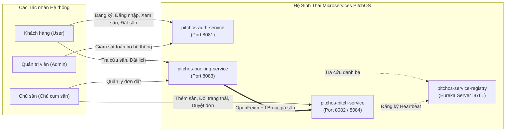

# PHẦN 1: GIỚI THIỆU HỆ THỐNG ĐẶT SÂN BÓNG TRỰC TUYẾN PITCHOS
**Học phần:** Phát triển phần mềm Hướng dịch vụ (SOA / Microservices 2026)  
**Sinh viên thực hiện:** LINH  
**Vai trò đề tài:** Kỹ sư Triển khai Container & Provider Pitch Service  
**Vùng mã nguồn sở hữu:** `pitchos-pitch-service/`, `docker-compose.yml`, `.env.example`

---

## 1.1. BỐI CẢNH VÀ BÀI TOÁN THỰC TẾ

Trong đời sống xã hội hiện đại, phong trào rèn luyện thể chất thông qua bộ môn bóng đá phong trào phát triển mạnh mẽ tại các đô thị lớn (Hà Nội, TP.HCM, Đà Nẵng). Nhu cầu thuê sân bóng đá cỏ nhân tạo mini (sân 5 người, sân 7 người, sân 10-11 người) của học sinh, sinh viên, người đi làm và các câu lạc bộ phong trào là rất lớn, đặc biệt vào các khung giờ vàng buổi chiều và tối (17h30 – 21h30).

Tuy nhiên, hầu hết các cụm sân bóng đá mini hiện nay vẫn áp dụng phương thức quản lý và khai thác mang nặng tính thủ công, dẫn đến nhiều bất cập nhức nhối:

```
┌────────────────────────────────────────────────────────────────────────┐
│ BẤT CẬP QUẢN LÝ THỦ CÔNG TRUYỀN THỐNG                                 │
├────────────────────────────────────┬───────────────────────────────────┤
│ Phía Khách hàng (Người thuê sân)   │ Phía Chủ cụm sân (Người quản lý)  │
├────────────────────────────────────┼───────────────────────────────────┤
│ • Mất thời gian gọi điện thoại,    │ • Ghi chép lịch thủ công ra sổ tay│
│   nhắn tin Zalo từng cụm sân.      │   hoặc file Excel rời rạc.        │
│ • Không nắm được đơn giá theo giờ, │ • Nguy cơ ghi trùng lịch          │
│   hình ảnh mặt sân, vị trí bản đồ. │   (Double Booking) trong giờ cao  │
│ • Khó đối soát khi có tranh chấp.  │   điểm gây xung đột giữa các đội. │
│ • Không nhận được xác nhận đặt sân │ • Khó quản lý lịch bảo trì cỏ,     │
│   minh bạch theo thời gian thực.   │   điều chỉnh giá và doanh thu.    │
└────────────────────────────────────┴───────────────────────────────────┘
```

Xuất phát từ thực tiễn trên, đề tài **Hệ thống đặt sân bóng đá mini trực tuyến PitchOS (Football Pitch Operating System)** được xây dựng nhằm mục tiêu chuyển đổi số toàn diện quy trình kết nối giữa các đội bóng và các cụm sân thể thao.

---

## 1.2. MỤC TIÊU HỆ THỐNG VÀ CÁC PHÂN HỆ CHỨC NĂNG

### 1.2.1. Mục tiêu cốt lõi của PitchOS
1. **Minh bạch hóa thông tin:** Số hóa toàn bộ danh mục sân bóng đá mini với đầy đủ thông số kỹ thuật (quy mô sân, loại mặt cỏ, địa chỉ bản đồ Google Maps, bảng giá niêm yết theo giờ và hình ảnh thực tế).
2. **Tự động hóa quy trình đặt sân:** Tiếp nhận yêu cầu đặt sân trực tuyến 24/7; tự động đối soát tránh trùng lặp khung giờ thi đấu; tính toán chính xác tổng tiền thuê dựa trên đơn giá thời gian thực từ dịch vụ cung cấp (Provider).
3. **Phân quyền và bảo mật nghiêm ngặt:** Quản lý truy cập dựa trên vai trò (Role-Based Access Control - RBAC) sử dụng chữ ký điện tử an toàn JSON Web Token (JWT).
4. **Kiến trúc hướng dịch vụ chịu lỗi và mở rộng cao:** Ứng dụng mô hình Microservices phân tán, cho phép từng dịch vụ nghiệp vụ (Xác thực, Quản lý sân, Đặt sân) và cơ sở dữ liệu được phát triển, mở rộng (Scale), và triển khai độc lập thông qua công nghệ Docker Container và Service Registry.



### 1.2.2. Chi tiết 3 phân hệ chức năng người dùng

#### A. Phân hệ Khách hàng (Vai trò: `user` - Khách thuê sân)
* **Xác thực tài khoản:** Đăng ký tài khoản mới bằng họ tên, email, số điện thoại; đăng nhập hệ thống để nhận Bearer JWT Token có thời hạn.
* **Tra cứu danh mục sân công khai:** Tìm kiếm sân bóng theo khu vực; lọc danh sách theo quy mô sân (`san_5`, `san_7`, `san_10`) và trạng thái (`hoat_dong`); xem thông tin chi tiết địa chỉ, đường dẫn Google Maps và đơn giá niêm yết.
* **Gửi yêu cầu đặt sân:** Chọn khung giờ đá bóng (thời gian bắt đầu, kết thúc); hệ thống tự động kiểm tra xem khung giờ đó đã có ai đặt chưa; tự động tính tổng tiền thuê và tạo đơn đặt ở trạng thái chờ phê duyệt (`cho_duyet`).
* **Quản lý lịch sử đặt sân:** Xem danh sách toàn bộ các đơn đặt sân cá nhân kèm trạng thái xử lý (`cho_duyet`, `da_duyet`, `tu_choi`).

#### B. Phân hệ Chủ sân (Vai trò: `chusan` - Quản lý cụm sân)
* **Khai báo sân bóng mới:** Nhập tên sân, quy mô, đơn giá theo giờ, địa chỉ chi tiết, liên kết hình ảnh và tọa độ bản đồ để mở bán trên hệ thống.
* **Điều phối trạng thái hoạt động của sân:** Chuyển đổi linh hoạt trạng thái giữa hoạt động (`hoat_dong`) và tạm dừng bảo dưỡng mặt cỏ/hệ thống chiếu sáng (`bao_tri`). Khi sân đang bảo trì, hệ thống tự động ngăn chặn mọi yêu cầu đặt mới.
* **Phê duyệt đơn đặt sân:** Tiếp nhận các đơn đặt sân gửi đến; phê duyệt đơn (`da_duyet`) hoặc từ chối đơn (`tu_choi`) kèm lý do rõ ràng.

#### C. Phân hệ Quản trị viên (Vai trò: `admin` - Hệ thống)
* Toàn quyền quản trị tài nguyên người dùng và danh mục sân bóng trên phạm vi toàn sàn.
* Giám sát tính sẵn sàng của hạ tầng thông qua Spring Boot Actuator và bảng điều khiển Eureka Service Registry.

---

## 1.3. BẢNG TỔNG HỢP CÔNG NGHỆ ÁP DỤNG TRONG TOÀN DỰ ÁN

Hệ thống PitchOS được xây dựng trên nền tảng công nghệ Java hiện đại, tích hợp các thành phần tiêu chuẩn công nghiệp phục vụ kiến trúc Microservices và Container hóa:

*Bảng 1.1: Bảng tổng hợp công nghệ sử dụng trong đề tài PitchOS*

| Phân tầng công nghệ | Tên công nghệ / Thư viện | Phiên bản | Vai trò & Mục đích sử dụng | Bổ sung mới ở KT2 |
|---|---|:---:|---|:---:|
| **Ngôn ngữ & Môi trường** | **Java Development Kit (JDK)** | OpenJDK 17 LTS | Môi trường lập trình tiêu chuẩn LTS, hỗ trợ Records, Pattern Matching, tối ưu hiệu năng GC | Không |
| **Framework nền tảng** | **Spring Boot** | 3.2.5 | Khung phát triển ứng dụng Java Microservices tự cấu hình (Auto-configuration), nhúng sẵn Tomcat Server | Không |
| **Giao tiếp Dịch vụ** | **Spring Cloud OpenFeign** | 2023.0.1 | Khai báo HTTP Client giao tiếp RESTful giữa Consumer (Booking) và Provider (Pitch) qua giao diện (Interface) | Có (Chuyển sang Service ID) |
| **Cân bằng tải Client-side** | **Spring Cloud LoadBalancer** | 2023.0.1 | Cân bằng tải phía Client không cần Gateway trung gian, phân phối request Round-Robin giữa các instance Provider | **Mới (KT2)** |
| **Quản lý Danh bạ Dịch vụ** | **Spring Cloud Netflix Eureka** | 2023.0.1 | Đóng vai trò Service Registry & Discovery, tự động phát hiện instance sống qua nhịp tim (Heartbeat) | **Mới (KT2)** |
| **Giám sát & Sức khỏe** | **Spring Boot Actuator** | 3.2.5 | Cung cấp endpoints giám sát `/actuator/health`, `/actuator/info` phục vụ Docker healthcheck | **Mới (KT2)** |
| **Truy cập Dữ liệu** | **Spring Data JPA & Hibernate** | 3.2.5 / 6.4.4 | ORM ánh xạ bảng quan hệ thành Object Java, quản lý Transaction, tự động sinh DDL | Không |
| **Cơ sở dữ liệu** | **MySQL Community Server** | 8.0 | Hệ quản trị CSDL quan hệ chính thức, mỗi microservice sở hữu 1 CSDL độc lập | Không |
| **Bảo mật & Cấp quyền** | **Spring Security & JJWT** | 6.2.4 / 0.11.5 | Xác thực không trạng thái (Stateless), giải mã Bearer JWT Token, kiểm tra RBAC 3 vai trò | Không |
| **Tài liệu hóa API** | **Springdoc OpenAPI (Swagger UI)**| 2.5.0 | Tự động sinh tài liệu chuẩn hóa OpenAPI v3 và giao diện tương tác `/swagger-ui.html` | Không |
| **Container hóa** | **Docker & Dockerfile Multi-stage**| 24.0+ | Đóng gói mã nguồn thành Image siêu nhẹ (~150MB), chạy quyền hạn thấp (`USER appuser`) | **Mới (KT2)** |
| **Điều phối Container** | **Docker Compose** | v2+ | Điều phối 8 container đồng thời, thiết lập mạng nội bộ `pitchos-network`, volume dữ liệu, healthcheck | **Mới (KT2)** |
| **Môi trường Runtime Container**| **Eclipse Temurin JRE Alpine** | 17-jre-alpine | Image nền JRE Linux tối giản giúp tiết kiệm tài nguyên bộ nhớ RAM và CPU trên máy chủ | **Mới (KT2)** |

---

## 1.4. SO SÁNH HIỆN TRẠNG HỆ THỐNG: KT1 (TRƯỚC) VS KT2 (SAU NÂNG CẤP)

Để minh chứng rõ nét khối lượng công việc kỹ thuật mà cả nhóm và cá nhân Linh đã hoàn thành cho Bài kiểm tra số 2, Bảng 1.2 phân tích chi tiết sự tiến hóa kiến trúc của PitchOS qua 2 giai đoạn:

*Bảng 1.2: Bảng phân định rõ ràng giữa kết quả KT1 và phần bổ sung nâng cấp cho KT2*

| Tiêu chí kiến trúc | Hiện trạng sau Bài kiểm tra số 1 (KT1) | Đã được nâng cấp, hoàn thiện ở Bài kiểm tra số 2 (KT2) | Đánh giá giá trị kỹ thuật |
|---|---|---|---|
| **Mô hình Khám phá Dịch vụ (Service Discovery)** | **Không có Service Registry.** Gắn cứng URL tĩnh trong cấu hình: `http://localhost:8082` | **Triển khai Netflix Eureka Server (:8761).** Mọi service tự động đăng ký với Service ID (`pitchos-pitch-service`) | Xóa bỏ hoàn toàn URL tĩnh; hệ thống tự nhận diện các node mạng động linh hoạt |
| **Số lượng Instance của Provider** | **Chỉ chạy duy nhất 1 instance** của Pitch Service ở cổng `8082` | **Chạy song song 2 instances** của Pitch Service (:8082 và :8084) cùng chung 1 Service ID và CSDL | Cho phép kiểm thử cân bằng tải (Load Balancing) và chịu lỗi (High Availability) |
| **Endpoint nhận diện Instance** | **Chưa có.** Không biết request do instance nào phục vụ | **Bổ sung endpoint `GET /api/v1/instance-info`** và cấu hình ghi rõ `[instanceId]` trong toàn bộ log | Giúp kiểm chứng trực quan luồng điều phối Round-Robin và đối soát log |
| **Cơ chế Cân bằng tải (Load Balancing)** | **Không có.** Mọi request chỉ dồn vào 1 cổng 8082 duy nhất | **Tích hợp Spring Cloud LoadBalancer.** Consumer tự động phân phối request luân phiên cho cả 2 instance | Phân bổ tải đồng đều, không làm quá tải một máy chủ đơn lẻ |
| **Khả năng Chịu lỗi (Fault Tolerance)** | Nếu Pitch Service tắt, toàn bộ hệ thống tê liệt, Booking Service bị lỗi không rõ nguyên nhân | Khi tắt 1 instance Pitch, **hệ thống vẫn hoạt động 100%** nhờ instance còn lại; nếu tắt cả 2 thì trả về **503 Service Unavailable** | Hệ thống có tính đàn hồi (Resilience), thông báo lỗi rõ ràng theo chuẩn REST |
| **Kiểm tra tính hợp lệ dữ liệu Provider** | Booking Service tin tưởng tuyệt đối giá trả về từ Pitch, không kiểm tra giá âm/null | Booking Service chủ động validate: Nếu giá <= 0 hoặc null ➔ chặn ngay và trả mã lỗi **502 Bad Gateway** | Bảo vệ tính toàn vẹn nghiệp vụ tài chính, không để dữ liệu rác lọt vào CSDL |
| **Triển khai & Môi trường thực thi** | Phải chạy thủ công bằng câu lệnh Maven/CMD trên máy tính cá nhân; dễ xung đột cổng | **Container hóa 100% với Docker Compose:** Khởi chạy 8 containers chỉ bằng 1 câu lệnh `docker compose up -d` | Đảm bảo tính nhất quán ("chạy trên máy tôi thì cũng chạy trên máy bạn") |
| **Bảo mật Container** | Tiến trình chạy tự do với quyền người dùng hệ thống máy chủ | **Dockerfile Multi-stage & Non-root user (`appuser`):** Giảm kích thước image từ 600MB xuống 150MB, triệt tiêu quyền root | Tuân thủ tuyệt đối nguyên tắc an toàn bảo mật chuẩn TH8 |
| **Mạng truyền thông (Networking)** | Dùng cổng mạng `localhost` của máy tính vật lý | **Mạng ảo riêng biệt `pitchos-network`:** Các service giao tiếp qua tên container (DNS nội bộ), chặn truy cập trái phép | Cách ly an toàn môi trường microservices với mạng bên ngoài |
| **Quản trị Cơ sở dữ liệu & Lưu trữ** | 3 schema nằm chung trong 1 MySQL cục bộ; khởi động dễ lỗi thiếu database | **3 Container MySQL riêng biệt (Database-per-Service)**, tự động nạp SQL init sạch và gắn **Named Volumes** bảo toàn dữ liệu | Dữ liệu không bao giờ bị mất sau lệnh `docker compose down` |
| **Giám sát sức khỏe hệ thống** | Không có công cụ giám sát; chỉ biết app chết khi gửi request bị từ chối | **Tích hợp Spring Boot Actuator (`/actuator/health`):** Kết hợp Docker Healthcheck tự phục hồi khi ứng dụng gặp sự cố | Phân biệt rõ ranh giới giữa Container Status và Application Health |
