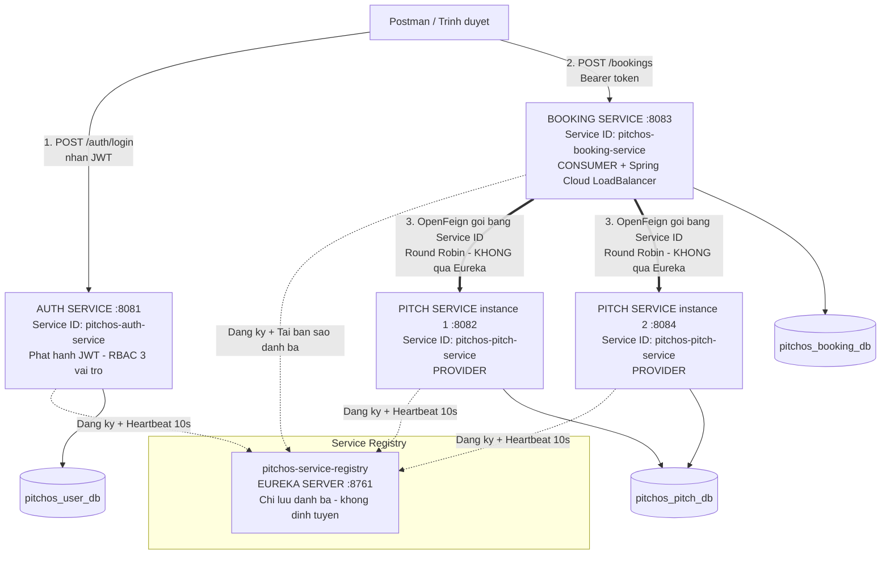
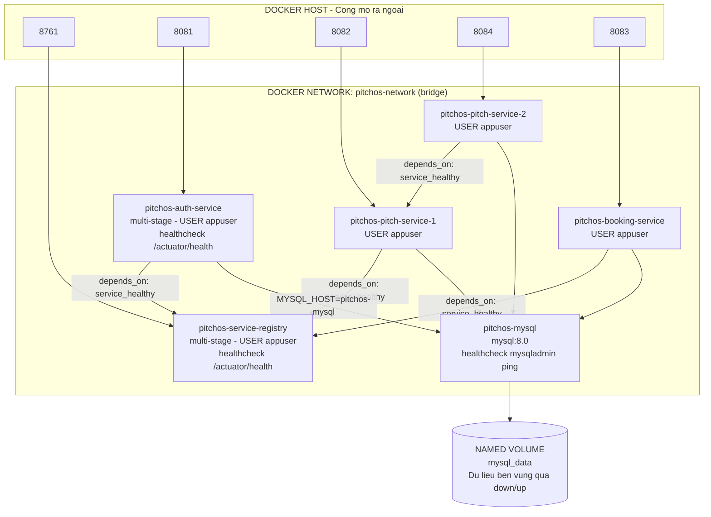

# PHẦN 2.1a: SƠ ĐỒ KIẾN TRÚC TÍCH HỢP VÀ KIẾN TRÚC TRIỂN KHAI
**Học phần:** Phát triển phần mềm Hướng dịch vụ (SOA / Microservices)
**Sinh viên thực hiện:** HOÀNG (Nhóm trưởng)
**Mục tiêu điểm số:** 0,5 / 1,0 Điểm (Mục 2.1 — phần còn lại do Hùng viết ở `PHAN_2_HUNG.md`)
**File ảnh cần xuất kèm:** `docs/architecture/integration-architecture.png`, `docs/architecture/deployment-architecture.png`

---

## 1. PHẠM VI CỦA MỤC NÀY

Mục 2.1a trình bày **hai sơ đồ kiến trúc** của hệ thống PitchOS và phân tích luồng tương tác giữa các dịch vụ:

| Sơ đồ | Trả lời câu hỏi | File ảnh |
|---|---|---|
| **Kiến trúc tích hợp** (Integration Architecture) | Các dịch vụ giao tiếp với nhau *bằng cơ chế nào*? Ai gọi ai, qua giao thức gì, dữ liệu nào đi qua đâu? | `integration-architecture.png` |
| **Kiến trúc triển khai** (Deployment Architecture) | Các dịch vụ *nằm ở đâu* khi chạy thật? Bao nhiêu container, mạng nào, volume nào, cổng nào mở ra ngoài? | `deployment-architecture.png` |

Hai sơ đồ này mô tả cùng một hệ thống nhưng ở hai góc nhìn khác nhau và **không thay thế được cho nhau**: sơ đồ tích hợp nói về *quan hệ logic*, sơ đồ triển khai nói về *hiện thực vật lý*. Phần mô tả chi tiết từng dịch vụ và thiết kế dữ liệu phân tán được trình bày ở mục 2.1b (`PHAN_2_HUNG.md`).

Để làm rõ phần nào đã có từ bài kiểm tra số 1 và phần nào được bổ sung ở bài kiểm tra số 2, mỗi sơ đồ dưới đây được trình bày thành hai trạng thái: **TRƯỚC** (hiện trạng KT1) và **SAU** (sau khi bổ sung ở KT2).

---

## 2. KIẾN TRÚC TÍCH HỢP

### 2.1. TRƯỚC — Hiện trạng ở bài kiểm tra số 1: tích hợp bằng URL cố định

```
                        ┌──────────────────────────┐
                        │   POSTMAN / TRÌNH DUYỆT  │
                        └─────┬──────────────┬─────┘
                              │              │
          JWT Bearer Token    │              │  JWT Bearer Token
                              ▼              ▼
             ┌────────────────────────┐   ┌────────────────────────┐
             │   AUTH SERVICE :8081   │   │ BOOKING SERVICE :8083  │
             │   Phát hành JWT        │   │ (CONSUMER)             │
             │   RBAC 3 vai trò       │   └───────────┬────────────┘
             └───────────┬────────────┘               │
                         │                            │ OpenFeign
                         ▼                   GỌI BẰNG URL GẮN CỨNG:
              ┌────────────────────┐         http://localhost:8082
              │  pitchos_user_db   │                  │
              └────────────────────┘                  ▼
                                        ┌────────────────────────┐
                                        │   PITCH SERVICE :8082  │
                                        │   (PROVIDER - 1 bản)   │
                                        └───────────┬────────────┘
                                                    ▼
                                        ┌────────────────────────┐
                                        │   pitchos_pitch_db     │
                                        └────────────────────────┘
```

**Bốn hạn chế của kiến trúc tích hợp này:**

| # | Hạn chế | Hệ quả cụ thể |
|---|---|---|
| 1 | Địa chỉ Provider gắn cứng trong cấu hình Consumer | Đổi cổng hoặc đổi máy chạy Pitch Service buộc phải sửa và build lại Booking Service |
| 2 | Chỉ mô tả được **một** điểm đích | Không thể chạy nhiều instance Provider, do đó không có cân bằng tải |
| 3 | Không có cơ chế phát hiện Provider đã chết | Consumer tiếp tục gọi vào địa chỉ đã chết đến khi timeout, không có danh sách dự phòng |
| 4 | `localhost` chỉ đúng khi mọi thứ chạy trên cùng một máy | Khi container hóa, `localhost` trỏ về chính container Booking → `Connection refused` |

### 2.2. SAU — Kiến trúc tích hợp ở bài kiểm tra số 2: tích hợp qua Service Registry

```
                        ┌──────────────────────────┐
                        │   POSTMAN / TRÌNH DUYỆT  │
                        └─────┬──────────────┬─────┘
                              │              │
                              ▼              ▼
             ┌────────────────────────┐   ┌─────────────────────────┐
             │   AUTH SERVICE :8081   │   │  BOOKING SERVICE :8083  │
             │   Eureka Client        │   │  (CONSUMER)             │
             │   /actuator/health     │   │  Eureka Client          │
             └──────────┬─────────────┘   │  + Spring Cloud LB      │
                        │                 └──────┬───────────┬──────┘
                        │ (1) Đăng ký            │ (2) Tra   │ (3) Gọi trực tiếp
                        │     + Heartbeat        │  cứu tên  │     bằng IP vừa
                        │                        │           │     tra cứu được
                        ▼                        ▼           │
     ╔══════════════════════════════════════════════════╗    │
     ║      SERVICE REGISTRY — EUREKA SERVER :8761      ║    │
     ║  PITCHOS-AUTH-SERVICE     -> 172.18.0.3:8081     ║    │
     ║  PITCHOS-PITCH-SERVICE    -> 172.18.0.5:8082     ║    │
     ║                           -> 172.18.0.6:8084     ║    │
     ║  PITCHOS-BOOKING-SERVICE  -> 172.18.0.7:8083     ║    │
     ╚═════════════════════▲════════════════════════════╝    │
                           │ (1) Đăng ký + Heartbeat         │
            ┌──────────────┴───────────────┐                 │
            │                              │                 │
   ┌────────┴─────────┐          ┌─────────┴────────┐        │
   │ PITCH SERVICE    │◄─────────┤ PITCH SERVICE    │◄───────┘
   │ INSTANCE 1 :8082 │          │ INSTANCE 2 :8084 │
   │ (PROVIDER)       │          │ (PROVIDER)       │
   └──────────────────┘          └──────────────────┘
          Cùng Service ID: pitchos-pitch-service
```

**Ba thay đổi cốt lõi so với KT1:**

1. **Bổ sung thành phần `pitchos-service-registry`** (Hoàng xây mới): giữ danh bạ địa chỉ của toàn hệ thống ở cổng 8761.
2. **Thay địa chỉ cứng bằng Service ID**: Feign Client của Booking Service bỏ thuộc tính `url`, chỉ còn `@FeignClient(name = "pitchos-pitch-service")`.
3. **Nhân bản Provider thành 2 instance** cùng Service ID: tạo điều kiện để Spring Cloud LoadBalancer phân bổ luân phiên.

### 2.3. Phân tích luồng tương tác của nghiệp vụ đặt sân

Luồng nghiệp vụ hoàn chỉnh khi người dùng đặt một sân bóng:

| Bước | Thành phần | Hành động | Giao thức / cơ chế |
|---|---|---|---|
| 1 | Client → Auth Service | `POST /api/v1/auth/login`, nhận JWT chứa `userId` và `role` | REST / HTTPS |
| 2 | Client → Booking Service | `POST /api/v1/bookings` kèm header `Authorization: Bearer <token>` | REST + JWT |
| 3 | Booking Service | Xác thực chữ ký JWT **cục bộ** bằng `JWT_SECRET` dùng chung, không cần gọi Auth Service | Chữ ký HMAC-SHA |
| 4 | Booking Service → Eureka cache | Tra cứu Service ID `pitchos-pitch-service`, nhận danh sách 2 instance | Service Discovery |
| 5 | Spring Cloud LoadBalancer | Chọn 1 instance theo Round Robin | Client-side Load Balancing |
| 6 | Booking Service → Pitch Service | `GET /api/v1/pitches/{id}` để kiểm tra sân có tồn tại và còn trống | OpenFeign / REST |
| 7 | Pitch Service → Booking Service | Trả về thông tin sân và giá, hoặc `404` nếu sân không tồn tại | REST |
| 8 | Booking Service | Ghi đơn đặt sân vào `pitchos_booking_db`, trả `201 Created` | JPA / MySQL |

**Điểm quan trọng ở bước 3:** việc xác thực JWT diễn ra *cục bộ* trong Booking Service, không phát sinh lời gọi mạng tới Auth Service. Nhờ vậy Auth Service **không trở thành điểm thắt cổ chai** cho mọi request của hệ thống, và khi Auth Service tạm dừng, các token đã phát hành vẫn dùng được cho đến khi hết hạn. Đánh đổi của thiết kế này là không thể thu hồi (revoke) một token trước thời điểm hết hạn.

**Điểm quan trọng ở bước 4–6:** Eureka Server chỉ tham gia ở bước 4, và tham gia dưới dạng *bản sao danh bạ đã nằm trong bộ nhớ của Booking Service*. Lời gọi ở bước 6 đi **trực tiếp** từ Booking Service tới Pitch Service, không trung chuyển qua Eureka. Đây là điểm phân biệt rõ nhất giữa Service Registry và API Gateway.

### 2.4. Phân định ranh giới trách nhiệm giữa các dịch vụ

| Dịch vụ | Service ID | Dữ liệu sở hữu độc quyền | Được phép gọi ai | KHÔNG được phép |
|---|---|---|---|---|
| **Auth Service** | `pitchos-auth-service` | `pitchos_user_db`: tài khoản, mật khẩu băm, vai trò | Không gọi dịch vụ nào | Không truy vấn dữ liệu sân hay đơn đặt sân |
| **Pitch Service** | `pitchos-pitch-service` | `pitchos_pitch_db`: sân bóng, khung giờ, giá | Không gọi dịch vụ nào | Không đọc bảng `users`; chỉ lưu `owner_id` dưới dạng Logical ID |
| **Booking Service** | `pitchos-booking-service` | `pitchos_booking_db`: đơn đặt sân, trạng thái thanh toán | Gọi Pitch Service qua Service ID | **Không truy vấn trực tiếp** `pitchos_pitch_db`; mọi thông tin sân phải lấy qua API |
| **Service Registry** | — | Bảng đăng ký trong bộ nhớ (không có CSDL) | Không gọi dịch vụ nghiệp vụ nào | Không tiếp nhận hay định tuyến request nghiệp vụ |

Nguyên tắc nền tảng là **Database-per-Service**: ranh giới dữ liệu trùng khít với ranh giới dịch vụ. Booking Service tuyệt đối không được mở kết nối JDBC vào `pitchos_pitch_db`, kể cả khi điều đó nhanh hơn một lời gọi HTTP, vì làm vậy sẽ tạo liên kết chặt ở tầng lưu trữ: Pitch Service không còn tự do thay đổi lược đồ bảng của mình. Luận giải chi tiết về Logical ID và lý do không dùng khóa ngoại vật lý được trình bày ở mục 2.1b (`PHAN_2_HUNG.md`).

---

## 3. KIẾN TRÚC TRIỂN KHAI

### 3.1. TRƯỚC — Hiện trạng ở bài kiểm tra số 1: ba tiến trình JVM trên một máy

```
┌───────────────────────── MÁY TÍNH CÁ NHÂN (Windows) ──────────────────────────┐
│                                                                               │
│   java -jar auth.jar      java -jar pitch.jar      java -jar booking.jar      │
│        :8081                    :8082                    :8083                │
│          └────────────────────────┴───────────────────────┘                   │
│                                   │                                           │
│                      MySQL cài trực tiếp trên máy :3306                       │
│                   (3 schema: user_db, pitch_db, booking_db)                   │
└───────────────────────────────────────────────────────────────────────────────┘

Khởi chạy: mở 3 cửa sổ terminal, chạy 3 lệnh, và phải cài sẵn JDK 17 + MySQL 8
```

**Vấn đề:** môi trường chạy phụ thuộc hoàn toàn vào máy cá nhân. Người khác clone mã nguồn về phải tự cài JDK đúng phiên bản, cài MySQL, tạo 3 schema, nhập dữ liệu mẫu, sửa mật khẩu trong file cấu hình. Đây chính là vấn đề *"trên máy tôi chạy được"* mà container hóa sinh ra để giải quyết.

### 3.2. SAU — Kiến trúc triển khai ở bài kiểm tra số 2: Docker Compose

```
┌─────────────────── MÁY CHỦ (DOCKER HOST) ────────────────────────────────────┐
│                                                                              │
│  Cổng mở ra ngoài:  8761      8081      8082      8084      8083      3306   │
│                       │         │         │         │         │         │    │
│  ┌────────────────────┼─────────┼─────────┼─────────┼─────────┼─────────┼──┐ │
│  │   DOCKER NETWORK: pitchos-network  (bridge, nội bộ)                    │ │
│  │                    │         │         │         │         │         │  │ │
│  │  ┌─────────────────▼──┐ ┌────▼─────┐ ┌─▼──────┐ ┌▼───────┐ ┌▼──────┐ │  │ │
│  │  │ service-registry   │ │   auth   │ │ pitch  │ │ pitch  │ │booking│ │  │ │
│  │  │ EUREKA SERVER      │ │  :8081   │ │ inst-1 │ │ inst-2 │ │ :8083 │ │  │ │
│  │  │ :8761              │ │          │ │ :8082  │ │ :8084  │ │       │ │  │ │
│  │  │ USER appuser       │ │ appuser  │ │appuser │ │appuser │ │appuser│ │  │ │
│  │  └────────────────────┘ └────┬─────┘ └───┬────┘ └───┬────┘ └───┬───┘ │  │ │
│  │                              │           │          │          │     │  │ │
│  │                              └───────────┴──────────┴──────────┘     │  │ │
│  │                                          │                           │  │ │
│  │                              ┌───────────▼────────────┐              │  │ │
│  │                              │  pitchos-mysql :3306   │◄─────────────┼──┘ │
│  │                              │  mysql:8.0             │              │    │
│  │                              └───────────┬────────────┘              │    │
│  └──────────────────────────────────────────┼───────────────────────────┘    │
│                                             │                                │
│                              ┌──────────────▼───────────────┐                │
│                              │  NAMED VOLUME: mysql_data    │                │
│                              │  Dữ liệu sống sót qua         │                │
│                              │  docker compose down / up     │                │
│                              └──────────────────────────────┘                │
└──────────────────────────────────────────────────────────────────────────────┘

Khởi chạy: docker compose up -d     (một lệnh duy nhất, không cần cài JDK/MySQL)
```

### 3.3. Bảng mô tả các container

| Container | Image / build | Cổng host → container | Phụ thuộc khởi động | Healthcheck |
|---|---|---|---|---|
| `pitchos-service-registry` | build từ `pitchos-service-registry/Dockerfile` | `8761 → 8761` | không | `GET /actuator/health` |
| `pitchos-auth-service` | build từ `pitchos-auth-service/Dockerfile` | `8081 → 8081` | `pitchos-mysql` healthy, `service-registry` healthy | `GET /actuator/health` |
| `pitchos-pitch-service-1` | build từ `pitchos-pitch-service/Dockerfile` | `8082 → 8082` | `pitchos-mysql` healthy, `service-registry` healthy | `GET /actuator/health` |
| `pitchos-pitch-service-2` | cùng image, cổng khác | `8084 → 8082` | `pitch-service-1` healthy | `GET /actuator/health` |
| `pitchos-booking-service` | build từ `pitchos-booking-service/Dockerfile` | `8083 → 8083` | `pitchos-mysql` healthy, `service-registry` healthy | `GET /actuator/health` |
| `pitchos-mysql` | `mysql:8.0` | `3306 → 3306` | không | `mysqladmin ping` |

> **Ghi chú phân công:** file `docker-compose.yml` hoàn chỉnh thuộc trách nhiệm của Linh (mục 2.4 — Container hóa). Hoàng đã khai báo trước hai service thuộc vùng sở hữu của mình (`pitchos-service-registry` và `pitchos-auth-service`) cùng hai `Dockerfile` multi-stage tương ứng; Linh bổ sung phần còn lại. Chi tiết về Dockerfile, network, volume và biến môi trường được phân tích ở Phần 5 (`PHAN_5_LINH.md`).

### 3.4. Ba điểm thiết kế triển khai cần giải thích

**(a) Thứ tự khởi động bằng `depends_on` với `condition: service_healthy`**

Nếu chỉ dùng `depends_on` thông thường, Docker chỉ chờ container *được tạo*, không chờ ứng dụng *sẵn sàng*. Auth Service sẽ khởi động khi MySQL vừa bật nhưng chưa nạp xong dữ liệu khởi tạo, dẫn tới lỗi kết nối rồi container thoát. Vì vậy cấu hình phải là:

```yaml
depends_on:
  pitchos-mysql:
    condition: service_healthy
  pitchos-service-registry:
    condition: service_healthy
```

Đây là biểu hiện trực tiếp của sự phân biệt giữa **trạng thái container** và **sức khỏe ứng dụng** — hai mức trạng thái được phân tích chi tiết ở Câu 1.4 (`CAU1_4_HUNG.md`).

**(b) Gọi nhau bằng tên service trong network, không dùng `localhost`**

Trong `pitchos-network`, Docker cung cấp DNS nội bộ phân giải tên service thành IP container. Do đó cấu hình truyền vào Auth Service là:

```yaml
environment:
  MYSQL_HOST: pitchos-mysql
  EUREKA_URL: http://pitchos-service-registry:8761/eureka/
```

**(c) Bí mật truyền bằng biến môi trường, không ghi vào image**

`Dockerfile` của Auth Service **không chứa** mật khẩu CSDL hay `JWT_SECRET`. Các giá trị này được Docker Compose đọc từ file `.env` ở thời điểm chạy. File `.env` thật đã được đưa vào `.gitignore` và gỡ khỏi Git; kho lưu trữ chỉ commit `.env.example` làm khuôn mẫu.

---

## 4. MÃ NGUỒN HAI SƠ ĐỒ KIẾN TRÚC

Hai sơ đồ dưới đây được đặc tả bằng ngôn ngữ Mermaid và được xuất thành hai file ảnh `docs/architecture/integration-architecture.png` và `docs/architecture/deployment-architecture.png`. Việc đặc tả bằng mã nguồn thay vì vẽ tay giúp sơ đồ luôn đồng bộ với kiến trúc thực tế và có thể sinh lại khi hệ thống thay đổi.

### 4.1. `integration-architecture.png`



Quy ước đường nét trong sơ đồ: **nét liền đậm** là luồng dữ liệu nghiệp vụ, **nét đứt** là luồng metadata đăng ký và tra cứu danh bạ. Không có đường nét liền nào đi xuyên qua khối Eureka — đó là minh chứng trực quan cho việc Registry không phải API Gateway.

### 4.2. `deployment-architecture.png`



---

