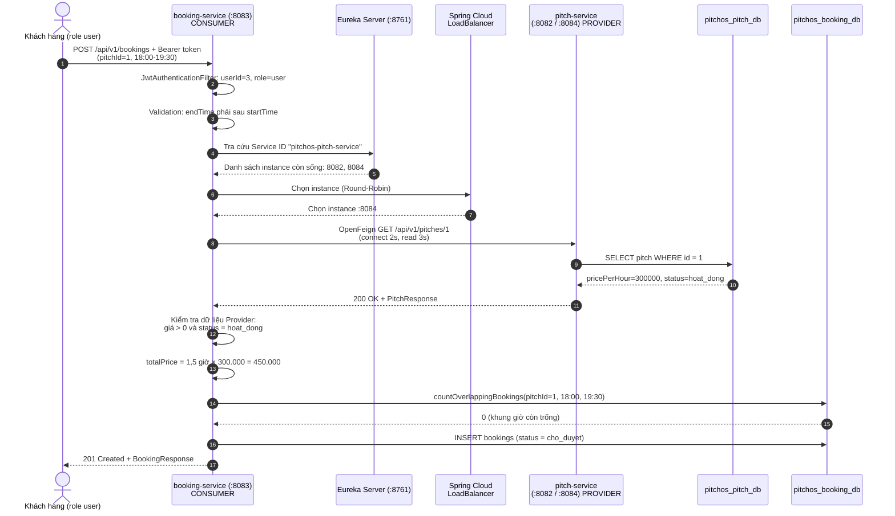
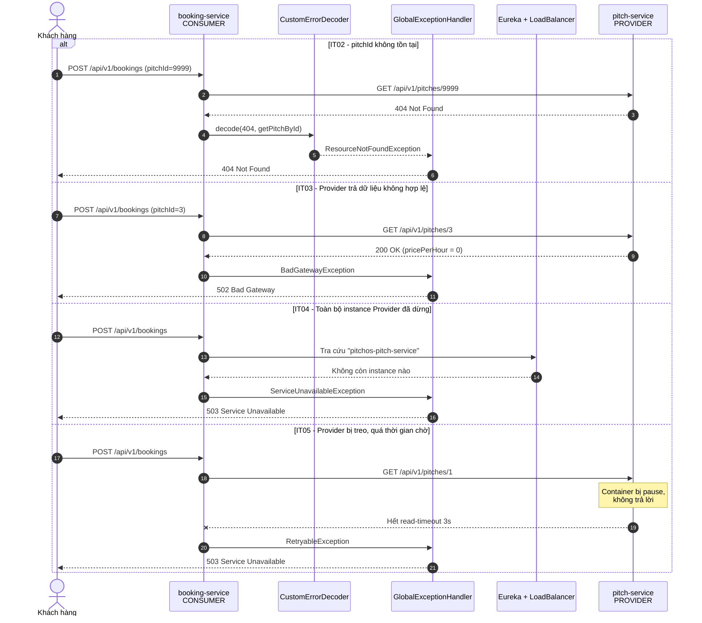

# PHẦN 3: TÍCH HỢP VÀ TIÊU THỤ DỊCH VỤ (CONSUMER → PROVIDER)
**Học phần:** Phát triển phần mềm Hướng dịch vụ (SOA / Microservices)  
**Sinh viên thực hiện:** NHẬT  
**Vùng mã nguồn phụ trách:** `pitchos-booking-service/`, `postman/collection.json`  
**Mục tiêu điểm số:** 2,0 / 2,0 Điểm (Mục 2.2 — Tích hợp dịch vụ)

---

## 1. VAI TRÒ CỦA BOOKING SERVICE TRONG KIẾN TRÚC PITCHOS

`pitchos-booking-service` giữ hai vai trò đồng thời:

* **Là Provider** đối với ứng dụng khách: công bố API `POST /api/v1/bookings`, `GET /api/v1/bookings/my-bookings`, `PATCH /api/v1/bookings/{id}/status`.
* **Là Consumer** đối với `pitchos-pitch-service`: mỗi lần khách đặt sân, Booking phải hỏi Pitch đơn giá và trạng thái sân mới tính được tiền.

```
                                    ┌──────────────────────────────┐
                                    │  Eureka Server (:8761)       │
                                    │  Danh bạ Service ID          │
                                    └───────▲──────────────▲───────┘
            (1) đăng ký + heartbeat 10s     │              │   (2) đăng ký 2 instance
                                            │              │
┌──────────┐    POST /api/v1/bookings   ┌───┴──────────────┴────────────────┐
│  Client  │ ─────────────────────────► │ pitchos-booking-service (:8083)   │
│ Postman  │ ◄───────────────────────── │        VAI TRÒ: CONSUMER          │
└──────────┘      201 / 400 / 404       └──────────────┬────────────────────┘
                  / 502 / 503                          │ (3) tra cứu Service ID
                                                       │     "pitchos-pitch-service"
                                                       │ (4) OpenFeign + LoadBalancer
                                        ┌──────────────┴───────────────┐
                                        ▼                              ▼
                        ┌───────────────────────────┐  ┌───────────────────────────┐
                        │ pitch-service-1 (:8082)   │  │ pitch-service-2 (:8084)   │
                        │     VAI TRÒ: PROVIDER     │  │     VAI TRÒ: PROVIDER     │
                        └─────────────┬─────────────┘  └─────────────┬─────────────┘
                                      └────────────┬─────────────────┘
                                                   ▼
                                       ┌───────────────────────┐
                                       │   pitchos_pitch_db    │
                                       └───────────────────────┘
```

**Điểm thay đổi cốt lõi so với KT1:** ở KT1, Booking gọi Pitch bằng URL cứng `http://localhost:8082`. Ở KT2, Booking chỉ biết **Service ID**; địa chỉ thật do Eureka cung cấp và LoadBalancer chọn tại thời điểm chạy. Nhờ vậy hệ thống có thể thêm/bớt instance Provider mà không cần sửa một dòng mã nào ở Consumer.

---

## 2. QUY TRÌNH NGHIỆP VỤ KHÁCH HÀNG ĐẶT SÂN BÓNG

### 2.1. Mô tả các bước

| Bước | Thành phần thực hiện | Nội dung xử lý | Kết quả nếu sai |
|:-:|---|---|---|
| 1 | Client | Đăng nhập `POST /api/v1/auth/login` lấy `accessToken` | `401` sai mật khẩu |
| 2 | Client | Gửi `POST /api/v1/bookings` kèm `Authorization: Bearer <token>` | `401` nếu thiếu token |
| 3 | `JwtAuthenticationFilter` | Giải mã JWT (HS256), nạp `userId` và quyền `ROLE_user` | `401` token sai/hết hạn |
| 4 | Spring Security | Kiểm tra vai trò: chỉ `user` được đặt sân | `403` sai vai trò |
| 5 | `BookingService` | Kiểm tra `endTime` phải sau `startTime` | `400`, **không gọi Provider** |
| 6 | `PitchGateway` → `PitchClient` | Tra cứu Eureka, LoadBalancer chọn instance, gọi `GET /api/v1/pitches/{id}` | `404` sân không tồn tại · `503` Provider sập/timeout |
| 7 | `BookingService` | Kiểm tra dữ liệu Provider: đơn giá hợp lệ, sân `hoat_dong` | `502` đơn giá sai · `400` sân bảo trì |
| 8 | `BookingService` | Tính `totalPrice = (số phút / 60) × pricePerHour` | — |
| 9 | `BookingRepository` | Kiểm tra trùng lịch rồi lưu đơn (trong cùng một khối khóa theo sân) | `400` khung giờ đã có người đặt |
| 10 | `BookingController` | Trả `201 Created` kèm đơn đặt sân trạng thái `cho_duyet` | — |

### 2.2. Sơ đồ tuần tự — Đặt sân thành công (201 Created)



### 2.3. Sơ đồ tuần tự — Bốn kịch bản lỗi tích hợp



> Trong cả 4 kịch bản, Booking Service **không sập** và vẫn phục vụ bình thường các endpoint không phụ thuộc Provider (minh chứng bằng request `IT04b` trong Postman: `GET /my-bookings` vẫn trả `200` ngay khi cả 2 instance Pitch đang dừng).

---

## 3. PHÂN TÍCH MÃ NGUỒN TÍCH HỢP

### 3.1. Gọi Provider theo Service ID — bỏ hoàn toàn URL cứng

`pitchos-booking-service/src/main/java/com/pitchos/booking/client/PitchClient.java`

```java
@FeignClient(name = "pitchos-pitch-service")      // KT2: chỉ còn Service ID
public interface PitchClient {

    @GetMapping("/api/v1/pitches/{id}")
    PitchResponseDTO getPitchById(@PathVariable("id") Long id);

    @GetMapping("/api/v1/instance-info")
    Map<String, Object> getInstanceInfo();
}
```

**So sánh trước và sau KT2:**

| | KT1 (URL cứng) | KT2 (Service ID) |
|---|---|---|
| Khai báo | `@FeignClient(name = "pitch-service", url = "${pitch.service.url}")` | `@FeignClient(name = "pitchos-pitch-service")` |
| Địa chỉ Provider | Cố định trong cấu hình | Lấy từ danh bạ Eureka tại thời điểm chạy |
| Số instance gọi được | Đúng 1 | Mọi instance đang còn sống (hiện là 2) |
| Khi 1 instance chết | Toàn bộ nghiệp vụ đặt sân chết theo | LoadBalancer tự chuyển sang instance còn lại |
| Thêm instance thứ 3 | Phải sửa cấu hình và khởi động lại Consumer | Không cần sửa gì ở Consumer |

Giá trị `name` trong `@FeignClient` **phải trùng tuyệt đối** với `spring.application.name` của Provider, vì đó chính là khóa tra cứu trong danh bạ Eureka.

Cấu hình kèm theo tại `application.properties` — timeout khai báo theo đúng Service ID:

```properties
eureka.client.service-url.defaultZone=${EUREKA_URL:http://localhost:8761/eureka/}
eureka.instance.prefer-ip-address=true
eureka.instance.instance-id=${spring.application.name}:${INSTANCE_ID:${server.port}}

spring.cloud.openfeign.client.config.pitchos-pitch-service.connect-timeout=2000
spring.cloud.openfeign.client.config.pitchos-pitch-service.read-timeout=3000
```

Khóa `pitch.service.url` của KT1 **đã bị xóa khỏi toàn bộ dự án**, kể cả file `application.properties` trùng lặp ở thư mục gốc của service (file này đã được xóa để tránh tình trạng hai nguồn cấu hình xung đột).

### 3.2. Kiểm tra tính hợp lệ của dữ liệu nhận về từ Provider

`service/BookingService.java`

```java
// 1. Gọi Provider qua OpenFeign + Service ID
PitchResponseDTO pitch = pitchGateway.getPitchById(request.getPitchId());
log.info("Pitch Service trả về sân {}: giá {} /giờ, trạng thái {}",
        pitch.getId(), pitch.getPricePerHour(), pitch.getStatus());

// 2. KT2 - Kiểm tra tính hợp lệ của dữ liệu nhận về từ Provider trước khi dùng
validateProviderData(pitch);

private void validateProviderData(PitchResponseDTO pitch) {
    if (pitch.getPricePerHour() == null
            || pitch.getPricePerHour().compareTo(BigDecimal.ZERO) <= 0) {
        throw new BadGatewayException("Dữ liệu đơn giá từ Pitch Service không hợp lệ");
    }
    if (!PITCH_STATUS_ACTIVE.equalsIgnoreCase(pitch.getStatus())) {
        throw new BadRequestException("Sân bóng hiện không hoạt động hoặc đang bảo trì");
    }
}
```

**Vì sao phải kiểm tra dù Provider đã trả `200 OK`?** Mã `200` chỉ bảo đảm **giao tiếp HTTP** thành công, không bảo đảm **dữ liệu dùng được**. Nếu không kiểm tra, một bản ghi sân bị nhập sai giá (`0` hoặc `null`) sẽ khiến Consumer tạo đơn đặt sân `totalPrice = 0` đồng, hoặc ném `NullPointerException` và trả `500` — cả hai đều là lỗi nghiêm trọng về nghiệp vụ.

**Vì sao đơn giá sai là `502` mà sân bảo trì là `400`?** Hai lỗi khác nhau về bản chất, nên phải khác mã:

* Đơn giá `null`/`<= 0` là **sự cố dữ liệu của dịch vụ phía sau** — người dùng không làm gì sai và thử lại cũng vô ích. `502 Bad Gateway` chỉ đúng chỗ cần sửa: dữ liệu bên Pitch Service.
* Sân `bao_tri` là **thông tin nghiệp vụ hợp lệ** — Provider trả dữ liệu hoàn toàn đúng, chỉ là yêu cầu của khách không thực hiện được. `400 Bad Request` kèm thông báo rõ ràng giúp khách chọn sân khác.

### 3.3. Phân loại lỗi hạ tầng — trả 503 sạch sẽ, không bao giờ 500

`client/PitchGateway.java` chuyển lỗi của tầng Service Discovery thành ngoại lệ có ngữ nghĩa rõ ràng:

```java
public PitchResponseDTO getPitchById(Long pitchId) {
    try {
        return pitchClient.getPitchById(pitchId);
    } catch (IllegalStateException ex) {           // LoadBalancer: hết instance khả dụng
        throw noInstanceAvailable(ex);             // -> ServiceUnavailableException -> 503
    }
}
```

`exception/GlobalExceptionHandler.java` quy mọi tình huống về đúng mã HTTP:

```java
@ExceptionHandler({FeignException.class, RetryableException.class})   // sập, mất mạng, timeout
public ResponseEntity<ErrorResponse> handleFeignFailure(FeignException ex) {
    log.warn("Không gọi được Pitch Service (status Feign = {}): {}", ex.status(), ex.getMessage());
    return build(HttpStatus.SERVICE_UNAVAILABLE,
            "Dịch vụ quản lý sân hiện không khả dụng. Vui lòng thử lại sau!");
}

@ExceptionHandler(ServiceUnavailableException.class)                  // Eureka hết instance
public ResponseEntity<ErrorResponse> handleServiceUnavailable(ServiceUnavailableException ex) { ... }

@ExceptionHandler(BadGatewayException.class)                          // dữ liệu Provider sai
public ResponseEntity<ErrorResponse> handleBadGateway(BadGatewayException ex) {
    log.error("Dữ liệu nhận từ Pitch Service không hợp lệ: {}", ex.getMessage());
    return build(HttpStatus.BAD_GATEWAY, ex.getMessage());
}
```

`client/CustomErrorDecoder.java` phân biệt `404` nghiệp vụ với `404` hạ tầng bằng tên phương thức được gọi:

```java
if (response.status() == 404 && methodKey.contains(GET_PITCH_METHOD)) {
    return new ResourceNotFoundException("Không tìm thấy sân bóng với pitchId đã gửi");
}
return defaultDecoder.decode(methodKey, response);   // -> FeignException -> 503
```

Nhờ vậy, `404` trả về từ `GET /api/v1/pitches/{id}` được hiểu là "không có sân này" (`404` cho client), còn `404` từ một endpoint khác (ví dụ Provider chưa triển khai `/api/v1/instance-info`) được hiểu là lỗi hạ tầng (`503`) — không báo sai thành "không tìm thấy sân bóng".

### 3.4. Endpoint phục vụ kiểm thử cân bằng tải qua Consumer

`controller/BookingController.java`

```java
@GetMapping("/pitch-instance")
public ResponseEntity<Map<String, Object>> getServingPitchInstance() {
    return ResponseEntity.ok(bookingService.getServingPitchInstance());
}
```

Mỗi lần gọi, Consumer lại nhờ LoadBalancer chọn instance, nên gửi 20 request liên tiếp sẽ thấy tải phân phối xấp xỉ 10/10 giữa cổng `8082` và `8084` (bảng kết quả xem Phần 4 của Hoàng). Endpoint này cùng với `/actuator/health` và `/actuator/info` được mở công khai trong `SecurityConfig`:

```java
.requestMatchers("/actuator/health", "/actuator/info").permitAll()
.requestMatchers(HttpMethod.GET, "/api/v1/bookings/pitch-instance").permitAll()
```

### 3.5. Container hóa Consumer — Dockerfile multi-stage không chạy quyền root

`pitchos-booking-service/Dockerfile` gồm 2 giai đoạn: giai đoạn `builder` dùng ảnh Maven để biên dịch, giai đoạn runtime chỉ còn JRE 17 và file `.jar`, chạy bằng `appuser` thay vì `root`, kèm `HEALTHCHECK` đọc `/actuator/health`:

```dockerfile
FROM maven:3.9-eclipse-temurin-17 AS builder
WORKDIR /build
COPY pom.xml .
RUN mvn -B dependency:go-offline
COPY src ./src
RUN mvn -B clean package -DskipTests

FROM eclipse-temurin:17-jre
RUN groupadd --system appgroup \
    && useradd --system --gid appgroup --create-home appuser
COPY --from=builder /build/target/*.jar /app/app.jar
USER appuser
HEALTHCHECK --interval=15s --timeout=5s --start-period=60s --retries=5 \
    CMD curl -fsS http://localhost:8083/actuator/health | grep -q '"status":"UP"' || exit 1
ENTRYPOINT ["java", "-jar", "/app/app.jar"]
```

Ba lợi ích: ảnh runtime nhỏ (không chứa Maven và mã nguồn), giảm thiệt hại nếu ứng dụng bị chiếm quyền (không phải `root`), và `docker compose ps` chỉ báo `healthy` khi ứng dụng **thật sự** sẵn sàng chứ không phải khi tiến trình vừa khởi động.

---

## 4. BẢNG HỢP ĐỒNG API

Bảng hợp đồng API đầy đủ của cả 3 dịch vụ (đường dẫn, phương thức, header, body request, phản hồi thành công, toàn bộ mã lỗi, biến môi trường tích hợp) được trình bày tại tài liệu riêng: [`docs/api/api-contract.md`](../api/api-contract.md).

Trích phần quan trọng nhất — mã lỗi của API đặt sân:

| Mã | Nguyên nhân | Ai phải sửa |
|:-:|---|---|
| `400` | Dữ liệu khách gửi sai, sân bảo trì, trùng khung giờ | Người dùng chọn lại |
| `401` / `403` | Thiếu token hoặc sai vai trò | Người dùng đăng nhập đúng tài khoản |
| `404` | `pitchId` không tồn tại | Người dùng chọn sân khác |
| `502` | Đơn giá của Provider `null` hoặc `<= 0` | Chủ sân / Pitch Service sửa dữ liệu |
| `503` | Provider sập, timeout, hoặc hết instance trong Eureka | Kỹ sư vận hành khởi động lại Provider |

---

## 5. MINH CHỨNG KIỂM THỬ TÍCH HỢP IT01 – IT07

Quy trình chạy chi tiết, lệnh Docker chuẩn bị cho từng ca và chỗ chèn ảnh minh chứng: xem [`docs/testing/integration-test.md`](../testing/integration-test.md).  
Bộ kiểm thử Postman: [`postman/collection.json`](../../postman/collection.json), thư mục **2. Integration & Error Handling (IT01–IT07)**.

### 5.1. Bảng tổng hợp kết quả

> **Trạng thái minh chứng tại thời điểm viết tài liệu:** cột *Test tự động* là kết quả **đã chạy thực tế** bằng `mvn test` (xem mục 5.3). Cột *Postman + Docker* phải chạy lại và chụp ảnh sau khi Hoàng hoàn thành `pitchos-service-registry`, Linh hoàn thành `docker-compose.yml` và endpoint `/api/v1/instance-info` — ô nào chưa chụp thì ghi rõ "chưa chạy", không ghi khống kết quả.

| Mã test | Tình huống | Cách tạo tình huống | Mã mong đợi | Test tự động | Postman + Docker |
|:-:|---|---|:-:|:-:|:-:|
| **IT01** | Đặt sân hợp lệ | Sân 1, 18:00–19:30, token `user` | `201` + `totalPrice = 450000` | ✔ Đạt | ⬜ Chờ chụp ảnh |
| **IT02** | Sân không tồn tại | `pitchId = 9999` | `404` | ✔ Đạt | ⬜ Chờ chụp ảnh |
| **IT03a** | Sân đang bảo trì | `pitchId = 4` (`bao_tri` trong dữ liệu mẫu) | `400` | ✔ Đạt | ⬜ Chờ chụp ảnh |
| **IT03b** | Đơn giá Provider `<= 0` / `null` | `UPDATE pitches SET price_per_hour = 0 WHERE id = 3` | `502` | ✔ Đạt | ⬜ Chờ chụp ảnh |
| **IT04** | Provider sập hoàn toàn | `docker compose stop` cả 2 instance Pitch | `503` | ✔ Đạt | ⬜ Chờ chụp ảnh |
| **IT05** | Timeout mạng | `docker compose pause` cả 2 instance Pitch | `503` sau 2–3s | ✔ Đạt | ⬜ Chờ chụp ảnh |
| **IT06** | Gửi lặp cùng khung giờ | Gửi 2 lần cùng sân, cùng giờ | `201` rồi `400` | ✔ Đạt | ⬜ Chờ chụp ảnh |
| **IT07** | Dữ liệu đầu vào sai | `endTime` trước `startTime` | `400` | ✔ Đạt | ⬜ Chờ chụp ảnh |

### 5.2. Phân tích từng ca kiểm thử

**IT01 — Đặt sân thành công.** Đây là ca chứng minh toàn bộ chuỗi tích hợp hoạt động: Consumer tra cứu Eureka, LoadBalancer chọn instance, Provider trả đơn giá, Consumer tính tiền và lưu đơn. Bằng chứng mạnh nhất không chỉ là mã `201` mà là **giá trị `totalPrice = 450.000`**: con số này không tồn tại trong CSDL của Booking Service, nó được tính từ đơn giá `300.000 đ/giờ` chỉ Pitch Service mới có. Log của Booking Service in kèm dòng `Pitch Service trả về sân 1: giá 300000.00 /giờ, trạng thái hoat_dong`.

**IT02 — Sân không tồn tại (404).** Lỗi của Provider được **chuyển tiếp đúng ngữ nghĩa** chứ không bị bóp thành `500` hay `503`. `CustomErrorDecoder` nhận biết `404` trả về từ `getPitchById` và chuyển thành thông báo tiếng Việt rõ ràng cho khách hàng. Đây là ví dụ cho nguyên tắc: lỗi do dữ liệu người dùng gửi thì trả nhóm `4xx`, không được quy về lỗi hệ thống.

**IT03a — Sân đang bảo trì (400).** Provider trả `200 OK` với dữ liệu hoàn toàn hợp lệ, nhưng Consumer vẫn từ chối tạo đơn vì `status = bao_tri`. Ca này chứng minh Consumer không chỉ "lấy giá rồi dùng" mà thực sự **đọc và áp dụng dữ liệu nghiệp vụ** của Provider vào quyết định của mình.

**IT03b — Đơn giá không hợp lệ (502).** Ca kiểm thử khó nhất và cũng quan trọng nhất của mục kiểm tra dữ liệu Provider. Khi cố ý làm sai dữ liệu bên Pitch Service (`price_per_hour = 0`), Consumer phát hiện và trả `502 Bad Gateway` kèm thông báo "Dữ liệu đơn giá từ Pitch Service không hợp lệ", thay vì tạo ra một đơn đặt sân `0 đồng`. Mã `502` là lựa chọn chính xác theo chuẩn HTTP: dịch vụ trung gian nhận được phản hồi không dùng được từ dịch vụ phía sau.

**IT04 — Provider sập hoàn toàn (503).** Sau khi dừng cả 2 instance Pitch và chờ Eureka loại chúng khỏi danh bạ, LoadBalancer không còn địa chỉ nào để gọi. `PitchGateway` chuyển lỗi này thành `503` **sạch sẽ**, body lỗi không chứa tên lớp ngoại lệ hay stack trace. Quan trọng nhất: request `IT04b` (`GET /my-bookings`) vẫn trả `200` ngay trong lúc Provider đang chết — chứng minh Consumer **không sụp đổ dây chuyền**.

**IT05 — Timeout mạng (503).** Khác với IT04, ở đây container Pitch vẫn sống nhưng bị `pause` nên không trả lời. Đây là tình huống nguy hiểm hơn sập hẳn, vì không có lỗi "Connection refused" tức thời để Consumer biết đường thoát. Nhờ `read-timeout = 3000 ms`, Feign chủ động ngắt sau khoảng 3 giây và ném `RetryableException` → `503`. Nếu không đặt timeout, request sẽ treo vô hạn và làm cạn thread pool của Consumer.

**IT06 — Gửi lặp yêu cầu đặt sân (201 → 400).** Lần đầu `201`, lần thứ hai cùng sân cùng khung giờ trả `400` với thông báo "Khung giờ này đã có người đặt". Truy vấn chống trùng lịch `startTime < :endTime AND endTime > :startTime` (loại trừ đơn `tu_choi`) được thực thi **bên trong cùng một khối khóa theo từng sân**, nên hai request gửi đồng thời cũng không thể cùng vượt qua — một đơn `201`, các đơn còn lại `400`.

**IT07 — Dữ liệu đầu vào sai (400).** `endTime` trước `startTime` bị chặn ngay tại Consumer **trước khi** gọi Provider. Bộ test tự động có kiểm tra `verifyNoInteractions(pitchClient)` để chứng minh không hề phát sinh vòng gọi mạng nào — vừa đúng nghiệp vụ, vừa tiết kiệm tài nguyên của Provider.

### 5.3. Bộ kiểm thử tự động kèm theo (bằng chứng chạy được mọi lúc)

Ngoài minh chứng Postman trên Docker, toàn bộ 8 ca IT01–IT07 còn được mã hóa thành bộ kiểm thử tự động trong chính dự án, chạy trên H2 in-memory và thay `PitchClient` bằng mock để mô phỏng mọi kiểu phản hồi của Provider (dữ liệu tốt, `404`, đơn giá rác, hết instance, timeout):

```
pitchos-booking-service/src/test/java/com/pitchos/booking/
├── IntegrationErrorHandlingTest.java   # IT01-IT07 + TC03, TC05
├── SecurityRbacTest.java               # 401 / 403 / actuator health
└── unit/CustomErrorDecoderTest.java    # phân loại 404 nghiệp vụ và 404 hạ tầng
```

Kết quả thực tế: **`Tests run: 17, Failures: 0, Errors: 0, Skipped: 0` — BUILD SUCCESS** (`mvn test`).

Giá trị của bộ test này: logic tích hợp được kiểm chứng ngay cả khi Eureka, Docker hay Pitch Service của nhóm chưa khởi động, và mọi lần sửa mã nguồn về sau đều được bảo vệ khỏi hồi quy.

---

## 6. ĐÁNH GIÁ VÀ HƯỚNG PHÁT TRIỂN

**Những yêu cầu đã đạt được:**

1. Consumer gọi Provider hoàn toàn qua **Service ID**, không còn một URL cứng nào trong mã nguồn và cấu hình.
2. **Kiểm tra dữ liệu nhận về từ Provider** trước khi dùng (đơn giá, trạng thái sân), phân biệt rạch ròi `502` với `400`.
3. Xử lý **5 loại lỗi tích hợp** (`404`, `502`, `503` do sập, `503` do timeout, `400` do trùng lịch) — nhiều hơn yêu cầu tối thiểu "≥ 2 lỗi" của đề bài.
4. Endpoint `/api/v1/bookings/pitch-instance` phục vụ lập bảng phân phối tải 20 request.
5. `Dockerfile` multi-stage không chạy quyền root, có `HEALTHCHECK` đọc Actuator.
6. Bộ Postman chuẩn hóa 26 request chia 3 thư mục kèm script tự lưu token và kiểm tra tự động.

**Hạn chế còn tồn tại (trình bày trung thực):**

1. **Khóa chống trùng lịch nằm trong bộ nhớ** (`ConcurrentHashMap` theo `pitchId`), nên chỉ bảo đảm đúng khi chạy **một instance** Booking Service — đây cũng là lý do `docker-compose.yml` giữ Booking ở 1 instance. Muốn chạy nhiều instance thì phải chuyển sang khóa phân tán (Redis) hoặc ràng buộc `UNIQUE` ở tầng CSDL.
2. **Chưa có Circuit Breaker.** Hiện hệ thống dựa vào timeout; khi Provider chết, mỗi request vẫn phải chờ hết 2–3 giây. Resilience4j sẽ giúp trả lỗi ngay sau khi phát hiện Provider mất khả dụng.
3. **Độ trễ 15–30 giây của Eureka.** Khi tắt một instance, danh bạ chưa cập nhật kịp nên một vài request đầu có thể lỗi tạm thời. Đây là cơ chế tự nhiên của Eureka (heartbeat 10s, eviction 30s), nhóm ghi nhận và giải thích trung thực thay vì che lỗi.
4. **Chưa có API Gateway.** Client hiện phải biết cổng của từng dịch vụ (8081, 8082, 8083). Bước nâng cấp tiếp theo là đặt một API Gateway (Spring Cloud Gateway) làm cửa vào duy nhất.
