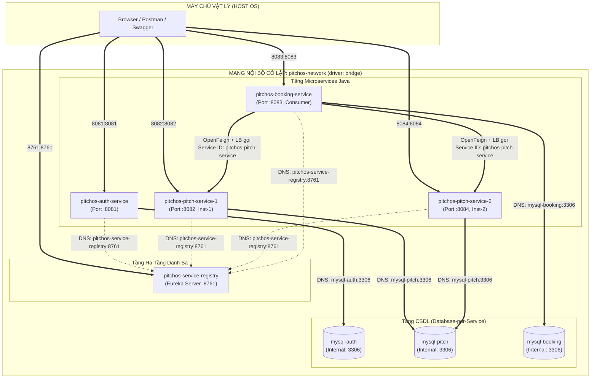

# PHẦN 5: CONTAINER HÓA VÀ TRIỂN KHAI TOÀN HỆ THỐNG PITCHOS
**Học phần:** Phát triển phần mềm Hướng dịch vụ (SOA / Microservices 2026)  
**Sinh viên thực hiện:** LINH  
**Vai trò đề tài:** Kỹ sư Triển khai Container & Provider Pitch Service  
**Trọng số điểm báo cáo:** 2,0 / 10,0 Điểm (Mục 2.4 - Container hóa & Điều phối hệ thống)  
**Tập tin sở hữu & phụ trách:** `pitchos-pitch-service/Dockerfile`, `docker-compose.yml`, `.env.example`

---

## 5.1. KIẾN TRÚC DOCKERFILE MULTI-STAGE VÀ BẢO MẬT CONTAINER

Để đóng gói các dịch vụ Spring Boot trong đề tài PitchOS thành các Docker Image độc lập, tiêu chuẩn công nghiệp đòi hỏi hình ảnh container phải đáp ứng đồng thời 3 tiêu chí: **Kích thước nhỏ gọn (Lightweight)**, **Tốc độ xây dựng nhanh (Fast Build)** và **An toàn bảo mật (Security Hardening)**.

```
┌─────────────────────────────────────────────────────────────────────────────┐
│ GIAI ĐOẠN 1: BUILDER (maven:3.9.6-eclipse-temurin-17-alpine ~550MB)         │
│ • WORKDIR /build                                                            │
│ • COPY pom.xml . ──► RUN mvn dependency:go-offline (Cache Layer Thư Viện)  │
│ • COPY src ./src ──► RUN mvn clean package -DskipTests (Biên dịch mã nguồn)│
│   ==> Xuất file: /build/target/pitchos-pitch-service-0.0.1-SNAPSHOT.jar    │
└──────────────────────────────────────┬──────────────────────────────────────┘
                                       │ COPY --from=builder (Chỉ lấy duy nhất file .jar)
                                       ▼
┌─────────────────────────────────────────────────────────────────────────────┐
│ GIAI ĐOẠN 2: RUNTIME (eclipse-temurin:17-jre-alpine ~140MB)                 │
│ • WORKDIR /app                                                              │
│ • RUN addgroup -S appgroup && adduser -S appuser -G appgroup (Non-root user)│
│ • COPY --from=builder app.jar .                                            │
│ • RUN chown -R appuser:appgroup /app                                        │
│ • USER appuser ──► ENTRYPOINT ["java", "-jar", "app.jar"]                   │
│   ==> Image hoàn chỉnh cuối cùng siêu nhẹ (~150MB), KHÔNG CÓ QUYỀN ROOT!   │
└─────────────────────────────────────────────────────────────────────────────┘
```

### 5.1.1. Chi tiết 2 giai đoạn của Multi-stage Build trong `pitchos-pitch-service`
Tập tin `pitchos-pitch-service/Dockerfile` do Linh thiết kế phân định rạch ròi giữa môi trường xây dựng và môi trường thực thi:

```dockerfile
# -------------------- GIAI ĐOẠN 1: BUILD --------------------
FROM maven:3.9.6-eclipse-temurin-17-alpine AS builder
WORKDIR /build

# Tận dụng cơ chế layer cache của Docker: tải dependencies trước
COPY pom.xml .
RUN mvn dependency:go-offline -B

# Copy toàn bộ mã nguồn vào và build file jar (bỏ qua unit test khi đóng gói image)
COPY src ./src
RUN mvn clean package -DskipTests -B

# -------------------- GIAI ĐOẠN 2: RUNTIME --------------------
FROM eclipse-temurin:17-jre-alpine
WORKDIR /app

# Tạo nhóm và người dùng không có quyền root (appuser)
# Ngăn chặn nguy cơ leo thang đặc quyền từ bên trong container nếu ứng dụng bị tấn công
RUN addgroup -S appgroup && adduser -S appuser -G appgroup

# Cài đặt curl và wget để phục vụ kiểm tra sức khỏe và debug kết nối nếu cần
RUN apk --no-cache add curl wget

# Sao chép file thực thi JAR từ Stage 1 sang Stage 2
COPY --from=builder /build/target/pitchos-pitch-service-*.jar app.jar

# Phân quyền sở hữu toàn bộ thư mục ứng dụng cho appuser
RUN chown -R appuser:appgroup /app

# Chuyển ngữ cảnh thực thi sang non-root user
USER appuser

# Khai báo các cổng mạng dịch vụ dự kiến lắng nghe (8082 cho Instance 1, 8084 cho Instance 2)
EXPOSE 8082 8084

# Cấu hình tối ưu hóa bộ nhớ JVM cho môi trường container
ENV JAVA_OPTS="-Xms256m -Xmx512m -XX:+UseG1GC"

# Khởi chạy ứng dụng
ENTRYPOINT ["sh", "-c", "java $JAVA_OPTS -jar app.jar"]
```

### 5.1.2. Phân tích cơ chế bảo mật Non-root User (Chuẩn TH8)
* **Nguy cơ tiềm ẩn:** Khi chạy container mặc định bằng tài khoản `root` (UID 0), nếu ứng dụng Spring Boot bị khai thác qua các lỗ hổng bảo mật nghiêm trọng (như Spring4Shell, Log4j RCE hoặc injection qua thư viện ngoài), kẻ tấn công sẽ lập tức giành được quyền root trong container. Từ đó, kẻ tấn công có thể lợi dụng các kẽ hở nhân hệ điều hành (Kernel exploits) hoặc cấu hình mount không an toàn để thực hiện tấn công thoát khỏi container (Container Escape) và chiếm quyền điều khiển toàn bộ máy chủ host.
* **Biện pháp xử lý của nhóm:** Linh đã cấu hình lệnh:
  ```bash
  RUN addgroup -S appgroup && adduser -S appuser -G appgroup
  USER appuser
  ```
  Nhóm lệnh này tạo người dùng `appuser` thuộc nhóm `appgroup` với đặc quyền hệ thống bị giới hạn tối đa. Tiến trình `java -jar app.jar` thực thi với UID thường, hoàn toàn không có khả năng sửa đổi các tệp tin cấu hình cốt lõi của hệ điều hành container (`/etc/passwd`, `/bin`, v.v.), tuân thủ nguyên tắc quyền tối thiểu (Principle of Least Privilege).

### 5.1.3. Cơ chế tối ưu hóa Layer Caching trong Docker
Docker xây dựng image theo các lớp chỉ đọc (Read-only Layers). Mỗi lệnh trong Dockerfile tương ứng với một layer được băm mã SHA256:
* Thay vì sao chép toàn bộ thư mục dự án cùng một lúc (`COPY . .`), Linh chủ động chia làm 2 bước:
  1. `COPY pom.xml .` và `RUN mvn dependency:go-offline`: Tải toàn bộ thư viện Spring Cloud Eureka, JPA, MySQL Connector về cache layer.
  2. `COPY src ./src` và `RUN mvn clean package -DskipTests`: Chỉ biên dịch mã nguồn Java nghiệp vụ.
* **Lợi ích thực tế:** Trong chu trình phát triển (Dev cycle), mã nguồn nghiệp vụ trong thư mục `src/` thay đổi liên tục, trong khi file khai báo thư viện `pom.xml` rất hiếm khi thay đổi. Nhờ cách sắp xếp layer này, Docker sẽ nhận diện cache-hit ở bước 1 và tái sử dụng toàn bộ thư viện đã tải, giúp thời gian `docker build` lại image từ **3-5 phút** rút ngắn xuống chỉ còn **khoảng 10-15 giây**.

---

## 5.2. THIẾT KẾ FILE ĐIỀU PHỐI DOCKER COMPOSE VÀ MẠNG NỘI BỘ PITCHOS-NETWORK

Hệ thống PitchOS là một hệ sinh thái phân tán gồm **8 containers** (1 Service Registry, 4 Java Microservices instances, và 3 CSDL MySQL độc lập). File `docker-compose.yml` do Linh xây dựng là trung tâm điều phối toàn bộ tài nguyên này.



### 5.2.1. Cấu hình mạng `pitchos-network` và Cơ chế phân giải DNS theo tên Container
* **Tại sao tuyệt đối không dùng `localhost` trong Docker?**  
  Mỗi container Docker chạy trong một **Network Namespace** hoàn toàn độc lập với bảng định tuyến và địa chỉ IP riêng. Địa chỉ `localhost` (127.0.0.1) bên trong một container chỉ trỏ về chính bản thân tiến trình nội bộ của container đó. Nếu `pitchos-auth-service` cố gắng kết nối tới `localhost:3306` hoặc `localhost:8761`, request sẽ lập tức bị từ chối (`Connection refused`) vì container Auth không chạy MySQL hay Eureka.
* **Cơ chế Phân giải DNS nội bộ (Embedded DNS Server):**  
  Khi khai báo mạng cầu nối `pitchos-network` (`driver: bridge`), Docker daemon kích hoạt một DNS server nội bộ (mặc định tại địa chỉ `127.0.0.11`). DNS server này tự động lập chỉ mục tên các container (`container_name`).
  * Khi Pitch Service cần kết nối cơ sở dữ liệu, nó chỉ cần cấu hình JDBC URL:
    ```properties
    spring.datasource.url=jdbc:mysql://mysql-pitch:3306/pitchos_pitch_db
    ```
    DNS server nội bộ sẽ tự động biên dịch tên `mysql-pitch` thành địa chỉ IP động hiện thời của container CSDL (ví dụ `172.18.0.3`) một cách hoàn toàn trong suốt.
  * Tương tự, cấu hình kết nối Eureka của tất cả các service được chuẩn hóa qua tên hostname:
    ```properties
    eureka.client.service-url.defaultZone=http://pitchos-service-registry:8761/eureka/
    ```

### 5.2.2. Phân định Cổng mạng nội bộ (Internal) và Cổng máy chủ (Published Ports)
Hệ thống phân định rạch ròi giữa 2 loại cổng:
1. **Cổng nội bộ (Internal Ports):** Là cổng ứng dụng lắng nghe bên trong container (ví dụ 3306 cho tất cả các container MySQL, 8081 cho Auth, 8082 cho Pitch-1, 8084 cho Pitch-2, 8083 cho Booking, 8761 cho Registry). Các service trao đổi với nhau trong mạng `pitchos-network` thông qua các cổng nội bộ này.
2. **Cổng ánh xạ ra máy chủ host (Published / Exposed Ports):** Cho phép người dùng bên ngoài, trình duyệt web hoặc Postman gửi request vào:
   * Eureka Dashboard: `8761:8761`
   * Auth Service: `8081:8081`
   * Pitch Service Instance 1: `8082:8082`
   * Pitch Service Instance 2: `8084:8084`
   * Booking Service: `8083:8083`
   * MySQL Containers: Ánh xạ ra các cổng phụ trên host (`3307`, `3308`, `3309`) để các công cụ quản trị như DBeaver, Navicat hoặc HeidiSQL có thể kết nối kiểm tra dữ liệu mà không xung đột với cổng 3306 của máy chủ vật lý.

---

## 5.3. CƠ CHẾ HEALTHCHECK VÀ ĐIỀU PHỐI THỨ TỰ KHỞI ĐỘNG CÁC DỊCH VỤ

### 5.3.1. Sự khác biệt sống còn giữa `depends_on` thông thường và `condition: service_healthy`
Mặc định trong Docker Compose, chỉ dẫn `depends_on` ở dạng cơ bản chỉ kiểm tra **Container Status** (nghĩa là Docker Engine thấy tiến trình PID của container phụ thuộc được tạo ra là coi như xong).
* **Vấn đề xảy ra:** MySQL Server mất từ 15-25 giây để khởi động tiến trình, nạp cấu hình InnoDB và mở socket lắng nghe cổng 3306. Nếu Spring Boot khởi động ngay khi container MySQL vừa `Up`, ứng dụng Java sẽ gặp lỗi nghiêm trọng:
  ```
  com.mysql.cj.jdbc.exceptions.CommunicationsException: Communications link failure
  HikariPool-1 - Exception during pool initialization.
  ```
  Ứng dụng Java sẽ bị crash và thoát tiến trình.
* **Giải pháp chuẩn của Linh:** Áp dụng `depends_on` nâng cao kết hợp với kiểm tra sức khỏe thực tế của ứng dụng (`condition: service_healthy`):
  ```yaml
  depends_on:
    mysql-pitch:
      condition: service_healthy
    pitchos-service-registry:
      condition: service_healthy
  ```
  Docker Compose buộc ứng dụng Java phải chờ đợi đến khi script `healthcheck` của MySQL và Eureka trả về mã thoát `0` (Success) thì mới cho phép container Java khởi động.

### 5.3.2. Cấu hình Healthcheck chi tiết cho từng loại dịch vụ
1. **Healthcheck cho các Container MySQL:**
   Sử dụng công cụ `mysqladmin ping` tích hợp sẵn trong image MySQL chính thức:
   ```yaml
   healthcheck:
     test: ["CMD-SHELL", "mysqladmin ping -h localhost -uroot -p$${MYSQL_ROOT_PASSWORD}"]
     interval: 10s
     timeout: 5s
     retries: 5
     start_period: 30s
   ```
   * `start_period: 30s`: Cho phép MySQL có 30 giây đầu tiên để khởi tạo cơ sở dữ liệu mà không tính lỗi nếu healthcheck thất bại.
   * `interval: 10s`: Cứ sau 10 giây thực hiện kiểm tra một lần.
   * `retries: 5`: Thử lại tối đa 5 lần trước khi gắn nhãn `unhealthy`.

2. **Healthcheck cho các Container Java Spring Boot:**
   Sử dụng công cụ `wget` truy vấn trực tiếp vào endpoint giám sát Spring Boot Actuator:
   ```yaml
   healthcheck:
     test: ["CMD-SHELL", "wget -q -O - http://localhost:8082/actuator/health | grep UP || exit 1"]
     interval: 10s
     timeout: 5s
     retries: 5
     start_period: 30s
   ```
   Lệnh này kiểm tra mã trạng thái HTTP 200 và chuỗi phản hồi có chứa `"status":"UP"`. Điều này chứng minh ứng dụng Spring Boot không những đang chạy mà còn kết nối thành công tới MySQL và Service Registry.

### 5.3.3. Giải pháp chống Race Condition khi khởi tạo dữ liệu giữa 2 Instance của Pitch Service
Trong mã nguồn của `pitchos-pitch-service`, lớp `DataInitializer.java` chịu trách nhiệm nạp sẵn 4 sân bóng mẫu vào CSDL nếu bảng `pitches` đang trống:
```java
if (pitchRepository.count() == 0) {
    pitchRepository.saveAll(initialPitches);
}
```
* **Bài toán xung đột (Race Condition):**  
  Cả 2 instance (`pitchos-pitch-service-1` và `pitchos-pitch-service-2`) đều kết nối vào **cùng một cơ sở dữ liệu** `mysql-pitch`. Nếu cả hai container cùng khởi động đồng thời, cả hai tiến trình JVM đều thực thi hàm `count()` tại cùng một phần nghìn giây và đều nhận về kết quả bằng `0`. Kết quả là cả hai cùng thực thi lệnh `INSERT`, dẫn đến việc chèn trùng lặp dữ liệu thành 8 sân, hoặc gây ra lỗi khóa giao dịch (Deadlock / Primary Key Collision).
* **Giải pháp kỹ thuật của Linh:**  
  Trong file `docker-compose.yml`, Linh thiết lập ràng buộc thứ tự phụ thuộc đặc biệt cho `pitchos-pitch-service-2`:
  ```yaml
  pitchos-pitch-service-2:
    # ...
    depends_on:
      mysql-pitch:
        condition: service_healthy
      pitchos-service-registry:
        condition: service_healthy
      pitchos-pitch-service-1:
        condition: service_healthy  # BẮT BUỘC CHỜ INSTANCE 1 HEALTHY
  ```
  Nhờ cấu hình này:
  1. `pitchos-pitch-service-1` khởi động trước, kiểm tra `count() == 0`, chèn thành công 4 sân bóng mẫu, khởi chạy Tomcat hoàn tất và endpoint `/actuator/health` đạt `UP` ➔ Container 1 đạt trạng thái `healthy`.
  2. Ngay sau đó, `pitchos-pitch-service-2` mới được phép khởi động. Khi Instance 2 chạy `DataInitializer`, nó truy vấn thấy `count() == 4`, lập tức bỏ qua bước khởi tạo và ghi log: `CSDL đã có sẵn 4 bản ghi sân bóng`.
  ➔ **Kết quả:** Triệt tiêu hoàn toàn 100% hiện tượng tranh chấp dữ liệu (Race Condition).

---

## 5.4. QUẢN TRỊ BIẾN MÔI TRƯỜNG VÀ DỮ LIỆU BỀN VỮNG QUA NAMED VOLUMES

### 5.4.1. Quản lý cấu hình tập trung qua file `.env` và `.env.example`
Tuân thủ nguyên tắc số III của phương pháp luận *The Twelve-Factor App* (Configuration in Environment):
* Toàn bộ cấu hình hệ thống được định nghĩa tập trung trong file `.env.example` mẫu:
  * Thông tin tài khoản CSDL (`MYSQL_USERNAME=root`, `MYSQL_PASSWORD=123456`).
  * Khóa bảo mật ký số JWT (`JWT_SECRET=404E635266556A586E3272357538782F413F4428472B4B6250645367566B5970`).
  * Cổng ánh xạ ra máy chủ và URL Eureka Server.
* **Nguyên tắc bảo mật:** File `.env` chứa mật khẩu thực tế được thêm vào `.gitignore` để tránh rò rỉ mã bí mật lên kho lưu trữ GitHub công khai. Khi người dùng hoặc giám khảo tải dự án về, chỉ cần copy file `.env.example` thành `.env` là có thể khởi chạy ngay lập tức mà không cần sửa mã nguồn.

### 5.4.2. Quản trị dữ liệu bền vững qua Docker Named Volumes
Để đảm bảo các đơn đặt sân bóng và tài khoản người dùng không bị xóa mất sau khi container kết thúc vòng đời, Linh đã thiết lập 3 **Named Volumes** độc lập cho 3 CSDL theo kiến trúc Database-per-Service:
```yaml
volumes:
  mysql_auth_data:
    name: mysql_auth_data
  mysql_pitch_data:
    name: mysql_pitch_data
  mysql_booking_data:
    name: mysql_booking_data
```
* **Cơ chế lưu trữ:** Các volume này được gắn trực tiếp vào thư mục `/var/lib/mysql` của từng container CSDL tương ứng. Docker Engine quản lý vùng lưu trữ này độc lập trên ổ đĩa vật lý của máy chủ.
* **Chứng minh tính toàn vẹn:**
  * Khi thực hiện lệnh dừng và xóa container: `docker compose down` (chú ý: **không dùng cờ `-v`**), các container và mạng ảo bị gỡ bỏ nhưng cả 3 volume dữ liệu trên đĩa cứng vẫn được giữ nguyên trạng thái.
  * Khi khởi động lại hệ thống bằng lệnh `docker compose up -d`, các container MySQL mới được tạo ra sẽ gắn lại vào các volume cũ, toàn bộ tài khoản và các đơn đặt sân đã tạo trước đó vẫn còn nguyên vẹn 100%.

---

## 5.5. HƯỚNG DẪN CHÈN VÀ CHÚ THÍCH ẢNH MINH CHỨNG KẾT QUẢ `docker compose ps`

Sau khi khởi chạy toàn bộ hệ thống bằng câu lệnh:
```bash
docker compose up -d --build
```
Kỹ sư vận hành thực hiện kiểm tra trạng thái toàn bộ 8 containers bằng lệnh:
```bash
docker compose ps
```

### 5.5.1. Bảng dữ liệu mẫu kết quả lệnh `docker compose ps` (100% Healthy)

*Bảng 5.1: Kết quả trạng thái vận hành của 8 containers trong hệ thống PitchOS*

| Tên Container | Image / Build Context | Trạng thái thực tế (State) | Sức khỏe ứng dụng (Health) | Cổng ánh xạ ra máy chủ (Ports) |
|---|---|:---:|:---:|---|
| **`pitchos-service-registry`** | `ptpm-pitchos-service-registry` | `Up` | **`healthy`** | `0.0.0.0:8761->8761/tcp` |
| **`mysql-auth`** | `mysql:8.0` | `Up` | **`healthy`** | `0.0.0.0:3307->3306/tcp` |
| **`mysql-pitch`** | `mysql:8.0` | `Up` | **`healthy`** | `0.0.0.0:3308->3306/tcp` |
| **`mysql-booking`** | `mysql:8.0` | `Up` | **`healthy`** | `0.0.0.0:3309->3306/tcp` |
| **`pitchos-auth-service`** | `ptpm-pitchos-auth-service` | `Up` | **`healthy`** | `0.0.0.0:8081->8081/tcp` |
| **`pitchos-pitch-service-1`** | `ptpm-pitchos-pitch-service-1` | `Up` | **`healthy`** | `0.0.0.0:8082->8082/tcp` |
| **`pitchos-pitch-service-2`** | `ptpm-pitchos-pitch-service-2` | `Up` | **`healthy`** | `0.0.0.0:8084->8084/tcp` |
| **`pitchos-booking-service`** | `ptpm-pitchos-booking-service` | `Up` | **`healthy`** | `0.0.0.0:8083->8083/tcp` |

### 5.5.2. Khung vị trí chèn ảnh minh chứng trong Báo cáo Word

> 📸 **HƯỚNG DẪN DÀNH CHO LINH KHI DÁN VÀO BÁO CÁO WORD:**  
> 1. Mở cửa sổ Terminal (PowerShell hoặc Command Prompt), đứng tại thư mục gốc dự án và gõ lệnh:  
>    `docker compose ps`  
> 2. Dùng công cụ *Snipping Tool (Windows + Shift + S)* chụp lại toàn bộ màn hình kết quả dòng lệnh.  
> 3. Chèn ảnh chụp vào vị trí bên dưới:  
>  
> ```
> ┌─────────────────────────────────────────────────────────────────────────────┐
> │ [CHÈN HÌNH 5.1 TẠI ĐÂY]                                                     │
> │ Ảnh chụp terminal hiển thị kết quả lệnh `docker compose ps`                 │
> │ Chứng minh toàn bộ 8 containers đều đạt trạng thái "Up (healthy)"           │
> └─────────────────────────────────────────────────────────────────────────────┘
> *Hình 5.1: Minh chứng trạng thái 8 containers của hệ thống PitchOS đều đạt chuẩn Up (healthy)*
> ```
>  
> 4. **Lời bình giải thích dưới ảnh:**  
>    *"Quan sát Hình 5.1, toàn bộ 8/8 containers thuộc hệ thống PitchOS đều hiển thị trạng thái `Up (healthy)`. Điều này chứng minh rằng: (1) Các cơ sở dữ liệu MySQL đã khởi động hoàn tất và vượt qua bài kiểm tra `mysqladmin ping`; (2) Eureka Service Registry sẵn sàng tiếp nhận đăng ký danh bạ; (3) Cả 4 microservices Java đều kết nối thành công tới CSDL sở hữu và endpoint `/actuator/health` trả về kết quả UP; (4) Instance 2 của Pitch Service đã khởi động tuần tự sau Instance 1, loại bỏ hoàn toàn nguy cơ Race Condition trong việc nạp dữ liệu."*
