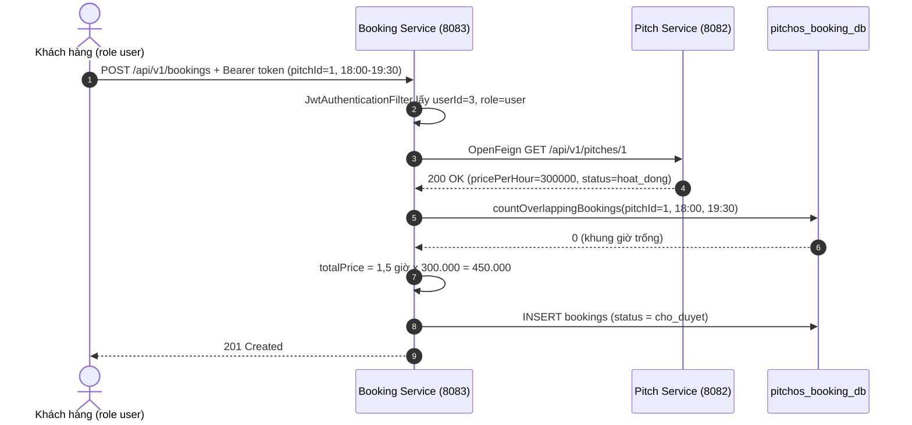
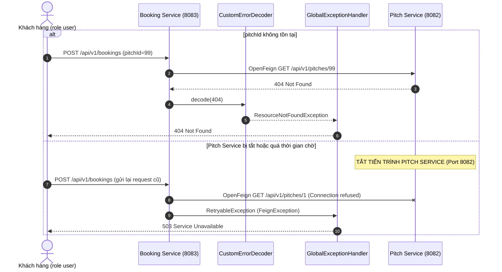

# Nhiệm vụ: Nhật — Giao tiếp Liên dịch vụ, Sequence Diagram & Booking Service

- **Vai trò:** Integration Specialist & Backend Booking Engineer
- **Tổng điểm phụ trách:** **2,25 / 10,0 Điểm** (0,75đ Lý thuyết + 1,5đ Thực nghiệm)
- **Cổng dịch vụ (Port):** `8083`
- **Cơ sở dữ liệu:** `pitchos_booking_db`
- **Báo cáo phụ trách:** **Chương 2** (Thiết kế API, giao tiếp liên dịch vụ, Sequence Diagram, cơ chế xử lý lỗi phân tán) — bản nháp: [`docs/BAO_CAO_CHUONG_2_NHAT.md`](../docs/BAO_CAO_CHUONG_2_NHAT.md)
- **Thứ tự thực hiện:** **GIAI ĐOẠN 3** — Code sau khi Linh hoàn thiện `GET /api/v1/pitches/{id}` trên cổng 8082.

---

## 📚 1. Yêu cầu Lý thuyết (0,75 Điểm — Câu 1 Ý 2a)

- [x] **Quy trình giao tiếp HTTP/REST giữa Booking Service và Pitch Service:**
  - Booking Service đóng vai trò Client sử dụng OpenFeign gửi HTTP GET tra cứu thông tin sân sang Pitch Service (`GET /api/v1/pitches/{id}`).
  - Kiểm tra trạng thái sân (`hoat_dong`) và đơn giá thuê (`pricePerHour`) để tính tổng tiền.
- [x] **Phân tích cấu trúc HTTP Request / Response và ý nghĩa các nhóm HTTP Status Code:**
  - HTTP Request (Method, URI, Headers, Body), HTTP Response (Status Line, Headers, Body).
  - Các nhóm mã trạng thái:
    - `2xx` (Thành công: `200 OK`, `201 Created`).
    - `4xx` (Lỗi client: `400 Bad Request`, `401 Unauthorized`, `403 Forbidden`, `404 Not Found`).
    - `5xx` (Lỗi server: `500 Internal Server Error`, `503 Service Unavailable`).
- [x] **Nguy cơ sụp đổ dây chuyền (Cascading Failure):**
  - Hiện tượng thread pool bị nghẽn khi Pitch Service chậm hoặc sập.
  - Giải pháp timeout và chuyển đổi ngoại lệ mạng sang mã **503 Service Unavailable**.

---

## 🛠️ 2. Yêu cầu Thực nghiệm (1,5 Điểm — Câu 2 Ý 2)

### 2.1. Xây dựng nghiệp vụ chính tại Booking Service (Port 8083)
- [x] **Thực thể `Booking` & `BookingRepository`:**
  - Lưu `userId`, `pitchId` (dạng `Long`, không tạo khóa ngoại Foreign Key vật lý).
  - Áp dụng truy vấn chống trùng lịch thi đấu từ Hùng (`startTime < :endTime AND endTime > :startTime`, loại trừ đơn có trạng thái `tu_choi`).
- [x] **Các Endpoints chính:**
  - `POST /api/v1/bookings`: Tiếp nhận yêu cầu đặt sân, gọi sang Pitch Service lấy giá, kiểm tra khung giờ trống, tính tổng tiền, tạo đơn với trạng thái `cho_duyet`.
  - `GET /api/v1/bookings/my-bookings`: Truy vấn lịch sử đặt chỗ của khách hàng trích xuất từ Token JWT (role `user`).
  - `PATCH /api/v1/bookings/{id}/status`: Chủ sân duyệt đơn (`da_duyet`) hoặc từ chối (`tu_choi`) (role `chusan` hoặc `admin`).

### 2.2. Giao tiếp liên dịch vụ với Spring Cloud OpenFeign
- [x] Kích hoạt `@EnableFeignClients` (trên `PitchosBookingServiceApplication`).
- [x] Định nghĩa Client interface gọi sang Pitch Service (`client/PitchClient.java`):
  ```java
  @FeignClient(name = "pitch-service", url = "${pitch.service.url:http://localhost:8082}")
  public interface PitchClient {
      @GetMapping("/api/v1/pitches/{id}")
      PitchResponseDTO getPitchById(@PathVariable("id") Long id);
  }
  ```

### 2.3. Lập trình tầng xử lý lỗi liên dịch vụ phân tán
- [x] **Cấu hình `CustomErrorDecoder`:** Bắt mã `404 Not Found` từ Pitch Service khi khách truyền `pitchId` không tồn tại.
- [x] **Cấu hình `GlobalExceptionHandler` (`@RestControllerAdvice`):**
  - Bắt lỗi mất kết nối, timeout mạng khi Pitch Service bị ngắt (`FeignException`, `RetryableException`).
  - Chuyển đổi an toàn thành mã phản hồi **503 Service Unavailable**:
    ```json
    {
      "timestamp": "2026-10-26T21:00:00",
      "status": 503,
      "error": "Service Unavailable",
      "message": "Dịch vụ quản lý sân hiện không khả dụng. Vui lòng thử lại sau!"
    }
    ```

### 2.4. Vẽ sơ đồ tuần tự (Sequence Diagram)
- [x] Mô tả chi tiết luồng nghiệp vụ tạo đơn đặt chỗ và kịch bản bắt lỗi 503 khi Pitch Service bị tắt — xem mục 6 bên dưới.

---

## 📝 3. Viết Báo cáo: Soạn Chương 2
- [x] Thiết kế các API đặt sân và điều phối nghiệp vụ.
- [x] Giao tiếp liên dịch vụ qua OpenFeign và Sequence Diagram.
- [x] Cơ chế xử lý lỗi phân tán, phòng chống Cascading Failure (503 Service Unavailable).

---

## 🎥 4. Kịch bản Demo Hội đồng (10–15 Phút)
1. **Ca 1 (Thành công - 201 Created):**
   - Đặt sân thành công với token `user`, tạo đơn với trạng thái `cho_duyet`.
   - Console của Booking Service in dòng `Pitch Service trả về sân 1: giá 300000.00 /giờ, trạng thái hoat_dong` → chứng minh đã gọi OpenFeign sang Pitch Service.
2. **Ca 2 (Sập dịch vụ phân tán - 503 Service Unavailable):**
   - **Tắt tiến trình Pitch Service (Port 8082)**.
   - Gửi lại request đặt sân vào Booking Service (Port 8083).
   - Chứng minh Booking Service bắt lỗi an toàn và trả về mã chuẩn **503 Service Unavailable**.

> ⚠️ Khi demo, chọn khung giờ **khác** `2026-10-27 18:00–19:30` (đơn mẫu trong `booking-service.sql`), nếu không sẽ nhận 400 "Khung giờ này đã có người đặt".

---

## ▶️ 5. Hướng dẫn chạy và đặc tả API

```bash
cd pitchos-booking-service
mvn spring-boot:run
```

- Cần MySQL đã chạy `pitchos-database/booking-service.sql`. Giá trị mặc định trong `application.properties` trùng với `.env` tổng.
- JDBC dùng `serverTimezone=Asia/Ho_Chi_Minh` để giờ đặt sân lưu xuống MySQL đúng như giờ gửi lên (dùng `UTC` sẽ lệch 7 tiếng).
- Timeout gọi Pitch Service: kết nối 2s, đọc 3s.

| Method | URL | Role | Body | Thành công |
| :--- | :--- | :---: | :--- | :---: |
| `POST` | `/api/v1/bookings` | `user` | `{"pitchId":1,"startTime":"2026-10-30T18:00:00","endTime":"2026-10-30T19:30:00"}` | `201` |
| `GET` | `/api/v1/bookings/my-bookings` | `user` | — | `200` |
| `PATCH` | `/api/v1/bookings/{id}/status` | `chusan`, `admin` | `{"status":"da_duyet"}` hoặc `{"status":"tu_choi"}` | `200` |

| Mã lỗi | Khi nào |
| :---: | :--- |
| `400` | Thiếu trường, `endTime` không sau `startTime`, sân đang bảo trì, trùng lịch, `status` sai |
| `401` | Không gửi token, token sai chữ ký hoặc hết hạn |
| `403` | Sai vai trò (token `chusan` gọi `POST`, token `user` gọi `PATCH`) |
| `404` | `pitchId` không tồn tại trên Pitch Service, hoặc đơn đặt không tồn tại |
| `503` | Pitch Service bị tắt / quá thời gian chờ / trả lỗi |

**Cấu trúc mã nguồn:**

```text
src/main/java/com/pitchos/booking/
├── PitchosBookingServiceApplication.java   # @EnableFeignClients
├── client/      PitchClient, CustomErrorDecoder
├── controller/  BookingController
├── dto/         BookingRequest, BookingResponse, UpdateStatusRequest, PitchResponseDTO, ErrorResponse
├── entity/      Booking, BookingStatus (Hùng)
├── exception/   GlobalExceptionHandler, BadRequestException, ResourceNotFoundException
├── repository/  BookingRepository (Hùng)
├── security/    JwtUtil, JwtAuthenticationFilter, SecurityConfig
└── service/     BookingService
```

**Hợp đồng với nhóm:**
- **Linh:** `GET /api/v1/pitches/{id}` trả JSON có `id`, `name`, `pricePerHour`, `status`; trả `404` khi không có sân.
- **Hoàng:** token ký HS256 bằng `Keys.hmacShaKeyFor(Decoders.BASE64.decode(jwt.secret))`, có claim `role` (`admin`/`chusan`/`user`) và `userId` (nếu không có thì `sub` phải là id số).

---

## 🧭 6. Sequence Diagram

### 6.1. Đặt sân thành công (201 Created)



### 6.2. Lỗi phân tán: sân không tồn tại (404) và Pitch Service bị tắt (503)



> **Vì sao gọi Pitch Service trước rồi mới kiểm tra trùng lịch?** Ở bước demo 503, nhóm gửi lại đúng request vừa đặt thành công. Nếu kiểm tra trùng lịch trước, request bị chặn bằng lỗi "trùng lịch" mà không gọi sang Pitch Service, nên không thể chứng minh được 503.
